# Design Document

## Overview

Event Forwarding is two decoupled Spark Structured Streaming jobs joined by Kafka. The **processing job** reads the Landing_Zone once per run (`trigger(availableNow=True)`), parses, validates, routes against Forwarding_Rules (default-deny, exact match), shapes the payload, re-verifies tenant/destination ownership with the Isolation_Guard, and publishes `Delivery_Message`s to a small set of Kafka topics shared by destination *kind* (not per tenant/product/destination) using the Spark Kafka sink's dynamic `topic` column.

The **File_Sink_Worker** is also a Spark Structured Streaming job: it runs `readStream.format("kafka")` on `delivery.file`, trigger `availableNow` by default, with its own Sink_Checkpoint_Location, and does all per-Micro_Batch work — `Sink_Isolation_Check`, batching, file naming, write, dead-letter — inside `foreachBatch`, using only Spark DataFrame operations. `Sink_Transform` is a pure function from a `Kafka_Shaped_Rows` DataFrame (`key`, `value`, `topic`, `partition`, `offset`, `timestamp` — exactly the columns the Spark Kafka source produces) to three output DataFrames (deliverable, dead-letter, audit), so tests build literal rows and need no Kafka and no Docker. The only driver-side loop anywhere on the Event_Path is the File_Sink_Worker's loop over the configured Destinations, which issues one Spark-filtered write per Destination; it never loops over rows.

PySpark is used everywhere on the Event_Path, in both jobs. There is no "the worker must not import pyspark" rule — the opposite is true: both jobs **require** pyspark. What is banned, in every Event_Path module of both jobs (the Config_Module is the only exemption), is pandas, pyarrow-as-writer, `collect()`/`toPandas()`/`take`/`head` on Event data, Python UDFs, and driver-side row iteration over Event data. A static AST scan enforces this ban across both jobs' modules.

HTTP and syslog destinations are designed only: Config_Store accepts the kinds, and the same Kafka_Publish_Stage mechanism would publish to `delivery.http`/`delivery.syslog`, but no consumer, sender, mock endpoint or mock receiver is built — matched events are dropped with reason `destination_kind_not_built` (Req 2.12) before publish.

A single-node Kafka broker (KRaft, no Zookeeper) runs via docker-compose for integration/acceptance tests; all other tests run without Docker, using Spark local mode and literal/constructed DataFrames.

## Architecture

```mermaid
flowchart LR
    LZ[Landing Zone *.jsonl] -->|readStream text, checkpoint| RD[Parse: from_json envelope]
    CFG[config.yaml] -->|loaded once, driver-side| CS[Config_Store: validate, build broadcast rules]
    RD -->|reject| RO[(Rejected_Output)]
    RD --> VN[Validate + normalize tenant_id]
    VN -->|reject| RO
    VN --> BJ[Broadcast join rules on tenant_id,product,schema]
    CS -.broadcast.-> BJ
    BJ -->|no match / http,syslog kind| AL1[(Audit_Log processing)]
    BJ --> SH[Shape: include/constant]
    SH --> IG[Isolation_Guard: anti-join tenant+dest ownership]
    IG -->|mismatch| AL1
    IG --> KB[Build topic/key/value columns]
    KB --> KS[["Spark Kafka sink (foreachBatch)"]]
    KS --> TF[["Kafka: delivery.file"]]
    KS -.designed only.-> TH[["delivery.http"]]
    KS -.designed only.-> TY[["delivery.syslog"]]
    SH --> SUM[Spark aggregation] --> RS[Run_Summary]

    TF --> FSW["File_Sink_Worker: readStream kafka, availableNow"]
    FSW --> FB["foreachBatch(Sink_Transform)"]
    FB --> SIC{Sink_Isolation_Check: filter/anti-join}
    SIC -->|fail| DLQ[["Kafka: delivery.file.dlq (Spark Kafka sink)"]]
    SIC -->|pass| BAT[Group by destination_id, topic, partition; min/max offset]
    BAT --> TMP[Spark write to temp path] --> RNM[Driver: list + atomic rename] --> FD[(File_Destination jsonl)]
    TMP -->|write/rename fail: raise| FAIL[["foreachBatch throws -> checkpoint does not advance"]]
    RNM --> AL2[(Audit_Log delivery, Spark)]
    DLQ --> AL2
```



**Module layout** (`event_forwarding/`):

- `cli_spark.py` — builds `SparkSession`, runs the processing streaming query (`availableNow`), exits non-zero on config/landing-zone/broker errors.
- `cli_file_sink_worker.py` — builds `SparkSession`, runs `readStream.format("kafka")` on `delivery.file` with `trigger(availableNow=True)` by default and the Sink_Checkpoint_Location, attaches `foreachBatch(sink_transform_and_write)`, exits non-zero on config/broker errors.
- `config_model.py` — driver-side only, the Config_Module; loads/validates JSON/YAML into typed `Rule`/`Destination`/`KafkaSettings` records, rejects calculated fields and non-scalar constants, resolves secrets from env vars, validates path containment, and builds the small destination-ownership DataFrame used by both jobs. The only module exempt from the Requirement 11 bans.
- `envelope_schema.py` — the `StructType` for the Event envelope, `data` kept as raw string.
- `pipeline.py` — the processing-stage streaming query: `readStream` → parse → reject split → tenant normalization → broadcast join → shape → Isolation_Guard → build `topic`/`key`/`value` → Kafka sink (inside `foreachBatch`, together with Run_Summary aggregation).
- `isolation_guard.py` — Spark-side anti-join: keeps a record only if its `(tenant_id, destination_id)` is the owning pair for an enabled rule whose `(tenant_id, product, schema)` matches, and the destination's `kind == "file"` and is built; non-matching rows go to the processing Audit_Log with `isolation_violation`.
- `kafka_publish.py` — pure Column logic that derives `topic` (from destination kind: `delivery.file`/`delivery.http`/`delivery.syslog`), `key` (`concat(tenant_id, lit("|"), destination_id)`), and `value` (`to_json(struct(...))` with fields `tenant_id, destination_id, product, schema, event_id, payload`).
- `audit_spark.py` — builds processing-stage Audit_Log rows as DataFrames, written under `<audit_root>/processing/`.
- `summary_spark.py` — Spark aggregations for Run_Summary; no `collect()` of event rows.
- `sink_transform.py` — `Sink_Transform(kafka_shaped_rows_df, destination_owner_df) -> (deliverable_df, dlq_df, audit_df)`: parses the Kafka value, applies `Sink_Isolation_Check` as a filter/anti-join against `destination_owner_df`, computes per-`(destination_id, topic, partition)` min/max offset with a window aggregation, derives the deterministic file-name column, and splits rows into deliverable / malformed / isolation-violation / format-not-built sets — pure DataFrame-to-DataFrame, no I/O. Used identically by `foreachBatch` and by every non-Docker test.
- `file_sink_write.py` — the `foreachBatch` body: calls `Sink_Transform`, then **one driver-side loop over the configured Destinations** (never over rows) that, per Destination, filters the deliverable DataFrame to that Destination's rows, writes them to a temp path under `<output_root>/<tenant_id>/<destination_id>/.tmp/` with `DataFrame.write`, lists the produced part file(s) and renames each to its deterministic final name (driver-side filesystem metadata operations — list and rename only, no row data touches the driver), then publishes the `dlq_df` and audit rows with the Spark Kafka sink / Spark write. Raises on any write/rename/DLQ-publish failure so `foreachBatch` fails and the Micro_Batch's offsets are not committed to the Sink_Checkpoint_Location.
- `audit_worker.py` — delivery-stage Audit_Log rows as a DataFrame, written under `<audit_root>/delivery/` with deterministic names derived from topic/partition/offset range and an atomic rename, so replay overwrites rather than duplicates.
- `summary_worker.py` — Worker_Summary via Spark aggregation; no `collect()` of event rows.

## Components and Interfaces

| Component | Responsibility | Mechanism |
|---|---|---|
| Config_Store | Load/validate config once; shared by both Spark jobs | Driver-side / process-start Python (Config_Module, exempt from Req 11 bans) |
| Reader/Parser | `readStream` text, `from_json`, reject split | Spark Column ops |
| Router (broadcast join) | Keep only events with a configured, enabled, exact-match rule | `broadcast(rulesDF)` join |
| Transformer | Field include and constant fields (no calculated fields) | `select`/`withColumn`, `lit` |
| Isolation_Guard | Pre-publish tenant+destination-ownership check | Filter/anti-join, Spark-native |
| Kafka_Publish_Stage | Build `topic`/`key`/`value`; write via Spark Kafka sink | `df.write.format("kafka")` inside `foreachBatch` |
| File_Sink_Worker | `readStream` Kafka `delivery.file`, trigger `availableNow`, own checkpoint | Spark Structured Streaming |
| Sink_Transform | Parse, Sink_Isolation_Check, batch, name files | Pure DataFrame function, Spark Column ops, filters, joins only |
| File write + rename | Per-destination temp write, then atomic rename | Spark `DataFrame.write` (data) + driver-side `list`/`rename` (filesystem metadata only, loop over Destinations, not rows) |
| Sink_Isolation_Check | Second, independent ownership check at the sink | Spark filter/anti-join against a destination-owner DataFrame built from Config_Store |
| Dead_Letter_Topic | Receive violations/failures/malformed messages | `delivery.file.dlq` via Spark Kafka sink, with headers |
| Audit_Log / Summary | Decision logs, counts, two writers | Spark DataFrames, written under `processing/` and `delivery/` |

## Data Models

Envelope schema (unchanged):

```python
envelope_schema = StructType([
    StructField("event_id", StringType()),
    StructField("product", StringType()),
    StructField("schema", StringType()),
    StructField("tenant_id", StringType()),
    StructField("data", StringType()),   # raw JSON text
])
```

**Delivery_Message** (the Kafka value, JSON):

```json
{
  "tenant_id": "3f2b8c1e-7a4d-4e9b-9c1a-2d5e6f7a8b90",
  "destination_id": "dest-a-file",
  "product": "sales",
  "schema": "purchase",
  "event_id": "e1",
  "payload": { "order_id": "o1", "amount": 10, "region": "eu" }
}
```

Message key: `"<tenant_id>|<destination_id>"`, e.g. `"3f2b8c1e-7a4d-4e9b-9c1a-2d5e6f7a8b90|dest-a-file"`.

Built with Spark Column expressions only:

```python
df = (guarded_df
    .withColumn("topic", topic_for_kind_col)                 # delivery.file / delivery.http / delivery.syslog
    .withColumn("key", concat(col("tenant_id"), lit("|"), col("destination_id")))
    .withColumn("value", to_json(struct(
        "tenant_id", "destination_id", "product", "schema", "event_id", "payload"))))
df.selectExpr("topic", "CAST(key AS STRING)", "CAST(value AS STRING)") \
  .write.format("kafka").options(**kafka_opts).save()
```

**Kafka_Shaped_Rows** (the File_Sink_Worker's input, both in production and in tests):

```python
kafka_shaped_schema = StructType([
    StructField("key", BinaryType()),
    StructField("value", BinaryType()),
    StructField("topic", StringType()),
    StructField("partition", IntegerType()),
    StructField("offset", LongType()),
    StructField("timestamp", TimestampType()),
])
```

This is exactly what `spark.readStream.format("kafka").load()` produces. Tests build the same shape from literal rows (`spark.createDataFrame([...], kafka_shaped_schema)`), so `Sink_Transform` and the per-Destination write step run unmodified in both places.

`Sink_Transform` parses `value` with `from_json` against the Delivery_Message schema, computes, per `(destination_id, topic, partition)`, `min(offset)`/`max(offset)` with a Spark window or groupBy aggregation, and derives the file-name column `concat(destination_id, lit("-"), topic, lit("-"), partition, lit("-"), min_offset, lit("-"), max_offset, lit(".jsonl"))` — all as Column expressions, no driver-side computation.

### Added columns: constants only

A Forwarding_Rule can add a column only as a constant field: a new column with a fixed literal value of type string, number or boolean (Req 4.4, 4.7). The build has no calculated fields and no expression language. The Config_Module rejects, at load time, any rule that defines a calculated field or a constant with another value type. Shaping adds each constant with lit(...) next to the included fields. The README and docs/design.md state this limit (Req 4.8).

### Topic and key design

Topics are shared **by destination kind**, not per tenant/product/destination:

- Built: `delivery.file`, `delivery.file.dlq`.
- Designed only: `delivery.file.retry`, `delivery.http`, `delivery.http.retry`, `delivery.http.dlq`, `delivery.syslog`, `delivery.syslog.retry`, `delivery.syslog.dlq`.

**Arithmetic for per-destination topics (why not):** ~15,000 tenants × ~3 forwarded products × ~2 destinations ≈ **90,000–100,000 topics**, each needing several partitions for throughput ⇒ several hundred thousand partitions. Kafka brokers hold partition metadata in controller memory and replicate it on every metadata change; practical guidance caps a cluster around low tens of thousands of partitions before controller failover, metadata-request latency, and per-partition file handles (two files per partition per segment) degrade cluster-wide. 100k+ topics would require a cluster far larger than this workload's throughput justifies, just to satisfy topic-level isolation — isolation is enforced by the Isolation_Guard and Sink_Isolation_Check instead, not by topic boundaries.

**Key `<tenant_id>|<destination_id>`:** Kafka guarantees order only within a partition, and the partitioner hashes the key. Using this key means every message for one destination lands in the same partition, so the File_Sink_Worker's Micro_Batches see that destination's messages in publish order and can batch by `(destination_id, topic, partition)` without cross-destination interleaving inside a batch. It also spreads load: with enough partitions on `delivery.file`, different destinations land on different partitions, so one noisy tenant's destination does not monopolize the only partition. The top-10-tenants-at-60%-of-volume skew still creates a few hot partitions (their destinations' keys), since partition count is fixed and hashing is deterministic — mitigated by giving `delivery.file` enough partitions that most large tenants' destinations spread out, and, as a designed-only extension, dedicating topics/partitions to the very largest tenants.

### Head-of-line blocking and mitigations

Because topics are shared by kind, one slow or failing `file` destination's messages sit in the same partition as other destinations that hashed to it, and a Micro_Batch that cannot complete for that partition's offset range (because `foreachBatch` throws) blocks the checkpoint from advancing for every destination sharing that partition, not just the failing one. Mitigations (designed only, not built): route a destination's messages to a per-kind **retry topic with delay** instead of blocking the main partition after N failures; a per-destination **circuit breaker** that stops attempting a known-bad destination for a cooldown so its Micro_Batches stop failing; per-destination **rate limits** so one tenant cannot starve others sharing a partition; a **bounded worker pool** for the designed-only HTTP/syslog workers so one slow destination occupies only one of many concurrent consumers; and **dedicated topics/partitions for top tenants** so their failures cannot affect the long tail.

### Three isolation layers

1. **Config validation + Isolation_Guard (Spark, before publish, processing job).** Config_Store rejects any rule whose destination has a different owning `tenant_id` (Req 8.3–8.4). The Isolation_Guard anti-joins the shaped records against the enabled-rule set per destination immediately before the Kafka_Publish_Stage: a record is only published if its `tenant_id` equals the destination's owning `tenant_id` and its `(product, schema)` is covered by an enabled rule referencing that destination. Violations go to the processing Audit_Log with `isolation_violation` and the run exits non-zero after all other publications finish.
2. **Sink_Isolation_Check (File_Sink_Worker, independent of the processing job, still Spark).** Inside every Micro_Batch's `foreachBatch` call, `Sink_Transform` anti-joins the parsed Delivery_Messages against a small `destination_owner_df` built from the *same* configuration file, loaded once at worker start — re-validating that `destination_id` exists, that the message's `tenant_id` equals that destination's owning `tenant_id`, and that the message key equals `<tenant_id>|<destination_id>`. This is a second, independently-coded Spark check: even if the processing job were compromised or a message tampered with in Kafka, the worker will not write it.
3. **Path derivation + per-destination writers.** The output path is built only from the Destination's *configured* owning `tenant_id` and its `destination_id` — never from message content — as `<output_root>/<tenant_id>/<destination_id>/`. The driver's per-Destination loop filters the deliverable DataFrame to exactly one destination's rows before writing to that destination's own temp/final path, so one destination's write can never touch another's directory even if a batching bug mixed messages.

**Security reviewer checklist:** (1) read `isolation_guard.py` and confirm the anti-join predicate matches tenant+product+schema+destination before `kafka_publish.py`'s column-build step runs; (2) read `sink_transform.py` and confirm `Sink_Isolation_Check` runs as a filter/anti-join against `destination_owner_df` before any row is marked deliverable, and that `destination_owner_df` comes from `config_model`, not from the message; (3) read `file_sink_write.py`'s per-Destination loop and confirm the path is built only from the loop's configured `(tenant_id, destination_id)`, never from a message column; (4) run the isolation property tests (Req 8.12, 8.13) and the acceptance test and inspect that cross-tenant output directories are empty; (5) inspect `<audit_root>` for `isolation_violation` entries after a deliberately tampered test run.

### Kafka Connect as option 3

Three delivery-stage options were compared:

| Option | Isolation control | Ops effort | Failure isolation |
|---|---|---|---|
| 1. Spark writes files directly in the processing job | Full (same anti-join reused) | Lowest (no extra component) | Poor — a slow filesystem/destination stalls the processing streaming query for everyone |
| 2. Kafka + Spark File_Sink_Worker (chosen) | Full — a second, independently-coded `Sink_Isolation_Check` | Moderate — one more streaming job, but logic is pure-DataFrame and testable without Kafka | Good — per-destination batching, dead-letter, worker Micro_Batch failure doesn't affect the processing job |
| 3. Kafka + Kafka Connect (file/S3/HTTP sinks) | Weaker by default — Connect sink connectors generally trust the topic/partition routing and do not re-verify tenant ownership per record without a custom SMT (Single Message Transform) | Lowest ongoing (managed connectors, no custom code to maintain) | Good — same partition/offset model as option 2 |

Option 3 is attractive operationally but was not chosen because adding a tenant-ownership re-check would itself require a custom SMT or post-processor — at that point it is custom code with less direct control over atomic renames and deterministic naming than option 2. Recommended designed-only alternative for HTTP/syslog once built: Kafka Connect could still host the *simple* file sink in production to reduce ops burden, provided a custom SMT performs the Sink_Isolation_Check equivalent.

### Audit split

- **Processing stage** (`<audit_root>/processing/`, Spark-written JSONL): one row per processing-job decision — `published`, `dropped` (`no_matching_rule`, `invalid_tenant_id`, `destination_kind_not_built`), or `rejected` (`malformed_json`, `missing_envelope_field`, `invalid_data`) — plus `isolation_violation` drops. Never contains `data`/`payload`.
- **Delivery stage** (`<audit_root>/delivery/`, File_Sink_Worker-written JSONL, deterministic names from topic/partition/offset range, atomic rename): one row per Micro_Batch decision — `delivered`, `dropped` (`format_not_built`), or `dead-lettered` (`isolation_violation`, `write_failed`, `malformed_message`). Never contains `payload`.

Both logs share the fields `event_id, tenant_id, product, schema, decision, reason, destination_id`, so an investigator can join processing and delivery entries by `event_id` + `destination_id` to trace one event end to end without ever seeing its payload.

### Streaming execution model

- **Processing job source**: `spark.readStream.format("text")` with `checkpointLocation`, restart safety without re-reading processed files (Req 1.10).
- **Processing job trigger**: `availableNow=True` for this build, draining the Landing_Zone and stopping with exit 0; the full product runs a continuous `processingTime="30 seconds"` (or 30–60s) trigger.
- **Processing job sink**: `foreachBatch` so each Micro_Batch's Run_Summary aggregation and `availableNow` termination semantics are explicit and a failed Micro_Batch write can be retried as a unit; the body does exactly one `df.write.format("kafka").save()` call per batch — no Python loop over rows.
- **File_Sink_Worker source**: `spark.readStream.format("kafka").option("subscribe", "delivery.file").option("startingOffsets", ...)`, its own `checkpointLocation` (the Sink_Checkpoint_Location), distinct from the processing job's.
- **File_Sink_Worker trigger**: `availableNow=True` by default, draining `delivery.file` up to the end offsets available at start and then stopping with exit 0 when no error occurred (Req 5.12); the full product can instead run it continuously with a `processingTime` trigger.
- **File_Sink_Worker sink**: `foreachBatch(sink_transform_and_write)` does all work for one Micro_Batch — `Sink_Transform`, the per-Destination write/rename loop, the DLQ publish, and the audit write — and **raises an exception on any failure** (write, rename, or DLQ publish) so Spark does not advance the Sink_Checkpoint_Location past that Micro_Batch; a retried Micro_Batch re-reads the same offset range from Kafka.
- **Delivery semantics**: the Spark Kafka sink is at-least-once (a retried Micro_Batch can republish the same Delivery_Messages, or the File_Sink_Worker can re-process the same offset range). The deterministic file name (`<destination_id>-<topic>-<partition>-<min_offset>-<max_offset>.jsonl`) makes a replay of the *same offset range* idempotent (overwrite via rename, not append). Because the checkpoint only advances after a Micro_Batch's `foreachBatch` call returns without raising, a crash between the rename and the checkpoint commit means the *next* run re-processes that same offset range and overwrites the same file name — safe. A crash that causes the *next* Micro_Batch to start at a different offset boundary than a prior partial attempt is the case `event_id`-based customer dedup exists for.
- **Replay**: running the File_Sink_Worker with a new Sink_Checkpoint_Location and an explicit `startingOffsets` (e.g. a JSON offsets map or `"earliest"` bounded by retention) re-drains a chosen range from `delivery.file`; deterministic names mean re-written files for already-delivered ranges overwrite rather than duplicate. Republishing from `delivery.file.dlq` after a fix is a separate Spark read-then-write of that topic back onto `delivery.file` (or directly reprocessed), also keyed so retried messages land on their original partition.

## Correctness Properties

*A property is a characteristic or behavior that should hold true across all valid executions of a system—essentially, a formal statement about what the system should do. Properties serve as the bridge between human-readable specifications and machine-verifiable correctness guarantees.*

Property 7 (the expression oracle) was withdrawn together with calculated fields. The remaining property numbers are unchanged so that references in tasks.md stay valid.

### Property 1: Landing zone file selection and line-level rejection
For any set of file names in the Landing_Zone (mixing `.jsonl`, other extensions, subdirectories) and any mix of blank lines, malformed JSON, non-object JSON, missing/null envelope fields, and non-object `data`, the pipeline reads only directly-contained `.jsonl` files, silently skips blank/whitespace lines, and routes every other bad line to Rejected_Output with exactly the reason (`malformed_json`, `missing_envelope_field`, or `invalid_data`) that matches its defect.
**Validates: Requirements 1.1, 1.3, 1.4, 1.5, 1.6, 1.7**

### Property 2: Config_Store rejects every defect it is supposed to reject
For any generated configuration containing a planted defect — an invalid tenant UUID, a rule/destination tenant-ownership mismatch, a rule referencing an undefined destination, an unsupported format/kind, a duplicate or malformed destination id, a path escaping `output_root`, a calculated field or a non-scalar constant value in a rule, or an unset/empty secret env-var reference — Config_Store rejects the whole configuration and names the offending rule/destination/path/variable, and leaves no partially-loaded state.
**Validates: Requirements 2.5, 2.6, 2.7, 2.8, 4.6, 4.7, 5.8, 8.3, 8.4, 14.8, 14.9**

### Property 3: Routing matches exactly the enabled, exact-equal rules
For any event and any set of rules (including rules differing only by case, whitespace, non-canonical UUID form, or `enabled=false`), the rows present in the publish-ready DataFrame (pre-Kafka-sink, columns `topic`, `key`, `value`) for that event correspond exactly to the enabled rules whose normalized tenant_id, product and schema are exactly equal (case-sensitive, untrimmed) to the event's, with no wildcard matching.
**Validates: Requirements 3.1, 3.3, 3.5, 11.2**

### Property 4: Unmatched, invalid-tenant, or undelivered-kind events publish nothing
For any event for which no enabled rule matches, whose tenant_id is missing/empty/unparseable as a UUID, or whose only matching rule references an `http`/`syslog` destination, the publish-ready DataFrame contains zero rows for that event, and exactly one processing Audit_Log row is produced with reason `no_matching_rule`, `invalid_tenant_id`, or `destination_kind_not_built` respectively.
**Validates: Requirements 2.12, 3.2, 3.6, 3.7, 8.1, 8.7**

### Property 5: Fan-out to multiple rules/destinations is independent
For any event matched by N enabled rules across N destinations, the publish-ready DataFrame contains one row per matching rule, and forcing one destination's downstream write to fail does not remove or alter the rows produced for the other matching rules.
**Validates: Requirements 3.4, 9.1**

### Property 6: Payload shaping and Delivery_Message construction are exact
For any `data` object, optional include-list, and constant-fields map with string, number or boolean values (no name collisions), the `payload` field of the resulting Delivery_Message equals: the intersection of the include list with fields present in `data` (or all of `data`'s fields if no include list), with original values, plus every constant field — and the Delivery_Message additionally always carries `tenant_id`, `destination_id`, `product`, `schema` and `event_id` matching the source event and the matched rule's destination.
**Validates: Requirements 4.1, 4.2, 4.3, 4.4, 4.5, 15.2**

### Property 8: Isolation Layer 1 — the Spark Isolation_Guard admits only ownership-correct records
For any generated multi-tenant, multi-destination set of events and configuration, every row in the publish-ready DataFrame has a `tenant_id` equal to the owning `tenant_id` of its `destination_id`, and a `(product, schema)` covered by an enabled rule referencing that destination; any record failing this is excluded, produces a processing Audit_Log row with reason `isolation_violation`, and does not prevent other records from being published in the same run.
**Validates: Requirements 8.2, 8.5, 8.6, 8.9, 11.3**

### Property 9: Isolation Layer 2 — the Sink_Isolation_Check rejects tampered or unowned messages
For any `Kafka_Shaped_Rows` DataFrame mixing valid Delivery_Messages with tampered ones (wrong `tenant_id` for the claimed `destination_id`, a key not matching `<tenant_id>|<destination_id>`, or an unknown `destination_id`), `Sink_Transform` routes zero tampered messages into the deliverable DataFrame, routes each one unchanged into the dead-letter DataFrame with reason `isolation_violation`, produces one delivery Audit_Log row per tampered message, and routes every valid message exactly once into the deliverable DataFrame for its own destination.
**Validates: Requirements 8.9, 8.10, 8.13**

### Property 10: Isolation Layer 3 — output path depends only on configured ownership, never on message content
For any two Delivery_Messages with arbitrary distinct `event_id`/`payload`/`product`/`schema` routed to the same `destination_id`, both are written under the identical path `<output_root>/<tenant_id>/<destination_id>/`, where `tenant_id` is the destination's *configured* owner, and that path never changes based on any other message field; the per-Destination write step for one destination never writes to another destination's path.
**Validates: Requirements 5.1, 5.5, 8.8, 8.11**

### Property 11: Deterministic file naming makes offset-range replay idempotent
For any fixed `(destination_id, topic, partition, first_offset, last_offset)` and Delivery_Batch content, running the write step twice on the same `Kafka_Shaped_Rows` input produces the same final file content under the same deterministic name with zero duplicate records, and the file is one JSONL file per Delivery_Batch (never one file per message).
**Validates: Requirements 5.2, 5.3, 5.6**

### Property 12: Write/rename failure is clean and dead-letters the whole batch without advancing the checkpoint
For any Delivery_Batch whose write or rename is forced to fail, the temporary file is removed, any pre-existing final file is left unchanged, every message in that batch is published unchanged to `delivery.file.dlq` with reason header `write_failed`, `foreachBatch` raises so the Sink_Checkpoint_Location does not advance past that Micro_Batch, and every other destination's Delivery_Batch in the same Micro_Batch completes normally.
**Validates: Requirements 5.9, 9.3, 9.4**

### Property 13: Checkpoint advances only after the whole Micro_Batch (including DLQ publish) succeeds
For any Micro_Batch, if every Delivery_Batch write/rename and every required DLQ publish succeeds, `foreachBatch` returns normally and the Sink_Checkpoint_Location advances past that Micro_Batch's offsets; if any DLQ publish required for that Micro_Batch fails, `foreachBatch` raises, the checkpoint does not advance, and the batch's messages count as neither delivered nor dead-lettered in the Worker_Summary.
**Validates: Requirements 5.7, 9.3, 9.4**

### Property 14: Malformed Delivery_Messages are dead-lettered, not written, and do not block the Micro_Batch
For any byte sequence that is not valid JSON, or any JSON object missing one of `tenant_id`, `destination_id`, `product`, `schema`, `event_id`, `payload`, `Sink_Transform` routes it into the dead-letter DataFrame (not the deliverable DataFrame) with reason `malformed_message`, and the remaining messages of the same Micro_Batch are still processed normally.
**Validates: Requirements 15.10**

### Property 15: Non-file destination kinds and non-JSONL formats are dropped, not written
For any Delivery_Message whose `destination_id` resolves to a `file` destination configured with format `parquet`, `Sink_Transform` writes it to no file and routes it to a `format_not_built` delivery Audit_Log row.
**Validates: Requirements 2.13**

### Property 16: Run_Summary and Worker_Summary are consistent, non-negative counters
For any run, the Spark-aggregated Run_Summary's read/rejected/dropped/published counts, and the Spark-aggregated Worker_Summary's delivered/dead-lettered counts, are all non-negative integers, and for each tenant/destination the counts equal the number of Audit_Log rows (processing or delivery, respectively) produced for that tenant/destination in the same run.
**Validates: Requirements 9.5, 9.6**

### Property 17: Audit entries never leak payload or secret values
For any event/Delivery_Message carrying a distinctive marker value in `data`/`payload`, and any destination with a secret/token setting, no processing or delivery Audit_Log row contains that marker value, that secret value, or any other data-sourced value; dead-lettered messages republished to the DLQ carry their original key/value unchanged in the message body, with reason/category only in headers.
**Validates: Requirements 14.3, 14.5, 14.6, 14.10**

### Property 18: Config and Delivery_Message round-trips are exact
For any valid configuration, parsing, serializing and re-parsing it yields an equal `Config` object. For any valid Delivery_Message, building it into a `Kafka_Shaped_Rows` row and parsing it back with `Sink_Transform` yields equal envelope fields, key and payload.
**Validates: Requirements 12.7, 12.8**

**Property reflection notes:**

- Layer-1 isolation criteria (8.2, 8.5, 8.6, 8.9, 11.3) are folded into Property 8 rather than split, since each names one facet of the same anti-join outcome; 8.9/8.10/8.13 reappear under Property 9 only for the Layer-2 (Sink_Isolation_Check) instance of ownership checking, which is independently coded and must be tested separately from Layer 1.
- 5.1 (path template) and 8.8/8.11 (content-independence, scoped writers) are merged into Property 10, since the template and its content-independence are one claim about path derivation.
- 5.6 (deterministic naming) and 5.2/5.3 (JSONL, one file per batch) are merged into Property 11, since idempotent replay is only meaningful once naming, format and batching are fixed together.
- 9.1 (decoupled failure) is folded into Property 5 (fan-out independence) for the processing side and Property 12 for the delivery side, rather than given its own property, since "one destination's failure doesn't affect another's" is the same independence claim checked at two pipeline points.
- 15.2/15.3 (Delivery_Message shape, Kafka sink from columns) are subsumed by Property 6 (payload/envelope construction) since the key/value columns are built from the same data asserted there; "no collect to driver" is a static property, not data-driven (see Testing Strategy).
- 2.9 (exit non-zero, report every error before reading any event) is an operational consequence of Property 2, checked as part of the same test rather than separately.
- 5.7 and 9.3/9.4 (offset-commit-after-rename, checkpoint-doesn't-advance-on-DLQ-failure) are combined into Property 13 rather than kept as two properties, since both describe the same "checkpoint advances iff the whole Micro_Batch succeeded" invariant from opposite directions.

**Not covered by properties (see Testing Strategy for the alternative test type):**
- 1.10/1.11, 5.12/5.13 (checkpoint restart/incremental, `availableNow` termination for both jobs) — streaming-engine operational behavior, dedicated restart/incremental tests.
- 12.16 (crash after rename, before checkpoint commit, re-run) — a single concrete fault-injection scenario distinct from the general replay property (Property 11), covered by a dedicated test.
- 9.2 (consumer lag grows, processing-job latency doesn't) — an operational/performance claim, not unit-testable; addressed narratively in Scale and cost.
- 10.* (Acceptance Scenario) — a fixed concrete scenario, covered by the no-Docker and Docker acceptance tests (Req 10.10, 10.11).
- 11.11/11.13 (no `collect`/pandas/UDF on the Event_Path of either job) — static source-code properties, covered by an AST/import scan test, not data-driven PBT.
- 15.1/15.5–15.7 (topic set definition, docker-compose, topic creation script, broker-unreachable exit) — fixed infrastructure/configuration facts, covered by smoke/integration tests.

## Error Handling

- **Reader/parse errors** (1.4–1.9): `from_json` + `when`/`isNull` classification into `malformed_json`/`missing_envelope_field`/`invalid_data`, written to Rejected_Output; bad Landing_Zone path checked before the processing query starts.
- **Config errors** (2.4–2.9, 5.8, 14.8–14.9): `config_model.load_config` collects *all* errors and raises one `ConfigError`; both `cli_spark.py` and `cli_file_sink_worker.py` call it before touching Kafka and exit non-zero on failure. Loaded once per process start in each (Req 2.10, 15.9) — a config change requires restarting both jobs.
- **Broker unreachable at start** (15.7): both jobs probe the bootstrap servers before the streaming query starts; on failure, exit non-zero, name the bootstrap servers, commit nothing.
- **Isolation_Guard violations** (8.6): excluded from the publish DataFrame, audited with `isolation_violation`; `pipeline.py` sets a driver-side boolean when the anti-join's complement is non-empty, forcing non-zero exit after the batch's Kafka write completes.
- **Sink_Isolation_Check failures / malformed messages** (8.10, 15.10): `Sink_Transform` routes them into the dead-letter DataFrame unchanged with the appropriate header; `file_sink_write.py` publishes that DataFrame to `delivery.file.dlq`, never writes them to a file, and the run exits non-zero at drain end if any occurred.
- **Write/rename failures** (5.9, 9.3): temp file removed, final file (if any) untouched, batch republished unchanged to the DLQ with `write_failed`; `foreachBatch` re-raises so the checkpoint does not advance and the batch is excluded from both summaries. If the DLQ publish itself also fails, the same re-raise applies.
- **Audit write failures** (14.7): both jobs report the error to stderr and exclude the affected decision from the printed summary rather than claiming it was recorded.
- **Destination kind/format not built** (2.12, 2.13): handled as ordinary filtered-out rows with a specific audit reason, not as exceptions.

## Testing Strategy

**Priority order and why:** isolation (three independent layers; the most severe failure mode), the processing job's routing/shaping/publish logic (highest input-space variability, also responsible for building `topic`/`key`/`value`), the File_Sink_Worker's `Sink_Transform` and write/rename/checkpoint protocol (new code, governs idempotency and dead-lettering), config validation (the gate that prevents most isolation bugs from reaching publish), and the two acceptance-test variants.

**No-Docker tests (the default suite, Req 12.2):**

- *Processing job*: every property above that concerns the processing job (1, 2 partially, 3–8, 15 partially, 16 partially, 17 partially) is tested by inspecting the **publish-ready DataFrame** — the DataFrame with columns `topic`, `key`, `value` immediately before `.write.format("kafka")` — using Spark local mode, `collect()`-ing only this small, already-filtered DataFrame inside the test (not inside the Event_Path code). No Docker, no real Kafka.
- *File_Sink_Worker*: every property about the File_Sink_Worker (9–14, 16 partially, 17 partially, 18) is tested by constructing a literal `Kafka_Shaped_Rows` DataFrame (valid and tampered/malformed rows) and calling `Sink_Transform` and the write step directly, asserting on the resulting deliverable/dead-letter/audit DataFrames and on a temp output directory. No Docker, no real Kafka, no in-memory consumer/producer abstraction — the only substitution is the input DataFrame itself.
- Library: [Hypothesis](https://hypothesis.readthedocs.io/), 2 examples per test (`@settings(max_examples=2)`), one test per property, each tagged `# Feature: event-forwarding, Property {n}: {title}`.
- A session-scoped `local[*]` SparkSession fixture is shared across property tests; generated datasets stay small (a handful to a few dozen rows) to keep 2-example runs fast. Property 8 (isolation) gets slightly larger per-example datasets (tens of rows / multiple tenants) because it needs multiple destinations to be meaningful.
- Generators: random UUIDs (valid and malformed), product/schema strings with case/whitespace variants, `data` dicts with numeric/non-numeric/missing fields, constant-field maps (valid scalars and invalid values), multi-tenant rule/destination graphs (2–5 tenants, 1–3 destinations each), `Kafka_Shaped_Rows` rows with planted tampering (wrong tenant, wrong key, unknown destination, missing field, invalid JSON).

**Static scan tests (not PBT, Req 11.13):**
1. An `ast`-based scan of every Event_Path module in both jobs (`pipeline.py`, `isolation_guard.py`, `kafka_publish.py`, `audit_spark.py`, `summary_spark.py`, `envelope_schema.py`, `sink_transform.py`, `file_sink_write.py`, `audit_worker.py`, `summary_worker.py`) fails if it finds `pandas`, `pyarrow` used as a writer, `collect`, `toPandas`, `take`, `head`, `udf`, `pandas_udf`, or `mapInPandas`; `config_model.py` is the only allow-listed module.

**Checkpoint/replay tests (deterministic, Req 1.10, 5.12/5.13, 12.13–12.17):**
1. Checkpoint restart: run the processing job twice against the same Landing_Zone/checkpoint; assert zero additional rows in the publish-ready output the second time.
2. Checkpoint incremental: add one file between two runs sharing a checkpoint; assert only the new file's events appear.
3. Sink checkpoint restart (marked `kafka`, Req 12.19): run the File_Sink_Worker twice with the same Sink_Checkpoint_Location against a running broker; assert the second run processes no additional Delivery_Messages.
4. Crash-before-checkpoint-commit replay: call `Sink_Transform` and the write step twice with the same `Kafka_Shaped_Rows` input (simulating a crash after rename, before the Micro_Batch's checkpoint commit); assert no duplicate records in the destination directory and the same single file.
5. Double-fault: force both the file write and the DLQ publish to fail for one Delivery_Batch; assert `foreachBatch` raises, no checkpoint advance, and the batch is excluded from both summaries.

**Round-trip tests (Req 12.7, 12.8):** covered as Property 18 above.

**Acceptance scenario tests (Req 10.10, 10.11, example-based, e1–e5):**
- *No-Docker variant*: assert on the publish-ready DataFrame (topic `delivery.file`, keys `tenantA|dest-a-file` ×2, `tenantB|dest-b-file` ×1, zero rows for e4/e5), convert it to a literal `Kafka_Shaped_Rows` DataFrame (adding `partition`/`offset`/`timestamp`, casting `key`/`value` to binary), and run `Sink_Transform` and the write step on it, asserting the file contents, `internal_note` omission, and `region == "eu"` and the unchanged `risk` value on e2.
- *Docker variant* (marked `kafka`, Req 12.4): the same assertions, but the processing job publishes to the real broker and the File_Sink_Worker drains from it with `readStream`/`availableNow`, inspected via the Kafka console consumer / produced files.

**Unit/example tests** for edge cases unsuited to generation: empty Landing_Zone, unreadable file, missing/unparseable config path, each individual destination-validation failure mode, drain-mode exit code for both jobs, audit file creation and write-failure reporting.

**Test commands:** one `pytest` run (no `kafka` marker) from the repo root needs no Docker/network and exits 0 iff all pass (Req 12.2); a second documented command runs the `kafka`-marked tests against the docker-compose broker (Req 12.3, 12.4).

## Risks (flagged, not mitigated in the 5-hour build)

- **Head-of-line blocking is designed, not load-tested.** The retry-topic/circuit-breaker/rate-limit mitigations exist only on paper; without them, one genuinely stuck `file` destination can still make its Micro_Batch fail repeatedly and block the checkpoint for every destination sharing its partition in the real build.
- **No partition-count tuning.** `delivery.file`'s partition count is a guess for this exercise; getting it wrong either reintroduces hot partitions (too few) or adds needless coordination overhead (too many) at the stated 40–120k events/sec scale.
- **At-least-once + `event_id`-only dedup pushes real work onto every customer.** It's correct but shifts complexity outward; some customers' systems may not dedupe well.
- **Two independent config loads can drift.** The processing job and the File_Sink_Worker each read the config file once at their own start; a restart-timing gap between the two after a config change means they can briefly disagree about which destination owns which tenant — a narrow isolation risk window that neither the Isolation_Guard nor the Sink_Isolation_Check alone closes, since each trusts its own (possibly stale) copy.
- **The driver-side rename step is filesystem metadata only, but still a single point of sequential work per Micro_Batch.** Listing and renaming staged files for every Destination happens in one driver loop; at very high destination fan-out within a single Micro_Batch this loop (not the data write, which is distributed) could become the slower part of `foreachBatch`.
- **`foreachBatch`-raises-to-block-checkpoint is simple but coarse.** A transient failure for one Destination blocks the *entire* Micro_Batch's checkpoint advance, including destinations that succeeded, until the whole batch is retried and succeeds — there is no partial-batch checkpoint commit.
- **5-hour scope cut Parquet, HTTP/syslog, and retry topics entirely**; the design above is unverified against a real multi-destination, multi-hour soak run.
