```mermaid
flowchart LR
    LZ[Landing Zone *.jsonl] -->|readStream text, checkpoint| RD[Parse: from_json envelope]
    CFG[config.yaml] -->|loaded once, driver-side| CS[Config_Store: validate, build broadcast rules]
    RD -->|reject| RO[(Rejected_Output)]
    RD --> VN[Validate + normalize tenant_id]
    VN -->|reject| RO
    VN --> BJ[Broadcast join rules on tenant_id,product,schema]
    CS -.broadcast.-> BJ
    BJ -->|no match / http,syslog kind| AL1[(Audit_Log processing)]
    BJ --> SH[Shape: include/constant/calculated]
    SH --> IG[Isolation_Guard: anti-join tenant+dest ownership]
    IG -->|mismatch| AL1
    IG --> KB[Build topic/key/value columns]
    KB --> KS[["Spark Kafka sink (foreachBatch)"]]
    KS --> TF[["Kafka: delivery.file"]]
    KS -.designed only.-> TH[["delivery.http"]]
    KS -.designed only.-> TY[["delivery.syslog"]]
    SH --> SUM[Spark aggregation] --> RS[Run_Summary]

    TF --> FSW["File_Sink_Worker: readStream kafka, availableNow"]
    FSW --> FB["foreachBatch(Sink_Transform)"]
    FB --> SIC{Sink_Isolation_Check: filter/anti-join}
    SIC -->|fail| DLQ[["Kafka: delivery.file.dlq (Spark Kafka sink)"]]
    SIC -->|pass| BAT[Group by destination_id, topic, partition; min/max offset]
    BAT --> TMP[Spark write to temp path] --> RNM[Driver: list + atomic rename] --> FD[(File_Destination jsonl)]
    TMP -->|write/rename fail: raise| FAIL[["foreachBatch throws -> checkpoint does not advance"]]
    RNM --> AL2[(Audit_Log delivery, Spark)]
    DLQ --> AL2
```

# Run all required tasks

- Tool: Kiro (spec mode)
- Session: `sess_6a71b314-efed-4a79-b36b-850651cf78f2`
- Started: 2026-11-24T14:09:56.620Z, last change: 2026-11-24T14:42:16.216Z
- Raw export: `kiro-2026-11-24-run-all-required-tasks-6a71b314.jsonl`

### User (2026-11-24T14:09:56.690Z)

Run all required tasks

### Tool call: task_list (2026-11-24T14:09:59.478Z)

```json
{
  "tasksFilePath": "f:\\dev_python\\checkpoint\\.kiro\\specs\\event-forwarding\\tasks.md"
}
```

### Tool result: List Tasks [ok]

```
{
  "summary": {
    "total": 61,
    "completed": 0,
    "remaining": 61,
    "ready": 2
  }
}
```

### Assistant (2026-11-24T14:09:59.636Z)

...

### Tool call: task_update (2026-11-24T14:10:01.711Z)

```json
{
  "tasksFilePath": "f:\\dev_python\\checkpoint\\.kiro\\specs\\event-forwarding\\tasks.md",
  "status": "queued"
}
```

### Assistant (2026-11-24T14:10:01.926Z)

...

### Tool result: Update Task [ok]

```
{
  "queuedAll": true,
  "queuedCount": 36,
  "queued": [
    {
      "taskId": "1.1 Create project skeleton and test harness",
      "text": "1.1 Create project skeleton and test harness"
    },
    {
      "taskId": "1.2 Create the sample input and sample configuration",
      "text": "1.2 Create the sample input and sample configuration"
    },
    {
      "taskId": "2.1 Implement the restricted-grammar expression parser in `event_forwarding/expr_parser.py`",
      "text": "2.1 Implement the restricted-grammar expression parser in `event_forwarding/expr_parser.py`"
    },
    {
      "taskId": "2.2 Implement `event_forwarding/config_model.py` (the Config_Module)",
      "text": "2.2 Implement `event_forwarding/config_model.py` (the Config_Module)"
    },
    {
      "taskId": "2.3 Write property test for expression evaluation",
      "text": "2.3 Write property test for expression evaluation"
    },
    {
      "taskId": "2.4 Write property test for configuration rejection",
      "text": "2.4 Write property test for configuration rejection"
    },
    {
      "taskId": "3. Checkpoint - Ensure all tests pass",
      "text": "3. Checkpoint - Ensure all tests pass"
    },
    {
      "taskId": "4.1 Implement envelope schema and parse stage",
      "text": "4.1 Implement envelope schema and parse stage"
    },
    {
      "taskId": "4.2 Implement routing in `pipeline.py`",
      "text": "4.2 Implement routing in `pipeline.py`"
    },
    {
      "taskId": "4.3 Implement shaping in `pipeline.py`",
      "text": "4.3 Implement shaping in `pipeline.py`"
    },
    {
      "taskId": "4.4 Implement `event_forwarding/isolation_guard.py`",
      "text": "4.4 Implement `event_forwarding/isolation_guard.py`"
    },
    {
      "taskId": "4.5 Implement `event_forwarding/kafka_publish.py` and `event_forwarding/audit_spark.py`",
      "text": "4.5 Implement `event_forwarding/kafka_publish.py` and `event_forwarding/audit_spark.py`"
    },
    {
      "taskId": "4.6 Wire `build_publish_ready` in `pipeline.py`",
      "text": "4.6 Wire `build_publish_ready` in `pipeline.py`"
    },
    {
      "taskId": "4.7 Write property test for routing",
      "text": "4.7 Write property test for routing"
    },
    {
      "taskId": "4.8 Write property test for Isolation Layer 1 (Isolation_Guard)",
      "text": "4.8 Write property test for Isolation Layer 1 (Isolation_Guard)"
    },
    {
      "taskId": "5. Checkpoint - Ensure all tests pass",
      "text": "5. Checkpoint - Ensure all tests pass"
    },
    {
      "taskId": "6.1 Implement `event_forwarding/sink_transform.py`",
      "text": "6.1 Implement `event_forwarding/sink_transform.py`"
    },
    {
      "taskId": "6.2 Implement `event_forwarding/audit_worker.py`",
      "text": "6.2 Implement `event_forwarding/audit_worker.py`"
    },
    {
      "taskId": "6.3 Implement `event_forwarding/file_sink_write.py`",
      "text": "6.3 Implement `event_forwarding/file_sink_write.py`"
    },
    {
      "taskId": "6.4 Write property test for Isolation Layer 2 (Sink_Isolation_Check)",
      "text": "6.4 Write property test for Isolation Layer 2 (Sink_Isolation_Check)"
    },
    {
      "taskId": "6.5 Write property test for Isolation Layer 3 (path derivation)",
      "text": "6.5 Write property test for Isolation Layer 3 (path derivation)"
    },
    {
      "taskId": "6.6 Write unit tests for the write step",
      "text": "6.6 Write unit tests for the write step"
    },
    {
      "taskId": "7.1 Write the AST static-scan test",
      "text": "7.1 Write the AST static-scan test"
    },
    {
      "taskId": "7.2 Write the no-Docker acceptance scenario test",
      "text": "7.2 Write the no-Docker acceptance scenario test"
    },
    {
      "taskId": "8. Checkpoint - Ensure all tests pass",
      "text": "8. Checkpoint - Ensure all tests pass"
    },
    {
      "taskId": "9.1 Implement summaries and the broker probe",
      "text": "9.1 Implement summaries and the broker probe"
    },
    {
      "taskId": "9.2 Implement the processing streaming query and `cli_spark.py`",
      "text": "9.2 Implement the processing streaming query and `cli_spark.py`"
    },
    {
      "taskId": "9.3 Implement `cli_file_sink_worker.py`",
      "text": "9.3 Implement `cli_file_sink_worker.py`"
    },
    {
      "taskId": "9.4 Write checkpoint restart and incremental tests (no Kafka)",
      "text": "9.4 Write checkpoint restart and incremental tests (no Kafka)"
    },
    {
      "taskId": "10. Checkpoint - Ensure all tests pass",
      "text": "10. Checkpoint - Ensure all tests pass"
    },
    {
      "taskId": "11.1 Create docker-compose and topic scripts",
      "text": "11.1 Create docker-compose and topic scripts"
    },
    {
      "taskId": "11.2 Write `README.md`",
      "text": "11.2 Write `README.md`"
    },
    {
      "taskId": "11.3 Write `docs/design.md` (at most 3 pages, at most 1,500 words, one diagram)",
      "text": "11.3 Write `docs/design.md` (at most 3 pages, at most 1,500 words, one diagram)"
    },
    {
      "taskId": "11.4 Create the AI log placeholder",
      "text": "11.4 Create the AI log placeholder"
    },
    {
      "taskId": "12.1 Write the Kafka acceptance test",
      "text": "12.1 Write the Kafka acceptance test"
    },
    {
      "taskId": "13. Final checkpoint - Ensure all tests pass",
      "text": "13. Final checkpoint - Ensure all tests pass"
    }
  ],
  "executionOrder": [
    "1.1 Create project skeleton and test harness",
    "1.2 Create the sample input and sample configuration",
    "2.1 Implement the restricted-grammar expression parser in `event_forwarding/expr_parser.py`",
    "2.2 Implement `event_forwarding/config_model.py` (the Config_Module)",
    "2.3 Write property test for expression evaluation",
    "2.4 Write property test for configuration rejection",
    "2.5 Write unit tests and round-trip test for configuration",
    "3. Checkpoint - Ensure all tests pass",
    "4.1 Implement envelope schema and parse stage",
    "4.2 Implement routing in `pipeline.py`",
    "4.3 Implement shaping in `pipeline.py`",
    "4.4 Implement `event_forwarding/isolation_guard.py`",
    "4.5 Implement `event_forwarding/kafka_publish.py` and `event_forwarding/audit_spark.py`",
    "4.6 Wire `build_publish_ready` in `pipeline.py`",
    "4.7 Write property test for routing",
    "4.8 Write property test for Isolation Layer 1 (Isolation_Guard)",
    "4.9 Write property test for unmatched, invalid-tenant and undelivered-kind events",
    "4.10 Write property test for fan-out independence",
    "4.11 Write property test for payload shaping and Delivery_Message construction",
    "4.12 Write property test for landing-zone line classification",
    "5. Checkpoint - Ensure all tests pass",
    "6.1 Implement `event_forwarding/sink_transform.py`",
    "6.2 Implement `event_forwarding/audit_worker.py`",
    "6.3 Implement `event_forwarding/file_sink_write.py`",
    "6.4 Write property test for Isolation Layer 2 (Sink_Isolation_Check)",
    "6.5 Write property test for Isolation Layer 3 (path derivation)",
    "6.6 Write unit tests for the write step",
    "6.7 Write unit tests for crash replay and double fault",
    "6.8 Write property test for idempotent replay",
    "6.9 Write property test for clean write failure",
    "6.10 Write property test for checkpoint-advance semantics",
    "6.11 Write property test for malformed messages",
    "6.12 Write property test for Parquet destinations",
    "7.1 Write the AST static-scan test",
    "7.2 Write the no-Docker acceptance scenario test",
    "8. Checkpoint - Ensure all tests pass",
    "9.1 Implement summaries and the broker probe",
    "9.2 Implement the processing streaming query and `cli_spark.py`",
    "9.3 Implement `cli_file_sink_worker.py`",
    "9.4 Write checkpoint restart and incremental tests (no Kafka)",
    "9.5 Write CLI and edge-case unit tests",
    "9.6 Write property test for summary counters",
    "9.7 Write property test for audit and secret leakage",
    "10. Checkpoint - Ensure all tests pass",
    "11.1 Create docker-compose and topic scripts",
    "11.2 Write `README.md`",
    "11.3 Write `docs/design.md` (at most 3 pages, at most 1,500 words, one diagram)",
    "11.4 Create the AI log placeholder",
    "11.5 Write a design document check test",
    "12.1 Write the Kafka acceptance test",
    "12.2 Write the Kafka integration test",
    "12.3 Write the sink checkpoint restart test",
    "13. Final checkpoint - Ensure all tests pass"
  ]
}
```

### Tool call: task_list (2026-11-24T14:10:09.535Z)

```json
{
  "tasksFilePath": "f:\\dev_python\\checkpoint\\.kiro\\specs\\event-forwarding\\tasks.md",
  "status": "ready"
}
```

### Tool result: List Tasks [ok]

```
{
  "tasks": [
    {
      "id": "1.1 Create project skeleton and test harness",
      "text": "1.1 Create project skeleton and test harness",
      "status": "queued",
      "isOptional": false
    },
    {
      "id": "1.2 Create the sample input and sample configuration",
      "text": "1.2 Create the sample input and sample configuration",
      "status": "queued",
      "isOptional": false
    }
  ]
}
```

### Assistant (2026-11-24T14:10:09.909Z)

...

### Tool call: task_update (2026-11-24T14:10:12.728Z)

```json
{
  "tasksFilePath": "f:\\dev_python\\checkpoint\\.kiro\\specs\\event-forwarding\\tasks.md",
  "status": "in_progress",
  "taskId": "1.1 Create project skeleton and test harness"
}
```

### Tool call: task_status (2026-11-24T14:10:12.876Z)

```json
{}
```

### Tool result: toolu_bdrk_01WK212FLQDbZ2mMDxqQAyn1_taskStatus_1_1_Create_projec [ok]

```
{}
```

### Tool result: Update Task [ok]

```
{
  "updated": true,
  "propagatedChanges": [
    {
      "taskId": "1.1 Create project skeleton and test harness",
      "oldStatus": "queued",
      "newStatus": "in_progress"
    }
  ],
  "newlyReady": [
    "1.2 Create the sample input and sample configuration"
  ]
}
```

### Tool call: task_update (2026-11-24T14:10:13.171Z)

```json
{
  "tasksFilePath": "f:\\dev_python\\checkpoint\\.kiro\\specs\\event-forwarding\\tasks.md",
  "status": "in_progress",
  "taskId": "1.2 Create the sample input and sample configuration"
}
```

### Tool call: task_status (2026-11-24T14:10:13.321Z)

```json
{}
```

### Tool result: toolu_bdrk_01Q2XJ7FEx2nRuLWkt9TmDW8_taskStatus_1_2_Create_the_sa [ok]

```
{}
```

### Tool result: Update Task [ok]

```
{
  "updated": true,
  "propagatedChanges": [
    {
      "taskId": "1.2 Create the sample input and sample configuration",
      "oldStatus": "queued",
      "newStatus": "in_progress"
    }
  ],
  "newlyReady": []
}
```

### Assistant (2026-11-24T14:10:13.396Z)

...

### Sub-agent started: spec-task-execution (2026-11-24T14:10:17.304Z)

Execute task 1.1 "Create project skeleton and test harness" from f:\dev_python\checkpoint\.kiro\specs\event-forwarding\tasks.md. Read the spec files (requirements.md, design.md, tasks.md) in that folder for full details, and follow the workspace rules (python-venv, project-precedence, git-workflow). Requirements: 12.1, 12.2, 12.3, 15.8, 15.9.

#### Sub-agent transcript

#### Tool call: list_directory (2026-11-24T14:10:19.688Z)

```json
{
  "path": "f:\\dev_python\\checkpoint\\.kiro\\specs\\event-forwarding"
}
```

#### Tool result: List Directory [ok]

```
Contents of f:\dev_python\checkpoint\.kiro\specs\event-forwarding:
  [FILE] .config.kiro
  [FILE] design.md
  [FILE] requirements.md
  [FILE] tasks.md
  [FILE] tasks.meta.json
```

#### Tool call: execute_pwsh (2026-11-24T14:10:19.951Z)

```json
{
  "command": "git status 2>&1 | Select-Object -First 5; java -version 2>&1",
  "cwd": "f:\\dev_python\\checkpoint"
}
```

#### Assistant (2026-11-24T14:10:20.342Z)

...

#### Tool result: Run Command [error]

```
Output:
git : fatal: not a git repository (or any of the parent directories): .git
At line:1 char:1
+ git status 2>&1 | Select-Object -First 5; java -version 2>&1
+ ~~~~~~~~~~~~~~~
    + CategoryInfo          : NotSpecified: (fatal: not a gi...ectories): .git 
   :String) [], RemoteException
    + FullyQualifiedErrorId : NativeCommandError
java : java version "21.0.9" 2025-10-21 LTS
At line:1 char:43
+ git status 2>&1 | Select-Object -First 5; java -version 2>&1
+                                           ~~~~~~~~~~~~~~~~~~
    + CategoryInfo          : NotSpecified: (java version "21.0.9" 2025-10-21  
   LTS:String) [], RemoteException
    + FullyQualifiedErrorId : NativeCommandError
Java(TM) SE Runtime Environment (build 21.0.9+7-LTS-338)
Java HotSpot(TM) 64-Bit Server VM (build 21.0.9+7-LTS-338, mixed mode, sharing)
(base)

Exit Code: 1
```

#### Tool call: read_file (2026-11-24T14:10:28.210Z)

```json
{
  "path": "f:\\dev_python\\checkpoint\\.kiro\\specs\\event-forwarding\\tasks.md",
  "limit": 80
}
```

#### Tool result: Read File [ok]

```
<file name="f:\dev_python\checkpoint\.kiro\specs\event-forwarding\tasks.md" language="markdown" >
<content>
# Implementation Plan: Event Forwarding

## Overview

Python 3.13.9 / PySpark 4.3.x project in `f:\dev_python\checkpoint` (Windows, PowerShell), using a project-local `.venv/`. Package `event_forwarding/`, tests in `tests/`, sample data in `sample/`. The plan follows the design: a Spark Structured Streaming processing job publishes to Kafka, and a Spark Structured Streaming File_Sink_Worker writes per-destination JSONL files.

Time budget is about 5 hours, so the top-level tasks are ordered by risk and priority. Scope can be cut from the end:

1. Tasks 1 to 8 are the core: config validation, expression compiler, routing, Isolation_Guard, Sink_Transform and write step, with their property tests, the static scan and the no-Docker acceptance test (about 3 hours).
2. Tasks 9 to 11 add the streaming jobs and CLIs, the checkpoint tests, and the deliverables (docker-compose, README, `docs/design.md`, `docs/ai-log/`) (about 1.5 hours).
3. Tasks 12 and 13 add the Kafka-marked tests and the final check (about 0.5 hour). Cut these first, then the optional (`*`) tasks.

Implementation constraints that apply to every task:

- Every module except `config_model.py` is Event_Path code. It must not import pandas or use pyarrow as a writer. It must not call `collect`, `toPandas`, `take` or `head`. It must not use Python UDFs or iterate over Event rows on the driver (Req 11.11).
- The only driver-side loop is over configured Destinations. Tests may call `collect()` on small result DataFrames.
- Tests that are not marked `kafka` must run with Spark `local[*]`, without Docker and without network.
- Environment: Python 3.13.9 and PySpark/Spark 4.3.x (Spark 4.3 supports Python 3.11+; exact patch pinned in `requirements.txt`), JDK 17, 21 or 25 (JDK 21 is installed). All commands (tests, CLIs, linters) run through the venv interpreter, for example `.\.venv\Scripts\python.exe -m pytest`. Packages are installed only with `python -m pip` from the pinned requirements files, never into the global or conda base environment.
- Spark Kafka connector: `org.apache.spark:spark-sql-kafka-0-10_2.13:<same version as pyspark>`, set through `spark.jars.packages` in the session builder (shared helper used by the fixture and both CLIs).
- Windows: Spark local mode may need `HADOOP_HOME` (winutils) and a supported JDK. Use `os.replace` for atomic renames. Use `Path` objects and avoid hard-coded `/`.

## Tasks

- [ ] 1. Project scaffold and sample data
  - [-] 1.1 Create project skeleton and test harness
    - Git setup (the workspace is not yet a git repository): run `git init`, `git remote add origin gitea@[REDACTED]:richiesgr/checkpoint-assignement.git`, `git fetch`, and align with the remote's default branch without overwriting remote history. Create a feature branch such as `feature/event-forwarding`. Do not push; ask the user first. Do not modify git config.
    - Create `.gitignore` excluding `.venv/`, `__pycache__/`, `.pytest_cache/`, `.hypothesis/`, `spark-warehouse/`, `metastore_db/`, `derby.log`, checkpoint directories, the run output directories `output/`, `audit/` and `rejected/`, Kafka data volumes, and `.env` files. Commit it first, staging files by name.
    - Create the venv from the conda base interpreter called by its full path (`C:\Users\[REDACTED]\miniconda3\python.exe -m venv .venv`); conda itself is never used directly (no `conda activate`, `conda install` or `conda create`). Check that `.\.venv\Scripts\python.exe --version` prints 3.13.9. Check `java -version` reports JDK 17, 21 or 25.
    - Create `event_forwarding/__init__.py`, `requirements.txt` (exact pins: `pyspark==4.3.<patch>`, PyYAML, kafka-python or confluent-kafka for test-side inspection only) and `requirements-dev.txt` (pinned pytest, hypothesis), installed with `.\.venv\Scripts\python.exe -m pip install -r requirements-dev.txt`. Create `pytest.ini` (register marker `kafka`, `testpaths = tests`, default `-m "not kafka"`).
    - Create a small shared Spark session helper (for example `event_forwarding/spark_session.py`) that sets `PYSPARK_PYTHON` and `PYSPARK_DRIVER_PYTHON` to the venv `sys.executable` and sets `spark.jars.packages` to `org.apache.spark:spark-sql-kafka-0-10_2.13:<pyspark version>`.
    - Create `tests/conftest.py` with a session-scoped `local[*]` SparkSession fixture built through that helper (venv python env vars set, small `spark.sql.shuffle.partitions`, UI disabled, `tmp_path`-friendly warehouse dir).
    - In `tests/conftest.py`, add a `kafka_broker` fixture that probes `localhost:<port>` and skips with a message naming the missing broker.
    - In `tests/conftest.py`, add a helper that builds a `Kafka_Shaped_Rows` DataFrame from literal rows using the schema in the design.
    - Record the exact installed versions (`python --version`, `java -version`, `python -m pip freeze`) for the README task.
    - _Requirements: 12.1, 12.2, 12.3, 15.8_

  - [-] 1.2 Create the sample input and sample configuration
    - Create `sample/events.jsonl` with exactly e1 to e5 as in `docs/event-forwarding-assignment.md`.
    - Create `sample/config.yaml`:
      - Tenant A: `sales/purchase` (include list omitting `internal_note`) and `security/alert` (constant `region: "eu"`, calculated `risk_score: "risk * 2"`) to `dest-a-file`. No `identity` rule.
      - Tenant B: `sales/purchase` to `dest-b-file`.
      - Separate output directories per tenant.
      - A commented-out HTTP destination for tenant B as the intended production target.
      - Kafka bootstrap servers and `output_root`.
    - _Requirements: 10.1, 10.2, 10.9, 2.1_

- [ ] 2. Config_Module and expression compiler (highest risk, built first)
  - [~] 2.1 Implement the restricted-grammar expression parser in `event_forwarding/expr_parser.py`
    - Write a hand-written recursive-descent parser for numeric literals, field names, `+ - * /`, unary minus and parentheses, with standard precedence and left-to-right associativity.
    - Emit a Spark `Column` tree. Reference fields as numeric-cast extractions from the raw `data` JSON string. Guard division with `when(denominator == 0, None)`. Missing or non-numeric fields yield null.
    - Never use `eval`, `exec` or UDFs.
    - Raise a precise error for invalid or out-of-grammar input.
    - _Requirements: 4.5, 4.6, 4.7, 4.8, 4.9_

  - [~] 2.2 Implement `event_forwarding/config_model.py` (the Config_Module)
    - Define typed `Rule`, `Destination`, `KafkaSettings` and `Config` records.
    - Load JSON or YAML once from a CLI path. Distinguish missing path, unreadable file and unparseable content.
    - Collect all validation errors and raise one `ConfigError` that names each offending rule or Destination.
    - Validate:
      - tenant UUID, normalized to lowercase canonical form;
      - rule/destination tenant-ownership match;
      - undefined destination references;
      - destination id pattern `[A-Za-z0-9_-]{1,64}` and duplicate ids;
      - kind and format support (`file`, `http`, `syslog`; `jsonl`, `parquet` for file);
      - required kind-specific settings;
      - list and map size limits;
      - duplicate field names across include, constant and calculated fields;
      - expression validity via `expr_parser`;
      - output paths contained in `output_root`, including `..`, absolute paths and symlinks;
      - secret values given as env-var references only (unset or empty rejects, never echoing the value).
    - Provide a serializer for round-trip.
    - Provide builders for the small `rules_df` (broadcastable) and `destination_owner_df` (destination_id, owning tenant_id, output path, kind, format).
    - _Requirements: 2.1, 2.2, 2.3, 2.4, 2.5, 2.6, 2.7, 2.8, 2.9, 2.10, 2.11, 4.7, 4.8, 4.10, 5.10, 8.3, 8.4, 14.8, 14.9, 15.9_

  - [~] 2.3 Write property test for expression evaluation
    - **Property 7: Compiled expressions match a Python oracle; errors null out with an audit row**
    - Hypothesis, at least 100 examples. Generate restricted-grammar ASTs rendered to text, compare the Spark result with a Python reference evaluator, and cover division by zero and missing or non-numeric fields yielding null.
    - File: `tests/test_expr_properties.py`.
    - **Validates: Requirements 4.6, 4.7, 4.8, 4.9, 4.10, 12.6**

</content>
</file>
Note: To continue, use offset 80.
```

#### Tool call: grep_search (2026-11-24T14:10:28.499Z)

```json
{
  "query": "^#|^\\*\\*|src/|package|module",
  "includePattern": ".kiro/specs/event-forwarding/design.md"
}
```

#### Tool result: Grep Search [ok]

````
You searched for ^#|^\*\*|src/|package|module and received the following results:
f:\dev_python\checkpoint\.kiro\specs\event-forwarding\design.md
1:# Design Document
3-
3:## Overview
5-
6-Event Forwarding is two decoupled Spark Structured Streaming jobs joined by Kafka. The **processing job** reads the Landing_Zone once per run (`trigger(availableNow=True)`), parses, validates, routes against Forwarding_Rules (default-deny, exact match), shapes the payload, re-verifies tenant/destination ownership with the Isolation_Guard, and publishes `Delivery_Message`s to a small set of Kafka topics shared by destination *kind* (not per tenant/product/destination) using the Spark Kafka sink's dynamic `topic` column.
8-The **File_Sink_Worker** is also a Spark Structured Streaming job: it runs `readStream.format("kafka")` on `delivery.file`, trigger `availableNow` by default, with its own Sink_Checkpoint_Location, and does all per-Micro_Batch work — `Sink_Isolation_Check`, batching, file naming, write, dead-letter — inside `foreachBatch`, using only Spark DataFrame operations. `Sink_Transform` is a pure function from a `Kafka_Shaped_Rows` DataFrame (`key`, `value`, `topic`, `partition`, `offset`, `timestamp` — exactly the columns the Spark Kafka source produces) to three output DataFrames (deliverable, dead-letter, audit), so tests build literal rows and need no Kafka and no Docker. The only driver-side loop anywhere on the Event_Path is the File_Sink_Worker's loop over the configured Destinations, which issues one Spark-filtered write per Destination; it never loops over rows.
9-
9:PySpark is used everywhere on the Event_Path, in both jobs. There is no "the worker must not import pyspark" rule — the opposite is true: both jobs **require** pyspark. What is banned, in every Event_Path module of both jobs (the Config_Module is the only exemption), is pandas, pyarrow-as-writer, `collect()`/`toPandas()`/`take`/`head` on Event data, Python UDFs, and driver-side row iteration over ... [truncated: line too long]
9:PySpark is used everywhere on the Event_Path, in both jobs. There is no "the worker must not import pyspark" rule — the opposite is true: both jobs **require** pyspark. What is banned, in every Event_Path module of both jobs (the Config_Module is the only exemption), is pandas, pyarrow-as-writer, `collect()`/`toPandas()`/`take`/`head` on Event data, Python UDFs, and driver-side row iteration over ... [truncated: line too long]
9:PySpark is used everywhere on the Event_Path, in both jobs. There is no "the worker must not import pyspark" rule — the opposite is true: both jobs **require** pyspark. What is banned, in every Event_Path module of both jobs (the Config_Module is the only exemption), is pandas, pyarrow-as-writer, `collect()`/`toPandas()`/`take`/`head` on Event data, Python UDFs, and driver-side row iteration over ... [truncated: line too long]
11-
12-HTTP and syslog destinations are designed only: Config_Store accepts the kinds, and the same Kafka_Publish_Stage mechanism would publish to `delivery.http`/`delivery.syslog`, but no consumer, sender, mock endpoint or mock receiver is built — matched events are dropped with reason `destination_kind_not_built` (Req 2.12) before publish.
14-A single-node Kafka broker (KRaft, no Zookeeper) runs via docker-compose for integration/acceptance tests; all other tests run without Docker, using Spark local mode and literal/constructed DataFrames.
15-
15:## Architecture
17-
18-```mermaid
47-```
48-
48:**Module layout** (`event_forwarding/`):
48:**Module layout** (`event_forwarding/`):
50-
51-- `cli_spark.py` — builds `SparkSession`, runs the processing streaming query (`availableNow`), exits non-zero on config/landing-zone/broker errors.
52-- `cli_file_sink_worker.py` — builds `SparkSession`, runs `readStream.format("kafka")` on `delivery.file` with `trigger(availableNow=True)` by default and the Sink_Checkpoint_Location, attaches `foreachBatch(sink_transform_and_write)`, exits non-zero on config/broker errors.
52:- `config_model.py` — driver-side only, the Config_Module; loads/validates JSON/YAML into typed `Rule`/`Destination`/`KafkaSettings` records, validates Expressions, resolves secrets from env vars, validates path containment, and builds the small destination-ownership DataFrame used by both jobs. The only module exempt from the Requirement 11 bans.
52:- `config_model.py` — driver-side only, the Config_Module; loads/validates JSON/YAML into typed `Rule`/`Destination`/`KafkaSettings` records, validates Expressions, resolves secrets from env vars, validates path containment, and builds the small destination-ownership DataFrame used by both jobs. The only module exempt from the Requirement 11 bans.
54-- `envelope_schema.py` — the `StructType` for the Event envelope, `data` kept as raw string.
55-- `expr_parser.py` — restricted-grammar parser emitting `Column` trees.
64-- `summary_worker.py` — Worker_Summary via Spark aggregation; no `collect()` of event rows.
65-
65:## Components and Interfaces
67-
68-| Component | Responsibility | Mechanism |
69-|---|---|---|
69:| Config_Store | Load/validate config once; shared by both Spark jobs | Driver-side / process-start Python (Config_Module, exempt from Req 11 bans) |
71-| Reader/Parser | `readStream` text, `from_json`, reject split | Spark Column ops |
72-| Router (broadcast join) | Keep only events with a configured, enabled, exact-match rule | `broadcast(rulesDF)` join |
81-| Audit_Log / Summary | Decision logs, counts, two writers | Spark DataFrames, written under `processing/` and `delivery/` |
82-
82:## Data Models
84-
85-Envelope schema (unchanged):
95-```
96-
96:**Delivery_Message** (the Kafka value, JSON):
98-
99-```json
122-```
123-
123:**Kafka_Shaped_Rows** (the File_Sink_Worker's input, both in production and in tests):
125-
126-```python
139-`Sink_Transform` parses `value` with `from_json` against the Delivery_Message schema, computes, per `(destination_id, topic, partition)`, `min(offset)`/`max(offset)` with a Spark window or groupBy aggregation, and derives the file-name column `concat(destination_id, lit("-"), topic, lit("-"), partition, lit("-"), min_offset, lit("-"), max_offset, lit(".jsonl"))` — all as Column expressions, no driver-side computation.
140-
140:### Topic and key design
142-
143-Topics are shared **by destination kind**, not per tenant/product/destination:
146-- Designed only: `delivery.file.retry`, `delivery.http`, `delivery.http.retry`, `delivery.http.dlq`, `delivery.syslog`, `delivery.syslog.retry`, `delivery.syslog.dlq`.
147-
147:**Arithmetic for per-destination topics (why not):** ~15,000 tenants × ~3 forwarded products × ~2 destinations ≈ **90,000–100,000 topics**, each needing several partitions for throughput ⇒ several hundred thousand partitions. Kafka brokers hold partition metadata in controller memory and replicate it on every metadata change; practical guidance caps a cluster around low tens of thousands of partit
149-
149:**Key `<tenant_id>|<destination_id>`:** Kafka guarantees order only within a partition, and the partitioner hashes the key. Using this key means every message for one destination lands in the same partition, so the File_Sink_Worker's Micro_Batches see that destination's messages in publish order and can batch by `(destination_id, topic, partition)` without cross-destination interleaving inside a b
151-
151:### Head-of-line blocking and mitigations
153-
154-Because topics are shared by kind, one slow or failing `file` destination's messages sit in the same partition as other destinations that hashed to it, and a Micro_Batch that cannot complete for that partition's offset range (because `foreachBatch` throws) blocks the checkpoint from advancing for every destination sharing that partition, not just the failing one. Mitigations (designed only, not built): route a destination's messages to a per-kind **retry topic with delay** instead of blocking the main partition after N failures; a per-destination **circuit breaker** that stops attempting a known-bad destination for a cooldown so its Micro_Batches stop failing; per-destination **rate limits** so one tenant cannot starve others sharing a partition; a **bounded worker pool** for the designed-only HTTP/syslog workers so one slow destination occupies only one of many concurrent consumers; and **dedicated topics/partitions for top tenants** so their failures cannot affect the long tail.
155-
155:### Three isolation layers
157-
158-1. **Config validation + Isolation_Guard (Spark, before publish, processing job).** Config_Store rejects any rule whose destination has a different owning `tenant_id` (Req 8.3–8.4). The Isolation_Guard anti-joins the shaped records against the enabled-rule set per destination immediately before the Kafka_Publish_Stage: a record is only published if its `tenant_id` equals the destination's owning `tenant_id` and its `(product, schema)` is covered by an enabled rule referencing that destination. Violations go to the processing Audit_Log with `isolation_violation` and the run exits non-zero after all other publications finish.
160-3. **Path derivation + per-destination writers.** The output path is built only from the Destination's *configured* owning `tenant_id` and its `destination_id` — never from message content — as `<output_root>/<tenant_id>/<destination_id>/`. The driver's per-Destination loop filters the deliverable DataFrame to exactly one destination's rows before writing to that destination's own temp/final path, so one destination's write can never touch another's directory even if a batching bug mixed messages.
161-
161:**Security reviewer checklist:** (1) read `isolation_guard.py` and confirm the anti-join predicate matches tenant+product+schema+destination before `kafka_publish.py`'s column-build step runs; (2) read `sink_transform.py` and confirm `Sink_Isolation_Check` runs as a filter/anti-join against `destination_owner_df` before any row is marked deliverable, and that `destination_owner_df` comes from `con
163-
163:### Kafka Connect as option 3
165-


... [truncated: too many matches] ...

````

#### Assistant (2026-11-24T14:10:28.727Z)

...

#### Tool call: read_file (2026-11-24T14:10:31.355Z)

```json
{
  "path": "f:\\dev_python\\checkpoint\\.kiro\\specs\\event-forwarding\\design.md",
  "offset": 122,
  "limit": 18
}
```

#### Tool result: Read File [ok]

````
<file name="f:\dev_python\checkpoint\.kiro\specs\event-forwarding\design.md" language="markdown" >
<content>
**Kafka_Shaped_Rows** (the File_Sink_Worker's input, both in production and in tests):

```python
kafka_shaped_schema = StructType([
    StructField("key", BinaryType()),
    StructField("value", BinaryType()),
    StructField("topic", StringType()),
    StructField("partition", IntegerType()),
    StructField("offset", LongType()),
    StructField("timestamp", TimestampType()),
])
```

This is exactly what `spark.readStream.format("kafka").load()` produces. Tests build the same shape from literal rows (`spark.createDataFrame([...], kafka_shaped_schema)`), so `Sink_Transform` and the per-Destination write step run unmodified in both places.

`Sink_Transform` parses `value` with `from_json` against the Delivery_Message schema, computes, per `(destination_id, topic, partition)`, `min(offset)`/`max(offset)` with a Spark window or groupBy aggregation, and derives the file-name column `concat(destination_id, lit("-"), topic, lit("-"), partition, lit("-"), min_offset, lit("-"), max_offset, lit(".jsonl"))` — all as Column expressions, no driver-side computation.

### Topic and key design
</content>
</file>
Note: To continue, use offset 140.
````

#### Tool call: execute_pwsh (2026-11-24T14:10:31.997Z)

```json
{
  "cwd": "f:\\dev_python\\checkpoint",
  "command": "git init 2>&1; git remote add origin gitea@[REDACTED]:richiesgr/checkpoint-assignement.git 2>&1; git fetch origin 2>&1; git branch -r 2>&1",
  "timeout": 60000
}
```

#### Assistant (2026-11-24T14:10:32.004Z)

...

#### Tool result: Run Command [error]

```
This tool was interrupted before it reported a result, so it may or may not have taken effect.
```

### Sub-agent started: spec-task-execution (2026-11-24T14:10:18.724Z)

Execute task 1.2 "Create the sample input and sample configuration" from f:\dev_python\checkpoint\.kiro\specs\event-forwarding\tasks.md. Read the spec files in that folder and docs/event-forwarding-assignment.md for details, and follow the workspace rules. Task 1.1 runs concurrently (git init, venv, scaffolding); do not touch those files, and stage files by name only. Requirements: 10.1, 10.2, 10.9, 2.1.

#### Sub-agent transcript

#### Tool call: list_directory (2026-11-24T14:10:20.904Z)

```json
{
  "path": "f:\\dev_python\\checkpoint\\.kiro\\specs\\event-forwarding"
}
```

#### Tool result: List Directory [ok]

```
Contents of f:\dev_python\checkpoint\.kiro\specs\event-forwarding:
  [FILE] .config.kiro
  [FILE] design.md
  [FILE] requirements.md
  [FILE] tasks.md
  [FILE] tasks.meta.json
```

#### Tool call: read_file (2026-11-24T14:10:20.977Z)

```json
{
  "path": "f:\\dev_python\\checkpoint\\docs\\event-forwarding-assignment.md"
}
```

#### Tool result: Read File [ok]

````
<file name="f:\dev_python\checkpoint\docs\event-forwarding-assignment.md" language="markdown" >
<content>
# Home Assignment: Event Forwarding (Tech Lead)

## About this assignment

You'll design and build a small version of an **Event Forwarding** product, and write a short design document explaining your decisions.

- **Time:** plan for about **5 hours**. The scope is intentionally larger than that. We want to see what you prioritize, what you cut, and why. A small, working core with a strong design document is better than broad, unfinished code.
- **AI tools:** allowed and expected. Please include your full AI interaction log with your submission (see "What to submit"). In the follow-up session you'll walk us through your code and design, and we'll change some requirements live. Make sure you understand and can defend everything you submit.
- **Environment:** local only. No cloud account is needed. Docker is fine.

## The product

Several products (for example *sales*, *security*, *identity*) emit events on behalf of many customers (tenants). Customers want those events **forwarded to systems they own**, such as their SIEM, their data lake, or a webhook, shaped the way they need them.

Customers manage this themselves in a self-service portal. For each combination of product, event schema and tenant, they decide:

- which events to forward, and which to skip
- which payload fields to include
- extra fields to add, either constant values (e.g. `region = "eu"`) or values calculated from the payload (e.g. `risk_score = risk * 2`)
- where to send the events, and in what format

Customers can change their configuration at any time.

Our landing zone receives the events of **every product, for every tenant**. A tenant typically forwards only a few of those products. For example, tenant A may have ten products landing but choose to forward only *sales* and *security*.

### Destinations

The product supports three kinds of destination. Design for all three; implement at least one end to end.

1. **File destination.** JSON Lines or Parquet files written to a tenant-specific location. Locally, a directory represents the customer's storage bucket.
2. **HTTP destination.** Events are POSTed to a customer-provided URL. Locally, you can write a trivial mock endpoint.
3. **Syslog destination.** Many customers' SIEMs only accept syslog. Events are sent as syslog messages to a customer-provided host and port. Locally, a trivial mock receiver is enough.

Destinations are owned and operated by customers. We don't control their availability, capacity or response times.

### Data isolation

The most serious incident this product can cause is **forwarding data a customer must not receive**. That means one tenant's events reaching another tenant's destination, or a tenant receiving events from a product they didn't choose to forward.

Show us how your solution prevents this. Cover the design, the code, and the tests, and explain how you would convince a security reviewer that it holds.

### Current scale

These figures are illustrative, but use them in your reasoning:

| | Today | Expected in 18 months |
|---|---|---|
| Ingested volume | ~2 TB/day | ~6 TB/day |
| Peak rate | ~40k events/sec | ~120k events/sec |
| Tenants | ~5,000 | ~15,000 |
| Distribution | Top 10 tenants ≈ 60% of volume; most tenants < 1 GB/day | similar |
| Products landing per tenant | 10–30 | more |
| Products a tenant forwards | typically 2–5 | similar |
| Destinations per tenant | 1–5 | similar |
| Expected delivery latency | events reach the destination within ~5 minutes | same |

Our data platform runs on **Apache Spark**. Use Spark where it fits. **Where it doesn't fit, say so and use something else.** Either way, justify the choice.

## Input

Events arrive as JSON Lines files in an input directory (representing a landing zone). Each event has this envelope:

```json
{
  "event_id": "e1",
  "product": "sales",
  "schema": "purchase",
  "tenant_id": "3f2b8c1e-7a4d-4e9b-9c1a-2d5e6f7a8b90",
  "data": { "order_id": "o1", "amount": 10 }
}
```

`tenant_id` is a UUID. `data` is a JSON object whose fields depend on the product and schema.

Provide your own sample input. Minimal acceptance scenario, where tenant A is `3f2b8c1e-…` and tenant B is `9d4e1a72-…`:

```jsonl
{"event_id":"e1","product":"sales","schema":"purchase","tenant_id":"3f2b8c1e-7a4d-4e9b-9c1a-2d5e6f7a8b90","data":{"order_id":"o1","amount":10,"internal_note":"private"}}
{"event_id":"e2","product":"security","schema":"alert","tenant_id":"3f2b8c1e-7a4d-4e9b-9c1a-2d5e6f7a8b90","data":{"alert_id":"a1","risk":7}}
{"event_id":"e3","product":"sales","schema":"purchase","tenant_id":"9d4e1a72-3c5b-4f8e-a1d2-6b7c8e9f0a13","data":{"order_id":"o2","amount":5}}
{"event_id":"e4","product":"sales","schema":"purchase","tenant_id":"","data":{"order_id":"o3","amount":3}}
{"event_id":"e5","product":"identity","schema":"login","tenant_id":"3f2b8c1e-7a4d-4e9b-9c1a-2d5e6f7a8b90","data":{"user":"u1","result":"success"}}
```

With your sample configuration, where tenant A forwards *sales* and *security* but not *identity*:

- `e1` and `e2` reach tenant A's file destination, and `internal_note` is not forwarded.
- `e3` reaches tenant B's HTTP or syslog destination.
- `e4` and `e5` never reach any customer.

Beyond this scenario, you decide the configuration format, the output model, and the system's behaviour.

## What to submit

1. **Working code** that implements a meaningful core of the product: configuration, processing, and at least one destination type end to end. Include setup and dependency instructions with exact versions (Python, Java, Spark, etc.) and the run commands.
2. **Sample configuration and input**, including the acceptance scenario above.
3. **Tests** for the parts you consider most important. Tell us why you chose those parts.
4. **A design document, no more than 3 pages**, covering:
   - **Architecture.** The components and data flow of the *full* product, not just what you built. Where Spark is used, where it isn't, and why.
   - **Data isolation.** How the design guarantees that no tenant receives another tenant's data, or a product they didn't choose to forward. Also how this is enforced, tested and audited.
   - **Operating it.** What you expect to go wrong once this runs in production for thousands of customers, and how your design deals with it.
   - **Scale and cost.** How the design behaves at today's volume and at 3x. What breaks first, and what drives cost.
   - **Scope.** What you built, what you cut and why, and what you'd do next with another week.
5. **A README** that gets us from clone to a working run and to inspecting the output.
6. **Your AI interaction log.** The complete, unedited history of the prompts you gave AI tools and their responses, across every tool you used. Exported chats, agent session transcripts, or a single file per tool are all fine. Remove any secrets or personal information, but don't curate it otherwise. We use it to understand how you work with AI, not to count how much you relied on it.

## How we evaluate

- Sound technical judgment, especially around Spark: where it fits and where it doesn't.
- How rigorously the solution prevents cross-tenant and cross-product data exposure.
- How well the design holds up in real-world operation.
- Reasoning about scale, efficiency and cost.
- Correctness and quality of the code you chose to build.
- Clear prioritization and communication.

We'll discuss your submission in a follow-up session of about 75 minutes.

</content>
</file>
````

#### Assistant (2026-11-24T14:10:21.104Z)

...

#### Tool call: read_file (2026-11-24T14:10:23.513Z)

```json
{
  "path": "f:\\dev_python\\checkpoint\\.kiro\\specs\\event-forwarding\\tasks.md"
}
```

#### Tool result: Read File [ok]

```
Note: This file content was truncated to fit the available context.

<file name="f:\dev_python\checkpoint\.kiro\specs\event-forwarding\tasks.md" language="markdown"  truncated="true">
<content>
# Implementation Plan: Event Forwarding

## Overview

Python 3.13.9 / PySpark 4.3.x project in `f:\dev_python\checkpoint` (Windows, PowerShell), using a project-local `.venv/`. Package `event_forwarding/`, tests in `tests/`, sample data in `sample/`. The plan follows the design: a Spark Structured Streaming processing job publishes to Kafka, and a Spark Structured Streaming File_Sink_Worker writes per-destination JSONL files.

Time budget is about 5 hours, so the top-level tasks are ordered by risk and priority. Scope can be cut from the end:

1. Tasks 1 to 8 are the core: config validation, expression compiler, routing, Isolation_Guard, Sink_Transform and write step, with their property tests, the static scan and the no-Docker acceptance test (about 3 hours).
2. Tasks 9 to 11 add the streaming jobs and CLIs, the checkpoint tests, and the deliverables (docker-compose, README, `docs/design.md`, `docs/ai-log/`) (about 1.5 hours).
3. Tasks 12 and 13 add the Kafka-marked tests and the final check (about 0.5 hour). Cut these first, then the optional (`*`) tasks.

Implementation constraints that apply to every task:

- Every module except `config_model.py` is Event_Path code. It must not import pandas or use pyarrow as a writer. It must not call `collect`, `toPandas`, `take` or `head`. It must not use Python UDFs or iterate over Event rows on the driver (Req 11.11).
- The only driver-side loop is over configured Destinations. Tests may call `collect()` on small result DataFrames.
- Tests that are not marked `kafka` must run with Spark `local[*]`, without Docker and without network.
- Environment: Python 3.13.9 and PySpark/Spark 4.3.x (Spark 4.3 supports Python 3.11+; exact patch pinned in `requirements.txt`), JDK 17, 21 or 25 (JDK 21 is installed). All commands (tests, CLIs, linters) run through the venv interpreter, for example `.\.venv\Scripts\python.exe -m pytest`. Packages are installed only with `python -m pip` from the pinned requirements files, never into the global or conda base environment.
- Spark Kafka connector: `org.apache.spark:spark-sql-kafka-0-10_2.13:<same version as pyspark>`, set through `spark.jars.packages` in the session builder (shared helper used by the fixture and both CLIs).
- Windows: Spark local mode may need `HADOOP_HOME` (winutils) and a supported JDK. Use `os.replace` for atomic renames. Use `Path` objects and avoid hard-coded `/`.

## Tasks

- [ ] 1. Project scaffold and sample data
  - [-] 1.1 Create project skeleton and test harness
    - Git setup (the workspace is not yet a git repository): run `git init`, `git remote add origin gitea@[REDACTED]:richiesgr/checkpoint-assignement.git`, `git fetch`, and align with the remote's default branch without overwriting remote history. Create a feature branch such as `feature/event-forwarding`. Do not push; ask the user first. Do not modify git config.
    - Create `.gitignore` excluding `.venv/`, `__pycache__/`, `.pytest_cache/`, `.hypothesis/`, `spark-warehouse/`, `metastore_db/`, `derby.log`, checkpoint directories, the run output directories `output/`, `audit/` and `rejected/`, Kafka data volumes, and `.env` files. Commit it first, staging files by name.
    - Create the venv from the conda base interpreter called by its full path (`C:\Users\[REDACTED]\miniconda3\python.exe -m venv .venv`); conda itself is never used directly (no `conda activate`, `conda install` or `conda create`). Check that `.\.venv\Scripts\python.exe --version` prints 3.13.9. Check `java -version` reports JDK 17, 21 or 25.
    - Create `event_forwarding/__init__.py`, `requirements.txt` (exact pins: `pyspark==4.3.<patch>`, PyYAML, kafka-python or confluent-kafka for test-side inspection only) and `requirements-dev.txt` (pinned pytest, hypothesis), installed with `.\.venv\Scripts\python.exe -m pip install -r requirements-dev.txt`. Create `pytest.ini` (register marker `kafka`, `testpaths = tests`, default `-m "not kafka"`).
    - Create a small shared Spark session helper (for example `event_forwarding/spark_session.py`) that sets `PYSPARK_PYTHON` and `PYSPARK_DRIVER_PYTHON` to the venv `sys.executable` and sets `spark.jars.packages` to `org.apache.spark:spark-sql-kafka-0-10_2.13:<pyspark version>`.
    - Create `tests/conftest.py` with a session-scoped `local[*]` SparkSession fixture built through that helper (venv python env vars set, small `spark.sql.shuffle.partitions`, UI disabled, `tmp_path`-friendly warehouse dir).
    - In `tests/conftest.py`, add a `kafka_broker` fixture that probes `localhost:<port>` and skips with a message naming the missing broker.
    - In `tests/conftest.py`, add a helper that builds a `Kafka_Shaped_Rows` DataFrame from literal rows using the schema in the design.
    - Record the exact installed versions (`python --version`, `java -version`, `python -m pip freeze`) for the README task.
    - _Requirements: 12.1, 12.2, 12.3, 15.8_

  - [-] 1.2 Create the sample input and sample configuration
    - Create `sample/events.jsonl` with exactly e1 to e5 as in `docs/event-forwarding-assignment.md`.
    - Create `sample/config.yaml`:
      - Tenant A: `sales/purchase` (include list omitting `internal_note`) and `security/alert` (constant `region: "eu"`, calculated `risk_score: "risk * 2"`) to `dest-a-file`. No `identity` rule.
      - Tenant B: `sales/purchase` to `dest-b-file`.
      - Separate output directories per tenant.
      - A commented-out HTTP destination for tenant B as the intended production target.
      - Kafka bootstrap servers and `output_root`.
    - _Requirements: 10.1, 10.2, 10.9, 2.1_

- [ ] 2. Config_Module and expression compiler (highest risk, built first)
  - [~] 2.1 Implement the restricted-grammar expression parser in `event_forwarding/expr_parser.py`
    - Write a hand-written recursive-descent parser for numeric literals, field names, `+ - * /`, unary minus and parentheses, with standard precedence and left-to-right associativity.
    - Emit a Spark `Column` tree. Reference fields as numeric-cast extractions from the raw `data` JSON string. Guard division with `when(denominator == 0, None)`. Missing or non-numeric fields yield null.
    - Never use `eval`, `exec` or UDFs.
    - Raise a precise error for invalid or out-of-grammar input.
    - _Requirements: 4.5, 4.6, 4.7, 4.8, 4.9_

  - [~] 2.2 Implement `event_forwarding/config_model.py` (the Config_Module)
    - Define typed `Rule`, `Destination`, `KafkaSettings` and `Config` records.
    - Load JSON or YAML once from a CLI path. Distinguish missing path, unreadable file and unparseable content.
    - Collect all validation errors and raise one `ConfigError` that names each offending rule or Destination.
    - Validate:
      - tenant UUID, normalized to lowercase canonical form;
      - rule/destination tenant-ownership match;
      - undefined destination references;
      - destination id pattern `[A-Za-z0-9_-]{1,64}` and duplicate ids;
      - kind and format support (`file`, `http`, `syslog`; `jsonl`, `parquet` for file);
      - required kind-specific settings;
      - list and map size limits;
      - duplicate field names across include, constant and calculated fields;
      - expression validity via `expr_parser`;
      - output paths contained in `output_root`, including `..`, absolute paths and symlinks;
      - secret values given as env-var references only (unset or empty rejects, never echoing the value).
    - Provide a serializer for round-trip.
    - Provide builders for the small `rules_df` (broadcastable) and `destination_owner_df` (destination_id, owning tenant_id, output path, kind, format).
    - _Requirements: 2.1, 2.2, 2.3, 2.4, 2.5, 2.6, 2.7, 2.8, 2.9, 2.10, 2.11, 4.7, 4.8, 4.10, 5.10, 8.3, 8.4, 14.8, 14.9, 15.9_

  - [~] 2.3 Write property test for expression evaluation
    - **Property 7: Compiled expressions match a Python oracle; errors null out with an audit row**
    - Hypothesis, at least 100 examples. Generate restricted-grammar ASTs rendered to text, compare the Spark result with a Python reference evaluator, and cover division by zero and missing or non-numeric fields yielding null.
    - File: `tests/test_expr_properties.py`.
    - **Validates: Requirements 4.6, 4.7, 4.8, 4.9, 4.10, 12.6**

  - [~] 2.4 Write property test for configuration rejection
    - **Property 2: Config_Store rejects every defect it is supposed to reject**
    - Hypothesis, at least 100 examples. Plant one defect at a time (bad tenant UUID, ownership mismatch, undefined destination, bad kind or format, duplicate or malformed id, escaping path, unset secret env var) and assert the whole config is rejected with the offender named.
    - File: `tests/test_config_properties.py`.
    - **Validates: Requirements 2.5, 2.6, 2.7, 2.8, 5.10, 8.3, 8.4, 14.8, 14.9**

  - [ ]* 2.5 Write unit tests and round-trip test for configuration
    - **Property 18 (config half): Config round-trip is exact**
    - Cover missing, unreadable and unparseable config path errors, the valid `sample/config.yaml`, and parse → serialize → parse equality.
    - File: `tests/test_config_unit.py`.
    - **Validates: Requirements 2.4, 2.9, 12.7, 10.12**

- [~] 3. Checkpoint - Ensure all tests pass
  - Ensure all tests pass, ask the user if questions arise.

- [ ] 4. Processing core: parse, routing, shaping, Isolation_Guard, publish-ready DataFrame
  - [~] 4.1 Implement envelope schema and parse stage
    - Create `event_forwarding/envelope_schema.py` with the `StructType` (`data` kept as raw string).
    - In `event_forwarding/pipeline.py`, implement `parse_events(text_df)` as pure Column logic:
      - skip blank lines;
      - classify `malformed_json`, `missing_envelope_field` and `invalid_data` (including non-object top-level JSON and null fields), keeping the source file name via `input_file_name`;
      - normalize `tenant_id`, sending an empty, null or non-UUID value to `invalid_tenant_id`.
    - Return a (valid, rejected) pair of DataFrames.
    - _Requirements: 1.3, 1.4, 1.5, 1.6, 1.7, 8.1, 8.8_

  - [~] 4.2 Implement routing in `pipeline.py`
    - `route_events(valid_df, rules_df)` filters to the configured (tenant_id, product, schema) keys before shaping. It then runs a broadcast join on exact, case-sensitive, untrimmed keys with `enabled = true`.
    - Fan out one row per matching rule/destination. Never use wildcards.
    - Emit audit rows for `no_matching_rule`, `invalid_tenant_id` and `destination_kind_not_built` (http/syslog dropped before publish).
    - _Requirements: 3.1, 3.2, 3.3, 3.4, 3.5, 3.6, 3.7, 2.12, 8.2, 8.7, 11.2_

  - [~] 4.3 Implement shaping in `pipeline.py`
    - `shape_events(routed_df)` builds the payload with Column ops: included top-level fields (absent ones omitted) or all fields, plus constant fields, plus calculated fields from the compiled Column expressions.
    - A failed expression yields a null that is omitted from the payload, plus an `expression_error` audit row that names the field and carries no data values.
    - Keep the envelope fields `event_id`, `product`, `schema` and `tenant_id`.
    - _Requirements: 4.1, 4.2, 4.3, 4.4, 4.5, 4.9, 4.11_

  - [~] 4.4 Implement `event_forwarding/isolation_guard.py`
    - A Spark anti-join or filter that keeps a record only if its tenant equals the destination's owning tenant and its (product, schema) is covered by an enabled rule that references that destination.
    - Return (guarded_df, violations_df) and route violations to the processing audit with `isolation_violation`. Other records proceed.
    - _Requirements: 8.5, 8.6, 11.3_

  - [~] 4.5 Implement `event_forwarding/kafka_publish.py` and `event_forwarding/audit_spark.py`
    - `kafka_publish`: derive `topic` from destination kind, `key` as `<tenant_id>|<destination_id>` (lowercase UUID), and `value` as `to_json(struct(tenant_id, destination_id, product, schema, event_id, payload))`.
    - `audit_spark`: build processing Audit_Log rows with fields `event_id, tenant_id, product, schema, decision, reason, destination_id`. Never include `data` or `payload`. Null the `tenant_id` when it is invalid. Write as Spark JSON Lines under `<audit_root>/processing/`.
    - _Requirements: 15.1, 15.2, 15.3, 11.3, 14.1, 14.3, 14.4, 14.5_

  - [~] 4.6 Wire `build_publish_ready` in `pipeline.py`
    - `build_publish_ready(text_df, config)` chains parse → route → shape → Isolation_Guard → publish columns and returns (publish_ready_df with `topic, key, value`, rejected_df, audit_df).
    - Keep it a pure DataFrame function so tests and `foreachBatch` use the same code.
    - _Requirements: 8.5, 11.1, 15.3, 3.4_

  - [~] 4.7 Write property test for routing
    - **Property 3: Routing matches exactly the enabled, exact-equal rules**
    - Hypothesis, at least 100 examples. Include case, whitespace, non-canonical UUID and `enabled=false` variants.
    - File: `tests/test_routing_properties.py`.
    - **Validates: Requirements 3.1, 3.3, 3.5, 11.2**

  - [~] 4.8 Write property test for Isolation Layer 1 (Isolation_Guard)
    - **Property 8: The Isolation_Guard admits only ownership-correct records**
    - Hypothesis, at least 100 examples, 2 to 5 tenants and 1 to 3 destinations each. Include a planted mismatch that must be excluded and audited as `isolation_violation`.
    - File: `tests/test_isolation_layer1_properties.py`.
    - **Validates: Requirements 8.2, 8.5, 8.6, 8.9, 8.12, 8.14, 11.3**

  - [ ]* 4.9 Write property test for unmatched, invalid-tenant and undelivered-kind events
    - **Property 4: Unmatched, invalid-tenant, or undelivered-kind events publish nothing**
    - File: `tests/test_unmatched_properties.py`.
    - **Validates: Requirements 2.12, 3.2, 3.6, 3.7, 8.1, 8.7**

  - [ ]* 4.10 Write property test for fan-out independence
    - **Property 5: Fan-out to multiple rules/destinations is independent**
    - File: `tests/test_fanout_properties.py`.
    - **Validates: Requirements 3.4, 9.1**

  - [ ]* 4.11 Write property test for payload shaping and Delivery_Message construction
    - **Property 6: Payload shaping and Delivery_Message construction are exact**
    - File: `tests/test_shaping_properties.py`.
    - **Validates: Requirements 4.1, 4.2, 4.3, 4.4, 4.5, 4.11, 15.2**

  - [ ]* 4.12 Write property test for landing-zone line classification
    - **Property 1: Landing zone file selection and line-level rejection**
    - Test `parse_events` on generated lines (blank, malformed, non-object, missing or null fields, non-object `data`). File selection (`.jsonl` only, no subdirectories) is exercised through a small temp-directory source.
    - File: `tests/test_landing_properties.py`.
    - **Validates: Requirements 1.1, 1.3, 1.4, 1.5, 1.6, 1.7**

- [~] 5. Checkpoint - Ensure all tests pass
  - Ensure all tests pass, ask the user if questions arise.

- [ ] 6. File_Sink_Worker core: Sink_Transform, write step, isolation layers 2 and 3
  - [~] 6.1 Implement `event_forwarding/sink_transform.py`
    - `sink_transform(kafka_shaped_df, destination_owner_df)` returns (deliverable_df, dlq_df, audit_df) as a pure DataFrame function.
    - Parse `value` with `from_json`. Rows with a null parse or any null required field go to the DLQ with `malformed_message`.
    - Apply Sink_Isolation_Check as a filter or anti-join. It checks that the destination is defined, that the value tenant equals the owner, that the key tenant equals the value tenant, and that the key equals `<tenant_id>|<destination_id>`. Failures go to the DLQ unchanged with `isolation_violation`.
    - Route Parquet destinations to `format_not_built` audit rows.
    - Compute min and max offset per (destination_id, topic, partition) with a window aggregation, and derive the deterministic `file_name` column.
    - _Requirements: 8.9, 8.10, 5.6, 5.7, 2.13, 15.8, 15.10_

  - [~] 6.2 Implement `event_forwarding/audit_worker.py`
    - Build delivery-stage Audit_Log rows for `delivered`, `dropped` and `dead-lettered`, with no payload.
    - Write JSONL under `<audit_root>/delivery/` with deterministic names from topic, partition and offset range, using a temp write and an atomic rename.
    - Surface audit write failures as errors, not as recorded decisions.
    - _Requirements: 14.2, 14.3, 14.5, 14.7_

  - [~] 6.3 Implement `event_forwarding/file_sink_write.py`
    - Implement the `foreachBatch` body as `process_micro_batch(batch_df, batch_id, config, publish_dlq=<Spark Kafka sink default>)`. The `publish_dlq` callable is a plain function parameter used for fault injection, not a consumer or producer abstraction.
    - Call `sink_transform`, then run one driver loop over configured Destinations only. Per Destination: filter the deliverable rows with a Spark filter, `DataFrame.write` JSONL to `<output_root>/<tenant_id>/<destination_id>/.tmp/`, and list and `os.replace` each file to its deterministic final name.
    - The path comes only from configured `(owner, destination_id)`, never from a message column.
    - On a write or rename failure for one Destination: delete its temp files, leave any existing final file unchanged, publish only that Destination's rows unchanged to `delivery.file.dlq` with reason `write_failed`, and continue with the other Destinations.
    - Raise on a failed DLQ publish or rename so the checkpoint does not advance.
    - Publish DLQ rows with headers, and write the delivery audit.
    - _Requirements: 5.1, 5.2, 5.3, 5.4, 5.5, 5.8, 5.9, 5.11, 8.11, 9.3, 9.4, 14.10, 15.11_

  - [~] 6.4 Write property test for Isolation Layer 2 (Sink_Isolation_Check)
    - **Property 9: The Sink_Isolation_Check rejects tampered or unowned messages**
    - Hypothesis, at least 100 examples. Feed `Kafka_Shaped_Rows` with valid rows and planted wrong-tenant, wrong-key and unknown-destination rows. Assert that zero tampered rows are deliverable, each goes unchanged to the DLQ with `isolation_violation`, and each has one audit row.
    - File: `tests/test_sink_isolation_properties.py`.
    - **Validates: Requirements 8.9, 8.10, 8.13, 12.5**

  - [~] 6.5 Write property test for Isolation Layer 3 (path derivation)
    - **Property 10: Output path depends only on configured ownership, never on message content**
    - Run the write step against a temp `output_root` and assert every written file lies under its Destination's configured directory, that no other Destination directory is touched, and that tampered `product`, `schema` and `payload` values do not change the path.
    - File: `tests/test_path_properties.py`.
    - **Validates: Requirements 5.1, 5.5, 8.8, 8.11**

  - [~] 6.6 Write unit tests for the write step
    - Pass the same `Kafka_Shaped_Rows` twice and assert one file and no duplicates (12.15). Fail one Destination's write and assert that only its rows reach the DLQ output while the other Destinations are still written (12.18). Cover one JSONL file per batch, with the line format and `\n` separators.
    - File: `tests/test_sink_write_unit.py`.
    - _Requirements: 12.15, 12.18, 5.2, 5.3, 5.6, 5.11, 9.3_

  - [ ]* 6.7 Write unit tests for crash replay and double fault
    - Simulate a crash after rename and re-run, asserting no duplicates (12.16). Force both the write and the DLQ publish to fail, and assert that `process_micro_batch` raises and that the batch is excluded from the delivered and dead-lettered counts (12.17).
    - File: `tests/test_sink_faults_unit.py`.
    - _Requirements: 12.16, 12.17, 5.9, 9.4_

  - [ ]* 6.8 Write property test for idempotent replay
    - **Property 11: Deterministic file naming makes offset-range replay idempotent**
    - File: `tests/test_sink_replay_properties.py`.
    - **Validates: Requirements 5.2, 5.3, 5.6**

  - [ ]* 6.9 Write property test for clean write failure
    - **Property 12: Write/rename failure is clean and dead-letters the whole batch without advancing the checkpoint**
    - File: `tests/test_sink_failure_properties.py`.
    - **Validates: Requirements 5.9, 9.3, 9.4**

  - [ ]* 6.10 Write property test for checkpoint-advance semantics
    - **Property 13: Checkpoint advances only after the whole Micro_Batch (including DLQ publish) succeeds**
    - File: `tests/test_sink_checkpoint_semantics_properties.py`.
    - **Validates: Requirements 5.7, 9.3, 9.4**

  - [ ]* 6.11 Write property test for malformed messages
    - **Property 14: Malformed Delivery_Messages are dead-lettered, not written, and do not block the Micro_Batch**
    - File: `tests/test_sink_malformed_properties.py`.
    - **Validates: Requirements 15.10**

  - [ ]* 6.12 Write property test for Parquet destinations
    - **Property 15: Non-file destination kinds and non-JSONL formats are dropped, not written**
    - File: `tests/test_sink_format_properties.py`.
    - **Validates: Requirements 2.13**

- [ ] 7. Static scan and no-Docker acceptance scenario
  - [~] 7.1 Write the AST static-scan test
    - Parse every Event_Path module of both jobs with `ast`: `pipeline.py`, `isolation_guard.py`, `kafka_publish.py`, `audit_spark.py`, `summary_spark.py`, `expr_parser.py`, `envelope_schema.py`, `sink_transform.py`, `file_sink_write.py`, `audit_worker.py`, `summary_worker.py`, `cli_spark.py`, `cli_file_sink_worker.py`.
    - Fail on imports of `pandas` or `pyarrow` (as writer), calls to `collect`, `toPandas`, `take` or `head`, and any `udf`, `pandas_udf`, `mapInPandas` or `eval`/`exec` use.
    - Skip modules that do not exist yet, but fail if the module list is empty. Allow-list only `config_model.py`.
    - Include a self-check that feeds the scanner a snippet containing each banned construct and asserts it is flagged.
    - File: `tests/test_static_scan.py`.
    - _Requirements: 11.11, 11.12, 11.13, 4.7_

  - [~] 7.2 Write the no-Docker acceptance scenario test
    - Load `sample/events.jsonl` and `sample/config.yaml`. Run `build_publish_ready` and assert:
      - three rows on `delivery.file`;
      - keys `<A>|dest-a-file` ×2 and `<B>|dest-b-file` ×1;
      - zero rows for e4 and e5.
    - Convert the publish-ready DataFrame to `Kafka_Shaped_Rows` (add `partition`, `offset` and `timestamp`; cast `key` and `value` to binary). Run `sink_transform` and `process_micro_batch` into a temp `output_root`. Assert:
      - e1 and e2 appear once each under tenant A;
      - `internal_note` is absent from e1;
      - `region == "eu"` and `risk_score == 2 * risk` on e2;
      - e3 appears once under tenant B;
      - no cross-tenant files;
      - the DLQ output holds no e4 or e5.
    - Also assert that an Event with no enabled rule produces zero published and zero written records.
    - File: `tests/test_acceptance_no_docker.py`.
    - _Requirements: 10.3, 10.4, 10.5, 10.6, 10.7, 10.8, 10.9, 10.11, 8.14_

- [~] 8. Checkpoint - Ensure all tests pass
  - Ensure all tests pass, ask the user if questions arise.

- [ ] 9. Streaming jobs, CLIs and checkpoint behavior
  - [~] 9.1 Implement summaries and the broker probe
    - Create `event_forwarding/summary_spark.py` (Run_Summary with read, rejected, dropped and published counts, total and per tenant and Destination) and `event_forwarding/summary_worker.py` (Worker_Summary with delivered and dead-lettered counts). Both use Spark aggregations only, with non-negative integers and JSON output.
    - Create `event_forwarding/kafka_util.py` with a bootstrap-servers reachability probe (a socket connect, not event handling).
    - _Requirements: 9.5, 9.6, 15.7_

  - [~] 9.2 Implement the processing streaming query and `cli_spark.py`
    - In `pipeline.py` add `run_processing(spark, config, landing_zone, checkpoint, batch_sink=<Kafka sink>)`. It uses `readStream.format("text")` with a `*.jsonl` glob, no recursion, `trigger(availableNow=True)` and a checkpoint.
    - `foreachBatch` calls `build_publish_ready` and `batch_sink`. The default `batch_sink` is one `df.write.format("kafka")` call over `topic`, `key` and `value`.
    - Write the Rejected_Output, the processing audit and the Run_Summary with Spark.
    - Exit non-zero after the run when there was an isolation violation or an unreadable file.
    - `cli_spark.py` builds its session through the shared Spark session helper (which sets `PYSPARK_PYTHON` and `PYSPARK_DRIVER_PYTHON` to the venv python and `spark.jars.packages` to the Kafka connector), parses arguments, loads the config once, checks that the landing zone is a directory, probes the broker and runs the query. Config errors, a bad landing-zone path and an unreachable broker give a non-zero exit before any Event is read.
    - _Requirements: 1.1, 1.2, 1.8, 1.9, 1.10, 1.11, 5.13, 8.6, 11.1, 14.1, 15.3, 15.4, 15.7_

  - [~] 9.3 Implement `cli_file_sink_worker.py`
    - Build the session through the shared Spark session helper (venv `PYSPARK_PYTHON` and `PYSPARK_DRIVER_PYTHON`, Kafka connector via `spark.jars.packages`).
    - Load the config once and build `destination_owner_df`.
    - `readStream.format("kafka")` on `delivery.file` with `trigger(availableNow=True)` and its own Sink_Checkpoint_Location, distinct from the processing checkpoint.
    - Wire `foreachBatch(process_micro_batch)`, commit no manual offsets, write the Worker_Summary at drain end, and exit non-zero on an isolation violation or a DLQ failure.
    - Probe the broker and fail fast with the bootstrap servers named.
    - _Requirements: 5.8, 5.12, 8.10, 9.4, 9.6, 15.7, 15.11, 15.12_

  - [~] 9.4 Write checkpoint restart and incremental tests (no Kafka)
    - Call `run_processing` twice with the same checkpoint and a local capture `batch_sink` (a Spark write to a temp directory). Assert zero additional records the second time.
    - Add a new file between two runs and assert that only its events are processed.
    - File: `tests/test_checkpoint.py`.
    - _Requirements: 1.10, 5.13, 12.13, 12.14_

  - [ ]* 9.5 Write CLI and edge-case unit tests
    - Cover an empty landing zone (exit 0, nothing published, nothing rejected), a non-directory landing zone, an unreadable file, a non-`.jsonl` file ignored, and config failure exit codes.
    - File: `tests/test_cli_unit.py`.
    - _Requirements: 1.1, 1.2, 1.8, 1.9, 2.4, 2.9_

  - [ ]* 9.6 Write property test for summary counters
    - **Property 16: Run_Summary and Worker_Summary are consistent, non-negative counters**
    - File: `tests/test_summary_properties.py`.
    - **Validates: Requirements 9.5, 9.6**

  - [ ]* 9.7 Write property test for audit and secret leakage
    - **Property 17: Audit entries never leak payload or secret values**
    - File: `tests/test_audit_leak_properties.py`.
    - **Validates: Requirements 14.3, 14.5, 14.6, 14.10**

- [~] 10. Checkpoint - Ensure all tests pass
  - Ensure all tests pass, ask the user if questions arise.

- [ ] 11. Deliverables: docker-compose, README, design document, AI log
  - [~] 11.1 Create docker-compose and topic scripts
    - Create `docker-compose.yml` with a single-node Kafka broker in KRaft mode (pinned `apache/kafka` image tag, no Zookeeper) and a host-reachable listener on a documented port.
    - Create `scripts/create-topics.ps1` that creates `delivery.file` and `delivery.file.dlq` with documented partition counts through `docker compose exec`.
    - Create `scripts/inspect-topic.ps1` (console consumer, printing key and headers).
    - _Requirements: 15.5, 15.6, 12.9_

  - [~] 11.2 Write `README.md`
    - Record the exact versions of Python 3.13.9, the JDK (17, 21 or 25; 21 installed), PySpark 4.3.x, the Spark Kafka connector `org.apache.spark:spark-sql-kafka-0-10_2.13:<pyspark version>` (explain it is resolved at runtime through `spark.jars.packages` in the session builder, which needs network access on first use, or can be shipped as a jar), the Kafka client library, the Kafka image and all pinned dependencies, taken from task 1.1. Note the Windows `HADOOP_HOME`/`winutils` requirement if needed.
    - Provide copy-pasteable PowerShell commands that work from a fresh clone, all through the venv interpreter:
      - check `java -version`;
      - create the venv (`C:\Users\[REDACTED]\miniconda3\python.exe -m venv .venv`), state that the venv is built from a Python 3.13.9 interpreter and that this path may differ on other machines, state that conda is not used directly, and check `.\.venv\Scripts\python.exe --version` prints 3.13.9;
      - install (`.\.venv\Scripts\python.exe -m pip install -r requirements-dev.txt`);
      - run tests (`.\.venv\Scripts\python.exe -m pytest`);
      - state that the CLIs and test fixture set `PYSPARK_PYTHON` and `PYSPARK_DRIVER_PYTHON` to the venv python;
      - `docker compose up -d`;
      - topic creation (stating that the designed-only topics are not created);
      - the Spark job;
      - the File_Sink_Worker with `availableNow`;
      - tests without Docker (`pytest`);
      - Kafka tests (`pytest -m kafka`);
      - topic inspection;
      - listing the output directories.
    - Explain why each tested component was chosen and name isolation as the highest priority. State the at-least-once semantics with `event_id` dedup.
    - Add separate "Built", "Cut" and "Designed only" sections, and a link to `docs/ai-log/`.
    - _Requirements: 11.6, 12.9, 12.10, 12.11, 12.12, 15.4_

  - [~] 11.3 Write `docs/design.md` (at most 3 pages, at most 1,500 words, one diagram)
    - Use exactly five top-level sections: Architecture, Data isolation, Operating it, Scale and cost, Scope.
    - Architecture:
      - the full product, with each component labeled built or designed only;
      - where Spark is used and where it is not;
      - the HTTP and syslog designs, including tenant B's intended HTTP target;
      - few shared topics with the 15,000 × 3 × 2 arithmetic, and the key choice;
      - head-of-line blocking and its mitigations;
      - the options 1/2/3 comparison including Kafka Connect;
      - Landing_Zone read as the Auto Loader substitute.
    - Data isolation: three layers, tests, audit, and the security reviewer steps.
    - Operating it, with seven labeled topics: slow destinations, noisy tenant, config mistakes, poison events, duplica
</content>
</file>
Note: This read hit the 30000-character limit. To continue, use offset 351.
```

#### Tool call: read_file (2026-11-24T14:10:23.860Z)

```json
{
  "path": "f:\\dev_python\\checkpoint\\.kiro\\specs\\event-forwarding\\requirements.md"
}
```

#### Tool call: read_file (2026-11-24T14:10:23.863Z)

```json
{
  "path": "f:\\dev_python\\checkpoint\\.kiro\\specs\\event-forwarding\\design.md"
}
```

#### Tool result: Read File [ok]

````
Note: This file content was truncated to fit the available context.

<file name="f:\dev_python\checkpoint\.kiro\specs\event-forwarding\design.md" language="markdown"  truncated="true">
<content>
# Design Document

## Overview

Event Forwarding is two decoupled Spark Structured Streaming jobs joined by Kafka. The **processing job** reads the Landing_Zone once per run (`trigger(availableNow=True)`), parses, validates, routes against Forwarding_Rules (default-deny, exact match), shapes the payload, re-verifies tenant/destination ownership with the Isolation_Guard, and publishes `Delivery_Message`s to a small set of Kafka topics shared by destination *kind* (not per tenant/product/destination) using the Spark Kafka sink's dynamic `topic` column.

The **File_Sink_Worker** is also a Spark Structured Streaming job: it runs `readStream.format("kafka")` on `delivery.file`, trigger `availableNow` by default, with its own Sink_Checkpoint_Location, and does all per-Micro_Batch work — `Sink_Isolation_Check`, batching, file naming, write, dead-letter — inside `foreachBatch`, using only Spark DataFrame operations. `Sink_Transform` is a pure function from a `Kafka_Shaped_Rows` DataFrame (`key`, `value`, `topic`, `partition`, `offset`, `timestamp` — exactly the columns the Spark Kafka source produces) to three output DataFrames (deliverable, dead-letter, audit), so tests build literal rows and need no Kafka and no Docker. The only driver-side loop anywhere on the Event_Path is the File_Sink_Worker's loop over the configured Destinations, which issues one Spark-filtered write per Destination; it never loops over rows.

PySpark is used everywhere on the Event_Path, in both jobs. There is no "the worker must not import pyspark" rule — the opposite is true: both jobs **require** pyspark. What is banned, in every Event_Path module of both jobs (the Config_Module is the only exemption), is pandas, pyarrow-as-writer, `collect()`/`toPandas()`/`take`/`head` on Event data, Python UDFs, and driver-side row iteration over Event data. A static AST scan enforces this ban across both jobs' modules.

HTTP and syslog destinations are designed only: Config_Store accepts the kinds, and the same Kafka_Publish_Stage mechanism would publish to `delivery.http`/`delivery.syslog`, but no consumer, sender, mock endpoint or mock receiver is built — matched events are dropped with reason `destination_kind_not_built` (Req 2.12) before publish.

A single-node Kafka broker (KRaft, no Zookeeper) runs via docker-compose for integration/acceptance tests; all other tests run without Docker, using Spark local mode and literal/constructed DataFrames.

## Architecture



**Module layout** (`event_forwarding/`):

- `cli_spark.py` — builds `SparkSession`, runs the processing streaming query (`availableNow`), exits non-zero on config/landing-zone/broker errors.
- `cli_file_sink_worker.py` — builds `SparkSession`, runs `readStream.format("kafka")` on `delivery.file` with `trigger(availableNow=True)` by default and the Sink_Checkpoint_Location, attaches `foreachBatch(sink_transform_and_write)`, exits non-zero on config/broker errors.
- `config_model.py` — driver-side only, the Config_Module; loads/validates JSON/YAML into typed `Rule`/`Destination`/`KafkaSettings` records, validates Expressions, resolves secrets from env vars, validates path containment, and builds the small destination-ownership DataFrame used by both jobs. The only module exempt from the Requirement 11 bans.
- `envelope_schema.py` — the `StructType` for the Event envelope, `data` kept as raw string.
- `expr_parser.py` — restricted-grammar parser emitting `Column` trees.
- `pipeline.py` — the processing-stage streaming query: `readStream` → parse → reject split → tenant normalization → broadcast join → shape → Isolation_Guard → build `topic`/`key`/`value` → Kafka sink (inside `foreachBatch`, together with Run_Summary aggregation).
- `isolation_guard.py` — Spark-side anti-join: keeps a record only if its `(tenant_id, destination_id)` is the owning pair for an enabled rule whose `(tenant_id, product, schema)` matches, and the destination's `kind == "file"` and is built; non-matching rows go to the processing Audit_Log with `isolation_violation`.
- `kafka_publish.py` — pure Column logic that derives `topic` (from destination kind: `delivery.file`/`delivery.http`/`delivery.syslog`), `key` (`concat(tenant_id, lit("|"), destination_id)`), and `value` (`to_json(struct(...))` with fields `tenant_id, destination_id, product, schema, event_id, payload`).
- `audit_spark.py` — builds processing-stage Audit_Log rows as DataFrames, written under `<audit_root>/processing/`.
- `summary_spark.py` — Spark aggregations for Run_Summary; no `collect()` of event rows.
- `sink_transform.py` — `Sink_Transform(kafka_shaped_rows_df, destination_owner_df) -> (deliverable_df, dlq_df, audit_df)`: parses the Kafka value, applies `Sink_Isolation_Check` as a filter/anti-join against `destination_owner_df`, computes per-`(destination_id, topic, partition)` min/max offset with a window aggregation, derives the deterministic file-name column, and splits rows into deliverable / malformed / isolation-violation / format-not-built sets — pure DataFrame-to-DataFrame, no I/O. Used identically by `foreachBatch` and by every non-Docker test.
- `file_sink_write.py` — the `foreachBatch` body: calls `Sink_Transform`, then **one driver-side loop over the configured Destinations** (never over rows) that, per Destination, filters the deliverable DataFrame to that Destination's rows, writes them to a temp path under `<output_root>/<tenant_id>/<destination_id>/.tmp/` with `DataFrame.write`, lists the produced part file(s) and renames each to its deterministic final name (driver-side filesystem metadata operations — list and rename only, no row data touches the driver), then publishes the `dlq_df` and audit rows with the Spark Kafka sink / Spark write. Raises on any write/rename/DLQ-publish failure so `foreachBatch` fails and the Micro_Batch's offsets are not committed to the Sink_Checkpoint_Location.
- `audit_worker.py` — delivery-stage Audit_Log rows as a DataFrame, written under `<audit_root>/delivery/` with deterministic names derived from topic/partition/offset range and an atomic rename, so replay overwrites rather than duplicates.
- `summary_worker.py` — Worker_Summary via Spark aggregation; no `collect()` of event rows.

## Components and Interfaces

| Component | Responsibility | Mechanism |
|---|---|---|
| Config_Store | Load/validate config once; shared by both Spark jobs | Driver-side / process-start Python (Config_Module, exempt from Req 11 bans) |
| Reader/Parser | `readStream` text, `from_json`, reject split | Spark Column ops |
| Router (broadcast join) | Keep only events with a configured, enabled, exact-match rule | `broadcast(rulesDF)` join |
| Transformer | Field include/constant/calculated | `select`/`withColumn`, compiled `Column` |
| Isolation_Guard | Pre-publish tenant+destination-ownership check | Filter/anti-join, Spark-native |
| Kafka_Publish_Stage | Build `topic`/`key`/`value`; write via Spark Kafka sink | `df.write.format("kafka")` inside `foreachBatch` |
| File_Sink_Worker | `readStream` Kafka `delivery.file`, trigger `availableNow`, own checkpoint | Spark Structured Streaming |
| Sink_Transform | Parse, Sink_Isolation_Check, batch, name files | Pure DataFrame function, Spark Column ops, filters, joins only |
| File write + rename | Per-destination temp write, then atomic rename | Spark `DataFrame.write` (data) + driver-side `list`/`rename` (filesystem metadata only, loop over Destinations, not rows) |
| Sink_Isolation_Check | Second, independent ownership check at the sink | Spark filter/anti-join against a destination-owner DataFrame built from Config_Store |
| Dead_Letter_Topic | Receive violations/failures/malformed messages | `delivery.file.dlq` via Spark Kafka sink, with headers |
| Audit_Log / Summary | Decision logs, counts, two writers | Spark DataFrames, written under `processing/` and `delivery/` |

## Data Models

Envelope schema (unchanged):

```python
envelope_schema = StructType([
    StructField("event_id", StringType()),
    StructField("product", StringType()),
    StructField("schema", StringType()),
    StructField("tenant_id", StringType()),
    StructField("data", StringType()),   # raw JSON text
])
```

**Delivery_Message** (the Kafka value, JSON):

```json
{
  "tenant_id": "3f2b8c1e-7a4d-4e9b-9c1a-2d5e6f7a8b90",
  "destination_id": "dest-a-file",
  "product": "sales",
  "schema": "purchase",
  "event_id": "e1",
  "payload": { "order_id": "o1", "amount": 10, "region": "eu" }
}
```

Message key: `"<tenant_id>|<destination_id>"`, e.g. `"3f2b8c1e-7a4d-4e9b-9c1a-2d5e6f7a8b90|dest-a-file"`.

Built with Spark Column expressions only:

```python
df = (guarded_df
    .withColumn("topic", topic_for_kind_col)                 # delivery.file / delivery.http / delivery.syslog
    .withColumn("key", concat(col("tenant_id"), lit("|"), col("destination_id")))
    .withColumn("value", to_json(struct(
        "tenant_id", "destination_id", "product", "schema", "event_id", "payload"))))
df.selectExpr("topic", "CAST(key AS STRING)", "CAST(value AS STRING)") \
  .write.format("kafka").options(**kafka_opts).save()
```

**Kafka_Shaped_Rows** (the File_Sink_Worker's input, both in production and in tests):

```python
kafka_shaped_schema = StructType([
    StructField("key", BinaryType()),
    StructField("value", BinaryType()),
    StructField("topic", StringType()),
    StructField("partition", IntegerType()),
    StructField("offset", LongType()),
    StructField("timestamp", TimestampType()),
])
```

This is exactly what `spark.readStream.format("kafka").load()` produces. Tests build the same shape from literal rows (`spark.createDataFrame([...], kafka_shaped_schema)`), so `Sink_Transform` and the per-Destination write step run unmodified in both places.

`Sink_Transform` parses `value` with `from_json` against the Delivery_Message schema, computes, per `(destination_id, topic, partition)`, `min(offset)`/`max(offset)` with a Spark window or groupBy aggregation, and derives the file-name column `concat(destination_id, lit("-"), topic, lit("-"), partition, lit("-"), min_offset, lit("-"), max_offset, lit(".jsonl"))` — all as Column expressions, no driver-side computation.

### Topic and key design

Topics are shared **by destination kind**, not per tenant/product/destination:

- Built: `delivery.file`, `delivery.file.dlq`.
- Designed only: `delivery.file.retry`, `delivery.http`, `delivery.http.retry`, `delivery.http.dlq`, `delivery.syslog`, `delivery.syslog.retry`, `delivery.syslog.dlq`.

**Arithmetic for per-destination topics (why not):** ~15,000 tenants × ~3 forwarded products × ~2 destinations ≈ **90,000–100,000 topics**, each needing several partitions for throughput ⇒ several hundred thousand partitions. Kafka brokers hold partition metadata in controller memory and replicate it on every metadata change; practical guidance caps a cluster around low tens of thousands of partitions before controller failover, metadata-request latency, and per-partition file handles (two files per partition per segment) degrade cluster-wide. 100k+ topics would require a cluster far larger than this workload's throughput justifies, just to satisfy topic-level isolation — isolation is enforced by the Isolation_Guard and Sink_Isolation_Check instead, not by topic boundaries.

**Key `<tenant_id>|<destination_id>`:** Kafka guarantees order only within a partition, and the partitioner hashes the key. Using this key means every message for one destination lands in the same partition, so the File_Sink_Worker's Micro_Batches see that destination's messages in publish order and can batch by `(destination_id, topic, partition)` without cross-destination interleaving inside a batch. It also spreads load: with enough partitions on `delivery.file`, different destinations land on different partitions, so one noisy tenant's destination does not monopolize the only partition. The top-10-tenants-at-60%-of-volume skew still creates a few hot partitions (their destinations' keys), since partition count is fixed and hashing is deterministic — mitigated by giving `delivery.file` enough partitions that most large tenants' destinations spread out, and, as a designed-only extension, dedicating topics/partitions to the very largest tenants.

### Head-of-line blocking and mitigations

Because topics are shared by kind, one slow or failing `file` destination's messages sit in the same partition as other destinations that hashed to it, and a Micro_Batch that cannot complete for that partition's offset range (because `foreachBatch` throws) blocks the checkpoint from advancing for every destination sharing that partition, not just the failing one. Mitigations (designed only, not built): route a destination's messages to a per-kind **retry topic with delay** instead of blocking the main partition after N failures; a per-destination **circuit breaker** that stops attempting a known-bad destination for a cooldown so its Micro_Batches stop failing; per-destination **rate limits** so one tenant cannot starve others sharing a partition; a **bounded worker pool** for the designed-only HTTP/syslog workers so one slow destination occupies only one of many concurrent consumers; and **dedicated topics/partitions for top tenants** so their failures cannot affect the long tail.

### Three isolation layers

1. **Config validation + Isolation_Guard (Spark, before publish, processing job).** Config_Store rejects any rule whose destination has a different owning `tenant_id` (Req 8.3–8.4). The Isolation_Guard anti-joins the shaped records against the enabled-rule set per destination immediately before the Kafka_Publish_Stage: a record is only published if its `tenant_id` equals the destination's owning `tenant_id` and its `(product, schema)` is covered by an enabled rule referencing that destination. Violations go to the processing Audit_Log with `isolation_violation` and the run exits non-zero after all other publications finish.
2. **Sink_Isolation_Check (File_Sink_Worker, independent of the processing job, still Spark).** Inside every Micro_Batch's `foreachBatch` call, `Sink_Transform` anti-joins the parsed Delivery_Messages against a small `destination_owner_df` built from the *same* configuration file, loaded once at worker start — re-validating that `destination_id` exists, that the message's `tenant_id` equals that destination's owning `tenant_id`, and that the message key equals `<tenant_id>|<destination_id>`. This is a second, independently-coded Spark check: even if the processing job were compromised or a message tampered with in Kafka, the worker will not write it.
3. **Path derivation + per-destination writers.** The output path is built only from the Destination's *configured* owning `tenant_id` and its `destination_id` — never from message content — as `<output_root>/<tenant_id>/<destination_id>/`. The driver's per-Destination loop filters the deliverable DataFrame to exactly one destination's rows before writing to that destination's own temp/final path, so one destination's write can never touch another's directory even if a batching bug mixed messages.

**Security reviewer checklist:** (1) read `isolation_guard.py` and confirm the anti-join predicate matches tenant+product+schema+destination before `kafka_publish.py`'s column-build step runs; (2) read `sink_transform.py` and confirm `Sink_Isolation_Check` runs as a filter/anti-join against `destination_owner_df` before any row is marked deliverable, and that `destination_owner_df` comes from `config_model`, not from the message; (3) read `file_sink_write.py`'s per-Destination loop and confirm the path is built only from the loop's configured `(tenant_id, destination_id)`, never from a message column; (4) run the isolation property tests (Req 8.12, 8.13) and the acceptance test and inspect that cross-tenant output directories are empty; (5) inspect `<audit_root>` for `isolation_violation` entries after a deliberately tampered test run.

### Kafka Connect as option 3

Three delivery-stage options were compared:

| Option | Isolation control | Ops effort | Failure isolation |
|---|---|---|---|
| 1. Spark writes files directly in the processing job | Full (same anti-join reused) | Lowest (no extra component) | Poor — a slow filesystem/destination stalls the processing streaming query for everyone |
| 2. Kafka + Spark File_Sink_Worker (chosen) | Full — a second, independently-coded `Sink_Isolation_Check` | Moderate — one more streaming job, but logic is pure-DataFrame and testable without Kafka | Good — per-destination batching, dead-letter, worker Micro_Batch failure doesn't affect the processing job |
| 3. Kafka + Kafka Connect (file/S3/HTTP sinks) | Weaker by default — Connect sink connectors generally trust the topic/partition routing and do not re-verify tenant ownership per record without a custom SMT (Single Message Transform) | Lowest ongoing (managed connectors, no custom code to maintain) | Good — same partition/offset model as option 2 |

Option 3 is attractive operationally but was not chosen because adding a tenant-ownership re-check would itself require a custom SMT or post-processor — at that point it is custom code with less direct control over atomic renames and deterministic naming than option 2. Recommended designed-only alternative for HTTP/syslog once built: Kafka Connect could still host the *simple* file sink in production to reduce ops burden, provided a custom SMT performs the Sink_Isolation_Check equivalent.

### Audit split

- **Processing stage** (`<audit_root>/processing/`, Spark-written JSONL): one row per processing-job decision — `published`, `dropped` (`no_matching_rule`, `invalid_tenant_id`, `destination_kind_not_built`, `expression_error`), or `rejected` (`malformed_json`, `missing_envelope_field`, `invalid_data`) — plus `isolation_violation` drops. Never contains `data`/`payload`.
- **Delivery stage** (`<audit_root>/delivery/`, File_Sink_Worker-written JSONL, deterministic names from topic/partition/offset range, atomic rename): one row per Micro_Batch decision — `delivered`, `dropped` (`format_not_built`), or `dead-lettered` (`isolation_violation`, `write_failed`, `malformed_message`). Never contains `payload`.

Both logs share the fields `event_id, tenant_id, product, schema, decision, reason, destination_id`, so an investigator can join processing and delivery entries by `event_id` + `destination_id` to trace one event end to end without ever seeing its payload.

### Streaming execution model

- **Processing job source**: `spark.readStream.format("text")` with `checkpointLocation`, restart safety without re-reading processed files (Req 1.10).
- **Processing job trigger**: `availableNow=True` for this build, draining the Landing_Zone and stopping with exit 0; the full product runs a continuous `processingTime="30 seconds"` (or 30–60s) trigger.
- **Processing job sink**: `foreachBatch` so each Micro_Batch's Run_Summary aggregation and `availableNow` termination semantics are explicit and a failed Micro_Batch write can be retried as a unit; the body does exactly one `df.write.format("kafka").save()` call per batch — no Python loop over rows.
- **File_Sink_Worker source**: `spark.readStream.format("kafka").option("subscribe", "delivery.file").option("startingOffsets", ...)`, its own `checkpointLocation` (the Sink_Checkpoint_Location), distinct from the processing job's.
- **File_Sink_Worker trigger**: `availableNow=True` by default, draining `delivery.file` up to the end offsets available at start and then stopping with exit 0 when no error occurred (Req 5.12); the full product can instead run it continuously with a `processingTime` trigger.
- **File_Sink_Worker sink**: `foreachBatch(sink_transform_and_write)` does all work for one Micro_Batch — `Sink_Transform`, the per-Destination write/rename loop, the DLQ publish, and the audit write — and **raises an exception on any failure** (write, rename, or DLQ publish) so Spark does not advance the Sink_Checkpoint_Location past that Micro_Batch; a retried Micro_Batch re-reads the same offset range from Kafka.
- **Delivery semantics**: the Spark Kafka sink is at-least-once (a retried Micro_Batch can republish the same Delivery_Messages, or the File_Sink_Worker can re-process the same offset range). The deterministic file name (`<destination_id>-<topic>-<partition>-<min_offset>-<max_offset>.jsonl`) makes a replay of the *same offset range* idempotent (overwrite via rename, not append). Because the checkpoint only advances after a Micro_Batch's `foreachBatch` call returns without raising, a crash between the rename and the checkpoint commit means the *next* run re-processes that same offset range and overwrites the same file name — safe. A crash that causes the *next* Micro_Batch to start at a different offset boundary than a prior partial attempt is the case `event_id`-based customer dedup exists for.
- **Replay**: running the File_Sink_Worker with a new Sink_Checkpoint_Location and an explicit `startingOffsets` (e.g. a JSON offsets map or `"earliest"` bounded by retention) re-drains a chosen range from `delivery.file`; deterministic names mean re-written files for already-delivered ranges overwrite rather than duplicate. Republishing from `delivery.file.dlq` after a fix is a separate Spark read-then-write of that topic back onto `delivery.file` (or directly reprocessed), also keyed so retried messages land on their original partition.

## Correctness Properties

*A property is a characteristic or behavior that should hold true across all valid executions of a system—essentially, a formal statement about what the system should do. Properties serve as the bridge between human-readable specifications and machine-verifiable correctness guarantees.*

### Property 1: Landing zone file selection and line-level rejection
For any set of file names in the Landing_Zone (mixing `.jsonl`, other extensions, subdirectories) and any mix of blank lines, malformed JSON, non-object JSON, missing/null envelope fields, and non-object `data`, the pipeline reads only directly-contained `.jsonl` files, silently skips blank/whitespace lines, and routes every other bad line to Rejected_Output with exactly the reason (`malformed_json`, `missing_envelope_field`, or `invalid_data`) that matches its defect.
**Validates: Requirements 1.1, 1.3, 1.4, 1.5, 1.6, 1.7**

### Property 2: Config_Store rejects every defect it is supposed to reject
For any generated configuration containing a planted defect — an invalid tenant UUID, a rule/destination tenant-ownership mismatch, a rule referencing an undefined destination, an unsupported format/kind, a duplicate or malformed destination id, a path escaping `output_root`, or an unset/empty secret env-var reference — Config_Store rejects the whole configuration and names the offending rule/destination/path/variable, and leaves no partially-loaded state.
**Validates: Requirements 2.5, 2.6, 2.7, 2.8, 5.8, 8.3, 8.4, 14.8, 14.9**

### Property 3: Routing matches exactly the enabled, exact-equal rules
For any event and any set of rules (including rules differing only by case, whitespace, non-canonical UUID form, or `enabled=false`), the rows present in the publish-ready DataFrame (pre-Kafka-sink, columns `topic`, `key`, `value`) for that event correspond exactly to the enabled rules whose normalized tenant_id, product and schema are exactly equal (case-sensitive, untrimmed) to the event's, with no wildcard matching.
**Validates: Requirements 3.1, 3.3, 3.5, 11.2**

### Property 4: Unmatched, invalid-tenant, or undelivered-kind events publish nothing
For any event for which no enabled rule matches, whose tenant_id is missing/empty/unparseable as a UUID, or whose only matching rule references an `http`/`syslog` destination, the publish-ready DataFrame contains zero rows for that event, and exactly one processing Audit_Log row is produced with reason `no_matching_rule`, `invalid_tenant_id`, or `destination_kind_not_built` respectively.
**Validates: Requirements 2.12, 3.2, 3.6, 3.7, 8.1, 8.7**

### Property 5: Fan-out to multiple rules/destinations is independent
For any event matched by N enabled rules across N destinations, the publish-ready DataFrame contains one row per matching rule, and forcing one destination's downstream write to fail does not remove or alter the rows produced for the other matching rules.
**Validates: Requirements 3.4, 9.1**

### Property 6: Payload shaping and Delivery_Message construction are exact
For any `data` object, optional include-list, constant-fields map, and calculated-fields map (no name collisions), the `payload` field of the resulting Delivery_Message equals: the intersection of the include list with fields present in `data` (or all of `data`'s fields if no include list), with original values, plus every constant field, plus every successfully-evaluated calculated field — and the Delivery_Message additionally always carries `tenant_id`, `destination_id`, `product`, `schema` and `event_id` matching the source event and the matched rule's destination.
**Validates: Requirements 4.1, 4.2, 4.3, 4.4, 4.5, 4.11, 15.2**

### Property 7: Compiled expressions match a Python oracle; errors null out with an audit row
For any restricted-grammar Expression and generated numeric inputs, the Spark Column result equals a Python reference evaluator's result on the same inputs. For any Expression referencing a missing/non-numeric field or dividing by zero, the calculated field is omitted from `payload`, all other fields are unaffected, and one processing Audit_Log row with reason `expression_error` naming the field is produced.
**Validates: Requirements 4.6, 4.7, 4.8, 4.9, 4.10**

### Property 8: Isolation Layer 1 — the Spark Isolation_Guard admits only ownership-correct records
For any generated multi-tenant, multi-destination set of events and configuration, every row in the publish-ready DataFrame has a `tenant_id` equal to the owning `tenant_id` of its `destination_id`, and a `(product, schema)` covered by an enabled rule referencing that destination; any record failing this is excluded, produces a processing Audit_Log row with reason `isolation_violation`, and does not prevent other records from being published in the same run.
**Validates: Requirements 8.2, 8.5, 8.6, 8.9, 11.3**

### Property 9: Isolation Layer 2 — the Sink_Isolation_Check rejects tampered or unowned messages
For any `Kafka_Shaped_Rows` DataFrame mixing valid Delivery_Messages with tampered ones (wrong `tenant_id` for the claimed `destination_id`, a key not matching `<tenant_id>|<destination_id>`, or an unknown `destination_id`), `Sink_Transform` routes zero tampered messages into the deliverable DataFrame, routes each one unchanged into the dead-letter DataFrame with reason `isolation_violation`, produces one delivery Audit_Log row per tampered message, and routes every valid message exactly once into the deliverable DataFrame for its own destination.
**Validates: Requirements 8.9, 8.10, 8.13**

### Property 10: Isolation Layer 3 — output path depends only on configured ownership, never on message content
For any two Delivery_Messages with arbitrary distinct `event_id`/`payload`/`product`/`schema` routed to the same `destination_id`, both are written under the identical path `<output_root>/<tenant_id>/<destination_id>/`, where `tenant_id` is the destination's *configured* owner, and that path never changes based on any other message field; the per-Destination write step for one destination never writes to another destination's path.
**Validates: Requirements 5.1, 5.5, 8.8, 8.11**

### Property 11: Deterministic file naming makes offset-range replay idempotent
For any fixed `(destination_id, topic, partition, first_offset, last_offset)` and Delivery_Batch content, running the write step twice on the same `Kafka_Shaped_Rows` input produces the same final file content under the same deterministic name with zero duplicate records, and the file is one JSONL file per Delivery_Batch (never one file per message).
**Validates: Requirements 5.2, 5.3, 5.6**

### Property 12: Write/rename failure is clean and dead-letters the whole batch without advancing the checkpoint
For any Delivery_Batch whose write or rename is forced to fail, the temporary file is removed, any pre-existing final file is left unchanged, every message in that batch is published unchanged to `delivery.file.dlq` with reason header `write_failed`, `foreachBatch` raises so the Sink_Checkpoint_Location does not adva
</content>
</file>
Note: This read hit the 30000-character limit. To continue, use offset 241.
````

#### Tool result: Read File [ok]

```
Note: This file content was truncated to fit the available context.

<file name="f:\dev_python\checkpoint\.kiro\specs\event-forwarding\requirements.md" language="markdown"  truncated="true">
<content>
# Requirements Document

## Introduction

Event Forwarding is a local, Python-based mini product that reads multi-tenant events from a landing-zone directory (JSON Lines) and forwards them to customer-owned destinations according to per-tenant, per-product, per-schema configuration. The most serious failure is forwarding data to a tenant that must not receive it, so strict data isolation is the top-priority quality attribute.

The product has two stages decoupled by Apache Kafka:

1. **Processing stage (Spark).** A PySpark job (DataFrame API and Structured Streaming, local mode) reads the Landing_Zone with a Structured Streaming file source that tracks processed files in a checkpoint location (the local substitute for Databricks Auto Loader). It parses, validates, filters (default deny), shapes the payload, applies the Isolation_Guard, and PUBLISHES the shaped records to Kafka with the Spark Kafka sink. It no longer writes customer files. The default run mode is trigger `availableNow` (process everything available, then stop), so that the exercise and the tests terminate. The design document describes continuous micro-batch triggers (for example every 30 to 60 seconds) for the full product. No event-handling code, in either stage, collects event data to the driver, uses pandas, or uses Python UDFs (Requirement 11).
2. **Delivery stage (workers).** A small File_Sink_Worker consumes the `delivery.file` topic, re-checks isolation, batches records per destination and writes JSONL files under `<output_root>/<tenant_id>/<destination_id>/`. Decision: the File_Sink_Worker is implemented with Apache Spark Structured Streaming reading from Kafka (`readStream` with format `kafka` on `delivery.file`), trigger `availableNow` by default, its own Sink_Checkpoint_Location, and `foreachBatch` to write per-destination JSONL files. The File_Sink_Worker commits no Kafka offsets manually; restart safety comes from the Spark checkpoint. The File_Sink_Worker is event-handling code and is subject to the same bans as the processing stage (Requirement 11). The only driver-side loop in the File_Sink_Worker is a loop over configuration (the Destinations), never over Event rows.

Kafka topics are few and shared by destination kind (`delivery.file`, designed-only `delivery.http` and `delivery.syslog`, plus retry and dead-letter variants), not per tenant, product or destination. A per-tenant-product-destination topic design would need about 100,000 topics at 15,000 tenants, which does not scale. The message key `<tenant_id>|<destination_id>` keeps the records of one destination ordered within one partition.

Delivery is at-least-once end to end: the Spark Kafka sink is at-least-once, and customers deduplicate with `event_id`. File output is idempotent for a replayed offset range because file names are deterministic and derived from the topic, partition and offset range of the Micro_Batch.

Scope is sized for about 5 hours. The build delivers: configuration loading and validation, the Spark processing job with Kafka publish, the File_Sink_Worker (JSONL) with a dead-letter topic, isolation enforcement at three layers and tests, a docker-compose single-node Kafka (KRaft, no Zookeeper), a README, and a design document of at most 3 pages. HTTP and syslog destinations are "designed, not built": the configuration model still accepts the kinds `http` and `syslog`, but no topic consumer, sender, mock endpoint or mock receiver is built. Parquet output is designed only; the build writes JSONL. Configuration stays a JSON or YAML file read once at start, and no database is built.

Out of scope: the customer portal and configuration updates. The Forwarding_System expects a valid configuration as input. A "forward all data" option is not a pipeline feature: the pipeline never forwards an Event without an explicit exact-match Forwarding_Rule (default deny). The portal is assumed to expand a customer's "all my products" choice into explicit per-product and per-schema Forwarding_Rules before the configuration reaches the pipeline.

Built vs. designed-only:

| Capability | Status |
|---|---|
| Config model (JSON or YAML file, read once at start), validation, default-deny exact-match filtering, field include, constant and calculated fields (Spark-native Column expressions) | Built |
| Spark Structured Streaming file source with checkpoint, trigger `availableNow`, isolation guard, shaping | Built |
| Kafka publish stage (Spark Kafka sink, topic chosen by destination kind through the `topic` column, key `<tenant_id>\|<destination_id>`) | Built |
| File_Sink_Worker (Spark Structured Streaming reading from Kafka, trigger `availableNow`, own Sink_Checkpoint_Location, `foreachBatch`, per-destination JSONL files, Spark-side sink isolation re-check, temporary write then atomic rename with deterministic names, no manual offset commit) | Built |
| Dead-letter topic `delivery.file.dlq` (isolation violations, malformed messages and write failures, published with the Spark Kafka sink) | Built |
| docker-compose with a single-node Kafka broker (KRaft mode), topic creation and inspection commands | Built |
| Run_Summary and Audit_Log written as JSON Lines (Spark for both stages), minimal | Built (minimal) |
| Parquet output in the File_Sink_Worker | Designed, not built |
| HTTP and syslog workers (`delivery.http`, `delivery.syslog`) with sender, mock endpoint, mock receiver | Designed, not built |
| Retry topics with delays (`delivery.file.retry`, `delivery.http.retry`, `delivery.syslog.retry`) | Designed, not built |
| Per-destination circuit breaker, rate limits, delivery time budget, bounded worker pool | Designed, not built |
| Dedicated topics and partitions for the top tenants | Designed, not built |
| Kafka Connect file, S3 and HTTP sinks as an alternative to the custom worker | Designed, not built |
| Kafka ACL considerations (producer and consumer principals per topic) | Designed, not built |
| Continuous micro-batch triggers (for example every 30 to 60 seconds) | Designed, not built |
| Wildcard rule type ("all products") as a possible extension | Designed, not built (risk described in the design document) |
| Customer portal and configuration updates | Out of scope |
| Database-backed configuration service, self-service portal, near-real-time config reload, streaming ingestion, multi-node deployment, audit store, replay tooling, lag monitoring | Designed, not built |

## Glossary

- **Forwarding_System**: The complete Event Forwarding application described in this document: the Spark processing job, Kafka, and the File_Sink_Worker.
- **Event**: A JSON object with envelope fields `event_id`, `product`, `schema`, `tenant_id` and `data`.
- **Spark**: Apache Spark, used through PySpark (DataFrame API and Structured Streaming) in local mode, for both the processing stage and the File_Sink_Worker.
- **Landing_Zone**: The input directory containing JSON Lines files with Events for all products and tenants, read through a Structured Streaming file source (`readStream`, lines read as text).
- **Checkpoint_Location**: The directory in which the processing-stage Structured Streaming query stores which files have been processed, so that they are not reprocessed after a restart. It is the local substitute for Databricks Auto Loader.
- **Sink_Checkpoint_Location**: The directory, separate from the Checkpoint_Location, in which the File_Sink_Worker's Structured Streaming query stores the Kafka offsets of completed Micro_Batches. It replaces any manual offset commit.
- **Micro_Batch**: One unit of work of the streaming query, identified by a batch id. With trigger `availableNow`, one run processes all available input in one or more Micro_Batches and then stops.
- **Event_Path**: All Spark processing steps that operate on Event data (read, parse, validate, filter, shape, guard, publish, audit). The File_Sink_Worker modules (read from Kafka, parse, Sink_Isolation_Check, write, dead-letter, audit) are part of the Event_Path for the purposes of the bans in Requirement 11.
- **Tenant**: A customer identified by a UUID in `tenant_id`.
- **Valid_Tenant_Id**: A `tenant_id` string that parses as a UUID in canonical form.
- **Forwarding_Rule**: A configuration entry keyed by (tenant_id, product, schema) that defines whether and how matching Events are forwarded.
- **Config_Store**: The component that loads, validates and serves Forwarding_Rules, Destination definitions and Kafka settings from a configuration file.
- **Destination**: A customer-owned target of one kind: `file`, `http` or `syslog`, with kind-specific settings and an output format.
- **Router**: The component that selects, for each Event, the Forwarding_Rules that apply to it.
- **Transformer**: The component that applies field inclusion, constant fields and calculated fields to an Event.
- **Expression**: A restricted arithmetic expression over fields of `data` used for a calculated field (for example `risk * 2`). Its grammar contains only numeric literals, field names, `+`, `-`, `*`, `/`, unary minus and parentheses.
- **Spark_Column_Expression**: A Spark `Column` expression built at configuration load time from a validated Expression, evaluated natively by Spark.
- **Kafka_Topic**: A named Kafka log shared by all Destinations of one kind. Topic names are `delivery.file`, `delivery.http`, `delivery.syslog`, and the variants `<topic>.retry` and `<topic>.dlq`.
- **Delivery_Message**: A Kafka message with key `<tenant_id>|<destination_id>` and a JSON value that carries the envelope fields `tenant_id`, `destination_id`, `product`, `schema`, `event_id` and the shaped payload in the field `payload`.
- **Kafka_Publish_Stage**: The last Spark step of the Event_Path. It builds the columns `topic`, `key` and `value` for each guarded record and writes them with the Spark Kafka sink.
- **File_Sink_Worker**: A Spark Structured Streaming query that reads `delivery.file` from Kafka (`readStream`, format `kafka`), with trigger `availableNow` by default and its own Sink_Checkpoint_Location, and that in `foreachBatch` re-checks isolation, groups records per Destination and writes JSONL files to File_Destinations.
- **Kafka_Shaped_Rows**: A Spark DataFrame with the columns of the Spark Kafka source: `key` (binary), `value` (binary), `topic`, `partition`, `offset` and `timestamp`. It is the input of the Sink_Transform, supplied by the Kafka source in production and built from literal rows in tests, so that tests need no Kafka.
- **Sink_Transform**: The single function of the File_Sink_Worker that takes a Kafka_Shaped_Rows DataFrame and the configuration and returns the DataFrames of deliverable records, dead-letter records and audit records, using Spark column operations, filters and joins only. `foreachBatch` and the tests call the same Sink_Transform.
- **Dead_Letter_Topic**: The Kafka topic `delivery.file.dlq`, which receives Delivery_Messages that the File_Sink_Worker could not or must not write, together with a reason header.
- **Delivery_Batch**: The Delivery_Messages of one Destination and one topic partition within one Micro_Batch of the File_Sink_Worker, written to one file whose name is derived from the offset range of that Delivery_Batch.
- **Default_Deny**: The rule that an Event is forwarded only when an enabled Forwarding_Rule matches it by exact (tenant_id, product, schema) key.
- **Run_Summary**: A Spark output that contains the read, rejected, dropped and published counts of the processing stage, produced by Spark aggregations or query progress.
- **Worker_Summary**: A JSON output of the File_Sink_Worker with delivered and dead-lettered counts in total and per tenant and Destination, obtained from Spark aggregations.
- **File_Destination**: A Destination that receives JSONL files under a tenant-specific directory, written by the File_Sink_Worker.
- **HTTP_Destination**: A Destination of kind `http` that POSTs Events to a customer-provided URL. Designed, not built.
- **Syslog_Destination**: A Destination of kind `syslog` that sends Events as syslog messages to a customer-provided host and port. Designed, not built.
- **Isolation_Guard**: The final Spark filter or anti-join step that runs immediately before the Kafka_Publish_Stage, verifies that each outgoing record's tenant, product and schema match the Forwarding_Rule and Destination that it is being published for, and routes violating records to the Audit_Log. The File_Sink_Worker applies a second, independent check (Sink_Isolation_Check).
- **Sink_Isolation_Check**: The File_Sink_Worker check, implemented as a Spark filter or anti-join against a small DataFrame of (destination_id, owning tenant_id) built from the configuration, that the tenant_id of a Delivery_Message equals the owning tenant_id of its destination_id.
- **Config_Module**: The small module that loads and validates the configuration on the driver. It is the only module exempt from the bans of Requirement 11.11.
- **Rejected_Output**: A Spark output directory where the Forwarding_System records rejected lines and Events with a reason code.
- **Audit_Log**: An append-only set of JSON Lines outputs of delivery decisions with counts and identifiers but without payload data. Spark writes the processing-stage entries under `<audit_root>/processing/`, and the File_Sink_Worker writes the delivery-stage entries under `<audit_root>/delivery/`.
- **Acceptance_Scenario**: The five-event scenario (e1 to e5) and sample configuration defined in Requirement 10.
- **Design_Document**: The deliverable document of at most 3 pages and about 1,500 words described in Requirement 13.

## Requirements

### Requirement 1: Read Events from the Landing Zone

**User Story:** As a platform operator, I want the Forwarding_System to read Events from a landing-zone directory, so that events from all products and tenants can be processed in one run.

#### Acceptance Criteria

1. WHEN the Spark job is started with a Landing_Zone path that exists and is a directory, THE Forwarding_System SHALL read every file in that directory whose name ends in `.jsonl` (case-sensitive) with a Spark Structured Streaming file source (`readStream`, JSON lines read as text) configured with a Checkpoint_Location, without descending into subdirectories, and SHALL ignore all other files.
2. WHEN the Landing_Zone directory contains zero `*.jsonl` files, THE Forwarding_System SHALL complete the run with exit status 0, process zero Events, publish zero Delivery_Messages, and write nothing to the Rejected_Output.
3. WHEN a line in a JSONL file is empty or contains only whitespace, THE Forwarding_System SHALL skip the line with a Spark filter, without writing it to the Rejected_Output.
4. IF a non-blank line in a JSONL file is not valid JSON, THEN THE Forwarding_System SHALL write the line text and its source file name to the Rejected_Output with reason `malformed_json` using Spark, and continue with the remaining lines.
5. IF a line is valid JSON but its top-level value is not a JSON object, THEN THE Forwarding_System SHALL write the line and its source file name to the Rejected_Output with reason `malformed_json` using Spark, and continue with the remaining lines.
6. IF an Event lacks any of the fields `event_id`, `product`, `schema`, `tenant_id` or `data`, or any of these fields is present with a JSON `null` value, THEN THE Forwarding_System SHALL write the Event and its source file name to the Rejected_Output with reason `missing_envelope_field` using Spark and continue with the remaining lines.
7. IF all of the fields `event_id`, `product`, `schema`, `tenant_id` and `data` are present and non-null and the `data` field of an Event is not a JSON object, THEN THE Forwarding_System SHALL write the Event and its source file name to the Rejected_Output with reason `invalid_data` using Spark and continue with the remaining lines.
8. IF the Landing_Zone path does not exist or is not a directory, THEN THE Forwarding_System SHALL exit with a non-zero status, write an error message that includes the path to standard error, and process zero Events.
9. IF a `*.jsonl` file in the Landing_Zone cannot be opened or read, THEN THE Forwarding_System SHALL write an error message naming the file to standard error, continue with the remaining files, and exit with a non-zero status after all files are attempted.
10. WHEN the Spark job is restarted with the same Checkpoint_Location, THE Forwarding_System SHALL NOT reprocess files that the streaming query has already processed.
11. THE Forwarding_System SHALL use the trigger `availableNow` as the default run mode of the Spark job, so that a run processes all available input and then stops with exit status 0 when no error occurred.

### Requirement 2: Forwarding Configuration Model

**User Story:** As a customer, I want to configure forwarding per product, schema and tenant, so that I control which events are forwarded and in what shape.

#### Acceptance Criteria

1. WHEN the Spark job or the File_Sink_Worker starts, THE Config_Store SHALL load Forwarding_Rules, Destination definitions and Kafka settings (bootstrap servers) from a single JSON or YAML configuration file whose path is given on the command line.
2. THE Config_Store SHALL represent each Forwarding_Rule with a tenant_id, a product, a schema, a boolean `enabled` flag, an optional list of 1 to 200 included field names, an optional map of 1 to 100 constant fields, an optional map of 1 to 100 calculated fields, and a list of 1 to 20 destination references.
3. THE Config_Store SHALL represent each Destination with an identifier, an owning tenant_id, a kind (`file`, `http` or `syslog`), an output format and the settings required by its kind.
4. IF the configuration file path is missing from the command line, does not exist, cannot be read, or its content cannot be parsed as JSON or YAML, THEN THE Forwarding_System SHALL exit with a non-zero status before reading any Event or Delivery_Message and report an error identifying which of these conditions occurred.
5. IF a Forwarding_Rule has a tenant_id that is not a Valid_Tenant_Id, THEN THE Config_Store SHALL reject the configuration and report an error identifying that rule.
6. IF a Forwarding_Rule references a Destination whose owning tenant_id differs from the rule's tenant_id, THEN THE Config_Store SHALL reject the configuration and report an error identifying the rule and the Destination.
7. IF a Forwarding_Rule references a Destination identifier that is not defined in the configuration file, THEN THE Config_Store SHALL reject the configuration and report an error identifying the rule and the undefined identifier.
8. IF a Destination has an output format that its kind does not support, a kind other than `file`, `http` or `syslog`, a missing required kind-specific setting, an identifier that duplicates another Destination's identifier, or an identifier that does not match the pattern `[A-Za-z0-9_-]{1,64}`, THEN THE Config_Store SHALL reject the configuration and report an error identifying that Destination.
9. IF the configuration file fails validation, THEN THE Forwarding_System SHALL exit with a non-zero status before reading any Event or Delivery_Message, publish zero Delivery_Messages, write nothing to any Destination, and report every validation error found together with the identifier of the offending rule or Destination.
10. WHEN the Spark job or the File_Sink_Worker starts, THE Forwarding_System SHALL read the configuration file exactly once, so that a configuration change made while the process is running does not affect that process and applies from the next start.
11. THE Forwarding_System SHALL obtain all configuration from the JSON or YAML configuration file and SHALL use no database for configuration.
12. WHEN a Forwarding_Rule references a Destination of kind `http` or `syslog` that passed validation, THE Forwarding_System SHALL publish zero Delivery_Messages for that Destination and SHALL record one Audit_Log entry per affected Event with decision `dropped` and reason `destination_kind_not_built`.
13. WHERE a Destination of kind `file` has the output format `parquet`, THE File_Sink_Worker SHALL write zero files for that Destination and SHALL record one Audit_Log entry per affected Delivery_Message with decision `dropped` and reason `format_not_built`.

### Requirement 3: Event Selection

**User Story:** As a customer, I want to forward only the events I selected, so that unselected products and schemas never leave the platform.

#### Acceptance Criteria

1. WHEN an Event is processed, THE Router SHALL select only Forwarding_Rules whose tenant_id, product and schema equal the Event's tenant_id, product and schema, where tenant_id values are compared after normalization to lowercase canonical UUID form (8-4-4-4-12 hexadecimal) and product and schema values are compared as case-sensitive exact strings with no trimming of leading or trailing whitespace.
2. IF no enabled Forwarding_Rule matches an Event, THEN THE Router SHALL drop the Event without publishing it to any Kafka_Topic and SHALL record one Audit_Log entry containing the Event identifier, the Event's tenant_id, product and schema, a timestamp, and the reason `no_matching_rule`.
3. WHILE a Forwarding_Rule has `enabled` set to false, THE Router SHALL treat the Forwarding_Rule as not matching any Event.
4. WHEN more than one enabled Forwarding_Rule matches an Event, THE Router SHALL process the Event once for each matching Forwarding_Rule, and a failure while processing the Event for one Forwarding_Rule SHALL NOT prevent or alter its processing for the other matching Forwarding_Rules.
5. THE Router SHALL perform no wildcard or prefix matching on tenant_id, product or schema.
6. IF an Event's tenant_id is missing or cannot be parsed as a UUID, THEN THE Router SHALL drop the Event without publishing it to any Kafka_Topic and SHALL record one Audit_Log entry containing the Event identifier (if present), a timestamp, and the reason `invalid_tenant_id`.
7. THE Router SHALL forward an Event only when an enabled Forwarding_Rule matches it by exact key (Default_Deny), and THE Forwarding_System SHALL provide no "forward all data" mode, so that an Event of a product or schema without an explicit Forwarding_Rule is never forwarded.
8. THE Forwarding_System SHALL treat the customer portal and configuration updates as out of scope and SHALL accept a valid configuration file as its only configuration input, in which any "all my products" choice of a customer is already expanded into explicit per-product and per-schema Forwarding_Rules.
9. THE Design_Document SHALL state the Default_Deny choice and the out-of-scope portal assumption (see Requirement 13), and SHALL describe a wildcard rule type as a possible extension together with its risk.

### Requirement 4: Payload Shaping

**User Story:** As a customer, I want to choose which payload fields are forwarded and to add extra fields, so that events arrive in the shape my systems need.

#### Acceptance Criteria

1. WHERE a Forwarding_Rule defines an included-fields list, THE Transformer SHALL output only those top-level `data` fields whose names appear in the list, with their original values unchanged.
2. WHERE a Forwarding_Rule defines an included-fields list, IF a listed field name is absent from the Event's `data`, THEN THE Transformer SHALL omit that field from the output and still output the other listed fields.
3. WHERE a Forwarding_Rule defines no included-fields list, THE Transformer SHALL output all top-level fields of `data` with their original values unchanged.
4. WHERE a Forwarding_Rule defines constant fields, THE Transformer SHALL add each constant field to the output with its configured value and under its configured field name.
5. WHERE a Forwarding_Rule defines calculated fields, THE Transformer SHALL evaluate each Expression against the Event's `data` as a Spark_Column_Expression and add the numeric result to the output under the configured field name.
6. THE Transformer SHALL support in Expressions the binary operators `+`, `-`, `*` and `/`, the unary minus operator, parentheses, numeric literals (integer and decimal) and references to top-level `data` field names, and SHALL apply standard arithmetic precedence (parentheses first, then `*` and `/`, then `+` and `-`, with operators of equal precedence evaluated left to right).
7. WHEN the configuration is loaded, THE Config_Store SHALL parse and validate each Expression with a restricted grammar (numeric literals, field names, `+`, `-`, `*`, `/`, unary minus, parentheses) and SHALL translate it into a Spark_Column_Expression, without using `eval`, `exec`, a Python UDF or any mechanism that executes arbitrary code.
8. IF an Expression is syntactically invalid or outside the restricted grammar, THEN THE Config_Store SHALL reject the Forwarding_Rule at load time with an error identifying the rule, the field name and the Expression.
9. IF the Spark_Column_Expression of an Event references a missing field, references a field whose value is not a number, or divides by zero, THEN THE Transformer SHALL produce a null calculated field that is omitted from the output, SHALL output all other fields unchanged, and SHALL record the Event identifier, the field name and the reason `expression_error` in the Audit_Log, with both the null result and the Audit_Log entry produced by Spark column operations and without per-row Python code.
10. IF a constant field name or calculated field name equals the name of an included field, another constant field, or another calculated field in the same Forwarding_Rule, THEN THE Config_Store SHALL reject the Forwarding_Rule at load time with an error identifying the duplicate field name, and SHALL leave previously loaded configuration unchanged.
11. WHEN the Transformer outputs an Event, THE Transformer SHALL include the Event envelope fields `event_id`, `product`, `schema` and `tenant_id` with their original values alongside the shaped payload, and the Kafka_Publish_Stage SHALL carry them in the Delivery_Message.

### Requirement 5: File Destination and File_Sink_Worker

**User Story:** As a customer, I want events written as files to my storage location, so that my data lake can ingest them.

#### Acceptance Criteria

1. WHEN a Micro_Batch of the File_Sink_Worker contains Delivery_Messages from `delivery.file` that pass the Sink_Isolation_Check, THE File_Sink_Worker SHALL group them into one Delivery_Batch per Destination and topic partition and SHALL write each Delivery_Batch as one file under `<output_root>/<tenant_id>/<destination_id>/`, creating any missing directories in that path, using a Spark `DataFrame.write` partitioned by Destination, without iterating over rows on the driver.
2. THE File_Sink_Worker SHALL write each file in the JSONL format, with one UTF-8 encoded JSON object per Delivery_Message (the envelope fields and the payload fields), lines separated by a single `\n` character and no embedded unescaped newlines within an object.
3. THE File_Sink_Worker SHALL write one file per Delivery_Batch and SHALL NOT write one file per Delivery_Message.
4. WHEN the File_Sink_Worker writes the output of a Micro_Batch, THE File_Sink_Worker SHALL write it to a temporary location on the same file system as `<output_root>` and SHALL rename each file atomically to its final name under the Destination directory before the Micro_Batch is considered complete, so that a reader listing the Destination directory never observes a partial file under a final name.
5. THE File_Sink_Worker SHALL derive the output path only from the owning tenant_id of the Destination according to the configuration and from the destination_id, and SHALL NOT use any Delivery_Message value other than the validated destination_id in any path component.
6. THE File_Sink_Worker SHALL name each file deterministically from the destination_id and the topic, partition, and minimum and maximum offset of the Delivery_Batch within the Micro_Batch (for example `<destination_id>-<topic>-<partition>-<min_offset>-<max_offset>.jsonl`), so that a replay of the same offset range overwrites the existing file and does not duplicate records.
7. THE File_Sink_Worker SHALL compute the minimum and maximum offset per Destination, topic and partition with a Spark aggregation or window expression, SHALL carry the resulting file-name column on the records, and SHALL NOT collect Event rows or aggregate metadata to the driver, so that the only driver-side loop is a loop over the Destinations in the configuration.
8. THE File_Sink_Worker SHALL commit no Kafka offsets manually and SHALL rely on the Sink_Checkpoint_Location for restart safety, so that after a restart the query resumes after the last completed Micro_Batch.
9. THE File_Sink_Worker SHALL perform the work of a Micro_Batch in `foreachBatch` and SHALL let `foreachBatch` raise an exception when the Micro_Batch cannot be completed (including a failed rename and a failed Dead_Letter_Topic publish), so that the Sink_Checkpoint_Location does not advance past that Micro_Batch.
10. IF a File_Destination path would resolve outside `<output_root>`, including through `..` segments, absolute paths, or symbolic links, THEN THE Config_Store SHALL reject the Destination at load time, SHALL return an error indicating the path is outside the output root, and SHALL leave previously loaded Destinations unchanged.
11. IF a write or rename for a Destination fails within a Micro_Batch, THEN THE File_Sink_Worker SHALL delete the temporary files of that Destination, SHALL leave any existing final file of that Destination unchanged, and SHALL publish every Delivery_Message of that Destination in that Micro_Batch unchanged (key and value) to the Dead_Letter_Topic with the Spark Kafka sink, with the reason header `write_failed` and an error category, selected from the Micro_Batch DataFrame with a Spark filter.
12. WHEN the File_Sink_Worker is run in its default mode (trigger `
</content>
</file>
Note: This read hit the 30000-character limit. To continue, use offset 174.
```

#### Assistant (2026-11-24T14:10:24.265Z)

...

#### Assistant (2026-11-24T14:10:28.416Z)

I need to check requirement 10 specifically, so I'll search the requirements document for that section.


#### Tool call: grep_search (2026-11-24T14:10:28.419Z)

```json
{
  "query": "^(### Requirement 10|10\\.\\d+\\.|\\d+\\. .*10\\.)",
  "includePattern": "**/requirements.md"
}
```

#### Tool result: Grep Search [ok]

```
You searched for ^(### Requirement 10|10\.\d+\.|\d+\. .*10\.) and received the following results:
f:\dev_python\checkpoint\.kiro\specs\event-forwarding\requirements.md
232-8. THE Design_Document SHALL describe, as designed but not built, the following mechanisms for unreliable network Destinations: retry with exponential backoff and jitter through retry topics, a per-destination delivery time budget, a bounded worker pool for concurrent delivery, a per-destination circuit breaker, per-destination rate limiting, a replay path from the Dead_Letter_Topic, and per-tenant delivery lag monitoring.
233-
233:### Requirement 10: Acceptance Scenario
235-
236-**User Story:** As a reviewer, I want a runnable sample that reproduces the assignment's scenario, so that I can verify the core behavior quickly.
281-2. WHEN the single test command is run on a clean checkout after the documented dependency installation, THE Forwarding_System SHALL run all tests that are not marked `kafka` with Spark in local mode, without Docker and without network access, and SHALL exit with code 0 if all of those tests pass and a non-zero code if any of them fails.
282-3. THE Forwarding_System SHALL mark every test that needs a running Kafka broker with a pytest marker `kafka` and a fixture that starts from the docker-compose broker, and SHALL skip those tests with a message naming the missing broker when the broker is not reachable.
282:4. THE Forwarding_System SHALL include exactly one Kafka integration test (Spark publish to the broker, worker consume from the broker, files and dead-letter topic inspected), the acceptance test of Requirement 10.10 and the sink checkpoint test of criterion 19, all marked `kafka`, and SHALL document a separate command that runs them.
284-5. THE Forwarding_System SHALL include property-based tests for isolation (Requirement 8.12 and 8.13) that run at least 100 generated cases per run each.
285-6. THE Forwarding_System SHALL include a property-based test for Expression evaluation that runs at least 100 generated cases per run and asserts that, for each supported operator and generated numeric inputs, the result of the Spark_Column_Expression equals the result of Python arithmetic on the same inputs, and that division by zero yields a null calculated field.
```

#### Assistant (2026-11-24T14:10:28.707Z)

...

#### Tool call: read_file (2026-11-24T14:10:31.503Z)

```json
{
  "path": "f:\\dev_python\\checkpoint\\.kiro\\specs\\event-forwarding\\requirements.md",
  "offset": 232,
  "limit": 30
}
```

#### Tool result: Read File [ok]

```
<file name="f:\dev_python\checkpoint\.kiro\specs\event-forwarding\requirements.md" language="markdown" >
<content>
### Requirement 10: Acceptance Scenario

**User Story:** As a reviewer, I want a runnable sample that reproduces the assignment's scenario, so that I can verify the core behavior quickly.

#### Acceptance Criteria

1. THE Forwarding_System SHALL include sample input containing exactly five events, e1 to e5, with field values identical to those given in the assignment, where tenant A has tenant_id `3f2b8c1e-7a4d-4e9b-9c1a-2d5e6f7a8b90` and tenant B has tenant_id `9d4e1a72-3c5b-4f8e-a1d2-6b7c8e9f0a13`.
2. THE Forwarding_System SHALL include a sample configuration in which tenant A forwards `sales/purchase` and `security/alert` to one File_Destination (`dest-a-file`) and has no forwarding rule for `identity`, and tenant B forwards `sales/purchase` to one File_Destination (`dest-b-file`) whose output directory is separate from tenant A's. The sample configuration SHALL additionally show, as a commented or disabled entry, an HTTP_Destination definition for tenant B as the intended production target.
3. WHEN the Spark job of the sample is run against a running Kafka broker, THE Forwarding_System SHALL publish exactly three Delivery_Messages to `delivery.file`, with the keys `3f2b8c1e-7a4d-4e9b-9c1a-2d5e6f7a8b90|dest-a-file` for e1 and e2 and `9d4e1a72-3c5b-4f8e-a1d2-6b7c8e9f0a13|dest-b-file` for e3, and SHALL publish zero Delivery_Messages for e4 and e5 to any topic.
4. WHEN the File_Sink_Worker has consumed the three Delivery_Messages of the sample, THE File_Sink_Worker SHALL have written e1 and e2 to tenant A's File_Destination, with exactly one record of each event.
5. WHEN the sample is run, THE Forwarding_System SHALL omit the field `internal_note` from the copy of e1 in tenant A's File_Destination, and SHALL retain all other fields of e1 that the tenant A configuration does not exclude.
6. WHEN the sample is run, THE Forwarding_System SHALL write e3 exactly once to tenant B's File_Destination.
7. WHEN the sample is run, THE Forwarding_System SHALL write e4 (empty tenant_id) and e5 (identity product, not configured for its tenant) to zero Destinations, so that each Destination's output and `delivery.file.dlq` contain no record of either event.
8. WHEN the sample is run, THE Forwarding_System SHALL write zero tenant B events to tenant A's File_Destination and zero tenant A events to tenant B's File_Destination.
9. WHERE the sample configuration defines a constant field `region` with value `"eu"` and a calculated field `risk_score` with the expression `risk * 2` on `security/alert`, THE Forwarding_System SHALL include `region` equal to `"eu"` and `risk_score` equal to twice the value of `risk` in the Delivery_Message and in the written file for e2.
10. THE Forwarding_System SHALL include an acceptance test, marked as requiring Kafka and run with docker-compose, that runs the Spark job and the File_Sink_Worker on the sample, asserts criteria 3 to 9 of this requirement on the consumed messages (topic and key) and on the files produced by the File_Sink_Worker after consuming from Kafka, and fails if any one of those assertions does not hold.
11. THE Forwarding_System SHALL include a variant of the acceptance test that runs without Docker, using the publish-ready DataFrame of the Kafka_Publish_Stage (columns `topic`, `key`, `value`), converting it to a Kafka_Shaped_Rows DataFrame (adding `partition`, `offset` and `timestamp` columns, with `key` and `value` cast to binary) and passing it to the same Sink_Transform and per-Destination write step that `foreachBatch` uses, and that asserts criteria 3 to 9 of this requirement.
12. IF the sample input or sample configuration is missing or cannot be parsed, THEN THE Forwarding_System SHALL exit with a non-zero status, report an error that identifies the unreadable file, and publish zero Delivery_Messages.

### Requirement 11: Processing Engine and Scale Reasoning

**User Story:** As a tech lead, I want the processing engine chosen with justified reasoning about scale and cost, so that the design holds at today's volume and at 3x.

#### Acceptance Criteria

1. THE Forwarding_System SHALL perform the read (Structured Streaming file source), parsing, tenant validation, filtering, joining with Forwarding_Rules, payload shaping, the Isolation_Guard, the Kafka publish with the Spark Kafka sink, the Rejected_Output and the processing-stage Audit_Log using Apache PySpark (DataFrame API and Structured Streaming), run in local mode.
2. THE Forwarding_System SHALL filter Events against the set of configured (tenant_id, product, schema) keys before the join with Forwarding_Rules and before payload shaping, so that 100% of Events whose (tenant_id, product, schema) key is not configured are excluded from the shaping step input.
3. THE Kafka_Publish_Stage SHALL choose the Kafka_Topic for each record from the Destination kind through the Spark `topic` column, and SHALL NOT create a Kafka_Topic per tenant, product or Destination.
4. THE Design_Document SHALL state that, in the full product, network delivery to HTTP_Destinations and Syslog_Destinations is performed by per-kind delivery workers that consume `delivery.http` and `delivery.syslog`, that the implementation technology of these HTTP and syslog workers is an open decision, and that this delivery is designed, not built. The File_Sink_Worker is not part of this open decision: it is built with Spark Structured Streaming reading from Kafka.
5. THE Design_Document SHALL state why file delivery is a separate Spark Structured Streaming query that reads from Kafka and not a file write inside the processing job (for example: delivery is decoupled from processing, per-destination failures and lag stay isolated, the Sink_Checkpoint_Location and deterministic file names give idempotent output, and per-destination logic is separated from the processing job).
</content>
</file>
Note: To continue, use offset 262.
```

#### Tool call: grep_search (2026-11-24T14:10:31.764Z)

```json
{
  "query": "dest-a-file|output_root|bootstrap|path:|secret|env",
  "includePattern": "**/requirements.md"
}
```

#### Tool result: Grep Search [ok]

```
You searched for dest-a-file|output_root|bootstrap|path:|secret|env and received the following results:
f:\dev_python\checkpoint\.kiro\specs\event-forwarding\requirements.md
9-
10-1. **Processing stage (Spark).** A PySpark job (DataFrame API and Structured Streaming, local mode) reads the Landing_Zone with a Structured Streaming file source that tracks processed files in a checkpoint location (the local substitute for Databricks Auto Loader). It parses, validates, filters (default deny), shapes the payload, applies the Isolation_Guard, and PUBLISHES the shaped records to Kafka with the Spark Kafka sink. It no longer writes customer files. The default run mode is trigger `availableNow` (process everything available, then stop), so that the exercise and the tests terminate. The design document describes continuous micro-batch triggers (for example every 30 to 60 seconds) for the full product. No event-handling code, in either stage, collects event data to the driver, uses pandas, or uses Python UDFs (Requirement 11).
10:2. **Delivery stage (workers).** A small File_Sink_Worker consumes the `delivery.file` topic, re-checks isolation, batches records per destination and writes JSONL files under `<output_root>/<tenant_id>/<destination_id>/`. Decision: the File_Sink_Worker is implemented with Apache Spark Structured Streaming reading from Kafka (`readStream` with format `kafka` on `delivery.file`), trigger `available... [truncated: line too long]
12-
13-Kafka topics are few and shared by destination kind (`delivery.file`, designed-only `delivery.http` and `delivery.syslog`, plus retry and dead-letter variants), not per tenant, product or destination. A per-tenant-product-destination topic design would need about 100,000 topics at 15,000 tenants, which does not scale. The message key `<tenant_id>|<destination_id>` keeps the records of one destination ordered within one partition.
45-
46-- **Forwarding_System**: The complete Event Forwarding application described in this document: the Spark processing job, Kafka, and the File_Sink_Worker.
46:- **Event**: A JSON object with envelope fields `event_id`, `product`, `schema`, `tenant_id` and `data`.
48-- **Spark**: Apache Spark, used through PySpark (DataFrame API and Structured Streaming) in local mode, for both the processing stage and the File_Sink_Worker.
49-- **Landing_Zone**: The input directory containing JSON Lines files with Events for all products and tenants, read through a Structured Streaming file source (`readStream`, lines read as text).
62-- **Spark_Column_Expression**: A Spark `Column` expression built at configuration load time from a validated Expression, evaluated natively by Spark.
63-- **Kafka_Topic**: A named Kafka log shared by all Destinations of one kind. Topic names are `delivery.file`, `delivery.http`, `delivery.syslog`, and the variants `<topic>.retry` and `<topic>.dlq`.
63:- **Delivery_Message**: A Kafka message with key `<tenant_id>|<destination_id>` and a JSON value that carries the envelope fields `tenant_id`, `destination_id`, `product`, `schema`, `event_id` and the shaped payload in the field `payload`.
65-- **Kafka_Publish_Stage**: The last Spark step of the Event_Path. It builds the columns `topic`, `key` and `value` for each guarded record and writes them with the Spark Kafka sink.
66-- **File_Sink_Worker**: A Spark Structured Streaming query that reads `delivery.file` from Kafka (`readStream`, format `kafka`), with trigger `availableNow` by default and its own Sink_Checkpoint_Location, and that in `foreachBatch` re-checks isolation, groups records per Destination and writes JSONL files to File_Destinations.
96-4. IF a non-blank line in a JSONL file is not valid JSON, THEN THE Forwarding_System SHALL write the line text and its source file name to the Rejected_Output with reason `malformed_json` using Spark, and continue with the remaining lines.
97-5. IF a line is valid JSON but its top-level value is not a JSON object, THEN THE Forwarding_System SHALL write the line and its source file name to the Rejected_Output with reason `malformed_json` using Spark, and continue with the remaining lines.
97:⟪ 193 characters skipped ⟫ the Event and its source file name to the Rejected_Output with reason `missing_envelope_field` using Spark and continue with the remaining lines.
99-7. IF all of the fields `event_id`, `product`, `schema`, `tenant_id` and `data` are present and non-null and the `data` field of an Event is not a JSON object, THEN THE Forwarding_System SHALL write the Event and its source file name to the Rejected_Output with reason `invalid_data` using Spark and continue with the remaining lines.
100-8. IF the Landing_Zone path does not exist or is not a directory, THEN THE Forwarding_System SHALL exit with a non-zero status, write an error message that includes the path to standard error, and process zero Events.
109-#### Acceptance Criteria
110-
110:1. WHEN the Spark job or the File_Sink_Worker starts, THE Config_Store SHALL load Forwarding_Rules, Destination definitions and Kafka settings (bootstrap servers) from a single JSON or YAML configuration file whose path is given on the command line.
112-2. THE Config_Store SHALL represent each Forwarding_Rule with a tenant_id, a product, a schema, a boolean `enabled` flag, an optional list of 1 to 200 included field names, an optional map of 1 to 100 constant fields, an optional map of 1 to 100 calculated fields, and a list of 1 to 20 destination references.
113-3. THE Config_Store SHALL represent each Destination with an identifier, an owning tenant_id, a kind (`file`, `http` or `syslog`), an output format and the settings required by its kind.
155-9. IF the Spark_Column_Expression of an Event references a missing field, references a field whose value is not a number, or divides by zero, THEN THE Transformer SHALL produce a null calculated field that is omitted from the output, SHALL output all other fields unchanged, and SHALL record the Event identifier, the field name and the reason `expression_error` in the Audit_Log, with both the null result and the Audit_Log entry produced by Spark column operations and without per-row Python code.
156-10. IF a constant field name or calculated field name equals the name of an included field, another constant field, or another calculated field in the same Forwarding_Rule, THEN THE Config_Store SHALL reject the Forwarding_Rule at load time with an error identifying the duplicate field name, and SHALL leave previously loaded configuration unchanged.
156:11. WHEN the Transformer outputs an Event, THE Transformer SHALL include the Event envelope fields `event_id`, `product`, `schema` and `tenant_id` with their original values alongside the shaped payload, and the Kafka_Publish_Stage SHALL carry them in the Delivery_Message.
158-
159-### Requirement 5: File Destination and File_Sink_Worker
163-#### Acceptance Criteria
164-
164:⟪ 204 characters skipped ⟫ion and topic partition and SHALL write each Delivery_Batch as one file under `<output_root>/<tenant_id>/<destination_id>/`, creating any missing directories in that path, using a Spark `DataFrame.write` partitioned by Destination, without iterating over rows on the driver.
165:2. THE File_Sink_Worker SHALL write each file in the JSONL format, with one UTF-8 encoded JSON object per Delivery_Message (the envelope fields and the payload fields), lines separated by a single `\n` character and no embedded unescaped newlines within an object.
167-3. THE File_Sink_Worker SHALL write one file per Delivery_Batch and SHALL NOT write one file per Delivery_Message.
167:4. WHEN the File_Sink_Worker writes the output of a Micro_Batch, THE File_Sink_Worker SHALL write it to a temporary location on the same file system as `<output_root>` and SHALL rename each file atomically to its final name under the Destination directory before the Micro_Batch is considered complete, so that a reader listing the Destination directory never observes a partial file under a final na... [truncated: line too long]
169-5. THE File_Sink_Worker SHALL derive the output path only from the owning tenant_id of the Destination according to the configuration and from the destination_id, and SHALL NOT use any Delivery_Message value other than the validated destination_id in any path component.
170-6. THE File_Sink_Worker SHALL name each file deterministically from the destination_id and the topic, partition, and minimum and maximum offset of the Delivery_Batch within the Micro_Batch (for example `<destination_id>-<topic>-<partition>-<min_offset>-<max_offset>.jsonl`), so that a replay of the same offset range overwrites the existing file and does not duplicate records.
172-8. THE File_Sink_Worker SHALL commit no Kafka offsets manually and SHALL rely on the Sink_Checkpoint_Location for restart safety, so that after a restart the query resumes after the last completed Micro_Batch.
173-9. THE File_Sink_Worker SHALL perform the work of a Micro_Batch in `foreachBatch` and SHALL let `foreachBatch` raise an exception when the Micro_Batch cannot be completed (including a failed rename and a failed Dead_Letter_Topic publish), so that the Sink_Checkpoint_Location does not advance past that Micro_Batch.
173:10. IF a File_Destination path would resolve outside `<output_root>`, including through `..` segments, absolute paths, or symbolic links, THEN THE Config_Store SHALL reject the Destination at load time, SHALL return an error indicating the path is outside the output root, and SHALL leave previously loaded Destinations unchanged.
175-11. IF a write or rename for a Destination fails within a Micro_Batch, THEN THE File_Sink_Worker SHALL delete the temporary files of that Destination, SHALL leave any existing final file of that Destination unchanged, and SHALL publish every Delivery_Message of that Destination in that Micro_Batch unchanged (key and value) to the Dead_Letter_Topic with the Spark Kafka sink, with the reason header `write_failed` and an error category, selected from the Micro_Batch DataFrame with a Spark filter.


... [truncated: too many matches] ...

```

#### Assistant (2026-11-24T14:10:31.975Z)

...

#### Assistant (2026-11-24T14:10:35.663Z)

I should check the design doc for the config schema keys, maybe look at a yaml example to see what fields are expected.


#### Tool call: grep_search (2026-11-24T14:10:35.811Z)

```json
{
  "query": "yaml|constants|calculated|include|output_root|settings|path",
  "includePattern": "**/design.md"
}
```

#### Tool call: list_directory (2026-11-24T14:10:35.813Z)

```json
{
  "path": "f:\\dev_python\\checkpoint"
}
```

#### Tool result: List Directory [ok]

```
Contents of f:\dev_python\checkpoint:
  [DIR] .git
  [DIR] .history
  [DIR] .kiro
  [DIR] docs
```

#### Tool result: Grep Search [ok]

```
You searched for yaml|constants|calculated|include|output_root|settings|path and received the following results:
f:\dev_python\checkpoint\.kiro\specs\event-forwarding\design.md
6-Event Forwarding is two decoupled Spark Structured Streaming jobs joined by Kafka. The **processing job** reads the Landing_Zone once per run (`trigger(availableNow=True)`), parses, validates, routes against Forwarding_Rules (default-deny, exact match), shapes the payload, re-verifies tenant/destination ownership with the Isolation_Guard, and publishes `Delivery_Message`s to a small set of Kafka topics shared by destination *kind* (not per tenant/product/destination) using the Spark Kafka sink's dynamic `topic` column.
7-
7:⟪ 644 characters skipped ⟫nd need no Kafka and no Docker. The only driver-side loop anywhere on the Event_Path is the File_Sink_Worker's loop over the configured Destinations, which issues one Spark-filtered write per Destination; it never loops over rows.
9-
9-
9:PySpark is used everywhere on the Event_Path, in both jobs. There is no "the worker must not import pyspark" rule — the opposite is true: both jobs **require** pyspark. What is banned, in every Event_Path module of both jobs (the Config_Module is the only exemption), is pandas, pyarrow-as-writer, `collect()`/`toPandas()`/`take`/`head` on Event data, Python UDFs, and driver-side row iteration over ... [truncated: line too long]
9:PySpark is used everywhere on the Event_Path, in both jobs. There is no "the worker must not import pyspark" rule — the opposite is true: both jobs **require** pyspark. What is banned, in every Event_Path module of both jobs (the Config_Module is the only exemption), is pandas, pyarrow-as-writer, `collect()`/`toPandas()`/`take`/`head` on Event data, Python UDFs, and driver-side row iteration over ... [truncated: line too long]
11-
12-HTTP and syslog destinations are designed only: Config_Store accepts the kinds, and the same Kafka_Publish_Stage mechanism would publish to `delivery.http`/`delivery.syslog`, but no consumer, sender, mock endpoint or mock receiver is built — matched events are dropped with reason `destination_kind_not_built` (Req 2.12) before publish.
19-flowchart LR
20-    LZ[Landing Zone *.jsonl] -->|readStream text, checkpoint| RD[Parse: from_json envelope]
20:    CFG[config.yaml] -->|loaded once, driver-side| CS[Config_Store: validate, build broadcast rules]
22-    RD -->|reject| RO[(Rejected_Output)]
23-    RD --> VN[Validate + normalize tenant_id]
26-    CS -.broadcast.-> BJ
27-    BJ -->|no match / http,syslog kind| AL1[(Audit_Log processing)]
27:    BJ --> SH[Shape: include/constant/calculated]
27:    BJ --> SH[Shape: include/constant/calculated]
29-    SH --> IG[Isolation_Guard: anti-join tenant+dest ownership]
30-    IG -->|mismatch| AL1
41-    SIC -->|fail| DLQ[["Kafka: delivery.file.dlq (Spark Kafka sink)"]]
42-    SIC -->|pass| BAT[Group by destination_id, topic, partition; min/max offset]
42:    BAT --> TMP[Spark write to temp path] --> RNM[Driver: list + atomic rename] --> FD[(File_Destination jsonl)]
44-    TMP -->|write/rename fail: raise| FAIL[["foreachBatch throws -> checkpoint does not advance"]]
45-    RNM --> AL2[(Audit_Log delivery, Spark)]
51-- `cli_spark.py` — builds `SparkSession`, runs the processing streaming query (`availableNow`), exits non-zero on config/landing-zone/broker errors.
52-- `cli_file_sink_worker.py` — builds `SparkSession`, runs `readStream.format("kafka")` on `delivery.file` with `trigger(availableNow=True)` by default and the Sink_Checkpoint_Location, attaches `foreachBatch(sink_transform_and_write)`, exits non-zero on config/broker errors.
52:- `config_model.py` — driver-side only, the Config_Module; loads/validates JSON/YAML into typed `Rule`/`Destination`/`KafkaSettings` records, validates Expressions, resolves secrets from env vars, validates path containment, and builds the small destination-ownership DataFrame used by both jobs. The only module exempt from the Requirement 11 bans.
52:- `config_model.py` — driver-side only, the Config_Module; loads/validates JSON/YAML into typed `Rule`/`Destination`/`KafkaSettings` records, validates Expressions, resolves secrets from env vars, validates path containment, and builds the small destination-ownership DataFrame used by both jobs. The only module exempt from the Requirement 11 bans.
52:- `config_model.py` — driver-side only, the Config_Module; loads/validates JSON/YAML into typed `Rule`/`Destination`/`KafkaSettings` records, validates Expressions, resolves secrets from env vars, validates path containment, and builds the small destination-ownership DataFrame used by both jobs. The only module exempt from the Requirement 11 bans.
54-- `envelope_schema.py` — the `StructType` for the Event envelope, `data` kept as raw string.
55-- `expr_parser.py` — restricted-grammar parser emitting `Column` trees.
60-- `summary_spark.py` — Spark aggregations for Run_Summary; no `collect()` of event rows.
61-- `sink_transform.py` — `Sink_Transform(kafka_shaped_rows_df, destination_owner_df) -> (deliverable_df, dlq_df, audit_df)`: parses the Kafka value, applies `Sink_Isolation_Check` as a filter/anti-join against `destination_owner_df`, computes per-`(destination_id, topic, partition)` min/max offset with a window aggregation, derives the deterministic file-name column, and splits rows into deliverable / malformed / isolation-violation / format-not-built sets — pure DataFrame-to-DataFrame, no I/O. Used identically by `foreachBatch` and by every non-Docker test.
61:⟪ 182 characters skipped ⟫ers the deliverable DataFrame to that Destination's rows, writes them to a temp path under `<output_root>/<tenant_id>/<destination_id>/.tmp/` with `DataFrame.write`, lists the produced part file(s) and renames each to its deterministic final name (driver-side filesystem metadata operations — list and rename only, no row data touches the driver), then publishes the `dlq_df... [truncated: line too long]
61:⟪ 182 characters skipped ⟫ers the deliverable DataFrame to that Destination's rows, writes them to a temp path under `<output_root>/<tenant_id>/<destination_id>/.tmp/` with `DataFrame.write`, lists the produced part file(s) and renames each to its deterministic final name (driver-side filesystem metadata operations — list and rename only, no row data touches the driver), then publishes the `dlq_df... [truncated: line too long]
63-- `audit_worker.py` — delivery-stage Audit_Log rows as a DataFrame, written under `<audit_root>/delivery/` with deterministic names derived from topic/partition/offset range and an atomic rename, so replay overwrites rather than duplicates.
64-- `summary_worker.py` — Worker_Summary via Spark aggregation; no `collect()` of event rows.
71-| Reader/Parser | `readStream` text, `from_json`, reject split | Spark Column ops |
72-| Router (broadcast join) | Keep only events with a configured, enabled, exact-match rule | `broadcast(rulesDF)` join |
72:| Transformer | Field include/constant/calculated | `select`/`withColumn`, compiled `Column` |
72:| Transformer | Field include/constant/calculated | `select`/`withColumn`, compiled `Column` |
74-| Isolation_Guard | Pre-publish tenant+destination-ownership check | Filter/anti-join, Spark-native |
75-| Kafka_Publish_Stage | Build `topic`/`key`/`value`; write via Spark Kafka sink | `df.write.format("kafka")` inside `foreachBatch` |
158-1. **Config validation + Isolation_Guard (Spark, before publish, processing job).** Config_Store rejects any rule whose destination has a different owning `tenant_id` (Req 8.3–8.4). The Isolation_Guard anti-joins the shaped records against the enabled-rule set per destination immediately before the Kafka_Publish_Stage: a record is only published if its `tenant_id` equals the destination's owning `tenant_id` and its `(product, schema)` is covered by an enabled rule referencing that destination. Violations go to the processing Audit_Log with `isolation_violation` and the run exits non-zero after all other publications finish.
159-2. **Sink_Isolation_Check (File_Sink_Worker, independent of the processing job, still Spark).** Inside every Micro_Batch's `foreachBatch` call, `Sink_Transform` anti-joins the parsed Delivery_Messages against a small `destination_owner_df` built from the *same* configuration file, loaded once at worker start — re-validating that `destination_id` exists, that the message's `tenant_id` equals that destination's owning `tenant_id`, and that the message key equals `<tenant_id>|<destination_id>`. This is a second, independently-coded Spark check: even if the processing job were compromised or a message tampered with in Kafka, the worker will not write it.
159:3. **Path derivation + per-destination writers.** The output path is built only from the Destination's *configured* owning `tenant_id` and its `destination_id` — never from message content — as `<output_root>/<tenant_id>/<destination_id>/`. The driver's per-Destination loop filters the deliverable DataFrame to exactly one destination's rows before writing to that destination's own temp/final path,... [truncated: line too long]
159:3. **Path derivation + per-destination writers.** The output path is built only from the Destination's *configured* owning `tenant_id` and its `destination_id` — never from message content — as `<output_root>/<tenant_id>/<destination_id>/`. The driver's per-Destination loop filters the deliverable DataFrame to exactly one destination's rows before writing to that destination's own temp/final path,... [truncated: line too long]
159:3. **Path derivation + per-destination writers.** The output path is built only from the Destination's *configured* owning `tenant_id` and its `destination_id` — never from message content — as `<output_root>/<tenant_id>/<destination_id>/`. The driver's per-Destination loop filters the deliverable DataFrame to exactly one destination's rows before writing to that destination's own temp/final path,... [truncated: line too long]


... [truncated: too many matches] ...

```

#### Assistant (2026-11-24T14:10:35.876Z)

...

#### Assistant (2026-11-24T14:10:42.734Z)

Since the config schema is flexible, I'm deciding that file destinations don't need an explicit path setting since it derives from output_root/tenant/dest automatically, meaning there's no required kind-specific setting to enforce for the file case.

For http destinations I'll require url and auth_token_env, then move to writing the actual files with correct events lines and LF newlines throughout.


#### Tool call: fs_write (2026-11-24T14:10:42.747Z)

```json
{
  "path": "f:\\dev_python\\checkpoint\\sample\\events.jsonl",
  "text": "{\"event_id\":\"e1\",\"product\":\"sales\",\"schema\":\"purchase\",\"tenant_id\":\"3f2b8c1e-7a4d-4e9b-9c1a-2d5e6f7a8b90\",\"data\":{\"order_id\":\"o1\",\"amount\":10,\"internal_note\":\"private\"}}\n{\"event_id\":\"e2\",\"product\":\"security\",\"schema\":\"alert\",\"tenant_id\":\"3f2b8c1e-7a4d-4e9b-9c1a-2d5e6f7a8b90\",\"data\":{\"alert_id\":\"a1\",\"risk\":7}}\n{\"event_id\":\"e3\",\"product\":\"sales\",\"schema\":\"purchase\",\"tenant_id\":\"9d4e1a72-3c5b-4f8e-a1d2-6b7c8e9f0a13\",\"data\":{\"order_id\":\"o2\",\"amount\":5}}\n{\"event_id\":\"e4\",\"product\":\"sales\",\"schema\":\"purchase\",\"tenant_id\":\"\",\"data\":{\"order_id\":\"o3\",\"amount\":3}}\n{\"event_id\":\"e5\",\"product\":\"identity\",\"schema\":\"login\",\"tenant_id\":\"3f2b8c1e-7a4d-4e9b-9c1a-2d5e6f7a8b90\",\"data\":{\"user\":\"u1\",\"result\":\"success\"}}\n"
}
```

#### Tool call: fs_write (2026-11-24T14:10:48.092Z)

```json
{
  "path": "f:\\dev_python\\checkpoint\\sample\\config.yaml",
  "text": "# Sample configuration for the acceptance scenario (e1 to e5 in sample/events.jsonl).\n#\n# Tenant A: 3f2b8c1e-7a4d-4e9b-9c1a-2d5e6f7a8b90\n#   forwards sales/purchase and security/alert to dest-a-file. No identity rule (default deny).\n# Tenant B: 9d4e1a72-3c5b-4f8e-a1d2-6b7c8e9f0a13\n#   forwards sales/purchase to dest-b-file.\n#\n# File destinations are written to <output_root>/<tenant_id>/<destination_id>/ ,\n# derived from the owning tenant and the destination id only. So the two tenants\n# always get separate directories.\n\nkafka:\n  bootstrap_servers: \"localhost:9092\"\n\n# Run output root (relative to the working directory). Every file destination\n# path must stay inside it.\noutput_root: \"output\"\n\ndestinations:\n  - id: dest-a-file\n    tenant_id: \"3f2b8c1e-7a4d-4e9b-9c1a-2d5e6f7a8b90\"\n    kind: file\n    format: jsonl\n\n  - id: dest-b-file\n    tenant_id: \"9d4e1a72-3c5b-4f8e-a1d2-6b7c8e9f0a13\"\n    kind: file\n    format: jsonl\n\n  # Intended production target for tenant B. HTTP delivery is designed, not\n  # built, so this stays commented out. The secret is an env-var reference,\n  # never a literal value.\n  # - id: dest-b-http\n  #   tenant_id: \"9d4e1a72-3c5b-4f8e-a1d2-6b7c8e9f0a13\"\n  #   kind: http\n  #   format: json\n  #   settings:\n  #     url: \"https://siem.tenant-b.example.com/events\"\n  #     auth_token_env: \"TENANT_B_HTTP_TOKEN\"\n\nrules:\n  # Tenant A, sales/purchase: forward without internal_note.\n  - tenant_id: \"3f2b8c1e-7a4d-4e9b-9c1a-2d5e6f7a8b90\"\n    product: sales\n    schema: purchase\n    enabled: true\n    include_fields: [order_id, amount]\n    destinations: [dest-a-file]\n\n  # Tenant A, security/alert: all payload fields plus a constant and a calculated field.\n  - tenant_id: \"3f2b8c1e-7a4d-4e9b-9c1a-2d5e6f7a8b90\"\n    product: security\n    schema: alert\n    enabled: true\n    constant_fields:\n      region: \"eu\"\n    calculated_fields:\n      risk_score: \"risk * 2\"\n    destinations: [dest-a-file]\n\n  # Tenant B, sales/purchase: forward everything in data.\n  - tenant_id: \"9d4e1a72-3c5b-4f8e-a1d2-6b7c8e9f0a13\"\n    product: sales\n    schema: purchase\n    enabled: true\n    destinations: [dest-b-file]\n"
}
```

#### Assistant (2026-11-24T14:10:48.099Z)

...

#### Assistant (2026-11-24T14:10:52.994Z)

I should validate by parsing the yaml and jsonl with python, but the venv might not exist yet—I'll use the miniconda python for a quick check without installing anything, just confirming yaml is available.


#### Tool call: execute_pwsh (2026-11-24T14:10:54.806Z)

```json
{
  "command": "& 'C:\\Users\\[REDACTED]\\miniconda3\\python.exe' -c \"import json,yaml;[json.loads(l) for l in open('sample/events.jsonl')];c=yaml.safe_load(open('sample/config.yaml'));print(len(open('sample/events.jsonl').readlines()),list(c),len(c['rules']))\""
}
```

#### Tool call: execute_pwsh (2026-11-24T14:11:28.471Z)

```json
{}
```

#### Tool result: toolu_bdrk_01NwBTb3D2QmZ224r3e8qHZK [error]

```
This tool call was cancelled before it ran.
```

#### Tool result: Run Command [error]

```
Output:
The tool call was cancelled before it was approved.

Exit Code: -1
```

#### Tool result: Write File [error]

```
This tool was interrupted before it reported a result, so it may or may not have taken effect.
```

#### Tool result: Write File [error]

```
This tool was interrupted before it reported a result, so it may or may not have taken effect.
```

### Assistant (2026-11-24T14:10:18.830Z)

...

### Approval asked (2026-11-24T14:10:19.974Z)

git status 2>&1 | Select-Object -First 5; java -version 2>&1

### Approval answer: selected accept

### Approval asked (2026-11-24T14:10:54.823Z)

& 'C:\Users\[REDACTED]\miniconda3\python.exe' -c "import json,yaml;[json.loads(l) for l in open('sample/events.jsonl')];c=yaml.safe_load(open('sample/config.yaml'));print(len(open('sample/events.jsonl').readlines()),list(c),len(c['rules']))"

### Approval answer: cancelled

### Sub-agent finished: error

Sub-agent execution was cancelled

### Sub-agent finished: error

Sub-agent execution was cancelled

### agent_note (2026-11-24T14:11:28.550Z)

<session_context>
Only the last <session_context> block is current; it remains current until a later block supersedes it.
The current model is Auto (model selected dynamically on the server).
</session_context>

### User (2026-11-24T14:11:28.549Z)

you can use keys to access git server here F:\Electronic\keys

### Assistant (2026-11-24T14:11:36.793Z)

The sub-agent tasks were cancelled while tasks 1.1 and 1.2 were still in progress, and now the user is just noting that keys are available. That's informational rather than a new directive, but since the original instruction was to run all tasks, I'm inclined to resume dispatching them—though the cancellation itself might signal the user wanted to pause things.

For git-workflow, since the remote uses SSH with keys located at F:\Electronic\keys, I'll instruct the subagent to use them only for fetch operations via GIT_SSH_COMMAND with the -i flag, avoiding any pushes or git config changes without explicit approval.


### Assistant (2026-11-24T14:11:36.798Z)

I'll resume the two tasks that were cancelled, 1.1 and 1.2. The sub-agents get the key location for git access. They'll pass it per command with `GIT_SSH_COMMAND` and won't change git config. They also won't push without asking you first.

### Tool call: invoke_sub_agent (2026-11-24T14:11:37.618Z)

```json
{
  "name": "spec-task-execution",
  "prompt": "Execute task 1.1 \"Create project skeleton and test harness\" from f:\\dev_python\\checkpoint\\.kiro\\specs\\event-forwarding\\tasks.md. Read requirements.md, design.md and tasks.md in that folder, and follow the workspace rules (python-venv, project-precedence, git-workflow). Requirements: 12.1, 12.2, 12.3, 15.8, 15.9. A previous attempt was cancelled, so check what already exists before creating anything. Git SSH keys are in F:\\Electronic\\keys. Use them per command, for example with the GIT_SSH_COMMAND environment variable and \"ssh -i <key>\". Do not modify git config. Do not push; the user must approve pushes. Stage files by name only.",
  "explanation": "Re-run task 1.1 after cancellation",
  "contextFiles": [],
  "specTask": {
    "taskId": "1.1 Create project skeleton and test harness",
    "tasksFilePath": "f:\\dev_python\\checkpoint\\.kiro\\specs\\event-forwarding\\tasks.md"
  }
}
```

### Tool result: invoke_subagent_toolu_bdrk_01CdGooxq5327p9JxJdrW7P7 [error]

```
The spec-task-execution child is not ready. Mark this exact task as in_progress and wait for that update to succeed, then retry the child dispatch.
```

### Tool call: invoke_sub_agent (2026-11-24T14:11:39.249Z)

```json
{
  "name": "spec-task-execution",
  "prompt": "Execute task 1.2 \"Create the sample input and sample configuration\" from f:\\dev_python\\checkpoint\\.kiro\\specs\\event-forwarding\\tasks.md. Read the spec files in that folder and follow the workspace rules. Requirements: 10.1, 10.2, 10.9, 2.1. A previous attempt was cancelled, so check what already exists first. Task 1.1 runs concurrently (git init, venv, scaffolding), so do not touch its files. Stage files by name only. Git SSH keys are in F:\\Electronic\\keys, to be used per command via GIT_SSH_COMMAND. Do not modify git config. Do not push.",
  "explanation": "Re-run task 1.2 after cancellation",
  "contextFiles": [],
  "specTask": {
    "taskId": "1.2 Create the sample input and sample configuration",
    "tasksFilePath": "f:\\dev_python\\checkpoint\\.kiro\\specs\\event-forwarding\\tasks.md"
  }
}
```

### Tool result: invoke_subagent_toolu_bdrk_018uHua7n9wNPuVHCEbzMgXm [error]

```
The spec-task-execution child is not ready. Mark this exact task as in_progress and wait for that update to succeed, then retry the child dispatch.
```

### Assistant (2026-11-24T14:11:39.444Z)

...

### Assistant (2026-11-24T14:11:42.853Z)

I should re-mark that task as in_progress since it may have gotten reset by the cancellation.


### Tool call: task_update (2026-11-24T14:11:43.010Z)

```json
{
  "taskId": "1.1 Create project skeleton and test harness",
  "tasksFilePath": "f:\\dev_python\\checkpoint\\.kiro\\specs\\event-forwarding\\tasks.md",
  "status": "in_progress"
}
```

### Tool call: task_update (2026-11-24T14:11:43.014Z)

```json
{
  "taskId": "1.2 Create the sample input and sample configuration",
  "tasksFilePath": "f:\\dev_python\\checkpoint\\.kiro\\specs\\event-forwarding\\tasks.md",
  "status": "in_progress"
}
```

### Assistant (2026-11-24T14:11:43.070Z)

...

### Tool call: task_status (2026-11-24T14:11:43.179Z)

```json
{}
```

### Tool result: toolu_bdrk_01Q2jx6pcJ1EsLaia725XGSH_taskStatus_1_1_Create_projec [ok]

```
{}
```

### Tool result: Update Task [ok]

```
{
  "updated": true,
  "propagatedChanges": [
    {
      "taskId": "1.1 Create project skeleton and test harness",
      "oldStatus": "not_started",
      "newStatus": "in_progress"
    }
  ],
  "newlyReady": [
    "1.2 Create the sample input and sample configuration"
  ]
}
```

### Tool call: task_status (2026-11-24T14:11:43.325Z)

```json
{}
```

### Tool result: toolu_bdrk_01TbgTHkhqVtfDibahthkHzS_taskStatus_1_2_Create_the_sa [ok]

```
{}
```

### Tool result: Update Task [ok]

```
{
  "updated": true,
  "propagatedChanges": [
    {
      "taskId": "1.2 Create the sample input and sample configuration",
      "oldStatus": "not_started",
      "newStatus": "in_progress"
    }
  ],
  "newlyReady": [
    "1.1 Create project skeleton and test harness"
  ]
}
```

### Sub-agent started: spec-task-execution (2026-11-24T14:11:47.251Z)

Execute task 1.1 "Create project skeleton and test harness" from f:\dev_python\checkpoint\.kiro\specs\event-forwarding\tasks.md. Read requirements.md, design.md and tasks.md in that folder, and follow the workspace rules (python-venv, project-precedence, git-workflow). Requirements: 12.1, 12.2, 12.3, 15.8, 15.9. A previous attempt was cancelled, so check what already exists before creating anything. Git SSH keys are in F:\Electronic\keys. Use them per command, for example with the GIT_SSH_COMMAND environment variable and "ssh -i <key>". Do not modify git config. Do not push; the user must approve pushes. Stage files by name only.

#### Sub-agent transcript

#### Tool call: read_file (2026-11-24T14:11:49.543Z)

```json
{
  "path": "f:\\dev_python\\checkpoint\\.kiro\\specs\\event-forwarding\\tasks.md",
  "limit": 80
}
```

#### Tool result: Read File [ok]

```
<file name="f:\dev_python\checkpoint\.kiro\specs\event-forwarding\tasks.md" language="markdown" >
<content>
# Implementation Plan: Event Forwarding

## Overview

Python 3.13.9 / PySpark 4.3.x project in `f:\dev_python\checkpoint` (Windows, PowerShell), using a project-local `.venv/`. Package `event_forwarding/`, tests in `tests/`, sample data in `sample/`. The plan follows the design: a Spark Structured Streaming processing job publishes to Kafka, and a Spark Structured Streaming File_Sink_Worker writes per-destination JSONL files.

Time budget is about 5 hours, so the top-level tasks are ordered by risk and priority. Scope can be cut from the end:

1. Tasks 1 to 8 are the core: config validation, expression compiler, routing, Isolation_Guard, Sink_Transform and write step, with their property tests, the static scan and the no-Docker acceptance test (about 3 hours).
2. Tasks 9 to 11 add the streaming jobs and CLIs, the checkpoint tests, and the deliverables (docker-compose, README, `docs/design.md`, `docs/ai-log/`) (about 1.5 hours).
3. Tasks 12 and 13 add the Kafka-marked tests and the final check (about 0.5 hour). Cut these first, then the optional (`*`) tasks.

Implementation constraints that apply to every task:

- Every module except `config_model.py` is Event_Path code. It must not import pandas or use pyarrow as a writer. It must not call `collect`, `toPandas`, `take` or `head`. It must not use Python UDFs or iterate over Event rows on the driver (Req 11.11).
- The only driver-side loop is over configured Destinations. Tests may call `collect()` on small result DataFrames.
- Tests that are not marked `kafka` must run with Spark `local[*]`, without Docker and without network.
- Environment: Python 3.13.9 and PySpark/Spark 4.3.x (Spark 4.3 supports Python 3.11+; exact patch pinned in `requirements.txt`), JDK 17, 21 or 25 (JDK 21 is installed). All commands (tests, CLIs, linters) run through the venv interpreter, for example `.\.venv\Scripts\python.exe -m pytest`. Packages are installed only with `python -m pip` from the pinned requirements files, never into the global or conda base environment.
- Spark Kafka connector: `org.apache.spark:spark-sql-kafka-0-10_2.13:<same version as pyspark>`, set through `spark.jars.packages` in the session builder (shared helper used by the fixture and both CLIs).
- Windows: Spark local mode may need `HADOOP_HOME` (winutils) and a supported JDK. Use `os.replace` for atomic renames. Use `Path` objects and avoid hard-coded `/`.

## Tasks

- [ ] 1. Project scaffold and sample data
  - [-] 1.1 Create project skeleton and test harness
    - Git setup (the workspace is not yet a git repository): run `git init`, `git remote add origin gitea@[REDACTED]:richiesgr/checkpoint-assignement.git`, `git fetch`, and align with the remote's default branch without overwriting remote history. Create a feature branch such as `feature/event-forwarding`. Do not push; ask the user first. Do not modify git config.
    - Create `.gitignore` excluding `.venv/`, `__pycache__/`, `.pytest_cache/`, `.hypothesis/`, `spark-warehouse/`, `metastore_db/`, `derby.log`, checkpoint directories, the run output directories `output/`, `audit/` and `rejected/`, Kafka data volumes, and `.env` files. Commit it first, staging files by name.
    - Create the venv from the conda base interpreter called by its full path (`C:\Users\[REDACTED]\miniconda3\python.exe -m venv .venv`); conda itself is never used directly (no `conda activate`, `conda install` or `conda create`). Check that `.\.venv\Scripts\python.exe --version` prints 3.13.9. Check `java -version` reports JDK 17, 21 or 25.
    - Create `event_forwarding/__init__.py`, `requirements.txt` (exact pins: `pyspark==4.3.<patch>`, PyYAML, kafka-python or confluent-kafka for test-side inspection only) and `requirements-dev.txt` (pinned pytest, hypothesis), installed with `.\.venv\Scripts\python.exe -m pip install -r requirements-dev.txt`. Create `pytest.ini` (register marker `kafka`, `testpaths = tests`, default `-m "not kafka"`).
    - Create a small shared Spark session helper (for example `event_forwarding/spark_session.py`) that sets `PYSPARK_PYTHON` and `PYSPARK_DRIVER_PYTHON` to the venv `sys.executable` and sets `spark.jars.packages` to `org.apache.spark:spark-sql-kafka-0-10_2.13:<pyspark version>`.
    - Create `tests/conftest.py` with a session-scoped `local[*]` SparkSession fixture built through that helper (venv python env vars set, small `spark.sql.shuffle.partitions`, UI disabled, `tmp_path`-friendly warehouse dir).
    - In `tests/conftest.py`, add a `kafka_broker` fixture that probes `localhost:<port>` and skips with a message naming the missing broker.
    - In `tests/conftest.py`, add a helper that builds a `Kafka_Shaped_Rows` DataFrame from literal rows using the schema in the design.
    - Record the exact installed versions (`python --version`, `java -version`, `python -m pip freeze`) for the README task.
    - _Requirements: 12.1, 12.2, 12.3, 15.8_

  - [-] 1.2 Create the sample input and sample configuration
    - Create `sample/events.jsonl` with exactly e1 to e5 as in `docs/event-forwarding-assignment.md`.
    - Create `sample/config.yaml`:
      - Tenant A: `sales/purchase` (include list omitting `internal_note`) and `security/alert` (constant `region: "eu"`, calculated `risk_score: "risk * 2"`) to `dest-a-file`. No `identity` rule.
      - Tenant B: `sales/purchase` to `dest-b-file`.
      - Separate output directories per tenant.
      - A commented-out HTTP destination for tenant B as the intended production target.
      - Kafka bootstrap servers and `output_root`.
    - _Requirements: 10.1, 10.2, 10.9, 2.1_

- [ ] 2. Config_Module and expression compiler (highest risk, built first)
  - [ ] 2.1 Implement the restricted-grammar expression parser in `event_forwarding/expr_parser.py`
    - Write a hand-written recursive-descent parser for numeric literals, field names, `+ - * /`, unary minus and parentheses, with standard precedence and left-to-right associativity.
    - Emit a Spark `Column` tree. Reference fields as numeric-cast extractions from the raw `data` JSON string. Guard division with `when(denominator == 0, None)`. Missing or non-numeric fields yield null.
    - Never use `eval`, `exec` or UDFs.
    - Raise a precise error for invalid or out-of-grammar input.
    - _Requirements: 4.5, 4.6, 4.7, 4.8, 4.9_

  - [ ] 2.2 Implement `event_forwarding/config_model.py` (the Config_Module)
    - Define typed `Rule`, `Destination`, `KafkaSettings` and `Config` records.
    - Load JSON or YAML once from a CLI path. Distinguish missing path, unreadable file and unparseable content.
    - Collect all validation errors and raise one `ConfigError` that names each offending rule or Destination.
    - Validate:
      - tenant UUID, normalized to lowercase canonical form;
      - rule/destination tenant-ownership match;
      - undefined destination references;
      - destination id pattern `[A-Za-z0-9_-]{1,64}` and duplicate ids;
      - kind and format support (`file`, `http`, `syslog`; `jsonl`, `parquet` for file);
      - required kind-specific settings;
      - list and map size limits;
      - duplicate field names across include, constant and calculated fields;
      - expression validity via `expr_parser`;
      - output paths contained in `output_root`, including `..`, absolute paths and symlinks;
      - secret values given as env-var references only (unset or empty rejects, never echoing the value).
    - Provide a serializer for round-trip.
    - Provide builders for the small `rules_df` (broadcastable) and `destination_owner_df` (destination_id, owning tenant_id, output path, kind, format).
    - _Requirements: 2.1, 2.2, 2.3, 2.4, 2.5, 2.6, 2.7, 2.8, 2.9, 2.10, 2.11, 4.7, 4.8, 4.10, 5.10, 8.3, 8.4, 14.8, 14.9, 15.9_

  - [ ] 2.3 Write property test for expression evaluation
    - **Property 7: Compiled expressions match a Python oracle; errors null out with an audit row**
    - Hypothesis, at least 100 examples. Generate restricted-grammar ASTs rendered to text, compare the Spark result with a Python reference evaluator, and cover division by zero and missing or non-numeric fields yielding null.
    - File: `tests/test_expr_properties.py`.
    - **Validates: Requirements 4.6, 4.7, 4.8, 4.9, 4.10, 12.6**

</content>
</file>
Note: To continue, use offset 80.
```

#### Tool call: list_directory (2026-11-24T14:11:49.791Z)

```json
{
  "path": "f:\\dev_python\\checkpoint",
  "depth": 2
}
```

#### Tool result: List Directory [ok]

```
Contents of f:\dev_python\checkpoint:
  [DIR] .git
  [DIR] .history
  [DIR] .kiro
  [DIR] docs
  [DIR] sample
```

#### Tool call: execute_pwsh (2026-11-24T14:11:50.155Z)

```json
{
  "command": "git status --short; git branch -a; git remote -v; git log --oneline -5",
  "cwd": "f:\\dev_python\\checkpoint"
}
```

#### Tool result: Run Command [error]

```
Output:
?? .history/
?? .kiro/
?? docs/
?? sample/
origin	gitea@[REDACTED]:richiesgr/checkpoint-assignement.git (fetch)
origin	gitea@[REDACTED]:richiesgr/checkpoint-assignement.git (push)
fatal: your current branch 'master' does not have any commits yet
(base)

Exit Code: 1
```

#### Assistant (2026-11-24T14:11:50.434Z)

...

#### Assistant (2026-11-24T14:11:54.145Z)

The repo has no commits yet, so I should check the design docs for the Kafka_Shaped_Rows schema before proceeding.


#### Tool call: grep_search (2026-11-24T14:11:54.148Z)

```json
{
  "query": "Kafka_Shaped_Rows|kafka_broker|StructType|9092",
  "includePattern": ".kiro/specs/event-forwarding/design.md"
}
```

#### Tool result: Grep Search [ok]

````
You searched for Kafka_Shaped_Rows|kafka_broker|StructType|9092 and received the following results:
f:\dev_python\checkpoint\.kiro\specs\event-forwarding\design.md
6-Event Forwarding is two decoupled Spark Structured Streaming jobs joined by Kafka. The **processing job** reads the Landing_Zone once per run (`trigger(availableNow=True)`), parses, validates, routes against Forwarding_Rules (default-deny, exact match), shapes the payload, re-verifies tenant/destination ownership with the Isolation_Guard, and publishes `Delivery_Message`s to a small set of Kafka topics shared by destination *kind* (not per tenant/product/destination) using the Spark Kafka sink's dynamic `topic` column.
7-
7:⟪ 328 characters skipped ⟫ng only Spark DataFrame operations. `Sink_Transform` is a pure function from a `Kafka_Shaped_Rows` DataFrame (`key`, `value`, `topic`, `partition`, `offset`, `timestamp` — exactly the columns the Spark Kafka source produces) to three output DataFrames (deliverable, dead-letter, audit), so tests build literal rows and need no Kafka and no Docker. The only driver-side loop ... [truncated: line too long]
9-
10-PySpark is used everywhere on the Event_Path, in both jobs. There is no "the worker must not import pyspark" rule — the opposite is true: both jobs **require** pyspark. What is banned, in every Event_Path module of both jobs (the Config_Module is the only exemption), is pandas, pyarrow-as-writer, `collect()`/`toPandas()`/`take`/`head` on Event data, Python UDFs, and driver-side row iteration over Event data. A static AST scan enforces this ban across both jobs' modules.
52-- `cli_file_sink_worker.py` — builds `SparkSession`, runs `readStream.format("kafka")` on `delivery.file` with `trigger(availableNow=True)` by default and the Sink_Checkpoint_Location, attaches `foreachBatch(sink_transform_and_write)`, exits non-zero on config/broker errors.
53-- `config_model.py` — driver-side only, the Config_Module; loads/validates JSON/YAML into typed `Rule`/`Destination`/`KafkaSettings` records, validates Expressions, resolves secrets from env vars, validates path containment, and builds the small destination-ownership DataFrame used by both jobs. The only module exempt from the Requirement 11 bans.
53:- `envelope_schema.py` — the `StructType` for the Event envelope, `data` kept as raw string.
55-- `expr_parser.py` — restricted-grammar parser emitting `Column` trees.
56-- `pipeline.py` — the processing-stage streaming query: `readStream` → parse → reject split → tenant normalization → broadcast join → shape → Isolation_Guard → build `topic`/`key`/`value` → Kafka sink (inside `foreachBatch`, together with Run_Summary aggregation).
59-- `audit_spark.py` — builds processing-stage Audit_Log rows as DataFrames, written under `<audit_root>/processing/`.
60-- `summary_spark.py` — Spark aggregations for Run_Summary; no `collect()` of event rows.
60:- `sink_transform.py` — `Sink_Transform(kafka_shaped_rows_df, destination_owner_df) -> (deliverable_df, dlq_df, audit_df)`: parses the Kafka value, applies `Sink_Isolation_Check` as a filter/anti-join against `destination_owner_df`, computes per-`(destination_id, topic, partition)` min/max offset with a window aggregation, derives the deterministic file-name column, and splits rows into deliverabl... [truncated: line too long]
62-- `file_sink_write.py` — the `foreachBatch` body: calls `Sink_Transform`, then **one driver-side loop over the configured Destinations** (never over rows) that, per Destination, filters the deliverable DataFrame to that Destination's rows, writes them to a temp path under `<output_root>/<tenant_id>/<destination_id>/.tmp/` with `DataFrame.write`, lists the produced part file(s) and renames each to its deterministic final name (driver-side filesystem metadata operations — list and rename only, no row data touches the driver), then publishes the `dlq_df` and audit rows with the Spark Kafka sink / Spark write. Raises on any write/rename/DLQ-publish failure so `foreachBatch` fails and the Micro_Batch's offsets are not committed to the Sink_Checkpoint_Location.
63-- `audit_worker.py` — delivery-stage Audit_Log rows as a DataFrame, written under `<audit_root>/delivery/` with deterministic names derived from topic/partition/offset range and an atomic rename, so replay overwrites rather than duplicates.
86-
87-```python
87:envelope_schema = StructType([
89-    StructField("event_id", StringType()),
90-    StructField("product", StringType()),
122-```
123-
123:**Kafka_Shaped_Rows** (the File_Sink_Worker's input, both in production and in tests):
125-
126-```python
126:kafka_shaped_schema = StructType([
128-    StructField("key", BinaryType()),
129-    StructField("value", BinaryType()),
229-
230-### Property 9: Isolation Layer 2 — the Sink_Isolation_Check rejects tampered or unowned messages
230:For any `Kafka_Shaped_Rows` DataFrame mixing valid Delivery_Messages with tampered ones (wrong `tenant_id` for the claimed `destination_id`, a key not matching `<tenant_id>|<destination_id>`, or an unknown `destination_id`), `Sink_Transform` routes zero tampered messages into the deliverable DataFrame, routes each one unchanged into the dead-letter DataFrame with reason `isolation_violation`, prod... [truncated: line too long]
232-**Validates: Requirements 8.9, 8.10, 8.13**
233-
237-
238-### Property 11: Deterministic file naming makes offset-range replay idempotent
238:For any fixed `(destination_id, topic, partition, first_offset, last_offset)` and Delivery_Batch content, running the write step twice on the same `Kafka_Shaped_Rows` input produces the same final file content under the same deterministic name with zero duplicate records, and the file is one JSONL file per Delivery_Batch (never one file per message).
240-**Validates: Requirements 5.2, 5.3, 5.6**
241-
265-
266-### Property 18: Config and Delivery_Message round-trips are exact
266:For any valid configuration, parsing, serializing and re-parsing it yields an equal `Config` object. For any valid Delivery_Message, building it into a `Kafka_Shaped_Rows` row and parsing it back with `Sink_Transform` yields equal envelope fields, key and payload.
268-**Validates: Requirements 12.7, 12.8**
269-
306-
307-- *Processing job*: every property above that concerns the processing job (1, 2 partially, 3–8, 15 partially, 16 partially, 17 partially) is tested by inspecting the **publish-ready DataFrame** — the DataFrame with columns `topic`, `key`, `value` immediately before `.write.format("kafka")` — using Spark local mode, `collect()`-ing only this small, already-filtered DataFrame inside the test (not inside the Event_Path code). No Docker, no real Kafka.
307:- *File_Sink_Worker*: every property about the File_Sink_Worker (9–14, 16 partially, 17 partially, 18) is tested by constructing a literal `Kafka_Shaped_Rows` DataFrame (valid and tampered/malformed rows) and calling `Sink_Transform` and the write step directly, asserting on the resulting deliverable/dead-letter/audit DataFrames and on a temp output directory. No Docker, no real Kafka, no in-memor... [truncated: line too long]
309-- Library: [Hypothesis](https://hypothesis.readthedocs.io/), ≥100 examples per test (`@settings(max_examples=100)`), one test per property, each tagged `# Feature: event-forwarding, Property {n}: {title}`.
310-- A session-scoped `local[*]` SparkSession fixture is shared across property tests; generated datasets stay small (a handful to a few dozen rows) to keep 100+ example runs fast. Properties 8 and 7 (isolation, expression oracle) get slightly larger per-example datasets (tens of rows / multiple tenants) because they need multiple destinations to be meaningful.
310:⟪ 207 characters skipped ⟫xt, multi-tenant rule/destination graphs (2–5 tenants, 1–3 destinations each), `Kafka_Shaped_Rows` rows with planted tampering (wrong tenant, wrong key, unknown destination, missing field, invalid JSON).
312-
313-**Static scan tests (not PBT, Req 11.13):**
318-2. Checkpoint incremental: add one file between two runs sharing a checkpoint; assert only the new file's events appear.
319-3. Sink checkpoint restart (marked `kafka`, Req 12.19): run the File_Sink_Worker twice with the same Sink_Checkpoint_Location against a running broker; assert the second run processes no additional Delivery_Messages.
319:4. Crash-before-checkpoint-commit replay: call `Sink_Transform` and the write step twice with the same `Kafka_Shaped_Rows` input (simulating a crash after rename, before the Micro_Batch's checkpoint commit); assert no duplicate records in the destination directory and the same single file.
321-5. Double-fault: force both the file write and the DLQ publish to fail for one Delivery_Batch; assert `foreachBatch` raises, no checkpoint advance, and the batch is excluded from both summaries.
322-
324-
325-**Acceptance scenario tests (Req 10.10, 10.11, example-based, e1–e5):**
325:- *No-Docker variant*: assert on the publish-ready DataFrame (topic `delivery.file`, keys `tenantA|dest-a-file` ×2, `tenantB|dest-b-file` ×1, zero rows for e4/e5), convert it to a literal `Kafka_Shaped_Rows` DataFrame (adding `partition`/`offset`/`timestamp`, casting `key`/`value` to binary), and run `Sink_Transform` and the write step on it, asserting the file contents, `internal_note` omission, ... [truncated: line too long]
327-- *Docker variant* (marked `kafka`, Req 12.4): the same assertions, but the processing job publishes to the real broker and the File_Sink_Worker drains from it with `readStream`/`availableNow`, inspected via the Kafka console consumer / produced files.
328-
````

#### Tool call: execute_pwsh (2026-11-24T14:11:54.294Z)

```json
{
  "command": "java -version 2>&1; Get-ChildItem F:\\Electronic\\keys | Select Name; & 'C:\\Users\\[REDACTED]\\miniconda3\\python.exe' --version; $env:HADOOP_HOME"
}
```

#### Assistant (2026-11-24T14:11:54.325Z)

...

#### Tool result: Run Command [ok]

```
Output:
java : java version "21.0.9" 2025-10-21 LTS
At line:1 char:1
+ java -version 2>&1; Get-ChildItem F:\Electronic\keys | Select Name; & ...
+ ~~~~~~~~~~~~~~~~~~
    + CategoryInfo          : NotSpecified: (java version "21.0.9" 2025-10-21 LTS:String) [], RemoteException
    + FullyQualifiedErrorId : NativeCommandError
Java(TM) SE Runtime Environment (build 21.0.9+7-LTS-338)
Java HotSpot(TM) 64-Bit Server VM (build 21.0.9+7-LTS-338, mixed mode, sharing)
Python 3.13.9

Name          
----          
id_ed25519    
id_ed25519.pub
(base)

Exit Code: 0
```

#### Tool call: read_file (2026-11-24T14:11:59.942Z)

```json
{
  "path": "f:\\dev_python\\checkpoint\\.kiro\\specs\\event-forwarding\\design.md",
  "offset": 122,
  "limit": 20
}
```

#### Tool result: Read File [ok]

````
<file name="f:\dev_python\checkpoint\.kiro\specs\event-forwarding\design.md" language="markdown" >
<content>
**Kafka_Shaped_Rows** (the File_Sink_Worker's input, both in production and in tests):

```python
kafka_shaped_schema = StructType([
    StructField("key", BinaryType()),
    StructField("value", BinaryType()),
    StructField("topic", StringType()),
    StructField("partition", IntegerType()),
    StructField("offset", LongType()),
    StructField("timestamp", TimestampType()),
])
```

This is exactly what `spark.readStream.format("kafka").load()` produces. Tests build the same shape from literal rows (`spark.createDataFrame([...], kafka_shaped_schema)`), so `Sink_Transform` and the per-Destination write step run unmodified in both places.

`Sink_Transform` parses `value` with `from_json` against the Delivery_Message schema, computes, per `(destination_id, topic, partition)`, `min(offset)`/`max(offset)` with a Spark window or groupBy aggregation, and derives the file-name column `concat(destination_id, lit("-"), topic, lit("-"), partition, lit("-"), min_offset, lit("-"), max_offset, lit(".jsonl"))` — all as Column expressions, no driver-side computation.

### Topic and key design

Topics are shared **by destination kind**, not per tenant/product/destination:
</content>
</file>
Note: To continue, use offset 142.
````

#### Tool call: execute_pwsh (2026-11-24T14:12:00.794Z)

```json
{
  "cwd": "f:\\dev_python\\checkpoint",
  "command": "$env:GIT_SSH_COMMAND='ssh -i [REDACTED] -o StrictHostKeyChecking=accept-new -o IdentitiesOnly=yes'; git fetch origin 2>&1; git branch -r; git ls-remote origin 2>&1"
}
```

#### Assistant (2026-11-24T14:12:01.151Z)

...

#### Tool result: Run Command [ok]

```
Output:
(base)

Exit Code: 0
```

#### Assistant (2026-11-24T14:12:06.442Z)

Since the remote has no branches, I'll just create the branch, add a .gitignore, and make the first commit. I'm thinking the schema definition should live in conftest rather than event_forwarding, matching how the envelope_schema task is structured, and I need to check which pyspark 4.3.x version is latest to install.


#### Tool call: execute_pwsh (2026-11-24T14:12:06.451Z)

```json
{
  "cwd": "f:\\dev_python\\checkpoint",
  "command": "git checkout -b feature/event-forwarding 2>&1; & 'C:\\Users\\[REDACTED]\\miniconda3\\python.exe' -m venv .venv; .\\.venv\\Scripts\\python.exe --version; .\\.venv\\Scripts\\python.exe -m pip index versions pyspark 2>&1 | Select -First 3; .\\.venv\\Scripts\\python.exe -m pip index versions kafka-python 2>&1 | Select -First 2; .\\.venv\\Scripts\\python.exe -m pip index versions hypothesis 2>&1 | Select -First 1;.\\.venv\\Scripts\\python.exe -m pip index versions pytest 2>&1 | Select -First 1; .\\.venv\\Scripts\\python.exe -m pip index versions PyYAML 2>&1 | Select -First 1",
  "timeout": 300000
}
```

#### Assistant (2026-11-24T14:12:06.590Z)

...

#### Tool result: Run Command [error]

```
Output:
git : Switched to a new branch 'feature/event-forwarding'
At line:1 char:1
+ git checkout -b feature/event-forwarding 2>&1; & 'C:\Users\[REDACTED]\mi ...
+ ~~~~~~~~~~~~~~~~~~~~~~~~~~~~~~~~~~~~~~~~~~~~~
    + CategoryInfo          : NotSpecified: (Switched to a n...ent-forwarding':String) [], RemoteException
    + FullyQualifiedErrorId : NativeCommandError
Python 3.13.9

pyspark (4.3.0)
Available versions: 4.3.0, 4.2.1, 4.2.0, 4.1.4, 4.1.3, 4.1.2, 4.1.1, 4.1.0, 4.0.5, 4.0.4, 4.0.3, 4.0.2, 4.0.1, 4.0.0, 3.5.10, 3.5.9, 3.5.8, 3.5.7, 3.5.6, 3.5.5, 3.5.4, 3.5.3, 3.5.2, 3.5.1, 3.5.0, 3.4.4, 3.4.3, 3.4.2, 3.4.1, 3.4.0, 3.3.4, 3.3.3, 3.3.2, 3.3.1, 3.3.0, 3.2.4, 3.2.3, 3.2.2, 3.2.1, 3.2.0, 3.1.3, 3.1.2, 3.1.1, 3.0.3, 3.0.2, 3.0.1, 3.0.0, 2.4.8, 2.4.7, 2.4.6, 2.4.5, 2.4.4, 2.4.3, 2.4.2, 2.4.1, 2.4.0, 2.3.4, 2.3.3, 2.3.2, 2.3.1, 2.3.0, 2.2.3, 2.2.2, 2.2.1, 2.2.0.post0, 2.1.3, 2.1.2
.\.venv\Scripts\python.exe : 
At line:1 char:144
+ ...  --version; .\.venv\Scripts\python.exe -m pip index versions pyspark  ...
+                 ~~~~~~~~~~~~~~~~~~~~~~~~~~~~~~~~~~~~~~~~~~~~~~~~~~~~~~~~~
    + CategoryInfo          : NotSpecified: (:String) [], RemoteException
    + FullyQualifiedErrorId : NativeCommandError
kafka-python (3.0.13)
Available versions: 3.0.13, 3.0.12, 3.0.11, 3.0.10, 3.0.9, 3.0.8, 3.0.7, 3.0.6, 3.0.5, 3.0.4, 3.0.2, 3.0.1, 3.0.0, 2.3.3, 2.3.2, 2.3.1, 2.3.0, 2.2.21, 2.2.20, 2.2.19, 2.2.18, 2.2.17, 2.2.16, 2.2.15, 2.2.14, 2.2.13, 2.2.12, 2.2.11, 2.2.10, 2.2.9, 2.2.8, 2.2.7, 2.2.6, 2.2.5, 2.2.4, 2.2.3, 2.2.2, 2.2.1, 2.2.0, 2.1.6, 2.1.5, 2.1.4, 2.1.3, 2.1.2, 2.1.1, 2.1.0, 2.0.6, 2.0.5, 2.0.4, 2.0.3, 2.0.2, 2.0.1, 2.0.0, 1.4.7, 1.4.6, 1.4.5, 1.4.4, 1.4.3, 1.4.2, 1.4.1, 1.4.0, 1.3.5, 1.3.4, 1.3.3, 1.3.2, 1.3.1, 1.3.0, 1.2.5, 1.2.4, 1.2.3, 1.2.2, 1.2.1, 1.2.0, 1.1.1, 1.1.0, 1.0.2, 1.0.1, 1.0.0, 0.9.5, 0.9.4, 0.9.3, 0.9.2, 0.9.1, 0.9.0
hypothesis (6.170.17)
pytest (9.2.0)
PyYAML (6.0.4)
(base)

Exit Code: 1
```

#### Assistant (2026-11-24T14:12:24.995Z)

Write the files. .gitignore first and commit.

#### Tool call: fs_write (2026-11-24T14:12:25.887Z)

```json
{
  "path": "f:\\dev_python\\checkpoint\\.gitignore",
  "text": ".venv/\n__pycache__/\n*.pyc\n.pytest_cache/\n.hypothesis/\nspark-warehouse/\nmetastore_db/\nderby.log\ncheckpoint/\ncheckpoints/\n*_checkpoint/\noutput/\naudit/\nrejected/\nkafka-data/\nkafka_data/\n.env\n.env.*\n.history/\n"
}
```

#### Tool result: Write File [ok]

```
Created the f:\dev_python\checkpoint\.gitignore file.
```

#### Tool call: execute_pwsh (2026-11-24T14:12:26.433Z)

```json
{
  "cwd": "f:\\dev_python\\checkpoint",
  "command": "git add .gitignore; git commit -m \"chore: add .gitignore (task 1.1)\" 2>&1 | Select -First 3"
}
```

#### Tool call: fs_write (2026-11-24T14:12:27.919Z)

```json
{
  "path": "f:\\dev_python\\checkpoint\\requirements.txt",
  "text": "pyspark==4.3.0\nPyYAML==6.0.4\nkafka-python==3.0.13\n"
}
```

#### Tool call: fs_write (2026-11-24T14:12:27.926Z)

```json
{
  "path": "f:\\dev_python\\checkpoint\\requirements-dev.txt",
  "text": "-r requirements.txt\npytest==9.2.0\nhypothesis==6.170.17\n"
}
```

#### Tool result: Write File [ok]

```
Created the f:\dev_python\checkpoint\requirements.txt file.
```

#### Tool result: Write File [ok]

```
Created the f:\dev_python\checkpoint\requirements-dev.txt file.
```

#### Tool call: fs_write (2026-11-24T14:12:28.083Z)

```json
{
  "path": "f:\\dev_python\\checkpoint\\pytest.ini",
  "text": "[pytest]\ntestpaths = tests\naddopts = -m \"not kafka\"\nmarkers =\n    kafka: requires a running Kafka broker (docker compose); skipped by default\n"
}
```

#### Tool result: Write File [ok]

```
Created the f:\dev_python\checkpoint\pytest.ini file.
```

#### Tool result: Run Command [error]

```
Output:
warning: in the working copy of '.gitignore', LF will be replaced by CRLF the next time Git touches it
[feature/event-forwarding (root-commit) 64284d5] chore: add .gitignore (task 1.1)
 1 file changed, 19 insertions(+)
 create mode 100644 .gitignore
(base)

Exit Code: 1
```

#### Tool call: fs_write (2026-11-24T14:12:28.540Z)

```json
{
  "path": "f:\\dev_python\\checkpoint\\event_forwarding\\__init__.py",
  "text": "\"\"\"Event forwarding: Spark Structured Streaming processing job and File_Sink_Worker.\"\"\"\n"
}
```

#### Tool result: Write File [ok]

```
Created the f:\dev_python\checkpoint\event_forwarding\__init__.py file.
```

#### Tool call: fs_write (2026-11-24T14:12:31.687Z)

```json
{
  "path": "f:\\dev_python\\checkpoint\\event_forwarding\\spark_session.py",
  "text": "\"\"\"Shared SparkSession builder used by tests and both CLIs.\"\"\"\nfrom __future__ import annotations\n\nimport os\nimport sys\n\nimport pyspark\nfrom pyspark.sql import SparkSession\n\nSCALA_BINARY_VERSION = \"2.13\"\n\n\ndef kafka_package() -> str:\n    \"\"\"Spark Kafka connector coordinate matching the installed PySpark/Scala build.\"\"\"\n    return f\"org.apache.spark:spark-sql-kafka-0-10_{SCALA_BINARY_VERSION}:{pyspark.__version__}\"\n\n\ndef pin_python_env() -> None:\n    \"\"\"Make Spark driver and workers use the interpreter running this process (the venv).\"\"\"\n    os.environ[\"PYSPARK_PYTHON\"] = sys.executable\n    os.environ[\"PYSPARK_DRIVER_PYTHON\"] = sys.executable\n\n\ndef build_spark(\n    app_name: str = \"event-forwarding\",\n    master: str = \"local[*]\",\n    warehouse_dir: str | None = None,\n    shuffle_partitions: int = 4,\n    with_kafka: bool = True,\n) -> SparkSession:\n    pin_python_env()\n    builder = (\n        SparkSession.builder.master(master)\n        .appName(app_name)\n        .config(\"spark.ui.enabled\", \"false\")\n        .config(\"spark.sql.shuffle.partitions\", str(shuffle_partitions))\n        .config(\"spark.sql.session.timeZone\", \"UTC\")\n    )\n    if warehouse_dir:\n        builder = builder.config(\"spark.sql.warehouse.dir\", warehouse_dir)\n    if with_kafka:\n        builder = builder.config(\"spark.jars.packages\", kafka_package())\n    return builder.getOrCreate()\n"
}
```

#### Tool result: Write File [ok]

```
Created the f:\dev_python\checkpoint\event_forwarding\spark_session.py file.
```

#### Assistant (2026-11-24T14:12:31.928Z)

...

#### Assistant (2026-11-24T14:12:35.831Z)

The .history/ folder being ignored is harmless, just an editor artifact. Now I should set up conftest and a smoke test.


#### Tool call: fs_write (2026-11-24T14:12:43.397Z)

```json
{
  "path": "f:\\dev_python\\checkpoint\\tests\\conftest.py",
  "text": "\"\"\"Shared pytest fixtures: local Spark session, Kafka broker probe, Kafka_Shaped_Rows builder.\"\"\"\nfrom __future__ import annotations\n\nimport os\nimport socket\nimport sys\nfrom datetime import datetime, timezone\n\nimport pytest\nfrom pyspark.sql.types import (\n    BinaryType,\n    IntegerType,\n    LongType,\n    StringType,\n    StructField,\n    StructType,\n    TimestampType,\n)\n\nfrom event_forwarding.spark_session import build_spark\n\n# Same shape that spark.readStream.format(\"kafka\").load() produces (design: Kafka_Shaped_Rows).\nkafka_shaped_schema = StructType(\n    [\n        StructField(\"key\", BinaryType()),\n        StructField(\"value\", BinaryType()),\n        StructField(\"topic\", StringType()),\n        StructField(\"partition\", IntegerType()),\n        StructField(\"offset\", LongType()),\n        StructField(\"timestamp\", TimestampType()),\n    ]\n)\n\nKAFKA_HOST = os.environ.get(\"KAFKA_TEST_HOST\", \"localhost\")\nKAFKA_PORT = int(os.environ.get(\"KAFKA_TEST_PORT\", \"9092\"))\n\n# Make sure spawned Python workers use the venv interpreter.\nos.environ[\"PYSPARK_PYTHON\"] = sys.executable\nos.environ[\"PYSPARK_DRIVER_PYTHON\"] = sys.executable\n\n\[REDACTED](scope=\"session\")\ndef spark(tmp_path_factory):\n    warehouse = tmp_path_factory.mktemp(\"spark-warehouse\")\n    session = build_spark(\n        app_name=\"event-forwarding-tests\",\n        master=\"local[*]\",\n        warehouse_dir=str(warehouse),\n        shuffle_partitions=2,\n        # The connector is only resolved (network) for kafka-marked tests.\n        with_kafka=False,\n    )\n    session.sparkContext.setLogLevel(\"ERROR\")\n    yield session\n    session.stop()\n\n\[REDACTED](scope=\"session\")\ndef kafka_broker():\n    \"\"\"Return 'host:port' of a reachable broker, or skip naming the missing broker.\"\"\"\n    address = f\"{KAFKA_HOST}:{KAFKA_PORT}\"\n    try:\n        with socket.create_connection((KAFKA_HOST, KAFKA_PORT), timeout=1.0):\n            pass\n    except OSError:\n        pytest.skip(\n            f\"Kafka broker not reachable at {address}; start it with `docker compose up -d`\"\n        )\n    return address\n\n\[REDACTED](scope=\"session\")\ndef kafka_spark(tmp_path_factory, kafka_broker):\n    \"\"\"Separate-from-`spark` session is not possible in one JVM, so Kafka tests run in their own session.\"\"\"\n    from pyspark.sql import SparkSession\n\n    SparkSession.builder.getOrCreate().stop()\n    warehouse = tmp_path_factory.mktemp(\"spark-warehouse-kafka\")\n    session = build_spark(\n        app_name=\"event-forwarding-kafka-tests\",\n        warehouse_dir=str(warehouse),\n        shuffle_partitions=2,\n        with_kafka=True,\n    )\n    session.sparkContext.setLogLevel(\"ERROR\")\n    yield session\n    session.stop()\n\n\ndef _to_bytes(value):\n    if value is None or isinstance(value, (bytes, bytearray)):\n        return None if value is None else bytes(value)\n    return str(value).encode(\"utf-8\")\n\n\[REDACTED]\ndef make_kafka_rows(spark):\n    \"\"\"Build a Kafka_Shaped_Rows DataFrame from literal rows.\n\n    Each row is a dict or tuple with key, value, topic, partition, offset and optionally timestamp.\n    key/value may be str (encoded as UTF-8) or bytes. Missing timestamp defaults to a fixed instant.\n    \"\"\"\n    default_ts = datetime(2024, 1, 1, tzinfo=timezone.utc)\n\n    def _build(rows):\n        normalized = []\n        for r in rows:\n            if isinstance(r, dict):\n                key, value, topic = r.get(\"key\"), r.get(\"value\"), r[\"topic\"]\n                partition, offset = r.get(\"partition\", 0), r[\"offset\"]\n                ts = r.get(\"timestamp\", default_ts)\n            else:\n                key, value, topic, partition, offset, *rest = r\n                ts = rest[0] if rest else default_ts\n            normalized.append(\n                (_to_bytes(key), _to_bytes(value), topic, int(partition), int(offset), ts)\n            )\n        return spark.createDataFrame(normalized, schema=kafka_shaped_schema)\n\n    return _build\n"
}
```

#### Tool result: Write File [ok]

```
Created the f:\dev_python\checkpoint\tests\conftest.py file.
```

#### Tool call: fs_write (2026-11-24T14:12:46.875Z)

```json
{
  "path": "f:\\dev_python\\checkpoint\\tests\\test_harness.py",
  "text": "\"\"\"Smoke tests for the test harness (task 1.1).\"\"\"\nimport sys\n\nimport pyspark\n\nfrom event_forwarding.spark_session import kafka_package\nfrom tests.conftest import kafka_shaped_schema\n\n\ndef test_kafka_package_matches_pyspark_version():\n    assert kafka_package() == f\"org.apache.spark:spark-sql-kafka-0-10_2.13:{pyspark.__version__}\"\n\n\ndef test_spark_session_runs_locally(spark):\n    assert spark.range(3).count() == 3\n    assert spark.sparkContext.master.startswith(\"local\")\n    assert spark.conf.get(\"spark.ui.enabled\") == \"false\"\n\n\ndef test_make_kafka_rows_has_kafka_shape(make_kafka_rows):\n    df = make_kafka_rows(\n        [(\"tenantA|dest-a-file\", '{\"x\":1}', \"delivery.file\", 0, 5)]\n    )\n    assert df.schema == kafka_shaped_schema\n    row = df.select(\"key\", \"value\", \"topic\", \"partition\", \"offset\").head()\n    assert bytes(row[\"key\"]) == b\"tenantA|dest-a-file\"\n    assert (row[\"topic\"], row[\"partition\"], row[\"offset\"]) == (\"delivery.file\", 0, 5)\n\n\ndef test_python_is_venv_interpreter():\n    assert \".venv\" in sys.executable.replace(\"\\\\\", \"/\")\n\n\ndef test_kafka_broker_fixture_skips_without_broker(request):\n    # Exercised via the fixture in kafka-marked tests; here just confirm the marker is registered.\n    assert any(m.startswith(\"kafka:\") for m in request.config.getini(\"markers\"))\n"
}
```

#### Tool result: Write File [ok]

```
Created the f:\dev_python\checkpoint\tests\test_harness.py file.
```

#### Tool call: fs_write (2026-11-24T14:12:47.066Z)

```json
{
  "path": "f:\\dev_python\\checkpoint\\tests\\__init__.py",
  "text": ""
}
```

#### Tool result: Write File [ok]

```
Created the f:\dev_python\checkpoint\tests\__init__.py file.
```

#### Tool call: execute_pwsh (2026-11-24T14:12:47.622Z)

```json
{
  "cwd": "f:\\dev_python\\checkpoint",
  "command": ".\\.venv\\Scripts\\python.exe -m pip install -r requirements-dev.txt 2>&1 | Select -Last 3; .\\.venv\\Scripts\\python.exe -m pytest -q 2>&1 | Select -Last 30",
  "timeout": 900000
}
```

#### Assistant (2026-11-24T14:12:48.021Z)

...

#### Tool result: Run Command [ok]

```
Output:
.\.venv\Scripts\python.exe : 
At line:1 char:1
+ .\.venv\Scripts\python.exe -m pip install -r requirements-dev.txt 2>& ...
+ ~~~~~~~~~~~~~~~~~~~~~~~~~~~~~~~~~~~~~~~~~~~~~~~~~~~~~~~~~~~~~~~~~~~~~
    + CategoryInfo          : NotSpecified: (:String) [], RemoteException
    + FullyQualifiedErrorId : NativeCommandError
[notice] A new release of pip is available: 25.2 -> 26.3
[notice] To update, run: F:\dev_python\checkpoint\.venv\Scripts\python.exe -m pip install --upgrade pip
.....                                                                    [100%]
5 passed in 34.81s
SUCCESS: The process with PID 6076 (child process of PID 6056) has been terminated.
SUCCESS: The process with PID 6056 (child process of PID 18148) has been terminated.
SUCCESS: The process with PID 18148 (child process of PID 5172) has been terminated.
(base)

Exit Code: 0
```

#### Assistant (2026-11-24T14:15:20.857Z)

I'll skip the kafka_broker check for now, just record the versions in the report rather than a separate file, and then commit.


#### Tool call: execute_pwsh (2026-11-24T14:15:21.013Z)

```json
{
  "cwd": "f:\\dev_python\\checkpoint",
  "command": ".\\.venv\\Scripts\\python.exe -m pip freeze; git add requirements.txt requirements-dev.txt pytest.ini event_forwarding/__init__.py event_forwarding/spark_session.py tests/__init__.py tests/conftest.py tests/test_harness.py; git commit -m \"feat: project skeleton, Spark session helper and test harness (task 1.1)\" 2>&1 | Select -First 3; git status --short"
}
```

#### Assistant (2026-11-24T14:15:21.068Z)

...

#### Tool result: Run Command [ok]

```
Output:
colorama==0.4.6
hypothesis==6.170.17
iniconfig==2.3.1
kafka-python==3.0.13
packaging==26.4
pluggy==1.7.0
py4j==0.[REDACTED]
Pygments==2.21.0
pyspark==4.3.0
pytest==9.2.0
PyYAML==6.0.4
sortedcontainers==2.4.0
warning: in the working copy of 'event_forwarding/__init__.py', LF will be replaced by CRLF the next time Git touches it
warning: in the working copy of 'event_forwarding/spark_session.py', LF will be replaced by CRLF the next time Git touches it
warning: in the working copy of 'pytest.ini', LF will be replaced by CRLF the next time Git touches it
warning: in the working copy of 'requirements-dev.txt', LF will be replaced by CRLF the next time Git touches it
warning: in the working copy of 'requirements.txt', LF will be replaced by CRLF the next time Git touches it
warning: in the working copy of 'tests/conftest.py', LF will be replaced by CRLF the next time Git touches it
warning: in the working copy of 'tests/test_harness.py', LF will be replaced by CRLF the next time Git touches it
[feature/event-forwarding 7acda26] feat: project skeleton, Spark session helper and test harness (task 1.1)
 8 files changed, 211 insertions(+)
 create mode 100644 event_forwarding/__init__.py
?? .kiro/
?? docs/
?? sample/
(base)

Exit Code: 0
```

#### Assistant (2026-11-24T14:15:36.935Z)

Task 1.1 is done and committed on `feature/event-forwarding`. The 5 smoke tests in `tests/test_harness.py` pass in about 35 s on `local[*]`, with no Docker or network. Nothing was pushed.

**Git**
- `.git` already existed with `origin` set and no commits.
- `git fetch` with the key in `F:\Electronic\keys` worked, and the remote has no branches. There was nothing to align with.
- I created `feature/event-forwarding` and made two commits, staging files by name:
  - `64284d5` `chore: add .gitignore (task 1.1)`
  - `7acda26` `feat: project skeleton, Spark session helper and test harness (task 1.1)`
- `.kiro/`, `docs/` and `sample/` are still untracked. I left them alone, since the task didn't cover them.
- `.gitignore` covers every pattern the git rule lists. I also added `.history/`, `*.pyc`, `checkpoint/`, `checkpoints/`, `*_checkpoint/`, `kafka-data/` and `kafka_data/`.
- `git push` is waiting on your approval.

**Environment (for the README task)**
- Python 3.13.9. The venv `.venv/` was created from `C:\Users\[REDACTED]\miniconda3\python.exe`.
- JDK is Java(TM) SE 21.0.9 LTS. I didn't need `HADOOP_HOME` or winutils for the local tests.
- Pins are in `requirements.txt` and `requirements-dev.txt` (`-r requirements.txt` plus pytest and hypothesis):
  - `pyspark==4.3.0`, the latest 4.3.x
  - `PyYAML==6.0.4`
  - `kafka-python==3.0.13`
  - `pytest==9.2.0`
  - `hypothesis==6.170.17`
- Other installed packages: `py4j==0.[REDACTED]`, `colorama==0.4.6`, `iniconfig==2.3.1`, `packaging==26.4`, `pluggy==1.7.0`, `Pygments==2.21.0`, `sortedcontainers==2.4.0`.
- I recorded these in this report only, not in a file.

**Files created**
- `event_forwarding/__init__.py`
- `event_forwarding/spark_session.py`. `build_spark()` sets `PYSPARK_PYTHON` and `PYSPARK_DRIVER_PYTHON` to `sys.executable`. `kafka_package()` returns `org.apache.spark:spark-sql-kafka-0-10_2.13:<pyspark.__version__>`, which `build_spark()` sets as `spark.jars.packages` by default.
- `pytest.ini` registers the `kafka` marker, sets `testpaths = tests` and `addopts = -m "not kafka"`.
- `tests/__init__.py`
- `tests/conftest.py`:
  - **`spark`:** session-scoped fixture, `local[*]`, UI off, 2 shuffle partitions, temp warehouse. It builds with `with_kafka=False`, so non-Kafka tests never try to fetch the connector jar. It has no network dependency.
  - **`kafka_broker`:** probes `localhost:9092` and skips with a message naming the missing broker. `KAFKA_TEST_HOST` and `KAFKA_TEST_PORT` override the address.
  - **`kafka_spark`:** an extra fixture I added. It stops any existing session and builds a new one with the connector, for the later `kafka`-marked tests.
  - **`kafka_shaped_schema` and `make_kafka_rows`:** the schema is exactly the design's, and `make_kafka_rows` builds a `Kafka_Shaped_Rows` DataFrame from literal rows. The schema is defined in `conftest.py` because `envelope_schema.py` doesn't exist yet.
- `tests/test_harness.py`

**Not run:** the `kafka_broker` skip path. The harness test only checks that the `kafka` marker is registered.

**Next:** task 1.2 is not started.

#### Assistant (2026-11-24T14:15:36.936Z)

...

### Sub-agent started: spec-task-execution (2026-11-24T14:11:48.769Z)

Execute task 1.2 "Create the sample input and sample configuration" from f:\dev_python\checkpoint\.kiro\specs\event-forwarding\tasks.md. Read the spec files in that folder and follow the workspace rules. Requirements: 10.1, 10.2, 10.9, 2.1. A previous attempt was cancelled, so check what already exists first. Task 1.1 runs concurrently (git init, venv, scaffolding), so do not touch its files. Stage files by name only. Git SSH keys are in F:\Electronic\keys, to be used per command via GIT_SSH_COMMAND. Do not modify git config. Do not push.

#### Sub-agent transcript

#### Tool call: read_file (2026-11-24T14:11:51.449Z)

```json
{
  "path": "f:\\dev_python\\checkpoint\\.kiro\\specs\\event-forwarding\\tasks.md",
  "limit": 80
}
```

#### Tool result: Read File [ok]

```
<file name="f:\dev_python\checkpoint\.kiro\specs\event-forwarding\tasks.md" language="markdown" >
<content>
# Implementation Plan: Event Forwarding

## Overview

Python 3.13.9 / PySpark 4.3.x project in `f:\dev_python\checkpoint` (Windows, PowerShell), using a project-local `.venv/`. Package `event_forwarding/`, tests in `tests/`, sample data in `sample/`. The plan follows the design: a Spark Structured Streaming processing job publishes to Kafka, and a Spark Structured Streaming File_Sink_Worker writes per-destination JSONL files.

Time budget is about 5 hours, so the top-level tasks are ordered by risk and priority. Scope can be cut from the end:

1. Tasks 1 to 8 are the core: config validation, expression compiler, routing, Isolation_Guard, Sink_Transform and write step, with their property tests, the static scan and the no-Docker acceptance test (about 3 hours).
2. Tasks 9 to 11 add the streaming jobs and CLIs, the checkpoint tests, and the deliverables (docker-compose, README, `docs/design.md`, `docs/ai-log/`) (about 1.5 hours).
3. Tasks 12 and 13 add the Kafka-marked tests and the final check (about 0.5 hour). Cut these first, then the optional (`*`) tasks.

Implementation constraints that apply to every task:

- Every module except `config_model.py` is Event_Path code. It must not import pandas or use pyarrow as a writer. It must not call `collect`, `toPandas`, `take` or `head`. It must not use Python UDFs or iterate over Event rows on the driver (Req 11.11).
- The only driver-side loop is over configured Destinations. Tests may call `collect()` on small result DataFrames.
- Tests that are not marked `kafka` must run with Spark `local[*]`, without Docker and without network.
- Environment: Python 3.13.9 and PySpark/Spark 4.3.x (Spark 4.3 supports Python 3.11+; exact patch pinned in `requirements.txt`), JDK 17, 21 or 25 (JDK 21 is installed). All commands (tests, CLIs, linters) run through the venv interpreter, for example `.\.venv\Scripts\python.exe -m pytest`. Packages are installed only with `python -m pip` from the pinned requirements files, never into the global or conda base environment.
- Spark Kafka connector: `org.apache.spark:spark-sql-kafka-0-10_2.13:<same version as pyspark>`, set through `spark.jars.packages` in the session builder (shared helper used by the fixture and both CLIs).
- Windows: Spark local mode may need `HADOOP_HOME` (winutils) and a supported JDK. Use `os.replace` for atomic renames. Use `Path` objects and avoid hard-coded `/`.

## Tasks

- [ ] 1. Project scaffold and sample data
  - [-] 1.1 Create project skeleton and test harness
    - Git setup (the workspace is not yet a git repository): run `git init`, `git remote add origin gitea@[REDACTED]:richiesgr/checkpoint-assignement.git`, `git fetch`, and align with the remote's default branch without overwriting remote history. Create a feature branch such as `feature/event-forwarding`. Do not push; ask the user first. Do not modify git config.
    - Create `.gitignore` excluding `.venv/`, `__pycache__/`, `.pytest_cache/`, `.hypothesis/`, `spark-warehouse/`, `metastore_db/`, `derby.log`, checkpoint directories, the run output directories `output/`, `audit/` and `rejected/`, Kafka data volumes, and `.env` files. Commit it first, staging files by name.
    - Create the venv from the conda base interpreter called by its full path (`C:\Users\[REDACTED]\miniconda3\python.exe -m venv .venv`); conda itself is never used directly (no `conda activate`, `conda install` or `conda create`). Check that `.\.venv\Scripts\python.exe --version` prints 3.13.9. Check `java -version` reports JDK 17, 21 or 25.
    - Create `event_forwarding/__init__.py`, `requirements.txt` (exact pins: `pyspark==4.3.<patch>`, PyYAML, kafka-python or confluent-kafka for test-side inspection only) and `requirements-dev.txt` (pinned pytest, hypothesis), installed with `.\.venv\Scripts\python.exe -m pip install -r requirements-dev.txt`. Create `pytest.ini` (register marker `kafka`, `testpaths = tests`, default `-m "not kafka"`).
    - Create a small shared Spark session helper (for example `event_forwarding/spark_session.py`) that sets `PYSPARK_PYTHON` and `PYSPARK_DRIVER_PYTHON` to the venv `sys.executable` and sets `spark.jars.packages` to `org.apache.spark:spark-sql-kafka-0-10_2.13:<pyspark version>`.
    - Create `tests/conftest.py` with a session-scoped `local[*]` SparkSession fixture built through that helper (venv python env vars set, small `spark.sql.shuffle.partitions`, UI disabled, `tmp_path`-friendly warehouse dir).
    - In `tests/conftest.py`, add a `kafka_broker` fixture that probes `localhost:<port>` and skips with a message naming the missing broker.
    - In `tests/conftest.py`, add a helper that builds a `Kafka_Shaped_Rows` DataFrame from literal rows using the schema in the design.
    - Record the exact installed versions (`python --version`, `java -version`, `python -m pip freeze`) for the README task.
    - _Requirements: 12.1, 12.2, 12.3, 15.8_

  - [-] 1.2 Create the sample input and sample configuration
    - Create `sample/events.jsonl` with exactly e1 to e5 as in `docs/event-forwarding-assignment.md`.
    - Create `sample/config.yaml`:
      - Tenant A: `sales/purchase` (include list omitting `internal_note`) and `security/alert` (constant `region: "eu"`, calculated `risk_score: "risk * 2"`) to `dest-a-file`. No `identity` rule.
      - Tenant B: `sales/purchase` to `dest-b-file`.
      - Separate output directories per tenant.
      - A commented-out HTTP destination for tenant B as the intended production target.
      - Kafka bootstrap servers and `output_root`.
    - _Requirements: 10.1, 10.2, 10.9, 2.1_

- [ ] 2. Config_Module and expression compiler (highest risk, built first)
  - [ ] 2.1 Implement the restricted-grammar expression parser in `event_forwarding/expr_parser.py`
    - Write a hand-written recursive-descent parser for numeric literals, field names, `+ - * /`, unary minus and parentheses, with standard precedence and left-to-right associativity.
    - Emit a Spark `Column` tree. Reference fields as numeric-cast extractions from the raw `data` JSON string. Guard division with `when(denominator == 0, None)`. Missing or non-numeric fields yield null.
    - Never use `eval`, `exec` or UDFs.
    - Raise a precise error for invalid or out-of-grammar input.
    - _Requirements: 4.5, 4.6, 4.7, 4.8, 4.9_

  - [ ] 2.2 Implement `event_forwarding/config_model.py` (the Config_Module)
    - Define typed `Rule`, `Destination`, `KafkaSettings` and `Config` records.
    - Load JSON or YAML once from a CLI path. Distinguish missing path, unreadable file and unparseable content.
    - Collect all validation errors and raise one `ConfigError` that names each offending rule or Destination.
    - Validate:
      - tenant UUID, normalized to lowercase canonical form;
      - rule/destination tenant-ownership match;
      - undefined destination references;
      - destination id pattern `[A-Za-z0-9_-]{1,64}` and duplicate ids;
      - kind and format support (`file`, `http`, `syslog`; `jsonl`, `parquet` for file);
      - required kind-specific settings;
      - list and map size limits;
      - duplicate field names across include, constant and calculated fields;
      - expression validity via `expr_parser`;
      - output paths contained in `output_root`, including `..`, absolute paths and symlinks;
      - secret values given as env-var references only (unset or empty rejects, never echoing the value).
    - Provide a serializer for round-trip.
    - Provide builders for the small `rules_df` (broadcastable) and `destination_owner_df` (destination_id, owning tenant_id, output path, kind, format).
    - _Requirements: 2.1, 2.2, 2.3, 2.4, 2.5, 2.6, 2.7, 2.8, 2.9, 2.10, 2.11, 4.7, 4.8, 4.10, 5.10, 8.3, 8.4, 14.8, 14.9, 15.9_

  - [ ] 2.3 Write property test for expression evaluation
    - **Property 7: Compiled expressions match a Python oracle; errors null out with an audit row**
    - Hypothesis, at least 100 examples. Generate restricted-grammar ASTs rendered to text, compare the Spark result with a Python reference evaluator, and cover division by zero and missing or non-numeric fields yielding null.
    - File: `tests/test_expr_properties.py`.
    - **Validates: Requirements 4.6, 4.7, 4.8, 4.9, 4.10, 12.6**

</content>
</file>
Note: To continue, use offset 80.
```

#### Tool call: list_directory (2026-11-24T14:11:51.663Z)

```json
{
  "path": "f:\\dev_python\\checkpoint",
  "depth": 2
}
```

#### Tool result: List Directory [ok]

```
Contents of f:\dev_python\checkpoint:
  [DIR] .git
  [DIR] .history
  [DIR] .kiro
  [DIR] docs
  [DIR] sample
```

#### Assistant (2026-11-24T14:11:51.975Z)

...

#### Tool call: read_file (2026-11-24T14:11:54.264Z)

```json
{
  "path": "f:\\dev_python\\checkpoint\\sample\\config.yaml"
}
```

#### Tool result: Read File [ok]

```
<file name="f:\dev_python\checkpoint\sample\config.yaml" language="yaml" >
<content>
# Sample configuration for the acceptance scenario (e1 to e5 in sample/events.jsonl).
#
# Tenant A: 3f2b8c1e-7a4d-4e9b-9c1a-2d5e6f7a8b90
#   forwards sales/purchase and security/alert to dest-a-file. No identity rule (default deny).
# Tenant B: 9d4e1a72-3c5b-4f8e-a1d2-6b7c8e9f0a13
#   forwards sales/purchase to dest-b-file.
#
# File destinations are written to <output_root>/<tenant_id>/<destination_id>/ ,
# derived from the owning tenant and the destination id only. So the two tenants
# always get separate directories.

kafka:
  bootstrap_servers: "localhost:9092"

# Run output root (relative to the working directory). Every file destination
# path must stay inside it.
output_root: "output"

destinations:
  - id: dest-a-file
    tenant_id: "3f2b8c1e-7a4d-4e9b-9c1a-2d5e6f7a8b90"
    kind: file
    format: jsonl

  - id: dest-b-file
    tenant_id: "9d4e1a72-3c5b-4f8e-a1d2-6b7c8e9f0a13"
    kind: file
    format: jsonl

  # Intended production target for tenant B. HTTP delivery is designed, not
  # built, so this stays commented out. The secret is an env-var reference,
  # never a literal value.
  # - id: dest-b-http
  #   tenant_id: "9d4e1a72-3c5b-4f8e-a1d2-6b7c8e9f0a13"
  #   kind: http
  #   format: json
  #   settings:
  #     url: "https://siem.tenant-b.example.com/events"
  #     auth_token_env: "TENANT_B_HTTP_TOKEN"

rules:
  # Tenant A, sales/purchase: forward without internal_note.
  - tenant_id: "3f2b8c1e-7a4d-4e9b-9c1a-2d5e6f7a8b90"
    product: sales
    schema: purchase
    enabled: true
    include_fields: [order_id, amount]
    destinations: [dest-a-file]

  # Tenant A, security/alert: all payload fields plus a constant and a calculated field.
  - tenant_id: "3f2b8c1e-7a4d-4e9b-9c1a-2d5e6f7a8b90"
    product: security
    schema: alert
    enabled: true
    constant_fields:
      region: "eu"
    calculated_fields:
      risk_score: "risk * 2"
    destinations: [dest-a-file]

  # Tenant B, sales/purchase: forward everything in data.
  - tenant_id: "9d4e1a72-3c5b-4f8e-a1d2-6b7c8e9f0a13"
    product: sales
    schema: purchase
    enabled: true
    destinations: [dest-b-file]

</content>
</file>
```

#### Tool call: read_file (2026-11-24T14:11:54.473Z)

```json
{
  "path": "f:\\dev_python\\checkpoint\\sample\\events.jsonl"
}
```

#### Tool result: Read File [ok]

```
<file name="f:\dev_python\checkpoint\sample\events.jsonl" language="plaintext" >
<content>
{"event_id":"e1","product":"sales","schema":"purchase","tenant_id":"3f2b8c1e-7a4d-4e9b-9c1a-2d5e6f7a8b90","data":{"order_id":"o1","amount":10,"internal_note":"private"}}
{"event_id":"e2","product":"security","schema":"alert","tenant_id":"3f2b8c1e-7a4d-4e9b-9c1a-2d5e6f7a8b90","data":{"alert_id":"a1","risk":7}}
{"event_id":"e3","product":"sales","schema":"purchase","tenant_id":"9d4e1a72-3c5b-4f8e-a1d2-6b7c8e9f0a13","data":{"order_id":"o2","amount":5}}
{"event_id":"e4","product":"sales","schema":"purchase","tenant_id":"","data":{"order_id":"o3","amount":3}}
{"event_id":"e5","product":"identity","schema":"login","tenant_id":"3f2b8c1e-7a4d-4e9b-9c1a-2d5e6f7a8b90","data":{"user":"u1","result":"success"}}

</content>
</file>
```

#### Tool call: read_file (2026-11-24T14:11:54.618Z)

```json
{
  "path": "f:\\dev_python\\checkpoint\\docs\\event-forwarding-assignment.md"
}
```

#### Assistant (2026-11-24T14:11:54.621Z)

...

#### Tool result: Read File [ok]

````
<file name="f:\dev_python\checkpoint\docs\event-forwarding-assignment.md" language="markdown" >
<content>
# Home Assignment: Event Forwarding (Tech Lead)

## About this assignment

You'll design and build a small version of an **Event Forwarding** product, and write a short design document explaining your decisions.

- **Time:** plan for about **5 hours**. The scope is intentionally larger than that. We want to see what you prioritize, what you cut, and why. A small, working core with a strong design document is better than broad, unfinished code.
- **AI tools:** allowed and expected. Please include your full AI interaction log with your submission (see "What to submit"). In the follow-up session you'll walk us through your code and design, and we'll change some requirements live. Make sure you understand and can defend everything you submit.
- **Environment:** local only. No cloud account is needed. Docker is fine.

## The product

Several products (for example *sales*, *security*, *identity*) emit events on behalf of many customers (tenants). Customers want those events **forwarded to systems they own**, such as their SIEM, their data lake, or a webhook, shaped the way they need them.

Customers manage this themselves in a self-service portal. For each combination of product, event schema and tenant, they decide:

- which events to forward, and which to skip
- which payload fields to include
- extra fields to add, either constant values (e.g. `region = "eu"`) or values calculated from the payload (e.g. `risk_score = risk * 2`)
- where to send the events, and in what format

Customers can change their configuration at any time.

Our landing zone receives the events of **every product, for every tenant**. A tenant typically forwards only a few of those products. For example, tenant A may have ten products landing but choose to forward only *sales* and *security*.

### Destinations

The product supports three kinds of destination. Design for all three; implement at least one end to end.

1. **File destination.** JSON Lines or Parquet files written to a tenant-specific location. Locally, a directory represents the customer's storage bucket.
2. **HTTP destination.** Events are POSTed to a customer-provided URL. Locally, you can write a trivial mock endpoint.
3. **Syslog destination.** Many customers' SIEMs only accept syslog. Events are sent as syslog messages to a customer-provided host and port. Locally, a trivial mock receiver is enough.

Destinations are owned and operated by customers. We don't control their availability, capacity or response times.

### Data isolation

The most serious incident this product can cause is **forwarding data a customer must not receive**. That means one tenant's events reaching another tenant's destination, or a tenant receiving events from a product they didn't choose to forward.

Show us how your solution prevents this. Cover the design, the code, and the tests, and explain how you would convince a security reviewer that it holds.

### Current scale

These figures are illustrative, but use them in your reasoning:

| | Today | Expected in 18 months |
|---|---|---|
| Ingested volume | ~2 TB/day | ~6 TB/day |
| Peak rate | ~40k events/sec | ~120k events/sec |
| Tenants | ~5,000 | ~15,000 |
| Distribution | Top 10 tenants ≈ 60% of volume; most tenants < 1 GB/day | similar |
| Products landing per tenant | 10–30 | more |
| Products a tenant forwards | typically 2–5 | similar |
| Destinations per tenant | 1–5 | similar |
| Expected delivery latency | events reach the destination within ~5 minutes | same |

Our data platform runs on **Apache Spark**. Use Spark where it fits. **Where it doesn't fit, say so and use something else.** Either way, justify the choice.

## Input

Events arrive as JSON Lines files in an input directory (representing a landing zone). Each event has this envelope:

```json
{
  "event_id": "e1",
  "product": "sales",
  "schema": "purchase",
  "tenant_id": "3f2b8c1e-7a4d-4e9b-9c1a-2d5e6f7a8b90",
  "data": { "order_id": "o1", "amount": 10 }
}
```

`tenant_id` is a UUID. `data` is a JSON object whose fields depend on the product and schema.

Provide your own sample input. Minimal acceptance scenario, where tenant A is `3f2b8c1e-…` and tenant B is `9d4e1a72-…`:

```jsonl
{"event_id":"e1","product":"sales","schema":"purchase","tenant_id":"3f2b8c1e-7a4d-4e9b-9c1a-2d5e6f7a8b90","data":{"order_id":"o1","amount":10,"internal_note":"private"}}
{"event_id":"e2","product":"security","schema":"alert","tenant_id":"3f2b8c1e-7a4d-4e9b-9c1a-2d5e6f7a8b90","data":{"alert_id":"a1","risk":7}}
{"event_id":"e3","product":"sales","schema":"purchase","tenant_id":"9d4e1a72-3c5b-4f8e-a1d2-6b7c8e9f0a13","data":{"order_id":"o2","amount":5}}
{"event_id":"e4","product":"sales","schema":"purchase","tenant_id":"","data":{"order_id":"o3","amount":3}}
{"event_id":"e5","product":"identity","schema":"login","tenant_id":"3f2b8c1e-7a4d-4e9b-9c1a-2d5e6f7a8b90","data":{"user":"u1","result":"success"}}
```

With your sample configuration, where tenant A forwards *sales* and *security* but not *identity*:

- `e1` and `e2` reach tenant A's file destination, and `internal_note` is not forwarded.
- `e3` reaches tenant B's HTTP or syslog destination.
- `e4` and `e5` never reach any customer.

Beyond this scenario, you decide the configuration format, the output model, and the system's behaviour.

## What to submit

1. **Working code** that implements a meaningful core of the product: configuration, processing, and at least one destination type end to end. Include setup and dependency instructions with exact versions (Python, Java, Spark, etc.) and the run commands.
2. **Sample configuration and input**, including the acceptance scenario above.
3. **Tests** for the parts you consider most important. Tell us why you chose those parts.
4. **A design document, no more than 3 pages**, covering:
   - **Architecture.** The components and data flow of the *full* product, not just what you built. Where Spark is used, where it isn't, and why.
   - **Data isolation.** How the design guarantees that no tenant receives another tenant's data, or a product they didn't choose to forward. Also how this is enforced, tested and audited.
   - **Operating it.** What you expect to go wrong once this runs in production for thousands of customers, and how your design deals with it.
   - **Scale and cost.** How the design behaves at today's volume and at 3x. What breaks first, and what drives cost.
   - **Scope.** What you built, what you cut and why, and what you'd do next with another week.
5. **A README** that gets us from clone to a working run and to inspecting the output.
6. **Your AI interaction log.** The complete, unedited history of the prompts you gave AI tools and their responses, across every tool you used. Exported chats, agent session transcripts, or a single file per tool are all fine. Remove any secrets or personal information, but don't curate it otherwise. We use it to understand how you work with AI, not to count how much you relied on it.

## How we evaluate

- Sound technical judgment, especially around Spark: where it fits and where it doesn't.
- How rigorously the solution prevents cross-tenant and cross-product data exposure.
- How well the design holds up in real-world operation.
- Reasoning about scale, efficiency and cost.
- Correctness and quality of the code you chose to build.
- Clear prioritization and communication.

We'll discuss your submission in a follow-up session of about 75 minutes.

</content>
</file>
````

#### Assistant (2026-11-24T14:11:58.303Z)

The files look complete and the events match exactly. Now I want to check the design doc's config schema to confirm the destination output path field is specified correctly.


#### Tool call: grep_search (2026-11-24T14:11:58.450Z)

```json
{
  "query": "output_root|include_fields|constant_fields|bootstrap_servers|auth_token|output_path|path:",
  "includePattern": ".kiro/specs/event-forwarding/design.md"
}
```

#### Tool call: execute_pwsh (2026-11-24T14:11:58.454Z)

```json
{
  "command": "git status --short; git branch --show-current; git log --oneline -3",
  "cwd": "f:\\dev_python\\checkpoint"
}
```

#### Tool result: Grep Search [ok]

```
You searched for output_root|include_fields|constant_fields|bootstrap_servers|auth_token|output_path|path: and received the following results:
f:\dev_python\checkpoint\.kiro\specs\event-forwarding\design.md
60-- `summary_spark.py` — Spark aggregations for Run_Summary; no `collect()` of event rows.
61-- `sink_transform.py` — `Sink_Transform(kafka_shaped_rows_df, destination_owner_df) -> (deliverable_df, dlq_df, audit_df)`: parses the Kafka value, applies `Sink_Isolation_Check` as a filter/anti-join against `destination_owner_df`, computes per-`(destination_id, topic, partition)` min/max offset with a window aggregation, derives the deterministic file-name column, and splits rows into deliverable / malformed / isolation-violation / format-not-built sets — pure DataFrame-to-DataFrame, no I/O. Used identically by `foreachBatch` and by every non-Docker test.
61:⟪ 195 characters skipped ⟫erable DataFrame to that Destination's rows, writes them to a temp path under `<output_root>/<tenant_id>/<destination_id>/.tmp/` with `DataFrame.write`, lists the produced part file(s) and renames each to its deterministic final name (driver-side filesystem metadata operations — list and rename only, no row data touches the driver), then publishes the `dlq_df` and audit r... [truncated: line too long]
63-- `audit_worker.py` — delivery-stage Audit_Log rows as a DataFrame, written under `<audit_root>/delivery/` with deterministic names derived from topic/partition/offset range and an atomic rename, so replay overwrites rather than duplicates.
64-- `summary_worker.py` — Worker_Summary via Spark aggregation; no `collect()` of event rows.
158-1. **Config validation + Isolation_Guard (Spark, before publish, processing job).** Config_Store rejects any rule whose destination has a different owning `tenant_id` (Req 8.3–8.4). The Isolation_Guard anti-joins the shaped records against the enabled-rule set per destination immediately before the Kafka_Publish_Stage: a record is only published if its `tenant_id` equals the destination's owning `tenant_id` and its `(product, schema)` is covered by an enabled rule referencing that destination. Violations go to the processing Audit_Log with `isolation_violation` and the run exits non-zero after all other publications finish.
159-2. **Sink_Isolation_Check (File_Sink_Worker, independent of the processing job, still Spark).** Inside every Micro_Batch's `foreachBatch` call, `Sink_Transform` anti-joins the parsed Delivery_Messages against a small `destination_owner_df` built from the *same* configuration file, loaded once at worker start — re-validating that `destination_id` exists, that the message's `tenant_id` equals that destination's owning `tenant_id`, and that the message key equals `<tenant_id>|<destination_id>`. This is a second, independently-coded Spark check: even if the processing job were compromised or a message tampered with in Kafka, the worker will not write it.
159:3. **Path derivation + per-destination writers.** The output path is built only from the Destination's *configured* owning `tenant_id` and its `destination_id` — never from message content — as `<output_root>/<tenant_id>/<destination_id>/`. The driver's per-Destination loop filters the deliverable DataFrame to exactly one destination's rows before writing to that destination's own temp/final path,... [truncated: line too long]
161-
162-**Security reviewer checklist:** (1) read `isolation_guard.py` and confirm the anti-join predicate matches tenant+product+schema+destination before `kafka_publish.py`'s column-build step runs; (2) read `sink_transform.py` and confirm `Sink_Isolation_Check` runs as a filter/anti-join against `destination_owner_df` before any row is marked deliverable, and that `destination_owner_df` comes from `config_model`, not from the message; (3) read `file_sink_write.py`'s per-Destination loop and confirm the path is built only from the loop's configured `(tenant_id, destination_id)`, never from a message column; (4) run the isolation property tests (Req 8.12, 8.13) and the acceptance test and inspect that cross-tenant output directories are empty; (5) inspect `<audit_root>` for `isolation_violation` entries after a deliberately tampered test run.
201-
202-### Property 2: Config_Store rejects every defect it is supposed to reject
202:⟪ 183 characters skipped ⟫upported format/kind, a duplicate or malformed destination id, a path escaping `output_root`, or an unset/empty secret env-var reference — Config_Store rejects the whole configuration and names the offending rule/destination/path/variable, and leaves no partially-loaded state.
204-**Validates: Requirements 2.5, 2.6, 2.7, 2.8, 5.8, 8.3, 8.4, 14.8, 14.9**
205-
233-
234-### Property 10: Isolation Layer 3 — output path depends only on configured ownership, never on message content
234:For any two Delivery_Messages with arbitrary distinct `event_id`/`payload`/`product`/`schema` routed to the same `destination_id`, both are written under the identical path `<output_root>/<tenant_id>/<destination_id>/`, where `tenant_id` is the destination's *configured* owner, and that path never changes based on any other message field; the per-Destination write step for one destination never wr... [truncated: line too long]
236-**Validates: Requirements 5.1, 5.5, 8.8, 8.11**
237-
```

#### Assistant (2026-11-24T14:11:58.584Z)

...

#### Tool result: Run Command [error]

```
Output:
?? .history/
?? .kiro/
?? docs/
?? sample/
master
fatal: your current branch 'master' does not have any commits yet
(base)

Exit Code: 1
```

#### Assistant (2026-11-24T14:12:05.683Z)

With files done, I'm weighing whether to commit now since another task is also handling git setup and .gitignore concurrently, which could cause a race if branches aren't ready yet. Given that risk, I'll hold off on committing and just report what's been staged instead.


#### Assistant (2026-11-24T14:12:05.842Z)

Task 1.2 is done, but I haven't committed it. Both sample files were already on disk from the cancelled attempt, so I only checked them and changed nothing.

- **`sample/events.jsonl`:** it holds exactly e1 to e5, matching the acceptance scenario in `docs/event-forwarding-assignment.md`.
- **`sample/config.yaml`:**
  - `kafka.bootstrap_servers` is `localhost:9092`, and `output_root` is `output`.
  - Tenant A has the two destinations and rules from the task: `sales/purchase` with `include_fields: [order_id, amount]`, and `security/alert` with constant `region: "eu"` and calculated `risk_score: "risk * 2"`. Both go to `dest-a-file`, and there is no `identity` rule.
  - Tenant B has `sales/purchase` going to `dest-b-file`.
  - Both file destinations use `jsonl`. The comments say output goes to `<output_root>/<tenant_id>/<destination_id>/`, so each tenant gets its own directory.
  - A commented-out `dest-b-http` destination for tenant B shows the production target. Its token is an env-var reference (`auth_token_env`), not a literal.

I did not run the YAML through the config loader, because it doesn't exist yet (that is task 2.2).

I didn't commit because the repo is still on `master` with no commits. Task 1.1 owns the first `.gitignore` commit and the `feature/event-forwarding` branch, and committing now would race with it. Once task 1.1 has finished, stage and commit these two files by name, for example `git add sample/events.jsonl sample/config.yaml`, then `git commit -m "feat: sample input and configuration (task 1.2)"`. Nothing was pushed, and I didn't touch git config or the SSH keys.

#### Assistant (2026-11-24T14:12:05.843Z)

...

### Assistant (2026-11-24T14:11:48.828Z)

...

### Approval asked (2026-11-24T14:11:54.323Z)

java -version 2>&1; Get-ChildItem F:\Electronic\keys | Select Name; & 'C:\Users\[REDACTED]\miniconda3\python.exe' --version; $env:HADOOP_HOME

### Approval answer: selected accept

### Sub-agent finished: success

Task 1.2 is done, but I haven't committed it. Both sample files were already on disk from the cancelled attempt, so I only checked them and changed nothing.

- **`sample/events.jsonl`:** it holds exactly e1 to e5, matching the acceptance scenario in `docs/event-forwarding-assignment.md`.
- **`sample/config.yaml`:**
  - `kafka.bootstrap_servers` is `localhost:9092`, and `output_root` is `output`.
  - Tenant A has the two destinations and rules from the task: `sales/purchase` with `include_fields: [order_id, amount]`, and `security/alert` with constant `region: "eu"` and calculated `risk_score: "risk * 2"`. Both go to `dest-a-file`, and there is no `identity` rule.
  - Tenant B has `sales/purchase` going to `dest-b-file`.
  - Both file destinations use `jsonl`. The comments say output goes to `<output_root>/<tenant_id>/<destination_id>/`, so each tenant gets its own directory.
  - A commented-out `dest-b-http` destination for tenant B shows the production target. Its token is an env-var reference (`auth_token_env`), not a literal.

I did not run the YAML through the config loader, because it doesn't exist yet (that is task 2.2).

I didn't commit because the repo is still on `master` with no commits. Task 1.1 owns the first `.gitignore` commit and the `feature/event-forwarding` branch, and committing now would race with it. Once task 1.1 has finished, stage and commit these two files by name, for example `git add sample/events.jsonl sample/config.yaml`, then `git commit -m "feat: sample input and configuration (task 1.2)"`. Nothing was pushed, and I didn't touch git config or the SSH keys.

### Approval asked (2026-11-24T14:12:06.519Z)

git checkout -b feature/event-forwarding 2>&1; & 'C:\Users\[REDACTED]\miniconda3\python.exe' -m venv .venv; .\.venv\Scripts\python.exe --version; .\.venv\Scripts\python.exe -m pip index versions pyspark 2>&1 | Select -First 3; .\.venv\Scripts\python.exe -m pip index versions kafka-python 2>&1 | Select -First 2; .\.venv\Scripts\python.exe -m pip index versions hypothesis 2>&1 | Select -First 1;.\.venv\Scripts\python.exe -m pip index versions pytest 2>&1 | Select -First 1; .\.venv\Scripts\python.exe -m pip index versions PyYAML 2>&1 | Select -First 1

### Approval answer: selected accept

### Approval asked (2026-11-24T14:12:26.459Z)

git add .gitignore; git commit -m "chore: add .gitignore (task 1.1)" 2>&1 | Select -First 3

### Approval answer: selected accept

### Approval asked (2026-11-24T14:12:47.651Z)

.\.venv\Scripts\python.exe -m pip install -r requirements-dev.txt 2>&1 | Select -Last 3; .\.venv\Scripts\python.exe -m pytest -q 2>&1 | Select -Last 30

### Approval answer: selected accept

### Approval asked (2026-11-24T14:15:21.065Z)

.\.venv\Scripts\python.exe -m pip freeze; git add requirements.txt requirements-dev.txt pytest.ini event_forwarding/__init__.py event_forwarding/spark_session.py tests/__init__.py tests/conftest.py tests/test_harness.py; git commit -m "feat: project skeleton, Spark session helper and test harness (task 1.1)" 2>&1 | Select -First 3; git status --short

### Approval answer: selected accept

### Sub-agent finished: success

Task 1.1 is done and committed on `feature/event-forwarding`. The 5 smoke tests in `tests/test_harness.py` pass in about 35 s on `local[*]`, with no Docker or network. Nothing was pushed.

**Git**
- `.git` already existed with `origin` set and no commits.
- `git fetch` with the key in `F:\Electronic\keys` worked, and the remote has no branches. There was nothing to align with.
- I created `feature/event-forwarding` and made two commits, staging files by name:
  - `64284d5` `chore: add .gitignore (task 1.1)`
  - `7acda26` `feat: project skeleton, Spark session helper and test harness (task 1.1)`
- `.kiro/`, `docs/` and `sample/` are still untracked. I left them alone, since the task didn't cover them.
- `.gitignore` covers every pattern the git rule lists. I also added `.history/`, `*.pyc`, `checkpoint/`, `checkpoints/`, `*_checkpoint/`, `kafka-data/` and `kafka_data/`.
- `git push` is waiting on your approval.

**Environment (for the README task)**
- Python 3.13.9. The venv `.venv/` was created from `C:\Users\[REDACTED]\miniconda3\python.exe`.
- JDK is Java(TM) SE 21.0.9 LTS. I didn't need `HADOOP_HOME` or winutils for the local tests.
- Pins are in `requirements.txt` and `requirements-dev.txt` (`-r requirements.txt` plus pytest and hypothesis):
  - `pyspark==4.3.0`, the latest 4.3.x
  - `PyYAML==6.0.4`
  - `kafka-python==3.0.13`
  - `pytest==9.2.0`
  - `hypothesis==6.170.17`
- Other installed packages: `py4j==0.[REDACTED]`, `colorama==0.4.6`, `iniconfig==2.3.1`, `packaging==26.4`, `pluggy==1.7.0`, `Pygments==2.21.0`, `sortedcontainers==2.4.0`.
- I recorded these in this report only, not in a file.

**Files created**
- `event_forwarding/__init__.py`
- `event_forwarding/spark_session.py`. `build_spark()` sets `PYSPARK_PYTHON` and `PYSPARK_DRIVER_PYTHON` to `sys.executable`. `kafka_package()` returns `org.apache.spark:spark-sql-kafka-0-10_2.13:<pyspark.__version__>`, which `build_spark()` sets as `spark.jars.packages` by default.
- `pytest.ini` registers the `kafka` marker, sets `testpaths = tests` and `addopts = -m "not kafka"`.
- `tests/__init__.py`
- `tests/conftest.py`:
  - **`spark`:** session-scoped fixture, `local[*]`, UI off, 2 shuffle partitions, temp warehouse. It builds with `with_kafka=False`, so non-Kafka tests never try to fetch the connector jar. It has no network dependency.
  - **`kafka_broker`:** probes `localhost:9092` and skips with a message naming the missing broker. `KAFKA_TEST_HOST` and `KAFKA_TEST_PORT` override the address.
  - **`kafka_spark`:** an extra fixture I added. It stops any existing session and builds a new one with the connector, for the later `kafka`-marked tests.
  - **`kafka_shaped_schema` and `make_kafka_rows`:** the schema is exactly the design's, and `make_kafka_rows` builds a `Kafka_Shaped_Rows` DataFrame from literal rows. The schema is defined in `conftest.py` because `envelope_schema.py` doesn't exist yet.
- `tests/test_harness.py`

**Not run:** the `kafka_broker` skip path. The harness test only checks that the `kafka` marker is registered.

**Next:** task 1.2 is not started.

### Assistant (2026-11-24T14:15:42.239Z)

There's a mismatch: the report says 1.2 wasn't started, but it's actually done and just needs to be committed. Since I shouldn't be running commit commands myself as orchestrator, I'll mark both tasks complete and flag the pending commit to be handled with the next dispatched task.


### Tool call: task_update (2026-11-24T14:15:42.243Z)

```json
{
  "taskId": "1.1 Create project skeleton and test harness",
  "tasksFilePath": "f:\\dev_python\\checkpoint\\.kiro\\specs\\event-forwarding\\tasks.md",
  "status": "completed"
}
```

### Tool call: task_update (2026-11-24T14:15:42.248Z)

```json
{
  "taskId": "1.2 Create the sample input and sample configuration",
  "tasksFilePath": "f:\\dev_python\\checkpoint\\.kiro\\specs\\event-forwarding\\tasks.md",
  "status": "completed"
}
```

### Assistant (2026-11-24T14:15:42.325Z)

...

### Tool call: task_status (2026-11-24T14:15:42.438Z)

```json
{}
```

### Tool result: toolu_bdrk_01HU6neTCRmwEnzk8hMyYFSz_taskStatus_1_1_Create_projec [ok]

```
{}
```

### Tool result: Update Task [ok]

```
{
  "updated": true,
  "propagatedChanges": [
    {
      "taskId": "1.1 Create project skeleton and test harness",
      "oldStatus": "in_progress",
      "newStatus": "completed"
    }
  ],
  "newlyReady": []
}
```

### Tool call: task_status (2026-11-24T14:15:42.725Z)

```json
{}
```

### Tool result: toolu_bdrk_01H648PMZzH9wXzrmJgshXhP_taskStatus_1_2_Create_the_sa [ok]

```
{}
```

### Tool result: Update Task [ok]

```
{
  "updated": true,
  "propagatedChanges": [
    {
      "taskId": "1.2 Create the sample input and sample configuration",
      "oldStatus": "in_progress",
      "newStatus": "completed"
    },
    {
      "taskId": "1. Project scaffold and sample data",
      "oldStatus": "not_started",
      "newStatus": "completed"
    }
  ],
  "newlyReady": [
    "2.1 Implement the restricted-grammar expression parser in `event_forwarding/expr_parser.py`"
  ]
}
```

### Tool call: task_list (2026-11-24T14:15:44.584Z)

```json
{
  "tasksFilePath": "f:\\dev_python\\checkpoint\\.kiro\\specs\\event-forwarding\\tasks.md",
  "status": "ready"
}
```

### Tool result: List Tasks [ok]

```
{
  "tasks": [
    {
      "id": "2.1 Implement the restricted-grammar expression parser in `event_forwarding/expr_parser.py`",
      "text": "2.1 Implement the restricted-grammar expression parser in `event_forwarding/expr_parser.py`",
      "status": "not_started",
      "isOptional": false
    }
  ]
}
```

### Assistant (2026-11-24T14:15:44.702Z)

...

### Assistant (2026-11-24T14:15:47.657Z)

That task was queued rather than not started, but either way I'll mark it as in progress now.


### Tool call: task_update (2026-11-24T14:15:47.809Z)

```json
{
  "taskId": "2.1 Implement the restricted-grammar expression parser in `event_forwarding/expr_parser.py`",
  "tasksFilePath": "f:\\dev_python\\checkpoint\\.kiro\\specs\\event-forwarding\\tasks.md",
  "status": "in_progress"
}
```

### Assistant (2026-11-24T14:15:47.811Z)

...

### Tool call: task_status (2026-11-24T14:15:47.958Z)

```json
{}
```

### Tool result: toolu_bdrk_01PJ3Anien3R2btFLEBvV3VP_taskStatus_2_1_Implement_the [ok]

```
{}
```

### Tool result: Update Task [ok]

```
{
  "updated": true,
  "propagatedChanges": [
    {
      "taskId": "2.1 Implement the restricted-grammar expression parser in `event_forwarding/expr_parser.py`",
      "oldStatus": "not_started",
      "newStatus": "in_progress"
    }
  ],
  "newlyReady": []
}
```

### Sub-agent started: spec-task-execution (2026-11-24T14:15:51.849Z)

Execute task 2.1 "Implement the restricted-grammar expression parser in event_forwarding/expr_parser.py" from f:\dev_python\checkpoint\.kiro\specs\event-forwarding\tasks.md. Read requirements.md, design.md and tasks.md in that folder, and follow the workspace rules. Use the .venv interpreter. The branch feature/event-forwarding already exists. Before your own commit, also commit sample/events.jsonl and sample/config.yaml (task 1.2) as "feat: sample input and configuration (task 1.2)", staging by name. Then commit your work with the task id. Git keys are in F:\Electronic\keys via GIT_SSH_COMMAND if needed. Do not push, and do not modify git config.

#### Sub-agent transcript

#### Tool call: read_file (2026-11-24T14:15:54.196Z)

```json
{
  "path": "f:\\dev_python\\checkpoint\\.kiro\\specs\\event-forwarding\\tasks.md"
}
```

#### Tool result: Read File [ok]

```
Note: This file content was truncated to fit the available context.

<file name="f:\dev_python\checkpoint\.kiro\specs\event-forwarding\tasks.md" language="markdown"  truncated="true">
<content>
# Implementation Plan: Event Forwarding

## Overview

Python 3.13.9 / PySpark 4.3.x project in `f:\dev_python\checkpoint` (Windows, PowerShell), using a project-local `.venv/`. Package `event_forwarding/`, tests in `tests/`, sample data in `sample/`. The plan follows the design: a Spark Structured Streaming processing job publishes to Kafka, and a Spark Structured Streaming File_Sink_Worker writes per-destination JSONL files.

Time budget is about 5 hours, so the top-level tasks are ordered by risk and priority. Scope can be cut from the end:

1. Tasks 1 to 8 are the core: config validation, expression compiler, routing, Isolation_Guard, Sink_Transform and write step, with their property tests, the static scan and the no-Docker acceptance test (about 3 hours).
2. Tasks 9 to 11 add the streaming jobs and CLIs, the checkpoint tests, and the deliverables (docker-compose, README, `docs/design.md`, `docs/ai-log/`) (about 1.5 hours).
3. Tasks 12 and 13 add the Kafka-marked tests and the final check (about 0.5 hour). Cut these first, then the optional (`*`) tasks.

Implementation constraints that apply to every task:

- Every module except `config_model.py` is Event_Path code. It must not import pandas or use pyarrow as a writer. It must not call `collect`, `toPandas`, `take` or `head`. It must not use Python UDFs or iterate over Event rows on the driver (Req 11.11).
- The only driver-side loop is over configured Destinations. Tests may call `collect()` on small result DataFrames.
- Tests that are not marked `kafka` must run with Spark `local[*]`, without Docker and without network.
- Environment: Python 3.13.9 and PySpark/Spark 4.3.x (Spark 4.3 supports Python 3.11+; exact patch pinned in `requirements.txt`), JDK 17, 21 or 25 (JDK 21 is installed). All commands (tests, CLIs, linters) run through the venv interpreter, for example `.\.venv\Scripts\python.exe -m pytest`. Packages are installed only with `python -m pip` from the pinned requirements files, never into the global or conda base environment.
- Spark Kafka connector: `org.apache.spark:spark-sql-kafka-0-10_2.13:<same version as pyspark>`, set through `spark.jars.packages` in the session builder (shared helper used by the fixture and both CLIs).
- Windows: Spark local mode may need `HADOOP_HOME` (winutils) and a supported JDK. Use `os.replace` for atomic renames. Use `Path` objects and avoid hard-coded `/`.

## Tasks

- [x] 1. Project scaffold and sample data
  - [x] 1.1 Create project skeleton and test harness
    - Git setup (the workspace is not yet a git repository): run `git init`, `git remote add origin gitea@[REDACTED]:richiesgr/checkpoint-assignement.git`, `git fetch`, and align with the remote's default branch without overwriting remote history. Create a feature branch such as `feature/event-forwarding`. Do not push; ask the user first. Do not modify git config.
    - Create `.gitignore` excluding `.venv/`, `__pycache__/`, `.pytest_cache/`, `.hypothesis/`, `spark-warehouse/`, `metastore_db/`, `derby.log`, checkpoint directories, the run output directories `output/`, `audit/` and `rejected/`, Kafka data volumes, and `.env` files. Commit it first, staging files by name.
    - Create the venv from the conda base interpreter called by its full path (`C:\Users\[REDACTED]\miniconda3\python.exe -m venv .venv`); conda itself is never used directly (no `conda activate`, `conda install` or `conda create`). Check that `.\.venv\Scripts\python.exe --version` prints 3.13.9. Check `java -version` reports JDK 17, 21 or 25.
    - Create `event_forwarding/__init__.py`, `requirements.txt` (exact pins: `pyspark==4.3.<patch>`, PyYAML, kafka-python or confluent-kafka for test-side inspection only) and `requirements-dev.txt` (pinned pytest, hypothesis), installed with `.\.venv\Scripts\python.exe -m pip install -r requirements-dev.txt`. Create `pytest.ini` (register marker `kafka`, `testpaths = tests`, default `-m "not kafka"`).
    - Create a small shared Spark session helper (for example `event_forwarding/spark_session.py`) that sets `PYSPARK_PYTHON` and `PYSPARK_DRIVER_PYTHON` to the venv `sys.executable` and sets `spark.jars.packages` to `org.apache.spark:spark-sql-kafka-0-10_2.13:<pyspark version>`.
    - Create `tests/conftest.py` with a session-scoped `local[*]` SparkSession fixture built through that helper (venv python env vars set, small `spark.sql.shuffle.partitions`, UI disabled, `tmp_path`-friendly warehouse dir).
    - In `tests/conftest.py`, add a `kafka_broker` fixture that probes `localhost:<port>` and skips with a message naming the missing broker.
    - In `tests/conftest.py`, add a helper that builds a `Kafka_Shaped_Rows` DataFrame from literal rows using the schema in the design.
    - Record the exact installed versions (`python --version`, `java -version`, `python -m pip freeze`) for the README task.
    - _Requirements: 12.1, 12.2, 12.3, 15.8_

  - [x] 1.2 Create the sample input and sample configuration
    - Create `sample/events.jsonl` with exactly e1 to e5 as in `docs/event-forwarding-assignment.md`.
    - Create `sample/config.yaml`:
      - Tenant A: `sales/purchase` (include list omitting `internal_note`) and `security/alert` (constant `region: "eu"`, calculated `risk_score: "risk * 2"`) to `dest-a-file`. No `identity` rule.
      - Tenant B: `sales/purchase` to `dest-b-file`.
      - Separate output directories per tenant.
      - A commented-out HTTP destination for tenant B as the intended production target.
      - Kafka bootstrap servers and `output_root`.
    - _Requirements: 10.1, 10.2, 10.9, 2.1_

- [ ] 2. Config_Module and expression compiler (highest risk, built first)
  - [-] 2.1 Implement the restricted-grammar expression parser in `event_forwarding/expr_parser.py`
    - Write a hand-written recursive-descent parser for numeric literals, field names, `+ - * /`, unary minus and parentheses, with standard precedence and left-to-right associativity.
    - Emit a Spark `Column` tree. Reference fields as numeric-cast extractions from the raw `data` JSON string. Guard division with `when(denominator == 0, None)`. Missing or non-numeric fields yield null.
    - Never use `eval`, `exec` or UDFs.
    - Raise a precise error for invalid or out-of-grammar input.
    - _Requirements: 4.5, 4.6, 4.7, 4.8, 4.9_

  - [ ] 2.2 Implement `event_forwarding/config_model.py` (the Config_Module)
    - Define typed `Rule`, `Destination`, `KafkaSettings` and `Config` records.
    - Load JSON or YAML once from a CLI path. Distinguish missing path, unreadable file and unparseable content.
    - Collect all validation errors and raise one `ConfigError` that names each offending rule or Destination.
    - Validate:
      - tenant UUID, normalized to lowercase canonical form;
      - rule/destination tenant-ownership match;
      - undefined destination references;
      - destination id pattern `[A-Za-z0-9_-]{1,64}` and duplicate ids;
      - kind and format support (`file`, `http`, `syslog`; `jsonl`, `parquet` for file);
      - required kind-specific settings;
      - list and map size limits;
      - duplicate field names across include, constant and calculated fields;
      - expression validity via `expr_parser`;
      - output paths contained in `output_root`, including `..`, absolute paths and symlinks;
      - secret values given as env-var references only (unset or empty rejects, never echoing the value).
    - Provide a serializer for round-trip.
    - Provide builders for the small `rules_df` (broadcastable) and `destination_owner_df` (destination_id, owning tenant_id, output path, kind, format).
    - _Requirements: 2.1, 2.2, 2.3, 2.4, 2.5, 2.6, 2.7, 2.8, 2.9, 2.10, 2.11, 4.7, 4.8, 4.10, 5.10, 8.3, 8.4, 14.8, 14.9, 15.9_

  - [ ] 2.3 Write property test for expression evaluation
    - **Property 7: Compiled expressions match a Python oracle; errors null out with an audit row**
    - Hypothesis, at least 100 examples. Generate restricted-grammar ASTs rendered to text, compare the Spark result with a Python reference evaluator, and cover division by zero and missing or non-numeric fields yielding null.
    - File: `tests/test_expr_properties.py`.
    - **Validates: Requirements 4.6, 4.7, 4.8, 4.9, 4.10, 12.6**

  - [ ] 2.4 Write property test for configuration rejection
    - **Property 2: Config_Store rejects every defect it is supposed to reject**
    - Hypothesis, at least 100 examples. Plant one defect at a time (bad tenant UUID, ownership mismatch, undefined destination, bad kind or format, duplicate or malformed id, escaping path, unset secret env var) and assert the whole config is rejected with the offender named.
    - File: `tests/test_config_properties.py`.
    - **Validates: Requirements 2.5, 2.6, 2.7, 2.8, 5.10, 8.3, 8.4, 14.8, 14.9**

  - [ ]* 2.5 Write unit tests and round-trip test for configuration
    - **Property 18 (config half): Config round-trip is exact**
    - Cover missing, unreadable and unparseable config path errors, the valid `sample/config.yaml`, and parse → serialize → parse equality.
    - File: `tests/test_config_unit.py`.
    - **Validates: Requirements 2.4, 2.9, 12.7, 10.12**

- [ ] 3. Checkpoint - Ensure all tests pass
  - Ensure all tests pass, ask the user if questions arise.

- [ ] 4. Processing core: parse, routing, shaping, Isolation_Guard, publish-ready DataFrame
  - [ ] 4.1 Implement envelope schema and parse stage
    - Create `event_forwarding/envelope_schema.py` with the `StructType` (`data` kept as raw string).
    - In `event_forwarding/pipeline.py`, implement `parse_events(text_df)` as pure Column logic:
      - skip blank lines;
      - classify `malformed_json`, `missing_envelope_field` and `invalid_data` (including non-object top-level JSON and null fields), keeping the source file name via `input_file_name`;
      - normalize `tenant_id`, sending an empty, null or non-UUID value to `invalid_tenant_id`.
    - Return a (valid, rejected) pair of DataFrames.
    - _Requirements: 1.3, 1.4, 1.5, 1.6, 1.7, 8.1, 8.8_

  - [ ] 4.2 Implement routing in `pipeline.py`
    - `route_events(valid_df, rules_df)` filters to the configured (tenant_id, product, schema) keys before shaping. It then runs a broadcast join on exact, case-sensitive, untrimmed keys with `enabled = true`.
    - Fan out one row per matching rule/destination. Never use wildcards.
    - Emit audit rows for `no_matching_rule`, `invalid_tenant_id` and `destination_kind_not_built` (http/syslog dropped before publish).
    - _Requirements: 3.1, 3.2, 3.3, 3.4, 3.5, 3.6, 3.7, 2.12, 8.2, 8.7, 11.2_

  - [ ] 4.3 Implement shaping in `pipeline.py`
    - `shape_events(routed_df)` builds the payload with Column ops: included top-level fields (absent ones omitted) or all fields, plus constant fields, plus calculated fields from the compiled Column expressions.
    - A failed expression yields a null that is omitted from the payload, plus an `expression_error` audit row that names the field and carries no data values.
    - Keep the envelope fields `event_id`, `product`, `schema` and `tenant_id`.
    - _Requirements: 4.1, 4.2, 4.3, 4.4, 4.5, 4.9, 4.11_

  - [ ] 4.4 Implement `event_forwarding/isolation_guard.py`
    - A Spark anti-join or filter that keeps a record only if its tenant equals the destination's owning tenant and its (product, schema) is covered by an enabled rule that references that destination.
    - Return (guarded_df, violations_df) and route violations to the processing audit with `isolation_violation`. Other records proceed.
    - _Requirements: 8.5, 8.6, 11.3_

  - [ ] 4.5 Implement `event_forwarding/kafka_publish.py` and `event_forwarding/audit_spark.py`
    - `kafka_publish`: derive `topic` from destination kind, `key` as `<tenant_id>|<destination_id>` (lowercase UUID), and `value` as `to_json(struct(tenant_id, destination_id, product, schema, event_id, payload))`.
    - `audit_spark`: build processing Audit_Log rows with fields `event_id, tenant_id, product, schema, decision, reason, destination_id`. Never include `data` or `payload`. Null the `tenant_id` when it is invalid. Write as Spark JSON Lines under `<audit_root>/processing/`.
    - _Requirements: 15.1, 15.2, 15.3, 11.3, 14.1, 14.3, 14.4, 14.5_

  - [ ] 4.6 Wire `build_publish_ready` in `pipeline.py`
    - `build_publish_ready(text_df, config)` chains parse → route → shape → Isolation_Guard → publish columns and returns (publish_ready_df with `topic, key, value`, rejected_df, audit_df).
    - Keep it a pure DataFrame function so tests and `foreachBatch` use the same code.
    - _Requirements: 8.5, 11.1, 15.3, 3.4_

  - [ ] 4.7 Write property test for routing
    - **Property 3: Routing matches exactly the enabled, exact-equal rules**
    - Hypothesis, at least 100 examples. Include case, whitespace, non-canonical UUID and `enabled=false` variants.
    - File: `tests/test_routing_properties.py`.
    - **Validates: Requirements 3.1, 3.3, 3.5, 11.2**

  - [ ] 4.8 Write property test for Isolation Layer 1 (Isolation_Guard)
    - **Property 8: The Isolation_Guard admits only ownership-correct records**
    - Hypothesis, at least 100 examples, 2 to 5 tenants and 1 to 3 destinations each. Include a planted mismatch that must be excluded and audited as `isolation_violation`.
    - File: `tests/test_isolation_layer1_properties.py`.
    - **Validates: Requirements 8.2, 8.5, 8.6, 8.9, 8.12, 8.14, 11.3**

  - [ ]* 4.9 Write property test for unmatched, invalid-tenant and undelivered-kind events
    - **Property 4: Unmatched, invalid-tenant, or undelivered-kind events publish nothing**
    - File: `tests/test_unmatched_properties.py`.
    - **Validates: Requirements 2.12, 3.2, 3.6, 3.7, 8.1, 8.7**

  - [ ]* 4.10 Write property test for fan-out independence
    - **Property 5: Fan-out to multiple rules/destinations is independent**
    - File: `tests/test_fanout_properties.py`.
    - **Validates: Requirements 3.4, 9.1**

  - [ ]* 4.11 Write property test for payload shaping and Delivery_Message construction
    - **Property 6: Payload shaping and Delivery_Message construction are exact**
    - File: `tests/test_shaping_properties.py`.
    - **Validates: Requirements 4.1, 4.2, 4.3, 4.4, 4.5, 4.11, 15.2**

  - [ ]* 4.12 Write property test for landing-zone line classification
    - **Property 1: Landing zone file selection and line-level rejection**
    - Test `parse_events` on generated lines (blank, malformed, non-object, missing or null fields, non-object `data`). File selection (`.jsonl` only, no subdirectories) is exercised through a small temp-directory source.
    - File: `tests/test_landing_properties.py`.
    - **Validates: Requirements 1.1, 1.3, 1.4, 1.5, 1.6, 1.7**

- [ ] 5. Checkpoint - Ensure all tests pass
  - Ensure all tests pass, ask the user if questions arise.

- [ ] 6. File_Sink_Worker core: Sink_Transform, write step, isolation layers 2 and 3
  - [ ] 6.1 Implement `event_forwarding/sink_transform.py`
    - `sink_transform(kafka_shaped_df, destination_owner_df)` returns (deliverable_df, dlq_df, audit_df) as a pure DataFrame function.
    - Parse `value` with `from_json`. Rows with a null parse or any null required field go to the DLQ with `malformed_message`.
    - Apply Sink_Isolation_Check as a filter or anti-join. It checks that the destination is defined, that the value tenant equals the owner, that the key tenant equals the value tenant, and that the key equals `<tenant_id>|<destination_id>`. Failures go to the DLQ unchanged with `isolation_violation`.
    - Route Parquet destinations to `format_not_built` audit rows.
    - Compute min and max offset per (destination_id, topic, partition) with a window aggregation, and derive the deterministic `file_name` column.
    - _Requirements: 8.9, 8.10, 5.6, 5.7, 2.13, 15.8, 15.10_

  - [ ] 6.2 Implement `event_forwarding/audit_worker.py`
    - Build delivery-stage Audit_Log rows for `delivered`, `dropped` and `dead-lettered`, with no payload.
    - Write JSONL under `<audit_root>/delivery/` with deterministic names from topic, partition and offset range, using a temp write and an atomic rename.
    - Surface audit write failures as errors, not as recorded decisions.
    - _Requirements: 14.2, 14.3, 14.5, 14.7_

  - [ ] 6.3 Implement `event_forwarding/file_sink_write.py`
    - Implement the `foreachBatch` body as `process_micro_batch(batch_df, batch_id, config, publish_dlq=<Spark Kafka sink default>)`. The `publish_dlq` callable is a plain function parameter used for fault injection, not a consumer or producer abstraction.
    - Call `sink_transform`, then run one driver loop over configured Destinations only. Per Destination: filter the deliverable rows with a Spark filter, `DataFrame.write` JSONL to `<output_root>/<tenant_id>/<destination_id>/.tmp/`, and list and `os.replace` each file to its deterministic final name.
    - The path comes only from configured `(owner, destination_id)`, never from a message column.
    - On a write or rename failure for one Destination: delete its temp files, leave any existing final file unchanged, publish only that Destination's rows unchanged to `delivery.file.dlq` with reason `write_failed`, and continue with the other Destinations.
    - Raise on a failed DLQ publish or rename so the checkpoint does not advance.
    - Publish DLQ rows with headers, and write the delivery audit.
    - _Requirements: 5.1, 5.2, 5.3, 5.4, 5.5, 5.8, 5.9, 5.11, 8.11, 9.3, 9.4, 14.10, 15.11_

  - [ ] 6.4 Write property test for Isolation Layer 2 (Sink_Isolation_Check)
    - **Property 9: The Sink_Isolation_Check rejects tampered or unowned messages**
    - Hypothesis, at least 100 examples. Feed `Kafka_Shaped_Rows` with valid rows and planted wrong-tenant, wrong-key and unknown-destination rows. Assert that zero tampered rows are deliverable, each goes unchanged to the DLQ with `isolation_violation`, and each has one audit row.
    - File: `tests/test_sink_isolation_properties.py`.
    - **Validates: Requirements 8.9, 8.10, 8.13, 12.5**

  - [ ] 6.5 Write property test for Isolation Layer 3 (path derivation)
    - **Property 10: Output path depends only on configured ownership, never on message content**
    - Run the write step against a temp `output_root` and assert every written file lies under its Destination's configured directory, that no other Destination directory is touched, and that tampered `product`, `schema` and `payload` values do not change the path.
    - File: `tests/test_path_properties.py`.
    - **Validates: Requirements 5.1, 5.5, 8.8, 8.11**

  - [ ] 6.6 Write unit tests for the write step
    - Pass the same `Kafka_Shaped_Rows` twice and assert one file and no duplicates (12.15). Fail one Destination's write and assert that only its rows reach the DLQ output while the other Destinations are still written (12.18). Cover one JSONL file per batch, with the line format and `\n` separators.
    - File: `tests/test_sink_write_unit.py`.
    - _Requirements: 12.15, 12.18, 5.2, 5.3, 5.6, 5.11, 9.3_

  - [ ]* 6.7 Write unit tests for crash replay and double fault
    - Simulate a crash after rename and re-run, asserting no duplicates (12.16). Force both the write and the DLQ publish to fail, and assert that `process_micro_batch` raises and that the batch is excluded from the delivered and dead-lettered counts (12.17).
    - File: `tests/test_sink_faults_unit.py`.
    - _Requirements: 12.16, 12.17, 5.9, 9.4_

  - [ ]* 6.8 Write property test for idempotent replay
    - **Property 11: Deterministic file naming makes offset-range replay idempotent**
    - File: `tests/test_sink_replay_properties.py`.
    - **Validates: Requirements 5.2, 5.3, 5.6**

  - [ ]* 6.9 Write property test for clean write failure
    - **Property 12: Write/rename failure is clean and dead-letters the whole batch without advancing the checkpoint**
    - File: `tests/test_sink_failure_properties.py`.
    - **Validates: Requirements 5.9, 9.3, 9.4**

  - [ ]* 6.10 Write property test for checkpoint-advance semantics
    - **Property 13: Checkpoint advances only after the whole Micro_Batch (including DLQ publish) succeeds**
    - File: `tests/test_sink_checkpoint_semantics_properties.py`.
    - **Validates: Requirements 5.7, 9.3, 9.4**

  - [ ]* 6.11 Write property test for malformed messages
    - **Property 14: Malformed Delivery_Messages are dead-lettered, not written, and do not block the Micro_Batch**
    - File: `tests/test_sink_malformed_properties.py`.
    - **Validates: Requirements 15.10**

  - [ ]* 6.12 Write property test for Parquet destinations
    - **Property 15: Non-file destination kinds and non-JSONL formats are dropped, not written**
    - File: `tests/test_sink_format_properties.py`.
    - **Validates: Requirements 2.13**

- [ ] 7. Static scan and no-Docker acceptance scenario
  - [ ] 7.1 Write the AST static-scan test
    - Parse every Event_Path module of both jobs with `ast`: `pipeline.py`, `isolation_guard.py`, `kafka_publish.py`, `audit_spark.py`, `summary_spark.py`, `expr_parser.py`, `envelope_schema.py`, `sink_transform.py`, `file_sink_write.py`, `audit_worker.py`, `summary_worker.py`, `cli_spark.py`, `cli_file_sink_worker.py`.
    - Fail on imports of `pandas` or `pyarrow` (as writer), calls to `collect`, `toPandas`, `take` or `head`, and any `udf`, `pandas_udf`, `mapInPandas` or `eval`/`exec` use.
    - Skip modules that do not exist yet, but fail if the module list is empty. Allow-list only `config_model.py`.
    - Include a self-check that feeds the scanner a snippet containing each banned construct and asserts it is flagged.
    - File: `tests/test_static_scan.py`.
    - _Requirements: 11.11, 11.12, 11.13, 4.7_

  - [ ] 7.2 Write the no-Docker acceptance scenario test
    - Load `sample/events.jsonl` and `sample/config.yaml`. Run `build_publish_ready` and assert:
      - three rows on `delivery.file`;
      - keys `<A>|dest-a-file` ×2 and `<B>|dest-b-file` ×1;
      - zero rows for e4 and e5.
    - Convert the publish-ready DataFrame to `Kafka_Shaped_Rows` (add `partition`, `offset` and `timestamp`; cast `key` and `value` to binary). Run `sink_transform` and `process_micro_batch` into a temp `output_root`. Assert:
      - e1 and e2 appear once each under tenant A;
      - `internal_note` is absent from e1;
      - `region == "eu"` and `risk_score == 2 * risk` on e2;
      - e3 appears once under tenant B;
      - no cross-tenant files;
      - the DLQ output holds no e4 or e5.
    - Also assert that an Event with no enabled rule produces zero published and zero written records.
    - File: `tests/test_acceptance_no_docker.py`.
    - _Requirements: 10.3, 10.4, 10.5, 10.6, 10.7, 10.8, 10.9, 10.11, 8.14_

- [ ] 8. Checkpoint - Ensure all tests pass
  - Ensure all tests pass, ask the user if questions arise.

- [ ] 9. Streaming jobs, CLIs and checkpoint behavior
  - [ ] 9.1 Implement summaries and the broker probe
    - Create `event_forwarding/summary_spark.py` (Run_Summary with read, rejected, dropped and published counts, total and per tenant and Destination) and `event_forwarding/summary_worker.py` (Worker_Summary with delivered and dead-lettered counts). Both use Spark aggregations only, with non-negative integers and JSON output.
    - Create `event_forwarding/kafka_util.py` with a bootstrap-servers reachability probe (a socket connect, not event handling).
    - _Requirements: 9.5, 9.6, 15.7_

  - [ ] 9.2 Implement the processing streaming query and `cli_spark.py`
    - In `pipeline.py` add `run_processing(spark, config, landing_zone, checkpoint, batch_sink=<Kafka sink>)`. It uses `readStream.format("text")` with a `*.jsonl` glob, no recursion, `trigger(availableNow=True)` and a checkpoint.
    - `foreachBatch` calls `build_publish_ready` and `batch_sink`. The default `batch_sink` is one `df.write.format("kafka")` call over `topic`, `key` and `value`.
    - Write the Rejected_Output, the processing audit and the Run_Summary with Spark.
    - Exit non-zero after the run when there was an isolation violation or an unreadable file.
    - `cli_spark.py` builds its session through the shared Spark session helper (which sets `PYSPARK_PYTHON` and `PYSPARK_DRIVER_PYTHON` to the venv python and `spark.jars.packages` to the Kafka connector), parses arguments, loads the config once, checks that the landing zone is a directory, probes the broker and runs the query. Config errors, a bad landing-zone path and an unreachable broker give a non-zero exit before any Event is read.
    - _Requirements: 1.1, 1.2, 1.8, 1.9, 1.10, 1.11, 5.13, 8.6, 11.1, 14.1, 15.3, 15.4, 15.7_

  - [ ] 9.3 Implement `cli_file_sink_worker.py`
    - Build the session through the shared Spark session helper (venv `PYSPARK_PYTHON` and `PYSPARK_DRIVER_PYTHON`, Kafka connector via `spark.jars.packages`).
    - Load the config once and build `destination_owner_df`.
    - `readStream.format("kafka")` on `delivery.file` with `trigger(availableNow=True)` and its own Sink_Checkpoint_Location, distinct from the processing checkpoint.
    - Wire `foreachBatch(process_micro_batch)`, commit no manual offsets, write the Worker_Summary at drain end, and exit non-zero on an isolation violation or a DLQ failure.
    - Probe the broker and fail fast with the bootstrap servers named.
    - _Requirements: 5.8, 5.12, 8.10, 9.4, 9.6, 15.7, 15.11, 15.12_

  - [ ] 9.4 Write checkpoint restart and incremental tests (no Kafka)
    - Call `run_processing` twice with the same checkpoint and a local capture `batch_sink` (a Spark write to a temp directory). Assert zero additional records the second time.
    - Add a new file between two runs and assert that only its events are processed.
    - File: `tests/test_checkpoint.py`.
    - _Requirements: 1.10, 5.13, 12.13, 12.14_

  - [ ]* 9.5 Write CLI and edge-case unit tests
    - Cover an empty landing zone (exit 0, nothing published, nothing rejected), a non-directory landing zone, an unreadable file, a non-`.jsonl` file ignored, and config failure exit codes.
    - File: `tests/test_cli_unit.py`.
    - _Requirements: 1.1, 1.2, 1.8, 1.9, 2.4, 2.9_

  - [ ]* 9.6 Write property test for summary counters
    - **Property 16: Run_Summary and Worker_Summary are consistent, non-negative counters**
    - File: `tests/test_summary_properties.py`.
    - **Validates: Requirements 9.5, 9.6**

  - [ ]* 9.7 Write property test for audit and secret leakage
    - **Property 17: Audit entries never leak payload or secret values**
    - File: `tests/test_audit_leak_properties.py`.
    - **Validates: Requirements 14.3, 14.5, 14.6, 14.10**

- [ ] 10. Checkpoint - Ensure all tests pass
  - Ensure all tests pass, ask the user if questions arise.

- [ ] 11. Deliverables: docker-compose, README, design document, AI log
  - [ ] 11.1 Create docker-compose and topic scripts
    - Create `docker-compose.yml` with a single-node Kafka broker in KRaft mode (pinned `apache/kafka` image tag, no Zookeeper) and a host-reachable listener on a documented port.
    - Create `scripts/create-topics.ps1` that creates `delivery.file` and `delivery.file.dlq` with documented partition counts through `docker compose exec`.
    - Create `scripts/inspect-topic.ps1` (console consumer, printing key and headers).
    - _Requirements: 15.5, 15.6, 12.9_

  - [ ] 11.2 Write `README.md`
    - Record the exact versions of Python 3.13.9, the JDK (17, 21 or 25; 21 installed), PySpark 4.3.x, the Spark Kafka connector `org.apache.spark:spark-sql-kafka-0-10_2.13:<pyspark version>` (explain it is resolved at runtime through `spark.jars.packages` in the session builder, which needs network access on first use, or can be shipped as a jar), the Kafka client library, the Kafka image and all pinned dependencies, taken from task 1.1. Note the Windows `HADOOP_HOME`/`winutils` requirement if needed.
    - Provide copy-pasteable PowerShell commands that work from a fresh clone, all through the venv interpreter:
      - check `java -version`;
      - create the venv (`C:\Users\[REDACTED]\miniconda3\python.exe -m venv .venv`), state that the venv is built from a Python 3.13.9 interpreter and that this path may differ on other machines, state that conda is not used directly, and check `.\.venv\Scripts\python.exe --version` prints 3.13.9;
      - install (`.\.venv\Scripts\python.exe -m pip install -r requirements-dev.txt`);
      - run tests (`.\.venv\Scripts\python.exe -m pytest`);
      - state that the CLIs and test fixture set `PYSPARK_PYTHON` and `PYSPARK_DRIVER_PYTHON` to the venv python;
      - `docker compose up -d`;
      - topic creation (stating that the designed-only topics are not created);
      - the Spark job;
      - the File_Sink_Worker with `availableNow`;
      - tests without Docker (`pytest`);
      - Kafka tests (`pytest -m kafka`);
      - topic inspection;
      - listing the output directories.
    - Explain why each tested component was chosen and name isolation as the highest priority. State the at-least-once semantics with `event_id` dedup.
    - Add separate "Built", "Cut" and "Designed only" sections, and a link to `docs/ai-log/`.
    - _Requirements: 11.6, 12.9, 12.10, 12.11, 12.12, 15.4_

  - [ ] 11.3 Write `docs/design.md` (at most 3 pages, at most 1,500 words, one diagram)
    - Use exactly five top-level sections: Architecture, Data isolation, Operating it, Scale and cost, Scope.
    - Architecture:
      - the full product, with each component labeled built or designed only;
      - where Spark is used and where it is not;
      - the HTTP and syslog designs, including tenant B's intended HTTP target;
      - few shared topics with the 15,000 × 3 × 2 arithmetic, and the key choice;
      - head-of-line blocking and its mitigations;
      - the options 1/2/3 comparison including Kafka Connect;
      - Landing_Zone read as the Auto Loader substitute.
    - Data isolation: three layers, tests, audit, and the security reviewer steps.
    - Operating it, with seven labeled topics: slow destinations, noisy tenant, config mistakes, poison events, duplica
</content>
</file>
Note: This read hit the 30000-character limit. To continue, use offset 351.
```

#### Tool call: read_file (2026-11-24T14:15:54.493Z)

```json
{
  "path": "f:\\dev_python\\checkpoint\\.kiro\\specs\\event-forwarding\\design.md"
}
```

#### Tool call: read_file (2026-11-24T14:15:54.496Z)

```json
{
  "path": "f:\\dev_python\\checkpoint\\.kiro\\specs\\event-forwarding\\requirements.md"
}
```

#### Tool result: Read File [ok]

````
Note: This file content was truncated to fit the available context.

<file name="f:\dev_python\checkpoint\.kiro\specs\event-forwarding\design.md" language="markdown"  truncated="true">
<content>
# Design Document

## Overview

Event Forwarding is two decoupled Spark Structured Streaming jobs joined by Kafka. The **processing job** reads the Landing_Zone once per run (`trigger(availableNow=True)`), parses, validates, routes against Forwarding_Rules (default-deny, exact match), shapes the payload, re-verifies tenant/destination ownership with the Isolation_Guard, and publishes `Delivery_Message`s to a small set of Kafka topics shared by destination *kind* (not per tenant/product/destination) using the Spark Kafka sink's dynamic `topic` column.

The **File_Sink_Worker** is also a Spark Structured Streaming job: it runs `readStream.format("kafka")` on `delivery.file`, trigger `availableNow` by default, with its own Sink_Checkpoint_Location, and does all per-Micro_Batch work — `Sink_Isolation_Check`, batching, file naming, write, dead-letter — inside `foreachBatch`, using only Spark DataFrame operations. `Sink_Transform` is a pure function from a `Kafka_Shaped_Rows` DataFrame (`key`, `value`, `topic`, `partition`, `offset`, `timestamp` — exactly the columns the Spark Kafka source produces) to three output DataFrames (deliverable, dead-letter, audit), so tests build literal rows and need no Kafka and no Docker. The only driver-side loop anywhere on the Event_Path is the File_Sink_Worker's loop over the configured Destinations, which issues one Spark-filtered write per Destination; it never loops over rows.

PySpark is used everywhere on the Event_Path, in both jobs. There is no "the worker must not import pyspark" rule — the opposite is true: both jobs **require** pyspark. What is banned, in every Event_Path module of both jobs (the Config_Module is the only exemption), is pandas, pyarrow-as-writer, `collect()`/`toPandas()`/`take`/`head` on Event data, Python UDFs, and driver-side row iteration over Event data. A static AST scan enforces this ban across both jobs' modules.

HTTP and syslog destinations are designed only: Config_Store accepts the kinds, and the same Kafka_Publish_Stage mechanism would publish to `delivery.http`/`delivery.syslog`, but no consumer, sender, mock endpoint or mock receiver is built — matched events are dropped with reason `destination_kind_not_built` (Req 2.12) before publish.

A single-node Kafka broker (KRaft, no Zookeeper) runs via docker-compose for integration/acceptance tests; all other tests run without Docker, using Spark local mode and literal/constructed DataFrames.

## Architecture


**Module layout** (`event_forwarding/`):

- `cli_spark.py` — builds `SparkSession`, runs the processing streaming query (`availableNow`), exits non-zero on config/landing-zone/broker errors.
- `cli_file_sink_worker.py` — builds `SparkSession`, runs `readStream.format("kafka")` on `delivery.file` with `trigger(availableNow=True)` by default and the Sink_Checkpoint_Location, attaches `foreachBatch(sink_transform_and_write)`, exits non-zero on config/broker errors.
- `config_model.py` — driver-side only, the Config_Module; loads/validates JSON/YAML into typed `Rule`/`Destination`/`KafkaSettings` records, validates Expressions, resolves secrets from env vars, validates path containment, and builds the small destination-ownership DataFrame used by both jobs. The only module exempt from the Requirement 11 bans.
- `envelope_schema.py` — the `StructType` for the Event envelope, `data` kept as raw string.
- `expr_parser.py` — restricted-grammar parser emitting `Column` trees.
- `pipeline.py` — the processing-stage streaming query: `readStream` → parse → reject split → tenant normalization → broadcast join → shape → Isolation_Guard → build `topic`/`key`/`value` → Kafka sink (inside `foreachBatch`, together with Run_Summary aggregation).
- `isolation_guard.py` — Spark-side anti-join: keeps a record only if its `(tenant_id, destination_id)` is the owning pair for an enabled rule whose `(tenant_id, product, schema)` matches, and the destination's `kind == "file"` and is built; non-matching rows go to the processing Audit_Log with `isolation_violation`.
- `kafka_publish.py` — pure Column logic that derives `topic` (from destination kind: `delivery.file`/`delivery.http`/`delivery.syslog`), `key` (`concat(tenant_id, lit("|"), destination_id)`), and `value` (`to_json(struct(...))` with fields `tenant_id, destination_id, product, schema, event_id, payload`).
- `audit_spark.py` — builds processing-stage Audit_Log rows as DataFrames, written under `<audit_root>/processing/`.
- `summary_spark.py` — Spark aggregations for Run_Summary; no `collect()` of event rows.
- `sink_transform.py` — `Sink_Transform(kafka_shaped_rows_df, destination_owner_df) -> (deliverable_df, dlq_df, audit_df)`: parses the Kafka value, applies `Sink_Isolation_Check` as a filter/anti-join against `destination_owner_df`, computes per-`(destination_id, topic, partition)` min/max offset with a window aggregation, derives the deterministic file-name column, and splits rows into deliverable / malformed / isolation-violation / format-not-built sets — pure DataFrame-to-DataFrame, no I/O. Used identically by `foreachBatch` and by every non-Docker test.
- `file_sink_write.py` — the `foreachBatch` body: calls `Sink_Transform`, then **one driver-side loop over the configured Destinations** (never over rows) that, per Destination, filters the deliverable DataFrame to that Destination's rows, writes them to a temp path under `<output_root>/<tenant_id>/<destination_id>/.tmp/` with `DataFrame.write`, lists the produced part file(s) and renames each to its deterministic final name (driver-side filesystem metadata operations — list and rename only, no row data touches the driver), then publishes the `dlq_df` and audit rows with the Spark Kafka sink / Spark write. Raises on any write/rename/DLQ-publish failure so `foreachBatch` fails and the Micro_Batch's offsets are not committed to the Sink_Checkpoint_Location.
- `audit_worker.py` — delivery-stage Audit_Log rows as a DataFrame, written under `<audit_root>/delivery/` with deterministic names derived from topic/partition/offset range and an atomic rename, so replay overwrites rather than duplicates.
- `summary_worker.py` — Worker_Summary via Spark aggregation; no `collect()` of event rows.

## Components and Interfaces

| Component | Responsibility | Mechanism |
|---|---|---|
| Config_Store | Load/validate config once; shared by both Spark jobs | Driver-side / process-start Python (Config_Module, exempt from Req 11 bans) |
| Reader/Parser | `readStream` text, `from_json`, reject split | Spark Column ops |
| Router (broadcast join) | Keep only events with a configured, enabled, exact-match rule | `broadcast(rulesDF)` join |
| Transformer | Field include/constant/calculated | `select`/`withColumn`, compiled `Column` |
| Isolation_Guard | Pre-publish tenant+destination-ownership check | Filter/anti-join, Spark-native |
| Kafka_Publish_Stage | Build `topic`/`key`/`value`; write via Spark Kafka sink | `df.write.format("kafka")` inside `foreachBatch` |
| File_Sink_Worker | `readStream` Kafka `delivery.file`, trigger `availableNow`, own checkpoint | Spark Structured Streaming |
| Sink_Transform | Parse, Sink_Isolation_Check, batch, name files | Pure DataFrame function, Spark Column ops, filters, joins only |
| File write + rename | Per-destination temp write, then atomic rename | Spark `DataFrame.write` (data) + driver-side `list`/`rename` (filesystem metadata only, loop over Destinations, not rows) |
| Sink_Isolation_Check | Second, independent ownership check at the sink | Spark filter/anti-join against a destination-owner DataFrame built from Config_Store |
| Dead_Letter_Topic | Receive violations/failures/malformed messages | `delivery.file.dlq` via Spark Kafka sink, with headers |
| Audit_Log / Summary | Decision logs, counts, two writers | Spark DataFrames, written under `processing/` and `delivery/` |

## Data Models

Envelope schema (unchanged):

```python
envelope_schema = StructType([
    StructField("event_id", StringType()),
    StructField("product", StringType()),
    StructField("schema", StringType()),
    StructField("tenant_id", StringType()),
    StructField("data", StringType()),   # raw JSON text
])
```

**Delivery_Message** (the Kafka value, JSON):

```json
{
  "tenant_id": "3f2b8c1e-7a4d-4e9b-9c1a-2d5e6f7a8b90",
  "destination_id": "dest-a-file",
  "product": "sales",
  "schema": "purchase",
  "event_id": "e1",
  "payload": { "order_id": "o1", "amount": 10, "region": "eu" }
}
```

Message key: `"<tenant_id>|<destination_id>"`, e.g. `"3f2b8c1e-7a4d-4e9b-9c1a-2d5e6f7a8b90|dest-a-file"`.

Built with Spark Column expressions only:

```python
df = (guarded_df
    .withColumn("topic", topic_for_kind_col)                 # delivery.file / delivery.http / delivery.syslog
    .withColumn("key", concat(col("tenant_id"), lit("|"), col("destination_id")))
    .withColumn("value", to_json(struct(
        "tenant_id", "destination_id", "product", "schema", "event_id", "payload"))))
df.selectExpr("topic", "CAST(key AS STRING)", "CAST(value AS STRING)") \
  .write.format("kafka").options(**kafka_opts).save()
```

**Kafka_Shaped_Rows** (the File_Sink_Worker's input, both in production and in tests):

```python
kafka_shaped_schema = StructType([
    StructField("key", BinaryType()),
    StructField("value", BinaryType()),
    StructField("topic", StringType()),
    StructField("partition", IntegerType()),
    StructField("offset", LongType()),
    StructField("timestamp", TimestampType()),
])
```

This is exactly what `spark.readStream.format("kafka").load()` produces. Tests build the same shape from literal rows (`spark.createDataFrame([...], kafka_shaped_schema)`), so `Sink_Transform` and the per-Destination write step run unmodified in both places.

`Sink_Transform` parses `value` with `from_json` against the Delivery_Message schema, computes, per `(destination_id, topic, partition)`, `min(offset)`/`max(offset)` with a Spark window or groupBy aggregation, and derives the file-name column `concat(destination_id, lit("-"), topic, lit("-"), partition, lit("-"), min_offset, lit("-"), max_offset, lit(".jsonl"))` — all as Column expressions, no driver-side computation.

### Topic and key design

Topics are shared **by destination kind**, not per tenant/product/destination:

- Built: `delivery.file`, `delivery.file.dlq`.
- Designed only: `delivery.file.retry`, `delivery.http`, `delivery.http.retry`, `delivery.http.dlq`, `delivery.syslog`, `delivery.syslog.retry`, `delivery.syslog.dlq`.

**Arithmetic for per-destination topics (why not):** ~15,000 tenants × ~3 forwarded products × ~2 destinations ≈ **90,000–100,000 topics**, each needing several partitions for throughput ⇒ several hundred thousand partitions. Kafka brokers hold partition metadata in controller memory and replicate it on every metadata change; practical guidance caps a cluster around low tens of thousands of partitions before controller failover, metadata-request latency, and per-partition file handles (two files per partition per segment) degrade cluster-wide. 100k+ topics would require a cluster far larger than this workload's throughput justifies, just to satisfy topic-level isolation — isolation is enforced by the Isolation_Guard and Sink_Isolation_Check instead, not by topic boundaries.

**Key `<tenant_id>|<destination_id>`:** Kafka guarantees order only within a partition, and the partitioner hashes the key. Using this key means every message for one destination lands in the same partition, so the File_Sink_Worker's Micro_Batches see that destination's messages in publish order and can batch by `(destination_id, topic, partition)` without cross-destination interleaving inside a batch. It also spreads load: with enough partitions on `delivery.file`, different destinations land on different partitions, so one noisy tenant's destination does not monopolize the only partition. The top-10-tenants-at-60%-of-volume skew still creates a few hot partitions (their destinations' keys), since partition count is fixed and hashing is deterministic — mitigated by giving `delivery.file` enough partitions that most large tenants' destinations spread out, and, as a designed-only extension, dedicating topics/partitions to the very largest tenants.

### Head-of-line blocking and mitigations

Because topics are shared by kind, one slow or failing `file` destination's messages sit in the same partition as other destinations that hashed to it, and a Micro_Batch that cannot complete for that partition's offset range (because `foreachBatch` throws) blocks the checkpoint from advancing for every destination sharing that partition, not just the failing one. Mitigations (designed only, not built): route a destination's messages to a per-kind **retry topic with delay** instead of blocking the main partition after N failures; a per-destination **circuit breaker** that stops attempting a known-bad destination for a cooldown so its Micro_Batches stop failing; per-destination **rate limits** so one tenant cannot starve others sharing a partition; a **bounded worker pool** for the designed-only HTTP/syslog workers so one slow destination occupies only one of many concurrent consumers; and **dedicated topics/partitions for top tenants** so their failures cannot affect the long tail.

### Three isolation layers

1. **Config validation + Isolation_Guard (Spark, before publish, processing job).** Config_Store rejects any rule whose destination has a different owning `tenant_id` (Req 8.3–8.4). The Isolation_Guard anti-joins the shaped records against the enabled-rule set per destination immediately before the Kafka_Publish_Stage: a record is only published if its `tenant_id` equals the destination's owning `tenant_id` and its `(product, schema)` is covered by an enabled rule referencing that destination. Violations go to the processing Audit_Log with `isolation_violation` and the run exits non-zero after all other publications finish.
2. **Sink_Isolation_Check (File_Sink_Worker, independent of the processing job, still Spark).** Inside every Micro_Batch's `foreachBatch` call, `Sink_Transform` anti-joins the parsed Delivery_Messages against a small `destination_owner_df` built from the *same* configuration file, loaded once at worker start — re-validating that `destination_id` exists, that the message's `tenant_id` equals that destination's owning `tenant_id`, and that the message key equals `<tenant_id>|<destination_id>`. This is a second, independently-coded Spark check: even if the processing job were compromised or a message tampered with in Kafka, the worker will not write it.
3. **Path derivation + per-destination writers.** The output path is built only from the Destination's *configured* owning `tenant_id` and its `destination_id` — never from message content — as `<output_root>/<tenant_id>/<destination_id>/`. The driver's per-Destination loop filters the deliverable DataFrame to exactly one destination's rows before writing to that destination's own temp/final path, so one destination's write can never touch another's directory even if a batching bug mixed messages.

**Security reviewer checklist:** (1) read `isolation_guard.py` and confirm the anti-join predicate matches tenant+product+schema+destination before `kafka_publish.py`'s column-build step runs; (2) read `sink_transform.py` and confirm `Sink_Isolation_Check` runs as a filter/anti-join against `destination_owner_df` before any row is marked deliverable, and that `destination_owner_df` comes from `config_model`, not from the message; (3) read `file_sink_write.py`'s per-Destination loop and confirm the path is built only from the loop's configured `(tenant_id, destination_id)`, never from a message column; (4) run the isolation property tests (Req 8.12, 8.13) and the acceptance test and inspect that cross-tenant output directories are empty; (5) inspect `<audit_root>` for `isolation_violation` entries after a deliberately tampered test run.

### Kafka Connect as option 3

Three delivery-stage options were compared:

| Option | Isolation control | Ops effort | Failure isolation |
|---|---|---|---|
| 1. Spark writes files directly in the processing job | Full (same anti-join reused) | Lowest (no extra component) | Poor — a slow filesystem/destination stalls the processing streaming query for everyone |
| 2. Kafka + Spark File_Sink_Worker (chosen) | Full — a second, independently-coded `Sink_Isolation_Check` | Moderate — one more streaming job, but logic is pure-DataFrame and testable without Kafka | Good — per-destination batching, dead-letter, worker Micro_Batch failure doesn't affect the processing job |
| 3. Kafka + Kafka Connect (file/S3/HTTP sinks) | Weaker by default — Connect sink connectors generally trust the topic/partition routing and do not re-verify tenant ownership per record without a custom SMT (Single Message Transform) | Lowest ongoing (managed connectors, no custom code to maintain) | Good — same partition/offset model as option 2 |

Option 3 is attractive operationally but was not chosen because adding a tenant-ownership re-check would itself require a custom SMT or post-processor — at that point it is custom code with less direct control over atomic renames and deterministic naming than option 2. Recommended designed-only alternative for HTTP/syslog once built: Kafka Connect could still host the *simple* file sink in production to reduce ops burden, provided a custom SMT performs the Sink_Isolation_Check equivalent.

### Audit split

- **Processing stage** (`<audit_root>/processing/`, Spark-written JSONL): one row per processing-job decision — `published`, `dropped` (`no_matching_rule`, `invalid_tenant_id`, `destination_kind_not_built`, `expression_error`), or `rejected` (`malformed_json`, `missing_envelope_field`, `invalid_data`) — plus `isolation_violation` drops. Never contains `data`/`payload`.
- **Delivery stage** (`<audit_root>/delivery/`, File_Sink_Worker-written JSONL, deterministic names from topic/partition/offset range, atomic rename): one row per Micro_Batch decision — `delivered`, `dropped` (`format_not_built`), or `dead-lettered` (`isolation_violation`, `write_failed`, `malformed_message`). Never contains `payload`.

Both logs share the fields `event_id, tenant_id, product, schema, decision, reason, destination_id`, so an investigator can join processing and delivery entries by `event_id` + `destination_id` to trace one event end to end without ever seeing its payload.

### Streaming execution model

- **Processing job source**: `spark.readStream.format("text")` with `checkpointLocation`, restart safety without re-reading processed files (Req 1.10).
- **Processing job trigger**: `availableNow=True` for this build, draining the Landing_Zone and stopping with exit 0; the full product runs a continuous `processingTime="30 seconds"` (or 30–60s) trigger.
- **Processing job sink**: `foreachBatch` so each Micro_Batch's Run_Summary aggregation and `availableNow` termination semantics are explicit and a failed Micro_Batch write can be retried as a unit; the body does exactly one `df.write.format("kafka").save()` call per batch — no Python loop over rows.
- **File_Sink_Worker source**: `spark.readStream.format("kafka").option("subscribe", "delivery.file").option("startingOffsets", ...)`, its own `checkpointLocation` (the Sink_Checkpoint_Location), distinct from the processing job's.
- **File_Sink_Worker trigger**: `availableNow=True` by default, draining `delivery.file` up to the end offsets available at start and then stopping with exit 0 when no error occurred (Req 5.12); the full product can instead run it continuously with a `processingTime` trigger.
- **File_Sink_Worker sink**: `foreachBatch(sink_transform_and_write)` does all work for one Micro_Batch — `Sink_Transform`, the per-Destination write/rename loop, the DLQ publish, and the audit write — and **raises an exception on any failure** (write, rename, or DLQ publish) so Spark does not advance the Sink_Checkpoint_Location past that Micro_Batch; a retried Micro_Batch re-reads the same offset range from Kafka.
- **Delivery semantics**: the Spark Kafka sink is at-least-once (a retried Micro_Batch can republish the same Delivery_Messages, or the File_Sink_Worker can re-process the same offset range). The deterministic file name (`<destination_id>-<topic>-<partition>-<min_offset>-<max_offset>.jsonl`) makes a replay of the *same offset range* idempotent (overwrite via rename, not append). Because the checkpoint only advances after a Micro_Batch's `foreachBatch` call returns without raising, a crash between the rename and the checkpoint commit means the *next* run re-processes that same offset range and overwrites the same file name — safe. A crash that causes the *next* Micro_Batch to start at a different offset boundary than a prior partial attempt is the case `event_id`-based customer dedup exists for.
- **Replay**: running the File_Sink_Worker with a new Sink_Checkpoint_Location and an explicit `startingOffsets` (e.g. a JSON offsets map or `"earliest"` bounded by retention) re-drains a chosen range from `delivery.file`; deterministic names mean re-written files for already-delivered ranges overwrite rather than duplicate. Republishing from `delivery.file.dlq` after a fix is a separate Spark read-then-write of that topic back onto `delivery.file` (or directly reprocessed), also keyed so retried messages land on their original partition.

## Correctness Properties

*A property is a characteristic or behavior that should hold true across all valid executions of a system—essentially, a formal statement about what the system should do. Properties serve as the bridge between human-readable specifications and machine-verifiable correctness guarantees.*

### Property 1: Landing zone file selection and line-level rejection
For any set of file names in the Landing_Zone (mixing `.jsonl`, other extensions, subdirectories) and any mix of blank lines, malformed JSON, non-object JSON, missing/null envelope fields, and non-object `data`, the pipeline reads only directly-contained `.jsonl` files, silently skips blank/whitespace lines, and routes every other bad line to Rejected_Output with exactly the reason (`malformed_json`, `missing_envelope_field`, or `invalid_data`) that matches its defect.
**Validates: Requirements 1.1, 1.3, 1.4, 1.5, 1.6, 1.7**

### Property 2: Config_Store rejects every defect it is supposed to reject
For any generated configuration containing a planted defect — an invalid tenant UUID, a rule/destination tenant-ownership mismatch, a rule referencing an undefined destination, an unsupported format/kind, a duplicate or malformed destination id, a path escaping `output_root`, or an unset/empty secret env-var reference — Config_Store rejects the whole configuration and names the offending rule/destination/path/variable, and leaves no partially-loaded state.
**Validates: Requirements 2.5, 2.6, 2.7, 2.8, 5.8, 8.3, 8.4, 14.8, 14.9**

### Property 3: Routing matches exactly the enabled, exact-equal rules
For any event and any set of rules (including rules differing only by case, whitespace, non-canonical UUID form, or `enabled=false`), the rows present in the publish-ready DataFrame (pre-Kafka-sink, columns `topic`, `key`, `value`) for that event correspond exactly to the enabled rules whose normalized tenant_id, product and schema are exactly equal (case-sensitive, untrimmed) to the event's, with no wildcard matching.
**Validates: Requirements 3.1, 3.3, 3.5, 11.2**

### Property 4: Unmatched, invalid-tenant, or undelivered-kind events publish nothing
For any event for which no enabled rule matches, whose tenant_id is missing/empty/unparseable as a UUID, or whose only matching rule references an `http`/`syslog` destination, the publish-ready DataFrame contains zero rows for that event, and exactly one processing Audit_Log row is produced with reason `no_matching_rule`, `invalid_tenant_id`, or `destination_kind_not_built` respectively.
**Validates: Requirements 2.12, 3.2, 3.6, 3.7, 8.1, 8.7**

### Property 5: Fan-out to multiple rules/destinations is independent
For any event matched by N enabled rules across N destinations, the publish-ready DataFrame contains one row per matching rule, and forcing one destination's downstream write to fail does not remove or alter the rows produced for the other matching rules.
**Validates: Requirements 3.4, 9.1**

### Property 6: Payload shaping and Delivery_Message construction are exact
For any `data` object, optional include-list, constant-fields map, and calculated-fields map (no name collisions), the `payload` field of the resulting Delivery_Message equals: the intersection of the include list with fields present in `data` (or all of `data`'s fields if no include list), with original values, plus every constant field, plus every successfully-evaluated calculated field — and the Delivery_Message additionally always carries `tenant_id`, `destination_id`, `product`, `schema` and `event_id` matching the source event and the matched rule's destination.
**Validates: Requirements 4.1, 4.2, 4.3, 4.4, 4.5, 4.11, 15.2**

### Property 7: Compiled expressions match a Python oracle; errors null out with an audit row
For any restricted-grammar Expression and generated numeric inputs, the Spark Column result equals a Python reference evaluator's result on the same inputs. For any Expression referencing a missing/non-numeric field or dividing by zero, the calculated field is omitted from `payload`, all other fields are unaffected, and one processing Audit_Log row with reason `expression_error` naming the field is produced.
**Validates: Requirements 4.6, 4.7, 4.8, 4.9, 4.10**

### Property 8: Isolation Layer 1 — the Spark Isolation_Guard admits only ownership-correct records
For any generated multi-tenant, multi-destination set of events and configuration, every row in the publish-ready DataFrame has a `tenant_id` equal to the owning `tenant_id` of its `destination_id`, and a `(product, schema)` covered by an enabled rule referencing that destination; any record failing this is excluded, produces a processing Audit_Log row with reason `isolation_violation`, and does not prevent other records from being published in the same run.
**Validates: Requirements 8.2, 8.5, 8.6, 8.9, 11.3**

### Property 9: Isolation Layer 2 — the Sink_Isolation_Check rejects tampered or unowned messages
For any `Kafka_Shaped_Rows` DataFrame mixing valid Delivery_Messages with tampered ones (wrong `tenant_id` for the claimed `destination_id`, a key not matching `<tenant_id>|<destination_id>`, or an unknown `destination_id`), `Sink_Transform` routes zero tampered messages into the deliverable DataFrame, routes each one unchanged into the dead-letter DataFrame with reason `isolation_violation`, produces one delivery Audit_Log row per tampered message, and routes every valid message exactly once into the deliverable DataFrame for its own destination.
**Validates: Requirements 8.9, 8.10, 8.13**

### Property 10: Isolation Layer 3 — output path depends only on configured ownership, never on message content
For any two Delivery_Messages with arbitrary distinct `event_id`/`payload`/`product`/`schema` routed to the same `destination_id`, both are written under the identical path `<output_root>/<tenant_id>/<destination_id>/`, where `tenant_id` is the destination's *configured* owner, and that path never changes based on any other message field; the per-Destination write step for one destination never writes to another destination's path.
**Validates: Requirements 5.1, 5.5, 8.8, 8.11**

### Property 11: Deterministic file naming makes offset-range replay idempotent
For any fixed `(destination_id, topic, partition, first_offset, last_offset)` and Delivery_Batch content, running the write step twice on the same `Kafka_Shaped_Rows` input produces the same final file content under the same deterministic name with zero duplicate records, and the file is one JSONL file per Delivery_Batch (never one file per message).
**Validates: Requirements 5.2, 5.3, 5.6**

### Property 12: Write/rename failure is clean and dead-letters the whole batch without advancing the checkpoint
For any Delivery_Batch whose write or rename is forced to fail, the temporary file is removed, any pre-existing final file is left unchanged, every message in that batch is published unchanged to `delivery.file.dlq` with reason header `write_failed`, `foreachBatch` raises so the Sink_Checkpoint_Location does not adva
</content>
</file>
Note: This read hit the 30000-character limit. To continue, use offset 241.
````

#### Tool result: Read File [ok]

```
Note: This file content was truncated to fit the available context.

<file name="f:\dev_python\checkpoint\.kiro\specs\event-forwarding\requirements.md" language="markdown"  truncated="true">
<content>
# Requirements Document

## Introduction

Event Forwarding is a local, Python-based mini product that reads multi-tenant events from a landing-zone directory (JSON Lines) and forwards them to customer-owned destinations according to per-tenant, per-product, per-schema configuration. The most serious failure is forwarding data to a tenant that must not receive it, so strict data isolation is the top-priority quality attribute.

The product has two stages decoupled by Apache Kafka:

1. **Processing stage (Spark).** A PySpark job (DataFrame API and Structured Streaming, local mode) reads the Landing_Zone with a Structured Streaming file source that tracks processed files in a checkpoint location (the local substitute for Databricks Auto Loader). It parses, validates, filters (default deny), shapes the payload, applies the Isolation_Guard, and PUBLISHES the shaped records to Kafka with the Spark Kafka sink. It no longer writes customer files. The default run mode is trigger `availableNow` (process everything available, then stop), so that the exercise and the tests terminate. The design document describes continuous micro-batch triggers (for example every 30 to 60 seconds) for the full product. No event-handling code, in either stage, collects event data to the driver, uses pandas, or uses Python UDFs (Requirement 11).
2. **Delivery stage (workers).** A small File_Sink_Worker consumes the `delivery.file` topic, re-checks isolation, batches records per destination and writes JSONL files under `<output_root>/<tenant_id>/<destination_id>/`. Decision: the File_Sink_Worker is implemented with Apache Spark Structured Streaming reading from Kafka (`readStream` with format `kafka` on `delivery.file`), trigger `availableNow` by default, its own Sink_Checkpoint_Location, and `foreachBatch` to write per-destination JSONL files. The File_Sink_Worker commits no Kafka offsets manually; restart safety comes from the Spark checkpoint. The File_Sink_Worker is event-handling code and is subject to the same bans as the processing stage (Requirement 11). The only driver-side loop in the File_Sink_Worker is a loop over configuration (the Destinations), never over Event rows.

Kafka topics are few and shared by destination kind (`delivery.file`, designed-only `delivery.http` and `delivery.syslog`, plus retry and dead-letter variants), not per tenant, product or destination. A per-tenant-product-destination topic design would need about 100,000 topics at 15,000 tenants, which does not scale. The message key `<tenant_id>|<destination_id>` keeps the records of one destination ordered within one partition.

Delivery is at-least-once end to end: the Spark Kafka sink is at-least-once, and customers deduplicate with `event_id`. File output is idempotent for a replayed offset range because file names are deterministic and derived from the topic, partition and offset range of the Micro_Batch.

Scope is sized for about 5 hours. The build delivers: configuration loading and validation, the Spark processing job with Kafka publish, the File_Sink_Worker (JSONL) with a dead-letter topic, isolation enforcement at three layers and tests, a docker-compose single-node Kafka (KRaft, no Zookeeper), a README, and a design document of at most 3 pages. HTTP and syslog destinations are "designed, not built": the configuration model still accepts the kinds `http` and `syslog`, but no topic consumer, sender, mock endpoint or mock receiver is built. Parquet output is designed only; the build writes JSONL. Configuration stays a JSON or YAML file read once at start, and no database is built.

Out of scope: the customer portal and configuration updates. The Forwarding_System expects a valid configuration as input. A "forward all data" option is not a pipeline feature: the pipeline never forwards an Event without an explicit exact-match Forwarding_Rule (default deny). The portal is assumed to expand a customer's "all my products" choice into explicit per-product and per-schema Forwarding_Rules before the configuration reaches the pipeline.

Built vs. designed-only:

| Capability | Status |
|---|---|
| Config model (JSON or YAML file, read once at start), validation, default-deny exact-match filtering, field include, constant and calculated fields (Spark-native Column expressions) | Built |
| Spark Structured Streaming file source with checkpoint, trigger `availableNow`, isolation guard, shaping | Built |
| Kafka publish stage (Spark Kafka sink, topic chosen by destination kind through the `topic` column, key `<tenant_id>\|<destination_id>`) | Built |
| File_Sink_Worker (Spark Structured Streaming reading from Kafka, trigger `availableNow`, own Sink_Checkpoint_Location, `foreachBatch`, per-destination JSONL files, Spark-side sink isolation re-check, temporary write then atomic rename with deterministic names, no manual offset commit) | Built |
| Dead-letter topic `delivery.file.dlq` (isolation violations, malformed messages and write failures, published with the Spark Kafka sink) | Built |
| docker-compose with a single-node Kafka broker (KRaft mode), topic creation and inspection commands | Built |
| Run_Summary and Audit_Log written as JSON Lines (Spark for both stages), minimal | Built (minimal) |
| Parquet output in the File_Sink_Worker | Designed, not built |
| HTTP and syslog workers (`delivery.http`, `delivery.syslog`) with sender, mock endpoint, mock receiver | Designed, not built |
| Retry topics with delays (`delivery.file.retry`, `delivery.http.retry`, `delivery.syslog.retry`) | Designed, not built |
| Per-destination circuit breaker, rate limits, delivery time budget, bounded worker pool | Designed, not built |
| Dedicated topics and partitions for the top tenants | Designed, not built |
| Kafka Connect file, S3 and HTTP sinks as an alternative to the custom worker | Designed, not built |
| Kafka ACL considerations (producer and consumer principals per topic) | Designed, not built |
| Continuous micro-batch triggers (for example every 30 to 60 seconds) | Designed, not built |
| Wildcard rule type ("all products") as a possible extension | Designed, not built (risk described in the design document) |
| Customer portal and configuration updates | Out of scope |
| Database-backed configuration service, self-service portal, near-real-time config reload, streaming ingestion, multi-node deployment, audit store, replay tooling, lag monitoring | Designed, not built |

## Glossary

- **Forwarding_System**: The complete Event Forwarding application described in this document: the Spark processing job, Kafka, and the File_Sink_Worker.
- **Event**: A JSON object with envelope fields `event_id`, `product`, `schema`, `tenant_id` and `data`.
- **Spark**: Apache Spark, used through PySpark (DataFrame API and Structured Streaming) in local mode, for both the processing stage and the File_Sink_Worker.
- **Landing_Zone**: The input directory containing JSON Lines files with Events for all products and tenants, read through a Structured Streaming file source (`readStream`, lines read as text).
- **Checkpoint_Location**: The directory in which the processing-stage Structured Streaming query stores which files have been processed, so that they are not reprocessed after a restart. It is the local substitute for Databricks Auto Loader.
- **Sink_Checkpoint_Location**: The directory, separate from the Checkpoint_Location, in which the File_Sink_Worker's Structured Streaming query stores the Kafka offsets of completed Micro_Batches. It replaces any manual offset commit.
- **Micro_Batch**: One unit of work of the streaming query, identified by a batch id. With trigger `availableNow`, one run processes all available input in one or more Micro_Batches and then stops.
- **Event_Path**: All Spark processing steps that operate on Event data (read, parse, validate, filter, shape, guard, publish, audit). The File_Sink_Worker modules (read from Kafka, parse, Sink_Isolation_Check, write, dead-letter, audit) are part of the Event_Path for the purposes of the bans in Requirement 11.
- **Tenant**: A customer identified by a UUID in `tenant_id`.
- **Valid_Tenant_Id**: A `tenant_id` string that parses as a UUID in canonical form.
- **Forwarding_Rule**: A configuration entry keyed by (tenant_id, product, schema) that defines whether and how matching Events are forwarded.
- **Config_Store**: The component that loads, validates and serves Forwarding_Rules, Destination definitions and Kafka settings from a configuration file.
- **Destination**: A customer-owned target of one kind: `file`, `http` or `syslog`, with kind-specific settings and an output format.
- **Router**: The component that selects, for each Event, the Forwarding_Rules that apply to it.
- **Transformer**: The component that applies field inclusion, constant fields and calculated fields to an Event.
- **Expression**: A restricted arithmetic expression over fields of `data` used for a calculated field (for example `risk * 2`). Its grammar contains only numeric literals, field names, `+`, `-`, `*`, `/`, unary minus and parentheses.
- **Spark_Column_Expression**: A Spark `Column` expression built at configuration load time from a validated Expression, evaluated natively by Spark.
- **Kafka_Topic**: A named Kafka log shared by all Destinations of one kind. Topic names are `delivery.file`, `delivery.http`, `delivery.syslog`, and the variants `<topic>.retry` and `<topic>.dlq`.
- **Delivery_Message**: A Kafka message with key `<tenant_id>|<destination_id>` and a JSON value that carries the envelope fields `tenant_id`, `destination_id`, `product`, `schema`, `event_id` and the shaped payload in the field `payload`.
- **Kafka_Publish_Stage**: The last Spark step of the Event_Path. It builds the columns `topic`, `key` and `value` for each guarded record and writes them with the Spark Kafka sink.
- **File_Sink_Worker**: A Spark Structured Streaming query that reads `delivery.file` from Kafka (`readStream`, format `kafka`), with trigger `availableNow` by default and its own Sink_Checkpoint_Location, and that in `foreachBatch` re-checks isolation, groups records per Destination and writes JSONL files to File_Destinations.
- **Kafka_Shaped_Rows**: A Spark DataFrame with the columns of the Spark Kafka source: `key` (binary), `value` (binary), `topic`, `partition`, `offset` and `timestamp`. It is the input of the Sink_Transform, supplied by the Kafka source in production and built from literal rows in tests, so that tests need no Kafka.
- **Sink_Transform**: The single function of the File_Sink_Worker that takes a Kafka_Shaped_Rows DataFrame and the configuration and returns the DataFrames of deliverable records, dead-letter records and audit records, using Spark column operations, filters and joins only. `foreachBatch` and the tests call the same Sink_Transform.
- **Dead_Letter_Topic**: The Kafka topic `delivery.file.dlq`, which receives Delivery_Messages that the File_Sink_Worker could not or must not write, together with a reason header.
- **Delivery_Batch**: The Delivery_Messages of one Destination and one topic partition within one Micro_Batch of the File_Sink_Worker, written to one file whose name is derived from the offset range of that Delivery_Batch.
- **Default_Deny**: The rule that an Event is forwarded only when an enabled Forwarding_Rule matches it by exact (tenant_id, product, schema) key.
- **Run_Summary**: A Spark output that contains the read, rejected, dropped and published counts of the processing stage, produced by Spark aggregations or query progress.
- **Worker_Summary**: A JSON output of the File_Sink_Worker with delivered and dead-lettered counts in total and per tenant and Destination, obtained from Spark aggregations.
- **File_Destination**: A Destination that receives JSONL files under a tenant-specific directory, written by the File_Sink_Worker.
- **HTTP_Destination**: A Destination of kind `http` that POSTs Events to a customer-provided URL. Designed, not built.
- **Syslog_Destination**: A Destination of kind `syslog` that sends Events as syslog messages to a customer-provided host and port. Designed, not built.
- **Isolation_Guard**: The final Spark filter or anti-join step that runs immediately before the Kafka_Publish_Stage, verifies that each outgoing record's tenant, product and schema match the Forwarding_Rule and Destination that it is being published for, and routes violating records to the Audit_Log. The File_Sink_Worker applies a second, independent check (Sink_Isolation_Check).
- **Sink_Isolation_Check**: The File_Sink_Worker check, implemented as a Spark filter or anti-join against a small DataFrame of (destination_id, owning tenant_id) built from the configuration, that the tenant_id of a Delivery_Message equals the owning tenant_id of its destination_id.
- **Config_Module**: The small module that loads and validates the configuration on the driver. It is the only module exempt from the bans of Requirement 11.11.
- **Rejected_Output**: A Spark output directory where the Forwarding_System records rejected lines and Events with a reason code.
- **Audit_Log**: An append-only set of JSON Lines outputs of delivery decisions with counts and identifiers but without payload data. Spark writes the processing-stage entries under `<audit_root>/processing/`, and the File_Sink_Worker writes the delivery-stage entries under `<audit_root>/delivery/`.
- **Acceptance_Scenario**: The five-event scenario (e1 to e5) and sample configuration defined in Requirement 10.
- **Design_Document**: The deliverable document of at most 3 pages and about 1,500 words described in Requirement 13.

## Requirements

### Requirement 1: Read Events from the Landing Zone

**User Story:** As a platform operator, I want the Forwarding_System to read Events from a landing-zone directory, so that events from all products and tenants can be processed in one run.

#### Acceptance Criteria

1. WHEN the Spark job is started with a Landing_Zone path that exists and is a directory, THE Forwarding_System SHALL read every file in that directory whose name ends in `.jsonl` (case-sensitive) with a Spark Structured Streaming file source (`readStream`, JSON lines read as text) configured with a Checkpoint_Location, without descending into subdirectories, and SHALL ignore all other files.
2. WHEN the Landing_Zone directory contains zero `*.jsonl` files, THE Forwarding_System SHALL complete the run with exit status 0, process zero Events, publish zero Delivery_Messages, and write nothing to the Rejected_Output.
3. WHEN a line in a JSONL file is empty or contains only whitespace, THE Forwarding_System SHALL skip the line with a Spark filter, without writing it to the Rejected_Output.
4. IF a non-blank line in a JSONL file is not valid JSON, THEN THE Forwarding_System SHALL write the line text and its source file name to the Rejected_Output with reason `malformed_json` using Spark, and continue with the remaining lines.
5. IF a line is valid JSON but its top-level value is not a JSON object, THEN THE Forwarding_System SHALL write the line and its source file name to the Rejected_Output with reason `malformed_json` using Spark, and continue with the remaining lines.
6. IF an Event lacks any of the fields `event_id`, `product`, `schema`, `tenant_id` or `data`, or any of these fields is present with a JSON `null` value, THEN THE Forwarding_System SHALL write the Event and its source file name to the Rejected_Output with reason `missing_envelope_field` using Spark and continue with the remaining lines.
7. IF all of the fields `event_id`, `product`, `schema`, `tenant_id` and `data` are present and non-null and the `data` field of an Event is not a JSON object, THEN THE Forwarding_System SHALL write the Event and its source file name to the Rejected_Output with reason `invalid_data` using Spark and continue with the remaining lines.
8. IF the Landing_Zone path does not exist or is not a directory, THEN THE Forwarding_System SHALL exit with a non-zero status, write an error message that includes the path to standard error, and process zero Events.
9. IF a `*.jsonl` file in the Landing_Zone cannot be opened or read, THEN THE Forwarding_System SHALL write an error message naming the file to standard error, continue with the remaining files, and exit with a non-zero status after all files are attempted.
10. WHEN the Spark job is restarted with the same Checkpoint_Location, THE Forwarding_System SHALL NOT reprocess files that the streaming query has already processed.
11. THE Forwarding_System SHALL use the trigger `availableNow` as the default run mode of the Spark job, so that a run processes all available input and then stops with exit status 0 when no error occurred.

### Requirement 2: Forwarding Configuration Model

**User Story:** As a customer, I want to configure forwarding per product, schema and tenant, so that I control which events are forwarded and in what shape.

#### Acceptance Criteria

1. WHEN the Spark job or the File_Sink_Worker starts, THE Config_Store SHALL load Forwarding_Rules, Destination definitions and Kafka settings (bootstrap servers) from a single JSON or YAML configuration file whose path is given on the command line.
2. THE Config_Store SHALL represent each Forwarding_Rule with a tenant_id, a product, a schema, a boolean `enabled` flag, an optional list of 1 to 200 included field names, an optional map of 1 to 100 constant fields, an optional map of 1 to 100 calculated fields, and a list of 1 to 20 destination references.
3. THE Config_Store SHALL represent each Destination with an identifier, an owning tenant_id, a kind (`file`, `http` or `syslog`), an output format and the settings required by its kind.
4. IF the configuration file path is missing from the command line, does not exist, cannot be read, or its content cannot be parsed as JSON or YAML, THEN THE Forwarding_System SHALL exit with a non-zero status before reading any Event or Delivery_Message and report an error identifying which of these conditions occurred.
5. IF a Forwarding_Rule has a tenant_id that is not a Valid_Tenant_Id, THEN THE Config_Store SHALL reject the configuration and report an error identifying that rule.
6. IF a Forwarding_Rule references a Destination whose owning tenant_id differs from the rule's tenant_id, THEN THE Config_Store SHALL reject the configuration and report an error identifying the rule and the Destination.
7. IF a Forwarding_Rule references a Destination identifier that is not defined in the configuration file, THEN THE Config_Store SHALL reject the configuration and report an error identifying the rule and the undefined identifier.
8. IF a Destination has an output format that its kind does not support, a kind other than `file`, `http` or `syslog`, a missing required kind-specific setting, an identifier that duplicates another Destination's identifier, or an identifier that does not match the pattern `[A-Za-z0-9_-]{1,64}`, THEN THE Config_Store SHALL reject the configuration and report an error identifying that Destination.
9. IF the configuration file fails validation, THEN THE Forwarding_System SHALL exit with a non-zero status before reading any Event or Delivery_Message, publish zero Delivery_Messages, write nothing to any Destination, and report every validation error found together with the identifier of the offending rule or Destination.
10. WHEN the Spark job or the File_Sink_Worker starts, THE Forwarding_System SHALL read the configuration file exactly once, so that a configuration change made while the process is running does not affect that process and applies from the next start.
11. THE Forwarding_System SHALL obtain all configuration from the JSON or YAML configuration file and SHALL use no database for configuration.
12. WHEN a Forwarding_Rule references a Destination of kind `http` or `syslog` that passed validation, THE Forwarding_System SHALL publish zero Delivery_Messages for that Destination and SHALL record one Audit_Log entry per affected Event with decision `dropped` and reason `destination_kind_not_built`.
13. WHERE a Destination of kind `file` has the output format `parquet`, THE File_Sink_Worker SHALL write zero files for that Destination and SHALL record one Audit_Log entry per affected Delivery_Message with decision `dropped` and reason `format_not_built`.

### Requirement 3: Event Selection

**User Story:** As a customer, I want to forward only the events I selected, so that unselected products and schemas never leave the platform.

#### Acceptance Criteria

1. WHEN an Event is processed, THE Router SHALL select only Forwarding_Rules whose tenant_id, product and schema equal the Event's tenant_id, product and schema, where tenant_id values are compared after normalization to lowercase canonical UUID form (8-4-4-4-12 hexadecimal) and product and schema values are compared as case-sensitive exact strings with no trimming of leading or trailing whitespace.
2. IF no enabled Forwarding_Rule matches an Event, THEN THE Router SHALL drop the Event without publishing it to any Kafka_Topic and SHALL record one Audit_Log entry containing the Event identifier, the Event's tenant_id, product and schema, a timestamp, and the reason `no_matching_rule`.
3. WHILE a Forwarding_Rule has `enabled` set to false, THE Router SHALL treat the Forwarding_Rule as not matching any Event.
4. WHEN more than one enabled Forwarding_Rule matches an Event, THE Router SHALL process the Event once for each matching Forwarding_Rule, and a failure while processing the Event for one Forwarding_Rule SHALL NOT prevent or alter its processing for the other matching Forwarding_Rules.
5. THE Router SHALL perform no wildcard or prefix matching on tenant_id, product or schema.
6. IF an Event's tenant_id is missing or cannot be parsed as a UUID, THEN THE Router SHALL drop the Event without publishing it to any Kafka_Topic and SHALL record one Audit_Log entry containing the Event identifier (if present), a timestamp, and the reason `invalid_tenant_id`.
7. THE Router SHALL forward an Event only when an enabled Forwarding_Rule matches it by exact key (Default_Deny), and THE Forwarding_System SHALL provide no "forward all data" mode, so that an Event of a product or schema without an explicit Forwarding_Rule is never forwarded.
8. THE Forwarding_System SHALL treat the customer portal and configuration updates as out of scope and SHALL accept a valid configuration file as its only configuration input, in which any "all my products" choice of a customer is already expanded into explicit per-product and per-schema Forwarding_Rules.
9. THE Design_Document SHALL state the Default_Deny choice and the out-of-scope portal assumption (see Requirement 13), and SHALL describe a wildcard rule type as a possible extension together with its risk.

### Requirement 4: Payload Shaping

**User Story:** As a customer, I want to choose which payload fields are forwarded and to add extra fields, so that events arrive in the shape my systems need.

#### Acceptance Criteria

1. WHERE a Forwarding_Rule defines an included-fields list, THE Transformer SHALL output only those top-level `data` fields whose names appear in the list, with their original values unchanged.
2. WHERE a Forwarding_Rule defines an included-fields list, IF a listed field name is absent from the Event's `data`, THEN THE Transformer SHALL omit that field from the output and still output the other listed fields.
3. WHERE a Forwarding_Rule defines no included-fields list, THE Transformer SHALL output all top-level fields of `data` with their original values unchanged.
4. WHERE a Forwarding_Rule defines constant fields, THE Transformer SHALL add each constant field to the output with its configured value and under its configured field name.
5. WHERE a Forwarding_Rule defines calculated fields, THE Transformer SHALL evaluate each Expression against the Event's `data` as a Spark_Column_Expression and add the numeric result to the output under the configured field name.
6. THE Transformer SHALL support in Expressions the binary operators `+`, `-`, `*` and `/`, the unary minus operator, parentheses, numeric literals (integer and decimal) and references to top-level `data` field names, and SHALL apply standard arithmetic precedence (parentheses first, then `*` and `/`, then `+` and `-`, with operators of equal precedence evaluated left to right).
7. WHEN the configuration is loaded, THE Config_Store SHALL parse and validate each Expression with a restricted grammar (numeric literals, field names, `+`, `-`, `*`, `/`, unary minus, parentheses) and SHALL translate it into a Spark_Column_Expression, without using `eval`, `exec`, a Python UDF or any mechanism that executes arbitrary code.
8. IF an Expression is syntactically invalid or outside the restricted grammar, THEN THE Config_Store SHALL reject the Forwarding_Rule at load time with an error identifying the rule, the field name and the Expression.
9. IF the Spark_Column_Expression of an Event references a missing field, references a field whose value is not a number, or divides by zero, THEN THE Transformer SHALL produce a null calculated field that is omitted from the output, SHALL output all other fields unchanged, and SHALL record the Event identifier, the field name and the reason `expression_error` in the Audit_Log, with both the null result and the Audit_Log entry produced by Spark column operations and without per-row Python code.
10. IF a constant field name or calculated field name equals the name of an included field, another constant field, or another calculated field in the same Forwarding_Rule, THEN THE Config_Store SHALL reject the Forwarding_Rule at load time with an error identifying the duplicate field name, and SHALL leave previously loaded configuration unchanged.
11. WHEN the Transformer outputs an Event, THE Transformer SHALL include the Event envelope fields `event_id`, `product`, `schema` and `tenant_id` with their original values alongside the shaped payload, and the Kafka_Publish_Stage SHALL carry them in the Delivery_Message.

### Requirement 5: File Destination and File_Sink_Worker

**User Story:** As a customer, I want events written as files to my storage location, so that my data lake can ingest them.

#### Acceptance Criteria

1. WHEN a Micro_Batch of the File_Sink_Worker contains Delivery_Messages from `delivery.file` that pass the Sink_Isolation_Check, THE File_Sink_Worker SHALL group them into one Delivery_Batch per Destination and topic partition and SHALL write each Delivery_Batch as one file under `<output_root>/<tenant_id>/<destination_id>/`, creating any missing directories in that path, using a Spark `DataFrame.write` partitioned by Destination, without iterating over rows on the driver.
2. THE File_Sink_Worker SHALL write each file in the JSONL format, with one UTF-8 encoded JSON object per Delivery_Message (the envelope fields and the payload fields), lines separated by a single `\n` character and no embedded unescaped newlines within an object.
3. THE File_Sink_Worker SHALL write one file per Delivery_Batch and SHALL NOT write one file per Delivery_Message.
4. WHEN the File_Sink_Worker writes the output of a Micro_Batch, THE File_Sink_Worker SHALL write it to a temporary location on the same file system as `<output_root>` and SHALL rename each file atomically to its final name under the Destination directory before the Micro_Batch is considered complete, so that a reader listing the Destination directory never observes a partial file under a final name.
5. THE File_Sink_Worker SHALL derive the output path only from the owning tenant_id of the Destination according to the configuration and from the destination_id, and SHALL NOT use any Delivery_Message value other than the validated destination_id in any path component.
6. THE File_Sink_Worker SHALL name each file deterministically from the destination_id and the topic, partition, and minimum and maximum offset of the Delivery_Batch within the Micro_Batch (for example `<destination_id>-<topic>-<partition>-<min_offset>-<max_offset>.jsonl`), so that a replay of the same offset range overwrites the existing file and does not duplicate records.
7. THE File_Sink_Worker SHALL compute the minimum and maximum offset per Destination, topic and partition with a Spark aggregation or window expression, SHALL carry the resulting file-name column on the records, and SHALL NOT collect Event rows or aggregate metadata to the driver, so that the only driver-side loop is a loop over the Destinations in the configuration.
8. THE File_Sink_Worker SHALL commit no Kafka offsets manually and SHALL rely on the Sink_Checkpoint_Location for restart safety, so that after a restart the query resumes after the last completed Micro_Batch.
9. THE File_Sink_Worker SHALL perform the work of a Micro_Batch in `foreachBatch` and SHALL let `foreachBatch` raise an exception when the Micro_Batch cannot be completed (including a failed rename and a failed Dead_Letter_Topic publish), so that the Sink_Checkpoint_Location does not advance past that Micro_Batch.
10. IF a File_Destination path would resolve outside `<output_root>`, including through `..` segments, absolute paths, or symbolic links, THEN THE Config_Store SHALL reject the Destination at load time, SHALL return an error indicating the path is outside the output root, and SHALL leave previously loaded Destinations unchanged.
11. IF a write or rename for a Destination fails within a Micro_Batch, THEN THE File_Sink_Worker SHALL delete the temporary files of that Destination, SHALL leave any existing final file of that Destination unchanged, and SHALL publish every Delivery_Message of that Destination in that Micro_Batch unchanged (key and value) to the Dead_Letter_Topic with the Spark Kafka sink, with the reason header `write_failed` and an error category, selected from the Micro_Batch DataFrame with a Spark filter.
12. WHEN the File_Sink_Worker is run in its default mode (trigger `
</content>
</file>
Note: This read hit the 30000-character limit. To continue, use offset 174.
```

#### Assistant (2026-11-24T14:15:54.628Z)

...

#### Assistant (2026-11-24T14:16:00.007Z)

I should check the design docs for details on expr_parser and field extraction requirements, and see what the repo currently has in place.


#### Tool call: execute_pwsh (2026-11-24T14:16:00.156Z)

```json
{
  "command": "git status --short; git branch --show-current; git log --oneline | Select-Object -First 5; Get-ChildItem -Name; Get-ChildItem event_forwarding,tests -Name",
  "cwd": "f:\\dev_python\\checkpoint"
}
```

#### Tool call: grep_search (2026-11-24T14:16:00.196Z)

```json
{
  "query": "expr_parser|get_json_object|numeric-cast|Expression",
  "includePattern": ".kiro/specs/event-forwarding/design.md"
}
```

#### Tool result: Grep Search [ok]

````
You searched for expr_parser|get_json_object|numeric-cast|Expression and received the following results:
f:\dev_python\checkpoint\.kiro\specs\event-forwarding\design.md
51-- `cli_spark.py` — builds `SparkSession`, runs the processing streaming query (`availableNow`), exits non-zero on config/landing-zone/broker errors.
52-- `cli_file_sink_worker.py` — builds `SparkSession`, runs `readStream.format("kafka")` on `delivery.file` with `trigger(availableNow=True)` by default and the Sink_Checkpoint_Location, attaches `foreachBatch(sink_transform_and_write)`, exits non-zero on config/broker errors.
52:- `config_model.py` — driver-side only, the Config_Module; loads/validates JSON/YAML into typed `Rule`/`Destination`/`KafkaSettings` records, validates Expressions, resolves secrets from env vars, validates path containment, and builds the small destination-ownership DataFrame used by both jobs. The only module exempt from the Requirement 11 bans.
54-- `envelope_schema.py` — the `StructType` for the Event envelope, `data` kept as raw string.
54:- `expr_parser.py` — restricted-grammar parser emitting `Column` trees.
56-- `pipeline.py` — the processing-stage streaming query: `readStream` → parse → reject split → tenant normalization → broadcast join → shape → Isolation_Guard → build `topic`/`key`/`value` → Kafka sink (inside `foreachBatch`, together with Run_Summary aggregation).
57-- `isolation_guard.py` — Spark-side anti-join: keeps a record only if its `(tenant_id, destination_id)` is the owning pair for an enabled rule whose `(tenant_id, product, schema)` matches, and the destination's `kind == "file"` and is built; non-matching rows go to the processing Audit_Log with `isolation_violation`.
110-Message key: `"<tenant_id>|<destination_id>"`, e.g. `"3f2b8c1e-7a4d-4e9b-9c1a-2d5e6f7a8b90|dest-a-file"`.
111-
111:Built with Spark Column expressions only:
113-
114-```python
137-This is exactly what `spark.readStream.format("kafka").load()` produces. Tests build the same shape from literal rows (`spark.createDataFrame([...], kafka_shaped_schema)`), so `Sink_Transform` and the per-Destination write step run unmodified in both places.
138-
138:⟪ 301 characters skipped ⟫on, lit("-"), min_offset, lit("-"), max_offset, lit(".jsonl"))` — all as Column expressions, no driver-side computation.
140-
141-### Topic and key design
176-### Audit split
177-
177:- **Processing stage** (`<audit_root>/processing/`, Spark-written JSONL): one row per processing-job decision — `published`, `dropped` (`no_matching_rule`, `invalid_tenant_id`, `destination_kind_not_built`, `expression_error`), or `rejected` (`malformed_json`, `missing_envelope_field`, `invalid_data`) — plus `isolation_violation` drops. Never contains `data`/`payload`.
179-- **Delivery stage** (`<audit_root>/delivery/`, File_Sink_Worker-written JSONL, deterministic names from topic/partition/offset range, atomic rename): one row per Micro_Batch decision — `delivered`, `dropped` (`format_not_built`), or `dead-lettered` (`isolation_violation`, `write_failed`, `malformed_message`). Never contains `payload`.
180-
220-**Validates: Requirements 4.1, 4.2, 4.3, 4.4, 4.5, 4.11, 15.2**
221-
221:### Property 7: Compiled expressions match a Python oracle; errors null out with an audit row
222:For any restricted-grammar Expression and generated numeric inputs, the Spark Column result equals a Python reference evaluator's result on the same inputs. For any Expression referencing a missing/non-numeric field or dividing by zero, the calculated field is omitted from `payload`, all other fields are unaffected, and one processing Audit_Log row with reason `expression_error` naming the field i... [truncated: line too long]
222:For any restricted-grammar Expression and generated numeric inputs, the Spark Column result equals a Python reference evaluator's result on the same inputs. For any Expression referencing a missing/non-numeric field or dividing by zero, the calculated field is omitted from `payload`, all other fields are unaffected, and one processing Audit_Log row with reason `expression_error` naming the field i... [truncated: line too long]
222:For any restricted-grammar Expression and generated numeric inputs, the Spark Column result equals a Python reference evaluator's result on the same inputs. For any Expression referencing a missing/non-numeric field or dividing by zero, the calculated field is omitted from `payload`, all other fields are unaffected, and one processing Audit_Log row with reason `expression_error` naming the field i... [truncated: line too long]
224-**Validates: Requirements 4.6, 4.7, 4.8, 4.9, 4.10**
225-
293-- **Broker unreachable at start** (15.7): both jobs probe the bootstrap servers before the streaming query starts; on failure, exit non-zero, name the bootstrap servers, commit nothing.
294-- **Isolation_Guard violations** (8.6): excluded from the publish DataFrame, audited with `isolation_violation`; `pipeline.py` sets a driver-side boolean when the anti-join's complement is non-empty, forcing non-zero exit after the batch's Kafka write completes.
294:- **Expression errors** (4.8): native Spark null propagation plus a `when(denominator == 0, None)` guard; a companion audit column is unioned into the processing Audit_Log — no Python exception path on the Event_Path.
296-- **Sink_Isolation_Check failures / malformed messages** (8.10, 15.10): `Sink_Transform` routes them into the dead-letter DataFrame unchanged with the appropriate header; `file_sink_write.py` publishes that DataFrame to `delivery.file.dlq`, never writes them to a file, and the run exits non-zero at drain end if any occurred.
297-- **Write/rename failures** (5.9, 9.3): temp file removed, final file (if any) untouched, batch republished unchanged to the DLQ with `write_failed`; `foreachBatch` re-raises so the checkpoint does not advance and the batch is excluded from both summaries. If the DLQ publish itself also fails, the same re-raise applies.
308-- *File_Sink_Worker*: every property about the File_Sink_Worker (9–14, 16 partially, 17 partially, 18) is tested by constructing a literal `Kafka_Shaped_Rows` DataFrame (valid and tampered/malformed rows) and calling `Sink_Transform` and the write step directly, asserting on the resulting deliverable/dead-letter/audit DataFrames and on a temp output directory. No Docker, no real Kafka, no in-memory consumer/producer abstraction — the only substitution is the input DataFrame itself.
309-- Library: [Hypothesis](https://hypothesis.readthedocs.io/), ≥100 examples per test (`@settings(max_examples=100)`), one test per property, each tagged `# Feature: event-forwarding, Property {n}: {title}`.
309:- A session-scoped `local[*]` SparkSession fixture is shared across property tests; generated datasets stay small (a handful to a few dozen rows) to keep 100+ example runs fast. Properties 8 and 7 (isolation, expression oracle) get slightly larger per-example datasets (tens of rows / multiple tenants) because they need multiple destinations to be meaningful.
310:- Generators: random UUIDs (valid and malformed), product/schema strings with case/whitespace variants, `data` dicts with numeric/non-numeric/missing fields, restricted-grammar Expression ASTs rendered to text, multi-tenant rule/destination graphs (2–5 tenants, 1–3 destinations each), `Kafka_Shaped_Rows` rows with planted tampering (wrong tenant, wrong key, unknown destination, missing field, inva... [truncated: line too long]
312-
313-**Static scan tests (not PBT, Req 11.13):**
313:1. An `ast`-based scan of every Event_Path module in both jobs (`pipeline.py`, `isolation_guard.py`, `kafka_publish.py`, `audit_spark.py`, `summary_spark.py`, `expr_parser.py`, `envelope_schema.py`, `sink_transform.py`, `file_sink_write.py`, `audit_worker.py`, `summary_worker.py`) fails if it finds `pandas`, `pyarrow` used as a writer, `collect`, `toPandas`, `take`, `head`, `udf`, `pandas_udf`, or... [truncated: line too long]
315-
316-**Checkpoint/replay tests (deterministic, Req 1.10, 5.12/5.13, 12.13–12.17):**
````

#### Assistant (2026-11-24T14:16:00.309Z)

...

#### Tool result: Run Command [ok]

```
Output:
?? .kiro/
?? docs/
?? sample/
feature/event-forwarding
7acda26 feat: project skeleton, Spark session helper and test harness (task 1.1)
64284d5 chore: add .gitignore (task 1.1)
.history
.kiro
.pytest_cache
.venv
docs
event_forwarding
sample
tests
.gitignore
pytest.ini
requirements-dev.txt
requirements.txt
__pycache__
spark_session.py
__init__.py
__pycache__
conftest.py
test_harness.py
__init__.py
(base)

Exit Code: 0
```

#### Assistant (2026-11-24T14:16:17.013Z)

I'm thinking through how to extract a field from the JSON data column and detect whether its value is numeric—needing try_cast instead of cast to avoid ANSI errors, and noting that a quoted string like "5" shouldn't count as numeric even though casting it would succeed.

I'm weighing alternatives: get_json_object plus try_cast is simple but doesn't distinguish JSON number types from numeric-looking strings, so I'm considering Spark 4's variant functions like parse_json, variant_get, try_variant_get, and schema_of_variant to actually check the underlying JSON type before casting.

For the arithmetic semantics, I'll mirror Python's float division in Spark by casting everything to double, letting division by zero return null and overflow produce infinity as expected. For the API design, I'm planning a parser that builds an AST, a compiler that turns that AST into a Spark Column, and helper functions for expression errors and field name extraction -- deciding whether a Python-side AST evaluator is worth adding now or can wait for the test-writing task.

I should also keep the number literal regex simple, requiring digits with an optional fractional part and no leading-dot or exponent forms, and add guardrails like a max expression length and recursion depth limit to prevent stack issues. Before finalizing, I should confirm exactly which functions are available in this Spark version.


#### Tool call: execute_pwsh (2026-11-24T14:16:17.017Z)

```json
{
  "cwd": "f:\\dev_python\\checkpoint",
  "command": "Get-Content event_forwarding\\spark_session.py | Select-Object -First 60; Get-Content tests\\conftest.py | Select-Object -First 50; .\\.venv\\Scripts\\python.exe -m pip list 2>$null | Select-String \"pyspark|hypothesis|pytest\""
}
```

#### Assistant (2026-11-24T14:16:17.057Z)

...

#### Tool result: Run Command [ok]

```
Output:
"""Shared SparkSession builder used by tests and both CLIs."""
from __future__ import annotations
import os
import sys
import pyspark
from pyspark.sql import SparkSession
SCALA_BINARY_VERSION = "2.13"
def kafka_package() -> str:
    """Spark Kafka connector coordinate matching the installed PySpark/Scala build."""
    return f"org.apache.spark:spark-sql-kafka-0-10_{SCALA_BINARY_VERSION}:{pyspark.__version__}"
def pin_python_env() -> None:
    """Make Spark driver and workers use the interpreter running this process (the venv)."""
    os.environ["PYSPARK_PYTHON"] = sys.executable
    os.environ["PYSPARK_DRIVER_PYTHON"] = sys.executable
def build_spark(
    app_name: str = "event-forwarding",
    master: str = "local[*]",
    warehouse_dir: str | None = None,
    shuffle_partitions: int = 4,
    with_kafka: bool = True,
) -> SparkSession:
    pin_python_env()
    builder = (
        SparkSession.builder.master(master)
        .appName(app_name)
        .config("spark.ui.enabled", "false")
        .config("spark.sql.shuffle.partitions", str(shuffle_partitions))
        .config("spark.sql.session.timeZone", "UTC")
    )
    if warehouse_dir:
        builder = builder.config("spark.sql.warehouse.dir", warehouse_dir)
    if with_kafka:
        builder = builder.config("spark.jars.packages", kafka_package())
    return builder.getOrCreate()
"""Shared pytest fixtures: local Spark session, Kafka broker probe, Kafka_Shaped_Rows builder."""
from __future__ import annotations
import os
import socket
import sys
from datetime import datetime, timezone
import pytest
from pyspark.sql.types import (
    BinaryType,
    IntegerType,
    LongType,
    StringType,
    StructField,
    StructType,
    TimestampType,
)
from event_forwarding.spark_session import build_spark
# Same shape that spark.readStream.format("kafka").load() produces (design: Kafka_Shaped_Rows).
kafka_shaped_schema = StructType(
    [
        StructField("key", BinaryType()),
        StructField("value", BinaryType()),
        StructField("topic", StringType()),
        StructField("partition", IntegerType()),
        StructField("offset", LongType()),
        StructField("timestamp", TimestampType()),
    ]
)
KAFKA_HOST = os.environ.get("KAFKA_TEST_HOST", "localhost")
KAFKA_PORT = int(os.environ.get("KAFKA_TEST_PORT", "9092"))
# Make sure spawned Python workers use the venv interpreter.
os.environ["PYSPARK_PYTHON"] = sys.executable
os.environ["PYSPARK_DRIVER_PYTHON"] = sys.executable
@pytest.fixture(scope="session")
def spark(tmp_path_factory):
    warehouse = tmp_path_factory.mktemp("spark-warehouse")
    session = build_spark(
        app_name="event-forwarding-tests",
        master="local[*]",
        warehouse_dir=str(warehouse),
        shuffle_partitions=2,
        # The connector is only resolved (network) for kafka-marked tests.
hypothesis       6.170.17
pyspark          4.3.0
pytest           9.2.0
(base)

Exit Code: 0
```

#### Assistant (2026-11-24T14:16:24.038Z)

I'm considering testing try_variant_get or schema_of_variant in Spark, since get_json_object only returns strings and can't distinguish types for strict number checking.


#### Tool call: execute_pwsh (2026-11-24T14:16:25.423Z)

```json
{
  "cwd": "f:\\dev_python\\checkpoint",
  "command": "@'\nfrom event_forwarding.spark_session import build_spark\ns = build_spark(with_kafka=False)\nrows = ['{\"a\":1,\"b\":\"5\",\"c\":2.5,\"d\":true,\"e\":null,\"f\":{\"x\":1}, \"g\":1e400, \"h\":12345678901234567890123}', '{}', 'bad']\ndf = s.createDataFrame([(r,) for r in rows], [\"data\"])\nfrom pyspark.sql import functions as F\nv = F.expr(\"try_parse_json(data)\")\nout = df.select(\"data\", *[\n  F.expr(f\"CASE WHEN schema_of_variant(try_variant_get(try_parse_json(data), '$.{k}', 'variant')) IN ('BIGINT','DOUBLE') OR schema_of_variant(try_variant_get(try_parse_json(data), '$.{k}', 'variant')) LIKE 'DECIMAL%' THEN try_variant_get(try_parse_json(data), '$.{k}', 'double') END\").alias(k) for k in \"abcdefgh\"])\nout.show(truncate=False)\n'@ | Set-Content $env:TEMP\\p.py; .\\.venv\\Scripts\\python.exe $env:TEMP\\p.py 2>&1 | Select-Object -Last 30"
}
```

#### Assistant (2026-11-24T14:16:25.563Z)

...

#### Tool result: Run Command [error]

```
Output:
.\.venv\Scripts\python.exe : Traceback (most recent call last):
At line:11 char:34
+ ... env:TEMP\p.py; .\.venv\Scripts\python.exe $env:TEMP\p.py 2>&1 | Selec ...
+                    ~~~~~~~~~~~~~~~~~~~~~~~~~~~~~~~~~~~~~~~~~~~~~~
    + CategoryInfo          : NotSpecified: (Traceback (most recent call last)::String) [], RemoteException
    + FullyQualifiedErrorId : NativeCommandError
  File "C:\Users\[REDACTED]\AppData\Local\Temp\p.py", line 1, in <module>
    from event_forwarding.spark_session import build_spark
ModuleNotFoundError: No module named 'event_forwarding'
(base)

Exit Code: 1
```

#### Tool call: execute_pwsh (2026-11-24T14:16:29.190Z)

```json
{
  "cwd": "f:\\dev_python\\checkpoint",
  "command": "$env:PYTHONPATH=\".\"; .\\.venv\\Scripts\\python.exe $env:TEMP\\p.py 2>&1 | Select-Object -Last 30"
}
```

#### Assistant (2026-11-24T14:16:29.318Z)

...

#### Tool result: Run Command [error]

```
Output:
.\.venv\Scripts\python.exe : WARNING: Using incubator modules: jdk.incubator.vector
At line:1 char:22
+ ... YTHONPATH="."; .\.venv\Scripts\python.exe $env:TEMP\p.py 2>&1 | Selec ...
+                    ~~~~~~~~~~~~~~~~~~~~~~~~~~~~~~~~~~~~~~~~~~~~~~
    + CategoryInfo          : NotSpecified: (WARNING: Using ...ncubator.vector:String) [], RemoteException
    + FullyQualifiedErrorId : NativeCommandError
26/11/24 16:16:34 WARN Shell: Did not find winutils.exe: java.io.FileNotFoundException: java.io.FileNotFoundException: HADOOP_HOME and 
hadoop.home.dir are unset. -see https://cwiki.apache.org/confluence/display/HADOOP2/WindowsProblems
Using Spark's default log4j profile: org/apache/spark/log4j2-defaults.properties
Setting default log level to "WARN".
To adjust logging level use sc.setLogLevel(newLevel). For SparkR, use setLogLevel(newLevel).
26/11/24 16:16:34 WARN NativeCodeLoader: Unable to load native-hadoop library for your platform... using builtin-java classes where 
applicable
[Stage 0:>                                                          (0 + 1) / 1]
[Stage 1:>                                                          (0 + 4) / 4]
[Stage 2:>                                                        (0 + 11) / 11]
+---------------------------------------------------------------------------------------------+----+----+----+----+----+----+--------+---------------------+
|data                                                                                         |a   |b   |c   |d   |e   |f   |g       |h                    |
+---------------------------------------------------------------------------------------------+----+----+----+----+----+----+--------+---------------------+
|{"a":1,"b":"5","c":2.5,"d":true,"e":null,"f":{"x":1}, "g":1e400, "h":12345678901234567890123}|1.0 |NULL|2.5 |NULL|NULL|NULL|Infinity|1.2345678901234568E22|
|{}                                                                                           |NULL|NULL|NULL|NULL|NULL|NULL|NULL    |NULL                 |
|bad                                                                                          |NULL|NULL|NULL|NULL|NULL|NULL|NULL    |NULL                 |
+---------------------------------------------------------------------------------------------+----+----+----+----+----+----+--------+---------------------+
SUCCESS: The process with PID 25108 (child process of PID 17532) has been terminated.
SUCCESS: The process with PID 17532 (child process of PID 5512) has been terminated.
SUCCESS: The process with PID 5512 (child process of PID 2564) has been terminated.
(base)

Exit Code: 1
```

#### Assistant (2026-11-24T14:17:03.314Z)

I should handle non-finite numbers like infinity or NaN by converting them to null when extracting field values, matching how the Python oracle treats these edge cases. Now I'm structuring the module to evaluate nested schema expressions per field.

I'll use the available variant functions like try_variant_get, parse_json, and schema_of_variant from the 4.0 API. For division operations, I'm guarding against zero denominators and null values with a when/otherwise clause, and nullifying results that become non-finite (like inf minus inf producing NaN) since JSON can't represent those. I'm also adding a parser with a depth limit and a custom ExpressionError class that tracks position info.


#### Tool call: fs_write (2026-11-24T14:17:17.856Z)

```json
{
  "path": "f:\\dev_python\\checkpoint\\event_forwarding\\expr_parser.py",
  "text": "\"\"\"Restricted-grammar expression parser that emits Spark Column trees.\n\nGrammar (standard precedence, left to right for equal precedence)::\n\n    expr    := term (('+' | '-') term)*\n    term    := unary (('*' | '/') unary)*\n    unary   := '-' unary | primary\n    primary := NUMBER | FIELD | '(' expr ')'\n    NUMBER  := [0-9]+ ('.' [0-9]+)?\n    FIELD   := [A-Za-z_][A-Za-z0-9_]*\n\nNothing is evaluated in Python: the text is tokenised and parsed by hand into a small AST, and\nthe AST is translated into native Spark ``Column`` operations. There is no ``eval``, ``exec`` or UDF.\n\nSemantics of the produced Column (Req 4.5, 4.6, 4.9):\n- A field reference reads a top-level key of the raw ``data`` JSON string. The value is used only\n  when it is a JSON number (a missing key, null, string, boolean, object or array gives null).\n- Arithmetic is done in double precision.\n- Division by zero gives null. A non-finite result gives null.\n- Null propagates through every operator, so any failed operand nulls the whole expression.\n\"\"\"\nfrom __future__ import annotations\n\nfrom dataclasses import dataclass\nfrom typing import Union\n\nfrom pyspark.sql import Column\nfrom pyspark.sql import functions as F\n\nMAX_EXPRESSION_LENGTH = 500\nMAX_NESTING_DEPTH = 50\n\n\nclass ExpressionError(ValueError):\n    \"\"\"Raised for text that is invalid or outside the restricted grammar.\"\"\"\n\n    def __init__(self, message: str, expression: str, position: int | None = None):\n        self.expression = expression\n        self.position = position\n        where = f\" at position {position}\" if position is not None else \"\"\n        super().__init__(f\"{message}{where} in expression {expression!r}\")\n\n\n# ---------------------------------------------------------------- AST\n@dataclass(frozen=True)\nclass Num:\n    text: str\n\n\n@dataclass(frozen=True)\nclass Field:\n    name: str\n\n\n@dataclass(frozen=True)\nclass Neg:\n    operand: \"Node\"\n\n\n@dataclass(frozen=True)\nclass BinOp:\n    op: str  # one of + - * /\n    left: \"Node\"\n    right: \"Node\"\n\n\nNode = Union[Num, Field, Neg, BinOp]\n\n\n# ---------------------------------------------------------------- tokenizer\n_DIGITS = \"0123456789\"\n_IDENT_START = \"abcdefghijklmnopqrstuvwxyzABCDEFGHIJKLMNOPQRSTUVWXYZ_\"\n_IDENT_PART = _IDENT_START + _DIGITS\n_OPERATORS = \"+-*/()\"\n\n\ndef _tokenize(text: str) -> list[tuple[str, str, int]]:\n    \"\"\"Return (kind, value, position) tokens; kind is num, field or op.\"\"\"\n    tokens: list[tuple[str, str, int]] = []\n    i, n = 0, len(text)\n    while i < n:\n        ch = text[i]\n        if ch in \" \\t\":\n            i += 1\n        elif ch in _DIGITS:\n            start = i\n            while i < n and text[i] in _DIGITS:\n                i += 1\n            if i < n and text[i] == \".\":\n                i += 1\n                if i >= n or text[i] not in _DIGITS:\n                    raise ExpressionError(\"malformed number\", text, start)\n                while i < n and text[i] in _DIGITS:\n                    i += 1\n            if i < n and (text[i] in _IDENT_PART or text[i] == \".\"):\n                raise ExpressionError(\"malformed number\", text, start)\n            tokens.append((\"num\", text[start:i], start))\n        elif ch in _IDENT_START:\n            start = i\n            while i < n and text[i] in _IDENT_PART:\n                i += 1\n            tokens.append((\"field\", text[start:i], start))\n        elif ch in _OPERATORS:\n            tokens.append((\"op\", ch, i))\n            i += 1\n        else:\n            raise ExpressionError(f\"unexpected character {ch!r}\", text, i)\n    return tokens\n\n\n# ---------------------------------------------------------------- parser\nclass _Parser:\n    def __init__(self, text: str):\n        self.text = text\n        self.tokens = _tokenize(text)\n        self.pos = 0\n        self.depth = 0\n\n    def _peek(self) -> tuple[str, str, int] | None:\n        return self.tokens[self.pos] if self.pos < len(self.tokens) else None\n\n    def _is_op(self, *ops: str) -> bool:\n        tok = self._peek()\n        return tok is not None and tok[0] == \"op\" and tok[1] in ops\n\n    def _enter(self, position: int) -> None:\n        self.depth += 1\n        if self.depth > MAX_NESTING_DEPTH:\n            raise ExpressionError(\"expression nested too deeply\", self.text, position)\n\n    def parse(self) -> Node:\n        if not self.tokens:\n            raise ExpressionError(\"empty expression\", self.text)\n        node = self._expr()\n        tok = self._peek()\n        if tok is not None:\n            raise ExpressionError(f\"unexpected {tok[1]!r}\", self.text, tok[2])\n        return node\n\n    def _expr(self) -> Node:\n        node = self._term()\n        while self._is_op(\"+\", \"-\"):\n            op = self.tokens[self.pos][1]\n            self.pos += 1\n            node = BinOp(op, node, self._term())\n        return node\n\n    def _term(self) -> Node:\n        node = self._unary()\n        while self._is_op(\"*\", \"/\"):\n            op = self.tokens[self.pos][1]\n            self.pos += 1\n            node = BinOp(op, node, self._unary())\n        return node\n\n    def _unary(self) -> Node:\n        if self._is_op(\"-\"):\n            self._enter(self.tokens[self.pos][2])\n            self.pos += 1\n            try:\n                return Neg(self._unary())\n            finally:\n                self.depth -= 1\n        return self._primary()\n\n    def _primary(self) -> Node:\n        tok = self._peek()\n        if tok is None:\n            raise ExpressionError(\"unexpected end of expression\", self.text, len(self.text))\n        kind, value, position = tok\n        if kind == \"num\":\n            self.pos += 1\n            return Num(value)\n        if kind == \"field\":\n            self.pos += 1\n            return Field(value)\n        if value == \"(\":\n            self._enter(position)\n            self.pos += 1\n            node = self._expr()\n            close = self._peek()\n            if close is None or close[1] != \")\":\n                raise ExpressionError(\"missing closing parenthesis\", self.text, position)\n            self.pos += 1\n            self.depth -= 1\n            return node\n        raise ExpressionError(f\"unexpected {value!r}\", self.text, position)\n\n\ndef parse_expression(text: str) -> Node:\n    \"\"\"Parse ``text`` into an AST. Raises ExpressionError for anything outside the grammar.\"\"\"\n    if not isinstance(text, str):\n        raise ExpressionError(\"expression must be a string\", repr(text))\n    if len(text) > MAX_EXPRESSION_LENGTH:\n        raise ExpressionError(f\"expression longer than {MAX_EXPRESSION_LENGTH} characters\", text[:40] + \"...\")\n    return _Parser(text).parse()\n\n\ndef field_names(node: Node | str) -> list[str]:\n    \"\"\"Distinct field names referenced by an expression, in order of first use.\"\"\"\n    if isinstance(node, str):\n        node = parse_expression(node)\n    seen: dict[str, None] = {}\n\n    def walk(n: Node) -> None:\n        if isinstance(n, Field):\n            seen.setdefault(n.name)\n        elif isinstance(n, Neg):\n            walk(n.operand)\n        elif isinstance(n, BinOp):\n            walk(n.left)\n            walk(n.right)\n\n    walk(node)\n    return list(seen)\n\n\n# ---------------------------------------------------------------- Column translation\ndef numeric_field(data: Column, name: str) -> Column:\n    \"\"\"Top-level key ``name`` of the JSON string ``data`` as a double, or null unless it is a JSON number.\"\"\"\n    variant = F.try_parse_json(data)\n    value = F.try_variant_get(variant, f\"$.{name}\", \"variant\")\n    type_name = F.schema_of_variant(value)\n    is_number = type_name.isin(\"BIGINT\", \"DOUBLE\") | type_name.startswith(\"DECIMAL\")\n    as_double = F.try_variant_get(variant, f\"$.{name}\", \"double\")\n    finite = ~(F.isnan(as_double) | as_double.isin(float(\"inf\"), float(\"-inf\")))\n    return F.when(is_number & finite, as_double)\n\n\ndef to_column(node: Node, data: Column) -> Column:\n    \"\"\"Translate an AST to a Spark Column evaluated against the raw JSON string column ``data``.\"\"\"\n    if isinstance(node, Num):\n        return F.lit(float(node.text))\n    if isinstance(node, Field):\n        return numeric_field(data, node.name)\n    if isinstance(node, Neg):\n        return -to_column(node.operand, data)\n    left = to_column(node.left, data)\n    right = to_column(node.right, data)\n    if node.op == \"+\":\n        return left + right\n    if node.op == \"-\":\n        return left - right\n    if node.op == \"*\":\n        return left * right\n    return F.when(right == F.lit(0.0), F.lit(None).cast(\"double\")).otherwise(left / right)\n\n\ndef compile_expression(text: str, data: Column | str = \"data\") -> Column:\n    \"\"\"Parse ``text`` and return a double Column (null on any evaluation failure).\n\n    ``data`` is the column (or column name) holding the raw JSON text of the event's ``data`` object.\n    \"\"\"\n    node = parse_expression(text)\n    data_col = F.col(data) if isinstance(data, str) else data\n    result = to_column(node, data_col).cast(\"double\")\n    finite = ~(F.isnan(result) | result.isin(float(\"inf\"), float(\"-inf\")))\n    return F.when(finite, result)\n"
}
```

#### Assistant (2026-11-24T14:17:17.865Z)

...

#### Tool result: Write File [ok]

```
Created the f:\dev_python\checkpoint\event_forwarding\expr_parser.py file.
```

#### Assistant (2026-11-24T14:17:23.316Z)

Checking that "1.5.2" correctly fails after parsing "1.5" and hitting the stray dot. Since task 2.1 only covers the parser itself (property-based testing comes later in 2.3), I'll add a minimal unit test file for the expression parser to cover basic cases.


#### Tool call: fs_write (2026-11-24T14:17:28.538Z)

```json
{
  "path": "f:\\dev_python\\checkpoint\\tests\\test_expr_parser_unit.py",
  "text": "\"\"\"Unit tests for the restricted-grammar expression parser (task 2.1).\"\"\"\nfrom __future__ import annotations\n\nimport pytest\nfrom pyspark.sql import functions as F\n\nfrom event_forwarding.expr_parser import (\n    BinOp,\n    ExpressionError,\n    Field,\n    Neg,\n    Num,\n    compile_expression,\n    field_names,\n    parse_expression,\n)\n\n\ndef test_precedence_and_left_associativity():\n    assert parse_expression(\"1 + 2 * 3\") == BinOp(\"+\", Num(\"1\"), BinOp(\"*\", Num(\"2\"), Num(\"3\")))\n    assert parse_expression(\"8 - 3 - 2\") == BinOp(\"-\", BinOp(\"-\", Num(\"8\"), Num(\"3\")), Num(\"2\"))\n    assert parse_expression(\"8 / 4 / 2\") == BinOp(\"/\", BinOp(\"/\", Num(\"8\"), Num(\"4\")), Num(\"2\"))\n    assert parse_expression(\"-(a + 1)\") == Neg(BinOp(\"+\", Field(\"a\"), Num(\"1\")))\n    assert parse_expression(\"- -a\") == Neg(Neg(Field(\"a\")))\n\n\ndef test_field_names():\n    assert field_names(\"risk * 2 + risk - other\") == [\"risk\", \"other\"]\n\n\[REDACTED](\n    \"text\",\n    [\"\", \"   \", \"1 +\", \"(1\", \"1)\", \"1 2\", \"a b\", \"2 ** 3\", \"1.\", \".5\", \"1e3\", \"a.b\", \"a[0]\",\n     \"__import__('os')\", \"f(1)\", \"a % 2\", \"1 + * 2\", \"'x'\", \"(\" * 60 + \"1\" + \")\" * 60, \"1.2.3\", \"12ab\"],\n)\ndef test_invalid_input_raises(text):\n    with pytest.raises(ExpressionError):\n        parse_expression(text)\n\n\ndef test_non_string_and_too_long_rejected():\n    with pytest.raises(ExpressionError):\n        parse_expression(None)\n    with pytest.raises(ExpressionError):\n        parse_expression(\"1+\" * 300 + \"1\")\n\n\ndef test_column_results(spark):\n    rows = [\n        ('{\"risk\": 3, \"d\": 2.5, \"z\": 0}',),   # normal\n        ('{\"risk\": \"3\"}',),                    # string, not a number\n        ('{\"risk\": true}',),                   # boolean\n        ('{\"risk\": null}',),                   # null\n        ('{}',),                               # missing\n        ('not json',),                         # unparsable\n        ('{\"risk\": 1e999}',),                  # non-finite\n    ]\n    df = spark.createDataFrame(rows, [\"data\"])\n    out = df.select(\n        compile_expression(\"risk * 2\").alias(\"times2\"),\n        compile_expression(\"(risk + 1) * -d / 2 - 1\").alias(\"mixed\"),\n        compile_expression(\"risk / z\").alias(\"div0\"),\n        compile_expression(\"7 / 2\").alias(\"literal\"),\n        compile_expression(\"data_col_missing + 1\", F.col(\"data\")).alias(\"missing\"),\n    ).collect()\n    assert out[0][\"times2\"] == 6.0\n    assert out[0][\"mixed\"] == (3 + 1) * -2.5 / 2 - 1\n    assert out[0][\"div0\"] is None\n    assert out[0][\"literal\"] == 3.5\n    assert all(r[\"missing\"] is None for r in out)\n    assert all(r[\"times2\"] is None for r in out[1:])\n"
}
```

#### Tool result: Write File [ok]

```
Created the f:\dev_python\checkpoint\tests\test_expr_parser_unit.py file.
```

#### Tool call: execute_pwsh (2026-11-24T14:17:28.829Z)

```json
{
  "cwd": "f:\\dev_python\\checkpoint",
  "command": ".\\.venv\\Scripts\\python.exe -m pytest tests/test_expr_parser_unit.py -q 2>&1 | Select-Object -Last 30",
  "timeout": 600000
}
```

#### Assistant (2026-11-24T14:17:29.209Z)

...

#### Tool result: Run Command [ok]

```
Output:
.........................                                                [100%]
25 passed in 25.06s
SUCCESS: The process with PID 7368 (child process of PID 17748) has been terminated.
SUCCESS: The process with PID 17748 (child process of PID 4040) has been terminated.
SUCCESS: The process with PID 4040 (child process of PID 10948) has been terminated.
(base)

Exit Code: 0
```

#### Assistant (2026-11-24T14:20:03.592Z)

Now the full suite, then commits.

#### Tool call: execute_pwsh (2026-11-24T14:20:04.861Z)

```json
{
  "cwd": "f:\\dev_python\\checkpoint",
  "command": ".\\.venv\\Scripts\\python.exe -m pytest -q 2>&1 | Select-Object -Last 5; git add sample/events.jsonl sample/config.yaml; git commit -m \"feat: sample input and configuration (task 1.2)\" 2>&1 | Select-Object -First 3; git add event_forwarding/expr_parser.py tests/test_expr_parser_unit.py; git commit -m \"feat: restricted-grammar expression parser (task 2.1)\" 2>&1 | Select-Object -First 3; git status --short; git log --oneline | Select-Object -First 3",
  "timeout": 600000
}
```

#### Assistant (2026-11-24T14:20:04.919Z)

...

#### Tool result: Run Command [error]

```
Output:
..............................                                           [100%]
30 passed in 39.99s
SUCCESS: The process with PID 14924 (child process of PID 27064) has been terminated.
SUCCESS: The process with PID 27064 (child process of PID 16868) has been terminated.
SUCCESS: The process with PID 16868 (child process of PID 1140) has been terminated.
warning: in the working copy of 'sample/config.yaml', LF will be replaced by CRLF the next time Git touches it
warning: in the working copy of 'sample/events.jsonl', LF will be replaced by CRLF the next time Git touches it
[feature/event-forwarding 21cbbd0] feat: sample input and configuration (task 1.2)
 2 files changed, 71 insertions(+)
 create mode 100644 sample/config.yaml
warning: in the working copy of 'event_forwarding/expr_parser.py', LF will be replaced by CRLF the next time Git touches it
warning: in the working copy of 'tests/test_expr_parser_unit.py', LF will be replaced by CRLF the next time Git touches it
[feature/event-forwarding 28901bb] feat: restricted-grammar expression parser (task 2.1)
 2 files changed, 329 insertions(+)
 create mode 100644 event_forwarding/expr_parser.py
?? .kiro/
?? docs/
28901bb feat: restricted-grammar expression parser (task 2.1)
21cbbd0 feat: sample input and configuration (task 1.2)
7acda26 feat: project skeleton, Spark session helper and test harness (task 1.1)
(base)

Exit Code: 1
```

#### Assistant (2026-11-24T14:20:57.399Z)

Task 2.1 is done: the expression parser is in `event_forwarding/expr_parser.py`. The full suite passes (30 tests, including the 25 new ones in `tests/test_expr_parser_unit.py`). I left the property test for Property 7 to task 2.3, and nothing was pushed.

**Commits on `feature/event-forwarding`**
- `21cbbd0` — `feat: sample input and configuration (task 1.2)`, staging `sample/events.jsonl` and `sample/config.yaml` by name.
- `28901bb` — `feat: restricted-grammar expression parser (task 2.1)`, staging `event_forwarding/expr_parser.py` and `tests/test_expr_parser_unit.py`.

`.kiro/` and `docs/` are still untracked. I did not touch them.

**What the parser does**
- **Parsing:** it is a hand-written recursive-descent parser with standard precedence and left-to-right evaluation. It supports numeric literals (`1`, `1.5`), field names, `+ - * /`, unary minus and parentheses.
- **Rejected input:** anything else raises `ExpressionError` with the expression and character position. That includes empty or non-string input, `.5`, `1.`, `1e3`, calls, `**`, `%`, expressions over 500 characters and nesting deeper than 50. The module has no `eval`, `exec` or UDF.
- **Public API:** `parse_expression(text)` returns an AST, `field_names(text)` lists referenced fields, and `compile_expression(text, data="data")` returns a double `Column`.
- **Field values:** a field counts only if it is a JSON number in the raw `data` string. A missing key, null, string (including `"3"`), boolean or unparseable JSON gives null.
- **Spark 4 variant functions:** I read fields with `try_parse_json`, `try_variant_get` and `schema_of_variant` rather than `get_json_object`. This is because ANSI mode is on by default in Spark 4, and a plain cast would throw instead of returning null.
- **Division and non-finite values:** division by zero gives null, and null propagates through every operator. Non-finite values (such as `1e999`) and results give null.

Two choices for you to confirm:
- **Numeric strings:** I made `"3"` (a JSON string) count as non-numeric, which is stricter than the spec text requires.
- **Non-finite results:** treating them as null (and so as an `expression_error`) is also my addition.

Git printed LF-to-CRLF warnings for the committed files. I changed no configuration.

#### Assistant (2026-11-24T14:20:57.399Z)

...

### Assistant (2026-11-24T14:15:52.100Z)

...

### Approval asked (2026-11-24T14:16:00.194Z)

git status --short; git branch --show-current; git log --oneline | Select-Object -First 5; Get-ChildItem -Name; Get-ChildItem event_forwarding,tests -Name

### Approval answer: selected accept

### Approval asked (2026-11-24T14:16:17.055Z)

Get-Content event_forwarding\spark_session.py | Select-Object -First 60; Get-Content tests\conftest.py | Select-Object -First 50; .\.venv\Scripts\python.exe -m pip list 2>$null | Select-String "pyspark|hypothesis|pytest"

### Approval answer: selected accept

### Approval asked (2026-11-24T14:16:25.448Z)

@'
from event_forwarding.spark_session import build_spark
s = build_spark(with_kafka=False)
rows = ['{"a":1,"b":"5","c":2.5,"d":true,"e":null,"f":{"x":1}, "g":1e400, "h":12345678901234567890123}', '{}', 'bad']
df = s.createDataFrame([(r,) for r in rows], ["data"])
from pyspark.sql import functions as F
v = F.expr("try_parse_json(data)")
out = df.select("data", *[
  F.expr(f"CASE WHEN schema_of_variant(try_variant_get(try_parse_json(data), '$.{k}', 'variant')) IN ('BIGINT','DOUBLE') OR schema_of_variant(try_variant_get(try_parse_json(data), '$.{k}', 'variant')) LIKE 'DECIMAL%' THEN try_variant_get(try_parse_json(data), '$.{k}', 'double') END").alias(k) for k in "abcdefgh"])
out.show(truncate=False)
'@ | Set-Content $env:TEMP\p.py; .\.venv\Scripts\python.exe $env:TEMP\p.py 2>&1 | Select-Object -Last 30

### Approval answer: selected accept

### Approval asked (2026-11-24T14:16:29.210Z)

$env:PYTHONPATH="."; .\.venv\Scripts\python.exe $env:TEMP\p.py 2>&1 | Select-Object -Last 30

### Approval answer: selected accept

### Approval asked (2026-11-24T14:17:28.845Z)

.\.venv\Scripts\python.exe -m pytest tests/test_expr_parser_unit.py -q 2>&1 | Select-Object -Last 30

### Approval answer: selected accept

### Approval asked (2026-11-24T14:20:04.918Z)

.\.venv\Scripts\python.exe -m pytest -q 2>&1 | Select-Object -Last 5; git add sample/events.jsonl sample/config.yaml; git commit -m "feat: sample input and configuration (task 1.2)" 2>&1 | Select-Object -First 3; git add event_forwarding/expr_parser.py tests/test_expr_parser_unit.py; git commit -m "feat: restricted-grammar expression parser (task 2.1)" 2>&1 | Select-Object -First 3; git status --short; git log --oneline | Select-Object -First 3

### Approval answer: selected accept

### Sub-agent finished: success

Task 2.1 is done: the expression parser is in `event_forwarding/expr_parser.py`. The full suite passes (30 tests, including the 25 new ones in `tests/test_expr_parser_unit.py`). I left the property test for Property 7 to task 2.3, and nothing was pushed.

**Commits on `feature/event-forwarding`**
- `21cbbd0` — `feat: sample input and configuration (task 1.2)`, staging `sample/events.jsonl` and `sample/config.yaml` by name.
- `28901bb` — `feat: restricted-grammar expression parser (task 2.1)`, staging `event_forwarding/expr_parser.py` and `tests/test_expr_parser_unit.py`.

`.kiro/` and `docs/` are still untracked. I did not touch them.

**What the parser does**
- **Parsing:** it is a hand-written recursive-descent parser with standard precedence and left-to-right evaluation. It supports numeric literals (`1`, `1.5`), field names, `+ - * /`, unary minus and parentheses.
- **Rejected input:** anything else raises `ExpressionError` with the expression and character position. That includes empty or non-string input, `.5`, `1.`, `1e3`, calls, `**`, `%`, expressions over 500 characters and nesting deeper than 50. The module has no `eval`, `exec` or UDF.
- **Public API:** `parse_expression(text)` returns an AST, `field_names(text)` lists referenced fields, and `compile_expression(text, data="data")` returns a double `Column`.
- **Field values:** a field counts only if it is a JSON number in the raw `data` string. A missing key, null, string (including `"3"`), boolean or unparseable JSON gives null.
- **Spark 4 variant functions:** I read fields with `try_parse_json`, `try_variant_get` and `schema_of_variant` rather than `get_json_object`. This is because ANSI mode is on by default in Spark 4, and a plain cast would throw instead of returning null.
- **Division and non-finite values:** division by zero gives null, and null propagates through every operator. Non-finite values (such as `1e999`) and results give null.

Two choices for you to confirm:
- **Numeric strings:** I made `"3"` (a JSON string) count as non-numeric, which is stricter than the spec text requires.
- **Non-finite results:** treating them as null (and so as an `expression_error`) is also my addition.

Git printed LF-to-CRLF warnings for the committed files. I changed no configuration.

### Tool call: task_update (2026-11-24T14:21:00.185Z)

```json
{
  "taskId": "2.1 Implement the restricted-grammar expression parser in `event_forwarding/expr_parser.py`",
  "tasksFilePath": "f:\\dev_python\\checkpoint\\.kiro\\specs\\event-forwarding\\tasks.md",
  "status": "completed"
}
```

### Tool call: task_status (2026-11-24T14:21:00.356Z)

```json
{}
```

### Tool result: toolu_bdrk_01CESnjzDSdjaGUCpqdmVyCd_taskStatus_2_1_Implement_the [ok]

```
{}
```

### Tool result: Update Task [ok]

```
{
  "updated": true,
  "propagatedChanges": [
    {
      "taskId": "2.1 Implement the restricted-grammar expression parser in `event_forwarding/expr_parser.py`",
      "oldStatus": "in_progress",
      "newStatus": "completed"
    }
  ],
  "newlyReady": [
    "2.2 Implement `event_forwarding/config_model.py` (the Config_Module)"
  ]
}
```

### Tool call: task_list (2026-11-24T14:21:00.484Z)

```json
{
  "tasksFilePath": "f:\\dev_python\\checkpoint\\.kiro\\specs\\event-forwarding\\tasks.md",
  "status": "ready"
}
```

### Tool result: List Tasks [ok]

```
{
  "tasks": [
    {
      "id": "2.2 Implement `event_forwarding/config_model.py` (the Config_Module)",
      "text": "2.2 Implement `event_forwarding/config_model.py` (the Config_Module)",
      "status": "not_started",
      "isOptional": false
    }
  ]
}
```

### Assistant (2026-11-24T14:21:00.602Z)

...

### Assistant (2026-11-24T14:21:03.966Z)

This is going to be a lengthy process with many tasks ahead, so I'll keep working through them one by one.


### Tool call: task_update (2026-11-24T14:21:04.118Z)

```json
{
  "taskId": "2.2 Implement `event_forwarding/config_model.py` (the Config_Module)",
  "tasksFilePath": "f:\\dev_python\\checkpoint\\.kiro\\specs\\event-forwarding\\tasks.md",
  "status": "in_progress"
}
```

### Assistant (2026-11-24T14:21:04.202Z)

...

### Tool call: task_status (2026-11-24T14:21:04.275Z)

```json
{}
```

### Tool result: toolu_bdrk_01MRxDZZC4fv1qCLUNMYsvPV_taskStatus_2_2_Implement__ev [ok]

```
{}
```

### Tool result: Update Task [ok]

```
{
  "updated": true,
  "propagatedChanges": [
    {
      "taskId": "2.2 Implement `event_forwarding/config_model.py` (the Config_Module)",
      "oldStatus": "not_started",
      "newStatus": "in_progress"
    }
  ],
  "newlyReady": []
}
```

### Sub-agent started: spec-task-execution (2026-11-24T14:21:07.882Z)

Execute task 2.2 "Implement event_forwarding/config_model.py (the Config_Module)" from f:\dev_python\checkpoint\.kiro\specs\event-forwarding\tasks.md, including all its sub-bullets. Read requirements.md, design.md and tasks.md in that folder, and follow the workspace rules. Use the .venv interpreter, work on branch feature/event-forwarding, run the tests before committing, commit with the task id, stage files by name. Do not push or modify git config.

#### Sub-agent transcript

#### Tool call: read_file (2026-11-24T14:21:10.447Z)

```json
{
  "path": "f:\\dev_python\\checkpoint\\.kiro\\specs\\event-forwarding\\tasks.md"
}
```

#### Tool result: Read File [ok]

```
Note: This file content was truncated to fit the available context.

<file name="f:\dev_python\checkpoint\.kiro\specs\event-forwarding\tasks.md" language="markdown"  truncated="true">
<content>
# Implementation Plan: Event Forwarding

## Overview

Python 3.13.9 / PySpark 4.3.x project in `f:\dev_python\checkpoint` (Windows, PowerShell), using a project-local `.venv/`. Package `event_forwarding/`, tests in `tests/`, sample data in `sample/`. The plan follows the design: a Spark Structured Streaming processing job publishes to Kafka, and a Spark Structured Streaming File_Sink_Worker writes per-destination JSONL files.

Time budget is about 5 hours, so the top-level tasks are ordered by risk and priority. Scope can be cut from the end:

1. Tasks 1 to 8 are the core: config validation, expression compiler, routing, Isolation_Guard, Sink_Transform and write step, with their property tests, the static scan and the no-Docker acceptance test (about 3 hours).
2. Tasks 9 to 11 add the streaming jobs and CLIs, the checkpoint tests, and the deliverables (docker-compose, README, `docs/design.md`, `docs/ai-log/`) (about 1.5 hours).
3. Tasks 12 and 13 add the Kafka-marked tests and the final check (about 0.5 hour). Cut these first, then the optional (`*`) tasks.

Implementation constraints that apply to every task:

- Every module except `config_model.py` is Event_Path code. It must not import pandas or use pyarrow as a writer. It must not call `collect`, `toPandas`, `take` or `head`. It must not use Python UDFs or iterate over Event rows on the driver (Req 11.11).
- The only driver-side loop is over configured Destinations. Tests may call `collect()` on small result DataFrames.
- Tests that are not marked `kafka` must run with Spark `local[*]`, without Docker and without network.
- Environment: Python 3.13.9 and PySpark/Spark 4.3.x (Spark 4.3 supports Python 3.11+; exact patch pinned in `requirements.txt`), JDK 17, 21 or 25 (JDK 21 is installed). All commands (tests, CLIs, linters) run through the venv interpreter, for example `.\.venv\Scripts\python.exe -m pytest`. Packages are installed only with `python -m pip` from the pinned requirements files, never into the global or conda base environment.
- Spark Kafka connector: `org.apache.spark:spark-sql-kafka-0-10_2.13:<same version as pyspark>`, set through `spark.jars.packages` in the session builder (shared helper used by the fixture and both CLIs).
- Windows: Spark local mode may need `HADOOP_HOME` (winutils) and a supported JDK. Use `os.replace` for atomic renames. Use `Path` objects and avoid hard-coded `/`.

## Tasks

- [x] 1. Project scaffold and sample data
  - [x] 1.1 Create project skeleton and test harness
    - Git setup (the workspace is not yet a git repository): run `git init`, `git remote add origin gitea@[REDACTED]:richiesgr/checkpoint-assignement.git`, `git fetch`, and align with the remote's default branch without overwriting remote history. Create a feature branch such as `feature/event-forwarding`. Do not push; ask the user first. Do not modify git config.
    - Create `.gitignore` excluding `.venv/`, `__pycache__/`, `.pytest_cache/`, `.hypothesis/`, `spark-warehouse/`, `metastore_db/`, `derby.log`, checkpoint directories, the run output directories `output/`, `audit/` and `rejected/`, Kafka data volumes, and `.env` files. Commit it first, staging files by name.
    - Create the venv from the conda base interpreter called by its full path (`C:\Users\[REDACTED]\miniconda3\python.exe -m venv .venv`); conda itself is never used directly (no `conda activate`, `conda install` or `conda create`). Check that `.\.venv\Scripts\python.exe --version` prints 3.13.9. Check `java -version` reports JDK 17, 21 or 25.
    - Create `event_forwarding/__init__.py`, `requirements.txt` (exact pins: `pyspark==4.3.<patch>`, PyYAML, kafka-python or confluent-kafka for test-side inspection only) and `requirements-dev.txt` (pinned pytest, hypothesis), installed with `.\.venv\Scripts\python.exe -m pip install -r requirements-dev.txt`. Create `pytest.ini` (register marker `kafka`, `testpaths = tests`, default `-m "not kafka"`).
    - Create a small shared Spark session helper (for example `event_forwarding/spark_session.py`) that sets `PYSPARK_PYTHON` and `PYSPARK_DRIVER_PYTHON` to the venv `sys.executable` and sets `spark.jars.packages` to `org.apache.spark:spark-sql-kafka-0-10_2.13:<pyspark version>`.
    - Create `tests/conftest.py` with a session-scoped `local[*]` SparkSession fixture built through that helper (venv python env vars set, small `spark.sql.shuffle.partitions`, UI disabled, `tmp_path`-friendly warehouse dir).
    - In `tests/conftest.py`, add a `kafka_broker` fixture that probes `localhost:<port>` and skips with a message naming the missing broker.
    - In `tests/conftest.py`, add a helper that builds a `Kafka_Shaped_Rows` DataFrame from literal rows using the schema in the design.
    - Record the exact installed versions (`python --version`, `java -version`, `python -m pip freeze`) for the README task.
    - _Requirements: 12.1, 12.2, 12.3, 15.8_

  - [x] 1.2 Create the sample input and sample configuration
    - Create `sample/events.jsonl` with exactly e1 to e5 as in `docs/event-forwarding-assignment.md`.
    - Create `sample/config.yaml`:
      - Tenant A: `sales/purchase` (include list omitting `internal_note`) and `security/alert` (constant `region: "eu"`, calculated `risk_score: "risk * 2"`) to `dest-a-file`. No `identity` rule.
      - Tenant B: `sales/purchase` to `dest-b-file`.
      - Separate output directories per tenant.
      - A commented-out HTTP destination for tenant B as the intended production target.
      - Kafka bootstrap servers and `output_root`.
    - _Requirements: 10.1, 10.2, 10.9, 2.1_

- [ ] 2. Config_Module and expression compiler (highest risk, built first)
  - [x] 2.1 Implement the restricted-grammar expression parser in `event_forwarding/expr_parser.py`
    - Write a hand-written recursive-descent parser for numeric literals, field names, `+ - * /`, unary minus and parentheses, with standard precedence and left-to-right associativity.
    - Emit a Spark `Column` tree. Reference fields as numeric-cast extractions from the raw `data` JSON string. Guard division with `when(denominator == 0, None)`. Missing or non-numeric fields yield null.
    - Never use `eval`, `exec` or UDFs.
    - Raise a precise error for invalid or out-of-grammar input.
    - _Requirements: 4.5, 4.6, 4.7, 4.8, 4.9_

  - [-] 2.2 Implement `event_forwarding/config_model.py` (the Config_Module)
    - Define typed `Rule`, `Destination`, `KafkaSettings` and `Config` records.
    - Load JSON or YAML once from a CLI path. Distinguish missing path, unreadable file and unparseable content.
    - Collect all validation errors and raise one `ConfigError` that names each offending rule or Destination.
    - Validate:
      - tenant UUID, normalized to lowercase canonical form;
      - rule/destination tenant-ownership match;
      - undefined destination references;
      - destination id pattern `[A-Za-z0-9_-]{1,64}` and duplicate ids;
      - kind and format support (`file`, `http`, `syslog`; `jsonl`, `parquet` for file);
      - required kind-specific settings;
      - list and map size limits;
      - duplicate field names across include, constant and calculated fields;
      - expression validity via `expr_parser`;
      - output paths contained in `output_root`, including `..`, absolute paths and symlinks;
      - secret values given as env-var references only (unset or empty rejects, never echoing the value).
    - Provide a serializer for round-trip.
    - Provide builders for the small `rules_df` (broadcastable) and `destination_owner_df` (destination_id, owning tenant_id, output path, kind, format).
    - _Requirements: 2.1, 2.2, 2.3, 2.4, 2.5, 2.6, 2.7, 2.8, 2.9, 2.10, 2.11, 4.7, 4.8, 4.10, 5.10, 8.3, 8.4, 14.8, 14.9, 15.9_

  - [ ] 2.3 Write property test for expression evaluation
    - **Property 7: Compiled expressions match a Python oracle; errors null out with an audit row**
    - Hypothesis, at least 100 examples. Generate restricted-grammar ASTs rendered to text, compare the Spark result with a Python reference evaluator, and cover division by zero and missing or non-numeric fields yielding null.
    - File: `tests/test_expr_properties.py`.
    - **Validates: Requirements 4.6, 4.7, 4.8, 4.9, 4.10, 12.6**

  - [ ] 2.4 Write property test for configuration rejection
    - **Property 2: Config_Store rejects every defect it is supposed to reject**
    - Hypothesis, at least 100 examples. Plant one defect at a time (bad tenant UUID, ownership mismatch, undefined destination, bad kind or format, duplicate or malformed id, escaping path, unset secret env var) and assert the whole config is rejected with the offender named.
    - File: `tests/test_config_properties.py`.
    - **Validates: Requirements 2.5, 2.6, 2.7, 2.8, 5.10, 8.3, 8.4, 14.8, 14.9**

  - [ ]* 2.5 Write unit tests and round-trip test for configuration
    - **Property 18 (config half): Config round-trip is exact**
    - Cover missing, unreadable and unparseable config path errors, the valid `sample/config.yaml`, and parse → serialize → parse equality.
    - File: `tests/test_config_unit.py`.
    - **Validates: Requirements 2.4, 2.9, 12.7, 10.12**

- [ ] 3. Checkpoint - Ensure all tests pass
  - Ensure all tests pass, ask the user if questions arise.

- [ ] 4. Processing core: parse, routing, shaping, Isolation_Guard, publish-ready DataFrame
  - [ ] 4.1 Implement envelope schema and parse stage
    - Create `event_forwarding/envelope_schema.py` with the `StructType` (`data` kept as raw string).
    - In `event_forwarding/pipeline.py`, implement `parse_events(text_df)` as pure Column logic:
      - skip blank lines;
      - classify `malformed_json`, `missing_envelope_field` and `invalid_data` (including non-object top-level JSON and null fields), keeping the source file name via `input_file_name`;
      - normalize `tenant_id`, sending an empty, null or non-UUID value to `invalid_tenant_id`.
    - Return a (valid, rejected) pair of DataFrames.
    - _Requirements: 1.3, 1.4, 1.5, 1.6, 1.7, 8.1, 8.8_

  - [ ] 4.2 Implement routing in `pipeline.py`
    - `route_events(valid_df, rules_df)` filters to the configured (tenant_id, product, schema) keys before shaping. It then runs a broadcast join on exact, case-sensitive, untrimmed keys with `enabled = true`.
    - Fan out one row per matching rule/destination. Never use wildcards.
    - Emit audit rows for `no_matching_rule`, `invalid_tenant_id` and `destination_kind_not_built` (http/syslog dropped before publish).
    - _Requirements: 3.1, 3.2, 3.3, 3.4, 3.5, 3.6, 3.7, 2.12, 8.2, 8.7, 11.2_

  - [ ] 4.3 Implement shaping in `pipeline.py`
    - `shape_events(routed_df)` builds the payload with Column ops: included top-level fields (absent ones omitted) or all fields, plus constant fields, plus calculated fields from the compiled Column expressions.
    - A failed expression yields a null that is omitted from the payload, plus an `expression_error` audit row that names the field and carries no data values.
    - Keep the envelope fields `event_id`, `product`, `schema` and `tenant_id`.
    - _Requirements: 4.1, 4.2, 4.3, 4.4, 4.5, 4.9, 4.11_

  - [ ] 4.4 Implement `event_forwarding/isolation_guard.py`
    - A Spark anti-join or filter that keeps a record only if its tenant equals the destination's owning tenant and its (product, schema) is covered by an enabled rule that references that destination.
    - Return (guarded_df, violations_df) and route violations to the processing audit with `isolation_violation`. Other records proceed.
    - _Requirements: 8.5, 8.6, 11.3_

  - [ ] 4.5 Implement `event_forwarding/kafka_publish.py` and `event_forwarding/audit_spark.py`
    - `kafka_publish`: derive `topic` from destination kind, `key` as `<tenant_id>|<destination_id>` (lowercase UUID), and `value` as `to_json(struct(tenant_id, destination_id, product, schema, event_id, payload))`.
    - `audit_spark`: build processing Audit_Log rows with fields `event_id, tenant_id, product, schema, decision, reason, destination_id`. Never include `data` or `payload`. Null the `tenant_id` when it is invalid. Write as Spark JSON Lines under `<audit_root>/processing/`.
    - _Requirements: 15.1, 15.2, 15.3, 11.3, 14.1, 14.3, 14.4, 14.5_

  - [ ] 4.6 Wire `build_publish_ready` in `pipeline.py`
    - `build_publish_ready(text_df, config)` chains parse → route → shape → Isolation_Guard → publish columns and returns (publish_ready_df with `topic, key, value`, rejected_df, audit_df).
    - Keep it a pure DataFrame function so tests and `foreachBatch` use the same code.
    - _Requirements: 8.5, 11.1, 15.3, 3.4_

  - [ ] 4.7 Write property test for routing
    - **Property 3: Routing matches exactly the enabled, exact-equal rules**
    - Hypothesis, at least 100 examples. Include case, whitespace, non-canonical UUID and `enabled=false` variants.
    - File: `tests/test_routing_properties.py`.
    - **Validates: Requirements 3.1, 3.3, 3.5, 11.2**

  - [ ] 4.8 Write property test for Isolation Layer 1 (Isolation_Guard)
    - **Property 8: The Isolation_Guard admits only ownership-correct records**
    - Hypothesis, at least 100 examples, 2 to 5 tenants and 1 to 3 destinations each. Include a planted mismatch that must be excluded and audited as `isolation_violation`.
    - File: `tests/test_isolation_layer1_properties.py`.
    - **Validates: Requirements 8.2, 8.5, 8.6, 8.9, 8.12, 8.14, 11.3**

  - [ ]* 4.9 Write property test for unmatched, invalid-tenant and undelivered-kind events
    - **Property 4: Unmatched, invalid-tenant, or undelivered-kind events publish nothing**
    - File: `tests/test_unmatched_properties.py`.
    - **Validates: Requirements 2.12, 3.2, 3.6, 3.7, 8.1, 8.7**

  - [ ]* 4.10 Write property test for fan-out independence
    - **Property 5: Fan-out to multiple rules/destinations is independent**
    - File: `tests/test_fanout_properties.py`.
    - **Validates: Requirements 3.4, 9.1**

  - [ ]* 4.11 Write property test for payload shaping and Delivery_Message construction
    - **Property 6: Payload shaping and Delivery_Message construction are exact**
    - File: `tests/test_shaping_properties.py`.
    - **Validates: Requirements 4.1, 4.2, 4.3, 4.4, 4.5, 4.11, 15.2**

  - [ ]* 4.12 Write property test for landing-zone line classification
    - **Property 1: Landing zone file selection and line-level rejection**
    - Test `parse_events` on generated lines (blank, malformed, non-object, missing or null fields, non-object `data`). File selection (`.jsonl` only, no subdirectories) is exercised through a small temp-directory source.
    - File: `tests/test_landing_properties.py`.
    - **Validates: Requirements 1.1, 1.3, 1.4, 1.5, 1.6, 1.7**

- [ ] 5. Checkpoint - Ensure all tests pass
  - Ensure all tests pass, ask the user if questions arise.

- [ ] 6. File_Sink_Worker core: Sink_Transform, write step, isolation layers 2 and 3
  - [ ] 6.1 Implement `event_forwarding/sink_transform.py`
    - `sink_transform(kafka_shaped_df, destination_owner_df)` returns (deliverable_df, dlq_df, audit_df) as a pure DataFrame function.
    - Parse `value` with `from_json`. Rows with a null parse or any null required field go to the DLQ with `malformed_message`.
    - Apply Sink_Isolation_Check as a filter or anti-join. It checks that the destination is defined, that the value tenant equals the owner, that the key tenant equals the value tenant, and that the key equals `<tenant_id>|<destination_id>`. Failures go to the DLQ unchanged with `isolation_violation`.
    - Route Parquet destinations to `format_not_built` audit rows.
    - Compute min and max offset per (destination_id, topic, partition) with a window aggregation, and derive the deterministic `file_name` column.
    - _Requirements: 8.9, 8.10, 5.6, 5.7, 2.13, 15.8, 15.10_

  - [ ] 6.2 Implement `event_forwarding/audit_worker.py`
    - Build delivery-stage Audit_Log rows for `delivered`, `dropped` and `dead-lettered`, with no payload.
    - Write JSONL under `<audit_root>/delivery/` with deterministic names from topic, partition and offset range, using a temp write and an atomic rename.
    - Surface audit write failures as errors, not as recorded decisions.
    - _Requirements: 14.2, 14.3, 14.5, 14.7_

  - [ ] 6.3 Implement `event_forwarding/file_sink_write.py`
    - Implement the `foreachBatch` body as `process_micro_batch(batch_df, batch_id, config, publish_dlq=<Spark Kafka sink default>)`. The `publish_dlq` callable is a plain function parameter used for fault injection, not a consumer or producer abstraction.
    - Call `sink_transform`, then run one driver loop over configured Destinations only. Per Destination: filter the deliverable rows with a Spark filter, `DataFrame.write` JSONL to `<output_root>/<tenant_id>/<destination_id>/.tmp/`, and list and `os.replace` each file to its deterministic final name.
    - The path comes only from configured `(owner, destination_id)`, never from a message column.
    - On a write or rename failure for one Destination: delete its temp files, leave any existing final file unchanged, publish only that Destination's rows unchanged to `delivery.file.dlq` with reason `write_failed`, and continue with the other Destinations.
    - Raise on a failed DLQ publish or rename so the checkpoint does not advance.
    - Publish DLQ rows with headers, and write the delivery audit.
    - _Requirements: 5.1, 5.2, 5.3, 5.4, 5.5, 5.8, 5.9, 5.11, 8.11, 9.3, 9.4, 14.10, 15.11_

  - [ ] 6.4 Write property test for Isolation Layer 2 (Sink_Isolation_Check)
    - **Property 9: The Sink_Isolation_Check rejects tampered or unowned messages**
    - Hypothesis, at least 100 examples. Feed `Kafka_Shaped_Rows` with valid rows and planted wrong-tenant, wrong-key and unknown-destination rows. Assert that zero tampered rows are deliverable, each goes unchanged to the DLQ with `isolation_violation`, and each has one audit row.
    - File: `tests/test_sink_isolation_properties.py`.
    - **Validates: Requirements 8.9, 8.10, 8.13, 12.5**

  - [ ] 6.5 Write property test for Isolation Layer 3 (path derivation)
    - **Property 10: Output path depends only on configured ownership, never on message content**
    - Run the write step against a temp `output_root` and assert every written file lies under its Destination's configured directory, that no other Destination directory is touched, and that tampered `product`, `schema` and `payload` values do not change the path.
    - File: `tests/test_path_properties.py`.
    - **Validates: Requirements 5.1, 5.5, 8.8, 8.11**

  - [ ] 6.6 Write unit tests for the write step
    - Pass the same `Kafka_Shaped_Rows` twice and assert one file and no duplicates (12.15). Fail one Destination's write and assert that only its rows reach the DLQ output while the other Destinations are still written (12.18). Cover one JSONL file per batch, with the line format and `\n` separators.
    - File: `tests/test_sink_write_unit.py`.
    - _Requirements: 12.15, 12.18, 5.2, 5.3, 5.6, 5.11, 9.3_

  - [ ]* 6.7 Write unit tests for crash replay and double fault
    - Simulate a crash after rename and re-run, asserting no duplicates (12.16). Force both the write and the DLQ publish to fail, and assert that `process_micro_batch` raises and that the batch is excluded from the delivered and dead-lettered counts (12.17).
    - File: `tests/test_sink_faults_unit.py`.
    - _Requirements: 12.16, 12.17, 5.9, 9.4_

  - [ ]* 6.8 Write property test for idempotent replay
    - **Property 11: Deterministic file naming makes offset-range replay idempotent**
    - File: `tests/test_sink_replay_properties.py`.
    - **Validates: Requirements 5.2, 5.3, 5.6**

  - [ ]* 6.9 Write property test for clean write failure
    - **Property 12: Write/rename failure is clean and dead-letters the whole batch without advancing the checkpoint**
    - File: `tests/test_sink_failure_properties.py`.
    - **Validates: Requirements 5.9, 9.3, 9.4**

  - [ ]* 6.10 Write property test for checkpoint-advance semantics
    - **Property 13: Checkpoint advances only after the whole Micro_Batch (including DLQ publish) succeeds**
    - File: `tests/test_sink_checkpoint_semantics_properties.py`.
    - **Validates: Requirements 5.7, 9.3, 9.4**

  - [ ]* 6.11 Write property test for malformed messages
    - **Property 14: Malformed Delivery_Messages are dead-lettered, not written, and do not block the Micro_Batch**
    - File: `tests/test_sink_malformed_properties.py`.
    - **Validates: Requirements 15.10**

  - [ ]* 6.12 Write property test for Parquet destinations
    - **Property 15: Non-file destination kinds and non-JSONL formats are dropped, not written**
    - File: `tests/test_sink_format_properties.py`.
    - **Validates: Requirements 2.13**

- [ ] 7. Static scan and no-Docker acceptance scenario
  - [ ] 7.1 Write the AST static-scan test
    - Parse every Event_Path module of both jobs with `ast`: `pipeline.py`, `isolation_guard.py`, `kafka_publish.py`, `audit_spark.py`, `summary_spark.py`, `expr_parser.py`, `envelope_schema.py`, `sink_transform.py`, `file_sink_write.py`, `audit_worker.py`, `summary_worker.py`, `cli_spark.py`, `cli_file_sink_worker.py`.
    - Fail on imports of `pandas` or `pyarrow` (as writer), calls to `collect`, `toPandas`, `take` or `head`, and any `udf`, `pandas_udf`, `mapInPandas` or `eval`/`exec` use.
    - Skip modules that do not exist yet, but fail if the module list is empty. Allow-list only `config_model.py`.
    - Include a self-check that feeds the scanner a snippet containing each banned construct and asserts it is flagged.
    - File: `tests/test_static_scan.py`.
    - _Requirements: 11.11, 11.12, 11.13, 4.7_

  - [ ] 7.2 Write the no-Docker acceptance scenario test
    - Load `sample/events.jsonl` and `sample/config.yaml`. Run `build_publish_ready` and assert:
      - three rows on `delivery.file`;
      - keys `<A>|dest-a-file` ×2 and `<B>|dest-b-file` ×1;
      - zero rows for e4 and e5.
    - Convert the publish-ready DataFrame to `Kafka_Shaped_Rows` (add `partition`, `offset` and `timestamp`; cast `key` and `value` to binary). Run `sink_transform` and `process_micro_batch` into a temp `output_root`. Assert:
      - e1 and e2 appear once each under tenant A;
      - `internal_note` is absent from e1;
      - `region == "eu"` and `risk_score == 2 * risk` on e2;
      - e3 appears once under tenant B;
      - no cross-tenant files;
      - the DLQ output holds no e4 or e5.
    - Also assert that an Event with no enabled rule produces zero published and zero written records.
    - File: `tests/test_acceptance_no_docker.py`.
    - _Requirements: 10.3, 10.4, 10.5, 10.6, 10.7, 10.8, 10.9, 10.11, 8.14_

- [ ] 8. Checkpoint - Ensure all tests pass
  - Ensure all tests pass, ask the user if questions arise.

- [ ] 9. Streaming jobs, CLIs and checkpoint behavior
  - [ ] 9.1 Implement summaries and the broker probe
    - Create `event_forwarding/summary_spark.py` (Run_Summary with read, rejected, dropped and published counts, total and per tenant and Destination) and `event_forwarding/summary_worker.py` (Worker_Summary with delivered and dead-lettered counts). Both use Spark aggregations only, with non-negative integers and JSON output.
    - Create `event_forwarding/kafka_util.py` with a bootstrap-servers reachability probe (a socket connect, not event handling).
    - _Requirements: 9.5, 9.6, 15.7_

  - [ ] 9.2 Implement the processing streaming query and `cli_spark.py`
    - In `pipeline.py` add `run_processing(spark, config, landing_zone, checkpoint, batch_sink=<Kafka sink>)`. It uses `readStream.format("text")` with a `*.jsonl` glob, no recursion, `trigger(availableNow=True)` and a checkpoint.
    - `foreachBatch` calls `build_publish_ready` and `batch_sink`. The default `batch_sink` is one `df.write.format("kafka")` call over `topic`, `key` and `value`.
    - Write the Rejected_Output, the processing audit and the Run_Summary with Spark.
    - Exit non-zero after the run when there was an isolation violation or an unreadable file.
    - `cli_spark.py` builds its session through the shared Spark session helper (which sets `PYSPARK_PYTHON` and `PYSPARK_DRIVER_PYTHON` to the venv python and `spark.jars.packages` to the Kafka connector), parses arguments, loads the config once, checks that the landing zone is a directory, probes the broker and runs the query. Config errors, a bad landing-zone path and an unreachable broker give a non-zero exit before any Event is read.
    - _Requirements: 1.1, 1.2, 1.8, 1.9, 1.10, 1.11, 5.13, 8.6, 11.1, 14.1, 15.3, 15.4, 15.7_

  - [ ] 9.3 Implement `cli_file_sink_worker.py`
    - Build the session through the shared Spark session helper (venv `PYSPARK_PYTHON` and `PYSPARK_DRIVER_PYTHON`, Kafka connector via `spark.jars.packages`).
    - Load the config once and build `destination_owner_df`.
    - `readStream.format("kafka")` on `delivery.file` with `trigger(availableNow=True)` and its own Sink_Checkpoint_Location, distinct from the processing checkpoint.
    - Wire `foreachBatch(process_micro_batch)`, commit no manual offsets, write the Worker_Summary at drain end, and exit non-zero on an isolation violation or a DLQ failure.
    - Probe the broker and fail fast with the bootstrap servers named.
    - _Requirements: 5.8, 5.12, 8.10, 9.4, 9.6, 15.7, 15.11, 15.12_

  - [ ] 9.4 Write checkpoint restart and incremental tests (no Kafka)
    - Call `run_processing` twice with the same checkpoint and a local capture `batch_sink` (a Spark write to a temp directory). Assert zero additional records the second time.
    - Add a new file between two runs and assert that only its events are processed.
    - File: `tests/test_checkpoint.py`.
    - _Requirements: 1.10, 5.13, 12.13, 12.14_

  - [ ]* 9.5 Write CLI and edge-case unit tests
    - Cover an empty landing zone (exit 0, nothing published, nothing rejected), a non-directory landing zone, an unreadable file, a non-`.jsonl` file ignored, and config failure exit codes.
    - File: `tests/test_cli_unit.py`.
    - _Requirements: 1.1, 1.2, 1.8, 1.9, 2.4, 2.9_

  - [ ]* 9.6 Write property test for summary counters
    - **Property 16: Run_Summary and Worker_Summary are consistent, non-negative counters**
    - File: `tests/test_summary_properties.py`.
    - **Validates: Requirements 9.5, 9.6**

  - [ ]* 9.7 Write property test for audit and secret leakage
    - **Property 17: Audit entries never leak payload or secret values**
    - File: `tests/test_audit_leak_properties.py`.
    - **Validates: Requirements 14.3, 14.5, 14.6, 14.10**

- [ ] 10. Checkpoint - Ensure all tests pass
  - Ensure all tests pass, ask the user if questions arise.

- [ ] 11. Deliverables: docker-compose, README, design document, AI log
  - [ ] 11.1 Create docker-compose and topic scripts
    - Create `docker-compose.yml` with a single-node Kafka broker in KRaft mode (pinned `apache/kafka` image tag, no Zookeeper) and a host-reachable listener on a documented port.
    - Create `scripts/create-topics.ps1` that creates `delivery.file` and `delivery.file.dlq` with documented partition counts through `docker compose exec`.
    - Create `scripts/inspect-topic.ps1` (console consumer, printing key and headers).
    - _Requirements: 15.5, 15.6, 12.9_

  - [ ] 11.2 Write `README.md`
    - Record the exact versions of Python 3.13.9, the JDK (17, 21 or 25; 21 installed), PySpark 4.3.x, the Spark Kafka connector `org.apache.spark:spark-sql-kafka-0-10_2.13:<pyspark version>` (explain it is resolved at runtime through `spark.jars.packages` in the session builder, which needs network access on first use, or can be shipped as a jar), the Kafka client library, the Kafka image and all pinned dependencies, taken from task 1.1. Note the Windows `HADOOP_HOME`/`winutils` requirement if needed.
    - Provide copy-pasteable PowerShell commands that work from a fresh clone, all through the venv interpreter:
      - check `java -version`;
      - create the venv (`C:\Users\[REDACTED]\miniconda3\python.exe -m venv .venv`), state that the venv is built from a Python 3.13.9 interpreter and that this path may differ on other machines, state that conda is not used directly, and check `.\.venv\Scripts\python.exe --version` prints 3.13.9;
      - install (`.\.venv\Scripts\python.exe -m pip install -r requirements-dev.txt`);
      - run tests (`.\.venv\Scripts\python.exe -m pytest`);
      - state that the CLIs and test fixture set `PYSPARK_PYTHON` and `PYSPARK_DRIVER_PYTHON` to the venv python;
      - `docker compose up -d`;
      - topic creation (stating that the designed-only topics are not created);
      - the Spark job;
      - the File_Sink_Worker with `availableNow`;
      - tests without Docker (`pytest`);
      - Kafka tests (`pytest -m kafka`);
      - topic inspection;
      - listing the output directories.
    - Explain why each tested component was chosen and name isolation as the highest priority. State the at-least-once semantics with `event_id` dedup.
    - Add separate "Built", "Cut" and "Designed only" sections, and a link to `docs/ai-log/`.
    - _Requirements: 11.6, 12.9, 12.10, 12.11, 12.12, 15.4_

  - [ ] 11.3 Write `docs/design.md` (at most 3 pages, at most 1,500 words, one diagram)
    - Use exactly five top-level sections: Architecture, Data isolation, Operating it, Scale and cost, Scope.
    - Architecture:
      - the full product, with each component labeled built or designed only;
      - where Spark is used and where it is not;
      - the HTTP and syslog designs, including tenant B's intended HTTP target;
      - few shared topics with the 15,000 × 3 × 2 arithmetic, and the key choice;
      - head-of-line blocking and its mitigations;
      - the options 1/2/3 comparison including Kafka Connect;
      - Landing_Zone read as the Auto Loader substitute.
    - Data isolation: three layers, tests, audit, and the security reviewer steps.
    - Operating it, with seven labeled topics: slow destinations, noisy tenant, config mistakes, poison events, duplica
</content>
</file>
Note: This read hit the 30000-character limit. To continue, use offset 351.
```

#### Tool call: execute_pwsh (2026-11-24T14:21:11.253Z)

```json
{
  "command": "git status --short; git branch --show-current; git log --oneline | Select-Object -First 10; Get-ChildItem -Recurse -File -Exclude *.pyc -Path . -Depth 3 | Where-Object { $_.FullName -notmatch '\\\\(\\.git|\\.venv|\\.history)\\\\' } | Select-Object -ExpandProperty FullName"
}
```

#### Assistant (2026-11-24T14:21:11.314Z)

...

#### Tool result: Run Command [ok]

```
Output:
?? .kiro/
?? docs/
feature/event-forwarding
28901bb feat: restricted-grammar expression parser (task 2.1)
21cbbd0 feat: sample input and configuration (task 1.2)
7acda26 feat: project skeleton, Spark session helper and test harness (task 1.1)
64284d5 chore: add .gitignore (task 1.1)
F:\dev_python\checkpoint\.kiro\specs\event-forwarding\.config.kiro
F:\dev_python\checkpoint\.kiro\specs\event-forwarding\design.md
F:\dev_python\checkpoint\.kiro\specs\event-forwarding\requirements.md
F:\dev_python\checkpoint\.kiro\specs\event-forwarding\tasks.md
F:\dev_python\checkpoint\.kiro\specs\event-forwarding\tasks.meta.json
F:\dev_python\checkpoint\.kiro\steering\git-workflow.md
F:\dev_python\checkpoint\.kiro\steering\project-precedence.md
F:\dev_python\checkpoint\.kiro\steering\python-venv.md
F:\dev_python\checkpoint\.pytest_cache\v\cache\nodeids
F:\dev_python\checkpoint\.pytest_cache\.gitignore
F:\dev_python\checkpoint\.pytest_cache\CACHEDIR.TAG
F:\dev_python\checkpoint\.pytest_cache\README.md
F:\dev_python\checkpoint\docs\event-forwarding-assignment.md
F:\dev_python\checkpoint\event_forwarding\expr_parser.py
F:\dev_python\checkpoint\event_forwarding\spark_session.py
F:\dev_python\checkpoint\event_forwarding\__init__.py
F:\dev_python\checkpoint\sample\config.yaml
F:\dev_python\checkpoint\sample\events.jsonl
F:\dev_python\checkpoint\tests\conftest.py
F:\dev_python\checkpoint\tests\test_expr_parser_unit.py
F:\dev_python\checkpoint\tests\test_harness.py
F:\dev_python\checkpoint\tests\__init__.py
F:\dev_python\checkpoint\.gitignore
F:\dev_python\checkpoint\pytest.ini
F:\dev_python\checkpoint\requirements-dev.txt
F:\dev_python\checkpoint\requirements.txt
(base)

Exit Code: 0
```

#### Tool call: read_file (2026-11-24T14:21:20.115Z)

```json
{
  "path": "f:\\dev_python\\checkpoint\\.kiro\\specs\\event-forwarding\\requirements.md"
}
```

#### Tool result: Read File [ok]

```
Note: This file content was truncated to fit the available context.

<file name="f:\dev_python\checkpoint\.kiro\specs\event-forwarding\requirements.md" language="markdown"  truncated="true">
<content>
# Requirements Document

## Introduction

Event Forwarding is a local, Python-based mini product that reads multi-tenant events from a landing-zone directory (JSON Lines) and forwards them to customer-owned destinations according to per-tenant, per-product, per-schema configuration. The most serious failure is forwarding data to a tenant that must not receive it, so strict data isolation is the top-priority quality attribute.

The product has two stages decoupled by Apache Kafka:

1. **Processing stage (Spark).** A PySpark job (DataFrame API and Structured Streaming, local mode) reads the Landing_Zone with a Structured Streaming file source that tracks processed files in a checkpoint location (the local substitute for Databricks Auto Loader). It parses, validates, filters (default deny), shapes the payload, applies the Isolation_Guard, and PUBLISHES the shaped records to Kafka with the Spark Kafka sink. It no longer writes customer files. The default run mode is trigger `availableNow` (process everything available, then stop), so that the exercise and the tests terminate. The design document describes continuous micro-batch triggers (for example every 30 to 60 seconds) for the full product. No event-handling code, in either stage, collects event data to the driver, uses pandas, or uses Python UDFs (Requirement 11).
2. **Delivery stage (workers).** A small File_Sink_Worker consumes the `delivery.file` topic, re-checks isolation, batches records per destination and writes JSONL files under `<output_root>/<tenant_id>/<destination_id>/`. Decision: the File_Sink_Worker is implemented with Apache Spark Structured Streaming reading from Kafka (`readStream` with format `kafka` on `delivery.file`), trigger `availableNow` by default, its own Sink_Checkpoint_Location, and `foreachBatch` to write per-destination JSONL files. The File_Sink_Worker commits no Kafka offsets manually; restart safety comes from the Spark checkpoint. The File_Sink_Worker is event-handling code and is subject to the same bans as the processing stage (Requirement 11). The only driver-side loop in the File_Sink_Worker is a loop over configuration (the Destinations), never over Event rows.

Kafka topics are few and shared by destination kind (`delivery.file`, designed-only `delivery.http` and `delivery.syslog`, plus retry and dead-letter variants), not per tenant, product or destination. A per-tenant-product-destination topic design would need about 100,000 topics at 15,000 tenants, which does not scale. The message key `<tenant_id>|<destination_id>` keeps the records of one destination ordered within one partition.

Delivery is at-least-once end to end: the Spark Kafka sink is at-least-once, and customers deduplicate with `event_id`. File output is idempotent for a replayed offset range because file names are deterministic and derived from the topic, partition and offset range of the Micro_Batch.

Scope is sized for about 5 hours. The build delivers: configuration loading and validation, the Spark processing job with Kafka publish, the File_Sink_Worker (JSONL) with a dead-letter topic, isolation enforcement at three layers and tests, a docker-compose single-node Kafka (KRaft, no Zookeeper), a README, and a design document of at most 3 pages. HTTP and syslog destinations are "designed, not built": the configuration model still accepts the kinds `http` and `syslog`, but no topic consumer, sender, mock endpoint or mock receiver is built. Parquet output is designed only; the build writes JSONL. Configuration stays a JSON or YAML file read once at start, and no database is built.

Out of scope: the customer portal and configuration updates. The Forwarding_System expects a valid configuration as input. A "forward all data" option is not a pipeline feature: the pipeline never forwards an Event without an explicit exact-match Forwarding_Rule (default deny). The portal is assumed to expand a customer's "all my products" choice into explicit per-product and per-schema Forwarding_Rules before the configuration reaches the pipeline.

Built vs. designed-only:

| Capability | Status |
|---|---|
| Config model (JSON or YAML file, read once at start), validation, default-deny exact-match filtering, field include, constant and calculated fields (Spark-native Column expressions) | Built |
| Spark Structured Streaming file source with checkpoint, trigger `availableNow`, isolation guard, shaping | Built |
| Kafka publish stage (Spark Kafka sink, topic chosen by destination kind through the `topic` column, key `<tenant_id>\|<destination_id>`) | Built |
| File_Sink_Worker (Spark Structured Streaming reading from Kafka, trigger `availableNow`, own Sink_Checkpoint_Location, `foreachBatch`, per-destination JSONL files, Spark-side sink isolation re-check, temporary write then atomic rename with deterministic names, no manual offset commit) | Built |
| Dead-letter topic `delivery.file.dlq` (isolation violations, malformed messages and write failures, published with the Spark Kafka sink) | Built |
| docker-compose with a single-node Kafka broker (KRaft mode), topic creation and inspection commands | Built |
| Run_Summary and Audit_Log written as JSON Lines (Spark for both stages), minimal | Built (minimal) |
| Parquet output in the File_Sink_Worker | Designed, not built |
| HTTP and syslog workers (`delivery.http`, `delivery.syslog`) with sender, mock endpoint, mock receiver | Designed, not built |
| Retry topics with delays (`delivery.file.retry`, `delivery.http.retry`, `delivery.syslog.retry`) | Designed, not built |
| Per-destination circuit breaker, rate limits, delivery time budget, bounded worker pool | Designed, not built |
| Dedicated topics and partitions for the top tenants | Designed, not built |
| Kafka Connect file, S3 and HTTP sinks as an alternative to the custom worker | Designed, not built |
| Kafka ACL considerations (producer and consumer principals per topic) | Designed, not built |
| Continuous micro-batch triggers (for example every 30 to 60 seconds) | Designed, not built |
| Wildcard rule type ("all products") as a possible extension | Designed, not built (risk described in the design document) |
| Customer portal and configuration updates | Out of scope |
| Database-backed configuration service, self-service portal, near-real-time config reload, streaming ingestion, multi-node deployment, audit store, replay tooling, lag monitoring | Designed, not built |

## Glossary

- **Forwarding_System**: The complete Event Forwarding application described in this document: the Spark processing job, Kafka, and the File_Sink_Worker.
- **Event**: A JSON object with envelope fields `event_id`, `product`, `schema`, `tenant_id` and `data`.
- **Spark**: Apache Spark, used through PySpark (DataFrame API and Structured Streaming) in local mode, for both the processing stage and the File_Sink_Worker.
- **Landing_Zone**: The input directory containing JSON Lines files with Events for all products and tenants, read through a Structured Streaming file source (`readStream`, lines read as text).
- **Checkpoint_Location**: The directory in which the processing-stage Structured Streaming query stores which files have been processed, so that they are not reprocessed after a restart. It is the local substitute for Databricks Auto Loader.
- **Sink_Checkpoint_Location**: The directory, separate from the Checkpoint_Location, in which the File_Sink_Worker's Structured Streaming query stores the Kafka offsets of completed Micro_Batches. It replaces any manual offset commit.
- **Micro_Batch**: One unit of work of the streaming query, identified by a batch id. With trigger `availableNow`, one run processes all available input in one or more Micro_Batches and then stops.
- **Event_Path**: All Spark processing steps that operate on Event data (read, parse, validate, filter, shape, guard, publish, audit). The File_Sink_Worker modules (read from Kafka, parse, Sink_Isolation_Check, write, dead-letter, audit) are part of the Event_Path for the purposes of the bans in Requirement 11.
- **Tenant**: A customer identified by a UUID in `tenant_id`.
- **Valid_Tenant_Id**: A `tenant_id` string that parses as a UUID in canonical form.
- **Forwarding_Rule**: A configuration entry keyed by (tenant_id, product, schema) that defines whether and how matching Events are forwarded.
- **Config_Store**: The component that loads, validates and serves Forwarding_Rules, Destination definitions and Kafka settings from a configuration file.
- **Destination**: A customer-owned target of one kind: `file`, `http` or `syslog`, with kind-specific settings and an output format.
- **Router**: The component that selects, for each Event, the Forwarding_Rules that apply to it.
- **Transformer**: The component that applies field inclusion, constant fields and calculated fields to an Event.
- **Expression**: A restricted arithmetic expression over fields of `data` used for a calculated field (for example `risk * 2`). Its grammar contains only numeric literals, field names, `+`, `-`, `*`, `/`, unary minus and parentheses.
- **Spark_Column_Expression**: A Spark `Column` expression built at configuration load time from a validated Expression, evaluated natively by Spark.
- **Kafka_Topic**: A named Kafka log shared by all Destinations of one kind. Topic names are `delivery.file`, `delivery.http`, `delivery.syslog`, and the variants `<topic>.retry` and `<topic>.dlq`.
- **Delivery_Message**: A Kafka message with key `<tenant_id>|<destination_id>` and a JSON value that carries the envelope fields `tenant_id`, `destination_id`, `product`, `schema`, `event_id` and the shaped payload in the field `payload`.
- **Kafka_Publish_Stage**: The last Spark step of the Event_Path. It builds the columns `topic`, `key` and `value` for each guarded record and writes them with the Spark Kafka sink.
- **File_Sink_Worker**: A Spark Structured Streaming query that reads `delivery.file` from Kafka (`readStream`, format `kafka`), with trigger `availableNow` by default and its own Sink_Checkpoint_Location, and that in `foreachBatch` re-checks isolation, groups records per Destination and writes JSONL files to File_Destinations.
- **Kafka_Shaped_Rows**: A Spark DataFrame with the columns of the Spark Kafka source: `key` (binary), `value` (binary), `topic`, `partition`, `offset` and `timestamp`. It is the input of the Sink_Transform, supplied by the Kafka source in production and built from literal rows in tests, so that tests need no Kafka.
- **Sink_Transform**: The single function of the File_Sink_Worker that takes a Kafka_Shaped_Rows DataFrame and the configuration and returns the DataFrames of deliverable records, dead-letter records and audit records, using Spark column operations, filters and joins only. `foreachBatch` and the tests call the same Sink_Transform.
- **Dead_Letter_Topic**: The Kafka topic `delivery.file.dlq`, which receives Delivery_Messages that the File_Sink_Worker could not or must not write, together with a reason header.
- **Delivery_Batch**: The Delivery_Messages of one Destination and one topic partition within one Micro_Batch of the File_Sink_Worker, written to one file whose name is derived from the offset range of that Delivery_Batch.
- **Default_Deny**: The rule that an Event is forwarded only when an enabled Forwarding_Rule matches it by exact (tenant_id, product, schema) key.
- **Run_Summary**: A Spark output that contains the read, rejected, dropped and published counts of the processing stage, produced by Spark aggregations or query progress.
- **Worker_Summary**: A JSON output of the File_Sink_Worker with delivered and dead-lettered counts in total and per tenant and Destination, obtained from Spark aggregations.
- **File_Destination**: A Destination that receives JSONL files under a tenant-specific directory, written by the File_Sink_Worker.
- **HTTP_Destination**: A Destination of kind `http` that POSTs Events to a customer-provided URL. Designed, not built.
- **Syslog_Destination**: A Destination of kind `syslog` that sends Events as syslog messages to a customer-provided host and port. Designed, not built.
- **Isolation_Guard**: The final Spark filter or anti-join step that runs immediately before the Kafka_Publish_Stage, verifies that each outgoing record's tenant, product and schema match the Forwarding_Rule and Destination that it is being published for, and routes violating records to the Audit_Log. The File_Sink_Worker applies a second, independent check (Sink_Isolation_Check).
- **Sink_Isolation_Check**: The File_Sink_Worker check, implemented as a Spark filter or anti-join against a small DataFrame of (destination_id, owning tenant_id) built from the configuration, that the tenant_id of a Delivery_Message equals the owning tenant_id of its destination_id.
- **Config_Module**: The small module that loads and validates the configuration on the driver. It is the only module exempt from the bans of Requirement 11.11.
- **Rejected_Output**: A Spark output directory where the Forwarding_System records rejected lines and Events with a reason code.
- **Audit_Log**: An append-only set of JSON Lines outputs of delivery decisions with counts and identifiers but without payload data. Spark writes the processing-stage entries under `<audit_root>/processing/`, and the File_Sink_Worker writes the delivery-stage entries under `<audit_root>/delivery/`.
- **Acceptance_Scenario**: The five-event scenario (e1 to e5) and sample configuration defined in Requirement 10.
- **Design_Document**: The deliverable document of at most 3 pages and about 1,500 words described in Requirement 13.

## Requirements

### Requirement 1: Read Events from the Landing Zone

**User Story:** As a platform operator, I want the Forwarding_System to read Events from a landing-zone directory, so that events from all products and tenants can be processed in one run.

#### Acceptance Criteria

1. WHEN the Spark job is started with a Landing_Zone path that exists and is a directory, THE Forwarding_System SHALL read every file in that directory whose name ends in `.jsonl` (case-sensitive) with a Spark Structured Streaming file source (`readStream`, JSON lines read as text) configured with a Checkpoint_Location, without descending into subdirectories, and SHALL ignore all other files.
2. WHEN the Landing_Zone directory contains zero `*.jsonl` files, THE Forwarding_System SHALL complete the run with exit status 0, process zero Events, publish zero Delivery_Messages, and write nothing to the Rejected_Output.
3. WHEN a line in a JSONL file is empty or contains only whitespace, THE Forwarding_System SHALL skip the line with a Spark filter, without writing it to the Rejected_Output.
4. IF a non-blank line in a JSONL file is not valid JSON, THEN THE Forwarding_System SHALL write the line text and its source file name to the Rejected_Output with reason `malformed_json` using Spark, and continue with the remaining lines.
5. IF a line is valid JSON but its top-level value is not a JSON object, THEN THE Forwarding_System SHALL write the line and its source file name to the Rejected_Output with reason `malformed_json` using Spark, and continue with the remaining lines.
6. IF an Event lacks any of the fields `event_id`, `product`, `schema`, `tenant_id` or `data`, or any of these fields is present with a JSON `null` value, THEN THE Forwarding_System SHALL write the Event and its source file name to the Rejected_Output with reason `missing_envelope_field` using Spark and continue with the remaining lines.
7. IF all of the fields `event_id`, `product`, `schema`, `tenant_id` and `data` are present and non-null and the `data` field of an Event is not a JSON object, THEN THE Forwarding_System SHALL write the Event and its source file name to the Rejected_Output with reason `invalid_data` using Spark and continue with the remaining lines.
8. IF the Landing_Zone path does not exist or is not a directory, THEN THE Forwarding_System SHALL exit with a non-zero status, write an error message that includes the path to standard error, and process zero Events.
9. IF a `*.jsonl` file in the Landing_Zone cannot be opened or read, THEN THE Forwarding_System SHALL write an error message naming the file to standard error, continue with the remaining files, and exit with a non-zero status after all files are attempted.
10. WHEN the Spark job is restarted with the same Checkpoint_Location, THE Forwarding_System SHALL NOT reprocess files that the streaming query has already processed.
11. THE Forwarding_System SHALL use the trigger `availableNow` as the default run mode of the Spark job, so that a run processes all available input and then stops with exit status 0 when no error occurred.

### Requirement 2: Forwarding Configuration Model

**User Story:** As a customer, I want to configure forwarding per product, schema and tenant, so that I control which events are forwarded and in what shape.

#### Acceptance Criteria

1. WHEN the Spark job or the File_Sink_Worker starts, THE Config_Store SHALL load Forwarding_Rules, Destination definitions and Kafka settings (bootstrap servers) from a single JSON or YAML configuration file whose path is given on the command line.
2. THE Config_Store SHALL represent each Forwarding_Rule with a tenant_id, a product, a schema, a boolean `enabled` flag, an optional list of 1 to 200 included field names, an optional map of 1 to 100 constant fields, an optional map of 1 to 100 calculated fields, and a list of 1 to 20 destination references.
3. THE Config_Store SHALL represent each Destination with an identifier, an owning tenant_id, a kind (`file`, `http` or `syslog`), an output format and the settings required by its kind.
4. IF the configuration file path is missing from the command line, does not exist, cannot be read, or its content cannot be parsed as JSON or YAML, THEN THE Forwarding_System SHALL exit with a non-zero status before reading any Event or Delivery_Message and report an error identifying which of these conditions occurred.
5. IF a Forwarding_Rule has a tenant_id that is not a Valid_Tenant_Id, THEN THE Config_Store SHALL reject the configuration and report an error identifying that rule.
6. IF a Forwarding_Rule references a Destination whose owning tenant_id differs from the rule's tenant_id, THEN THE Config_Store SHALL reject the configuration and report an error identifying the rule and the Destination.
7. IF a Forwarding_Rule references a Destination identifier that is not defined in the configuration file, THEN THE Config_Store SHALL reject the configuration and report an error identifying the rule and the undefined identifier.
8. IF a Destination has an output format that its kind does not support, a kind other than `file`, `http` or `syslog`, a missing required kind-specific setting, an identifier that duplicates another Destination's identifier, or an identifier that does not match the pattern `[A-Za-z0-9_-]{1,64}`, THEN THE Config_Store SHALL reject the configuration and report an error identifying that Destination.
9. IF the configuration file fails validation, THEN THE Forwarding_System SHALL exit with a non-zero status before reading any Event or Delivery_Message, publish zero Delivery_Messages, write nothing to any Destination, and report every validation error found together with the identifier of the offending rule or Destination.
10. WHEN the Spark job or the File_Sink_Worker starts, THE Forwarding_System SHALL read the configuration file exactly once, so that a configuration change made while the process is running does not affect that process and applies from the next start.
11. THE Forwarding_System SHALL obtain all configuration from the JSON or YAML configuration file and SHALL use no database for configuration.
12. WHEN a Forwarding_Rule references a Destination of kind `http` or `syslog` that passed validation, THE Forwarding_System SHALL publish zero Delivery_Messages for that Destination and SHALL record one Audit_Log entry per affected Event with decision `dropped` and reason `destination_kind_not_built`.
13. WHERE a Destination of kind `file` has the output format `parquet`, THE File_Sink_Worker SHALL write zero files for that Destination and SHALL record one Audit_Log entry per affected Delivery_Message with decision `dropped` and reason `format_not_built`.

### Requirement 3: Event Selection

**User Story:** As a customer, I want to forward only the events I selected, so that unselected products and schemas never leave the platform.

#### Acceptance Criteria

1. WHEN an Event is processed, THE Router SHALL select only Forwarding_Rules whose tenant_id, product and schema equal the Event's tenant_id, product and schema, where tenant_id values are compared after normalization to lowercase canonical UUID form (8-4-4-4-12 hexadecimal) and product and schema values are compared as case-sensitive exact strings with no trimming of leading or trailing whitespace.
2. IF no enabled Forwarding_Rule matches an Event, THEN THE Router SHALL drop the Event without publishing it to any Kafka_Topic and SHALL record one Audit_Log entry containing the Event identifier, the Event's tenant_id, product and schema, a timestamp, and the reason `no_matching_rule`.
3. WHILE a Forwarding_Rule has `enabled` set to false, THE Router SHALL treat the Forwarding_Rule as not matching any Event.
4. WHEN more than one enabled Forwarding_Rule matches an Event, THE Router SHALL process the Event once for each matching Forwarding_Rule, and a failure while processing the Event for one Forwarding_Rule SHALL NOT prevent or alter its processing for the other matching Forwarding_Rules.
5. THE Router SHALL perform no wildcard or prefix matching on tenant_id, product or schema.
6. IF an Event's tenant_id is missing or cannot be parsed as a UUID, THEN THE Router SHALL drop the Event without publishing it to any Kafka_Topic and SHALL record one Audit_Log entry containing the Event identifier (if present), a timestamp, and the reason `invalid_tenant_id`.
7. THE Router SHALL forward an Event only when an enabled Forwarding_Rule matches it by exact key (Default_Deny), and THE Forwarding_System SHALL provide no "forward all data" mode, so that an Event of a product or schema without an explicit Forwarding_Rule is never forwarded.
8. THE Forwarding_System SHALL treat the customer portal and configuration updates as out of scope and SHALL accept a valid configuration file as its only configuration input, in which any "all my products" choice of a customer is already expanded into explicit per-product and per-schema Forwarding_Rules.
9. THE Design_Document SHALL state the Default_Deny choice and the out-of-scope portal assumption (see Requirement 13), and SHALL describe a wildcard rule type as a possible extension together with its risk.

### Requirement 4: Payload Shaping

**User Story:** As a customer, I want to choose which payload fields are forwarded and to add extra fields, so that events arrive in the shape my systems need.

#### Acceptance Criteria

1. WHERE a Forwarding_Rule defines an included-fields list, THE Transformer SHALL output only those top-level `data` fields whose names appear in the list, with their original values unchanged.
2. WHERE a Forwarding_Rule defines an included-fields list, IF a listed field name is absent from the Event's `data`, THEN THE Transformer SHALL omit that field from the output and still output the other listed fields.
3. WHERE a Forwarding_Rule defines no included-fields list, THE Transformer SHALL output all top-level fields of `data` with their original values unchanged.
4. WHERE a Forwarding_Rule defines constant fields, THE Transformer SHALL add each constant field to the output with its configured value and under its configured field name.
5. WHERE a Forwarding_Rule defines calculated fields, THE Transformer SHALL evaluate each Expression against the Event's `data` as a Spark_Column_Expression and add the numeric result to the output under the configured field name.
6. THE Transformer SHALL support in Expressions the binary operators `+`, `-`, `*` and `/`, the unary minus operator, parentheses, numeric literals (integer and decimal) and references to top-level `data` field names, and SHALL apply standard arithmetic precedence (parentheses first, then `*` and `/`, then `+` and `-`, with operators of equal precedence evaluated left to right).
7. WHEN the configuration is loaded, THE Config_Store SHALL parse and validate each Expression with a restricted grammar (numeric literals, field names, `+`, `-`, `*`, `/`, unary minus, parentheses) and SHALL translate it into a Spark_Column_Expression, without using `eval`, `exec`, a Python UDF or any mechanism that executes arbitrary code.
8. IF an Expression is syntactically invalid or outside the restricted grammar, THEN THE Config_Store SHALL reject the Forwarding_Rule at load time with an error identifying the rule, the field name and the Expression.
9. IF the Spark_Column_Expression of an Event references a missing field, references a field whose value is not a number, or divides by zero, THEN THE Transformer SHALL produce a null calculated field that is omitted from the output, SHALL output all other fields unchanged, and SHALL record the Event identifier, the field name and the reason `expression_error` in the Audit_Log, with both the null result and the Audit_Log entry produced by Spark column operations and without per-row Python code.
10. IF a constant field name or calculated field name equals the name of an included field, another constant field, or another calculated field in the same Forwarding_Rule, THEN THE Config_Store SHALL reject the Forwarding_Rule at load time with an error identifying the duplicate field name, and SHALL leave previously loaded configuration unchanged.
11. WHEN the Transformer outputs an Event, THE Transformer SHALL include the Event envelope fields `event_id`, `product`, `schema` and `tenant_id` with their original values alongside the shaped payload, and the Kafka_Publish_Stage SHALL carry them in the Delivery_Message.

### Requirement 5: File Destination and File_Sink_Worker

**User Story:** As a customer, I want events written as files to my storage location, so that my data lake can ingest them.

#### Acceptance Criteria

1. WHEN a Micro_Batch of the File_Sink_Worker contains Delivery_Messages from `delivery.file` that pass the Sink_Isolation_Check, THE File_Sink_Worker SHALL group them into one Delivery_Batch per Destination and topic partition and SHALL write each Delivery_Batch as one file under `<output_root>/<tenant_id>/<destination_id>/`, creating any missing directories in that path, using a Spark `DataFrame.write` partitioned by Destination, without iterating over rows on the driver.
2. THE File_Sink_Worker SHALL write each file in the JSONL format, with one UTF-8 encoded JSON object per Delivery_Message (the envelope fields and the payload fields), lines separated by a single `\n` character and no embedded unescaped newlines within an object.
3. THE File_Sink_Worker SHALL write one file per Delivery_Batch and SHALL NOT write one file per Delivery_Message.
4. WHEN the File_Sink_Worker writes the output of a Micro_Batch, THE File_Sink_Worker SHALL write it to a temporary location on the same file system as `<output_root>` and SHALL rename each file atomically to its final name under the Destination directory before the Micro_Batch is considered complete, so that a reader listing the Destination directory never observes a partial file under a final name.
5. THE File_Sink_Worker SHALL derive the output path only from the owning tenant_id of the Destination according to the configuration and from the destination_id, and SHALL NOT use any Delivery_Message value other than the validated destination_id in any path component.
6. THE File_Sink_Worker SHALL name each file deterministically from the destination_id and the topic, partition, and minimum and maximum offset of the Delivery_Batch within the Micro_Batch (for example `<destination_id>-<topic>-<partition>-<min_offset>-<max_offset>.jsonl`), so that a replay of the same offset range overwrites the existing file and does not duplicate records.
7. THE File_Sink_Worker SHALL compute the minimum and maximum offset per Destination, topic and partition with a Spark aggregation or window expression, SHALL carry the resulting file-name column on the records, and SHALL NOT collect Event rows or aggregate metadata to the driver, so that the only driver-side loop is a loop over the Destinations in the configuration.
8. THE File_Sink_Worker SHALL commit no Kafka offsets manually and SHALL rely on the Sink_Checkpoint_Location for restart safety, so that after a restart the query resumes after the last completed Micro_Batch.
9. THE File_Sink_Worker SHALL perform the work of a Micro_Batch in `foreachBatch` and SHALL let `foreachBatch` raise an exception when the Micro_Batch cannot be completed (including a failed rename and a failed Dead_Letter_Topic publish), so that the Sink_Checkpoint_Location does not advance past that Micro_Batch.
10. IF a File_Destination path would resolve outside `<output_root>`, including through `..` segments, absolute paths, or symbolic links, THEN THE Config_Store SHALL reject the Destination at load time, SHALL return an error indicating the path is outside the output root, and SHALL leave previously loaded Destinations unchanged.
11. IF a write or rename for a Destination fails within a Micro_Batch, THEN THE File_Sink_Worker SHALL delete the temporary files of that Destination, SHALL leave any existing final file of that Destination unchanged, and SHALL publish every Delivery_Message of that Destination in that Micro_Batch unchanged (key and value) to the Dead_Letter_Topic with the Spark Kafka sink, with the reason header `write_failed` and an error category, selected from the Micro_Batch DataFrame with a Spark filter.
12. WHEN the File_Sink_Worker is run in its default mode (trigger `
</content>
</file>
Note: This read hit the 30000-character limit. To continue, use offset 174.
```

#### Tool call: read_file (2026-11-24T14:21:20.417Z)

```json
{
  "path": "f:\\dev_python\\checkpoint\\.kiro\\specs\\event-forwarding\\design.md"
}
```

#### Tool result: Read File [ok]

````
Note: This file content was truncated to fit the available context.

<file name="f:\dev_python\checkpoint\.kiro\specs\event-forwarding\design.md" language="markdown"  truncated="true">
<content>
# Design Document

## Overview

Event Forwarding is two decoupled Spark Structured Streaming jobs joined by Kafka. The **processing job** reads the Landing_Zone once per run (`trigger(availableNow=True)`), parses, validates, routes against Forwarding_Rules (default-deny, exact match), shapes the payload, re-verifies tenant/destination ownership with the Isolation_Guard, and publishes `Delivery_Message`s to a small set of Kafka topics shared by destination *kind* (not per tenant/product/destination) using the Spark Kafka sink's dynamic `topic` column.

The **File_Sink_Worker** is also a Spark Structured Streaming job: it runs `readStream.format("kafka")` on `delivery.file`, trigger `availableNow` by default, with its own Sink_Checkpoint_Location, and does all per-Micro_Batch work — `Sink_Isolation_Check`, batching, file naming, write, dead-letter — inside `foreachBatch`, using only Spark DataFrame operations. `Sink_Transform` is a pure function from a `Kafka_Shaped_Rows` DataFrame (`key`, `value`, `topic`, `partition`, `offset`, `timestamp` — exactly the columns the Spark Kafka source produces) to three output DataFrames (deliverable, dead-letter, audit), so tests build literal rows and need no Kafka and no Docker. The only driver-side loop anywhere on the Event_Path is the File_Sink_Worker's loop over the configured Destinations, which issues one Spark-filtered write per Destination; it never loops over rows.

PySpark is used everywhere on the Event_Path, in both jobs. There is no "the worker must not import pyspark" rule — the opposite is true: both jobs **require** pyspark. What is banned, in every Event_Path module of both jobs (the Config_Module is the only exemption), is pandas, pyarrow-as-writer, `collect()`/`toPandas()`/`take`/`head` on Event data, Python UDFs, and driver-side row iteration over Event data. A static AST scan enforces this ban across both jobs' modules.

HTTP and syslog destinations are designed only: Config_Store accepts the kinds, and the same Kafka_Publish_Stage mechanism would publish to `delivery.http`/`delivery.syslog`, but no consumer, sender, mock endpoint or mock receiver is built — matched events are dropped with reason `destination_kind_not_built` (Req 2.12) before publish.

A single-node Kafka broker (KRaft, no Zookeeper) runs via docker-compose for integration/acceptance tests; all other tests run without Docker, using Spark local mode and literal/constructed DataFrames.

## Architecture


**Module layout** (`event_forwarding/`):

- `cli_spark.py` — builds `SparkSession`, runs the processing streaming query (`availableNow`), exits non-zero on config/landing-zone/broker errors.
- `cli_file_sink_worker.py` — builds `SparkSession`, runs `readStream.format("kafka")` on `delivery.file` with `trigger(availableNow=True)` by default and the Sink_Checkpoint_Location, attaches `foreachBatch(sink_transform_and_write)`, exits non-zero on config/broker errors.
- `config_model.py` — driver-side only, the Config_Module; loads/validates JSON/YAML into typed `Rule`/`Destination`/`KafkaSettings` records, validates Expressions, resolves secrets from env vars, validates path containment, and builds the small destination-ownership DataFrame used by both jobs. The only module exempt from the Requirement 11 bans.
- `envelope_schema.py` — the `StructType` for the Event envelope, `data` kept as raw string.
- `expr_parser.py` — restricted-grammar parser emitting `Column` trees.
- `pipeline.py` — the processing-stage streaming query: `readStream` → parse → reject split → tenant normalization → broadcast join → shape → Isolation_Guard → build `topic`/`key`/`value` → Kafka sink (inside `foreachBatch`, together with Run_Summary aggregation).
- `isolation_guard.py` — Spark-side anti-join: keeps a record only if its `(tenant_id, destination_id)` is the owning pair for an enabled rule whose `(tenant_id, product, schema)` matches, and the destination's `kind == "file"` and is built; non-matching rows go to the processing Audit_Log with `isolation_violation`.
- `kafka_publish.py` — pure Column logic that derives `topic` (from destination kind: `delivery.file`/`delivery.http`/`delivery.syslog`), `key` (`concat(tenant_id, lit("|"), destination_id)`), and `value` (`to_json(struct(...))` with fields `tenant_id, destination_id, product, schema, event_id, payload`).
- `audit_spark.py` — builds processing-stage Audit_Log rows as DataFrames, written under `<audit_root>/processing/`.
- `summary_spark.py` — Spark aggregations for Run_Summary; no `collect()` of event rows.
- `sink_transform.py` — `Sink_Transform(kafka_shaped_rows_df, destination_owner_df) -> (deliverable_df, dlq_df, audit_df)`: parses the Kafka value, applies `Sink_Isolation_Check` as a filter/anti-join against `destination_owner_df`, computes per-`(destination_id, topic, partition)` min/max offset with a window aggregation, derives the deterministic file-name column, and splits rows into deliverable / malformed / isolation-violation / format-not-built sets — pure DataFrame-to-DataFrame, no I/O. Used identically by `foreachBatch` and by every non-Docker test.
- `file_sink_write.py` — the `foreachBatch` body: calls `Sink_Transform`, then **one driver-side loop over the configured Destinations** (never over rows) that, per Destination, filters the deliverable DataFrame to that Destination's rows, writes them to a temp path under `<output_root>/<tenant_id>/<destination_id>/.tmp/` with `DataFrame.write`, lists the produced part file(s) and renames each to its deterministic final name (driver-side filesystem metadata operations — list and rename only, no row data touches the driver), then publishes the `dlq_df` and audit rows with the Spark Kafka sink / Spark write. Raises on any write/rename/DLQ-publish failure so `foreachBatch` fails and the Micro_Batch's offsets are not committed to the Sink_Checkpoint_Location.
- `audit_worker.py` — delivery-stage Audit_Log rows as a DataFrame, written under `<audit_root>/delivery/` with deterministic names derived from topic/partition/offset range and an atomic rename, so replay overwrites rather than duplicates.
- `summary_worker.py` — Worker_Summary via Spark aggregation; no `collect()` of event rows.

## Components and Interfaces

| Component | Responsibility | Mechanism |
|---|---|---|
| Config_Store | Load/validate config once; shared by both Spark jobs | Driver-side / process-start Python (Config_Module, exempt from Req 11 bans) |
| Reader/Parser | `readStream` text, `from_json`, reject split | Spark Column ops |
| Router (broadcast join) | Keep only events with a configured, enabled, exact-match rule | `broadcast(rulesDF)` join |
| Transformer | Field include/constant/calculated | `select`/`withColumn`, compiled `Column` |
| Isolation_Guard | Pre-publish tenant+destination-ownership check | Filter/anti-join, Spark-native |
| Kafka_Publish_Stage | Build `topic`/`key`/`value`; write via Spark Kafka sink | `df.write.format("kafka")` inside `foreachBatch` |
| File_Sink_Worker | `readStream` Kafka `delivery.file`, trigger `availableNow`, own checkpoint | Spark Structured Streaming |
| Sink_Transform | Parse, Sink_Isolation_Check, batch, name files | Pure DataFrame function, Spark Column ops, filters, joins only |
| File write + rename | Per-destination temp write, then atomic rename | Spark `DataFrame.write` (data) + driver-side `list`/`rename` (filesystem metadata only, loop over Destinations, not rows) |
| Sink_Isolation_Check | Second, independent ownership check at the sink | Spark filter/anti-join against a destination-owner DataFrame built from Config_Store |
| Dead_Letter_Topic | Receive violations/failures/malformed messages | `delivery.file.dlq` via Spark Kafka sink, with headers |
| Audit_Log / Summary | Decision logs, counts, two writers | Spark DataFrames, written under `processing/` and `delivery/` |

## Data Models

Envelope schema (unchanged):

```python
envelope_schema = StructType([
    StructField("event_id", StringType()),
    StructField("product", StringType()),
    StructField("schema", StringType()),
    StructField("tenant_id", StringType()),
    StructField("data", StringType()),   # raw JSON text
])
```

**Delivery_Message** (the Kafka value, JSON):

```json
{
  "tenant_id": "3f2b8c1e-7a4d-4e9b-9c1a-2d5e6f7a8b90",
  "destination_id": "dest-a-file",
  "product": "sales",
  "schema": "purchase",
  "event_id": "e1",
  "payload": { "order_id": "o1", "amount": 10, "region": "eu" }
}
```

Message key: `"<tenant_id>|<destination_id>"`, e.g. `"3f2b8c1e-7a4d-4e9b-9c1a-2d5e6f7a8b90|dest-a-file"`.

Built with Spark Column expressions only:

```python
df = (guarded_df
    .withColumn("topic", topic_for_kind_col)                 # delivery.file / delivery.http / delivery.syslog
    .withColumn("key", concat(col("tenant_id"), lit("|"), col("destination_id")))
    .withColumn("value", to_json(struct(
        "tenant_id", "destination_id", "product", "schema", "event_id", "payload"))))
df.selectExpr("topic", "CAST(key AS STRING)", "CAST(value AS STRING)") \
  .write.format("kafka").options(**kafka_opts).save()
```

**Kafka_Shaped_Rows** (the File_Sink_Worker's input, both in production and in tests):

```python
kafka_shaped_schema = StructType([
    StructField("key", BinaryType()),
    StructField("value", BinaryType()),
    StructField("topic", StringType()),
    StructField("partition", IntegerType()),
    StructField("offset", LongType()),
    StructField("timestamp", TimestampType()),
])
```

This is exactly what `spark.readStream.format("kafka").load()` produces. Tests build the same shape from literal rows (`spark.createDataFrame([...], kafka_shaped_schema)`), so `Sink_Transform` and the per-Destination write step run unmodified in both places.

`Sink_Transform` parses `value` with `from_json` against the Delivery_Message schema, computes, per `(destination_id, topic, partition)`, `min(offset)`/`max(offset)` with a Spark window or groupBy aggregation, and derives the file-name column `concat(destination_id, lit("-"), topic, lit("-"), partition, lit("-"), min_offset, lit("-"), max_offset, lit(".jsonl"))` — all as Column expressions, no driver-side computation.

### Topic and key design

Topics are shared **by destination kind**, not per tenant/product/destination:

- Built: `delivery.file`, `delivery.file.dlq`.
- Designed only: `delivery.file.retry`, `delivery.http`, `delivery.http.retry`, `delivery.http.dlq`, `delivery.syslog`, `delivery.syslog.retry`, `delivery.syslog.dlq`.

**Arithmetic for per-destination topics (why not):** ~15,000 tenants × ~3 forwarded products × ~2 destinations ≈ **90,000–100,000 topics**, each needing several partitions for throughput ⇒ several hundred thousand partitions. Kafka brokers hold partition metadata in controller memory and replicate it on every metadata change; practical guidance caps a cluster around low tens of thousands of partitions before controller failover, metadata-request latency, and per-partition file handles (two files per partition per segment) degrade cluster-wide. 100k+ topics would require a cluster far larger than this workload's throughput justifies, just to satisfy topic-level isolation — isolation is enforced by the Isolation_Guard and Sink_Isolation_Check instead, not by topic boundaries.

**Key `<tenant_id>|<destination_id>`:** Kafka guarantees order only within a partition, and the partitioner hashes the key. Using this key means every message for one destination lands in the same partition, so the File_Sink_Worker's Micro_Batches see that destination's messages in publish order and can batch by `(destination_id, topic, partition)` without cross-destination interleaving inside a batch. It also spreads load: with enough partitions on `delivery.file`, different destinations land on different partitions, so one noisy tenant's destination does not monopolize the only partition. The top-10-tenants-at-60%-of-volume skew still creates a few hot partitions (their destinations' keys), since partition count is fixed and hashing is deterministic — mitigated by giving `delivery.file` enough partitions that most large tenants' destinations spread out, and, as a designed-only extension, dedicating topics/partitions to the very largest tenants.

### Head-of-line blocking and mitigations

Because topics are shared by kind, one slow or failing `file` destination's messages sit in the same partition as other destinations that hashed to it, and a Micro_Batch that cannot complete for that partition's offset range (because `foreachBatch` throws) blocks the checkpoint from advancing for every destination sharing that partition, not just the failing one. Mitigations (designed only, not built): route a destination's messages to a per-kind **retry topic with delay** instead of blocking the main partition after N failures; a per-destination **circuit breaker** that stops attempting a known-bad destination for a cooldown so its Micro_Batches stop failing; per-destination **rate limits** so one tenant cannot starve others sharing a partition; a **bounded worker pool** for the designed-only HTTP/syslog workers so one slow destination occupies only one of many concurrent consumers; and **dedicated topics/partitions for top tenants** so their failures cannot affect the long tail.

### Three isolation layers

1. **Config validation + Isolation_Guard (Spark, before publish, processing job).** Config_Store rejects any rule whose destination has a different owning `tenant_id` (Req 8.3–8.4). The Isolation_Guard anti-joins the shaped records against the enabled-rule set per destination immediately before the Kafka_Publish_Stage: a record is only published if its `tenant_id` equals the destination's owning `tenant_id` and its `(product, schema)` is covered by an enabled rule referencing that destination. Violations go to the processing Audit_Log with `isolation_violation` and the run exits non-zero after all other publications finish.
2. **Sink_Isolation_Check (File_Sink_Worker, independent of the processing job, still Spark).** Inside every Micro_Batch's `foreachBatch` call, `Sink_Transform` anti-joins the parsed Delivery_Messages against a small `destination_owner_df` built from the *same* configuration file, loaded once at worker start — re-validating that `destination_id` exists, that the message's `tenant_id` equals that destination's owning `tenant_id`, and that the message key equals `<tenant_id>|<destination_id>`. This is a second, independently-coded Spark check: even if the processing job were compromised or a message tampered with in Kafka, the worker will not write it.
3. **Path derivation + per-destination writers.** The output path is built only from the Destination's *configured* owning `tenant_id` and its `destination_id` — never from message content — as `<output_root>/<tenant_id>/<destination_id>/`. The driver's per-Destination loop filters the deliverable DataFrame to exactly one destination's rows before writing to that destination's own temp/final path, so one destination's write can never touch another's directory even if a batching bug mixed messages.

**Security reviewer checklist:** (1) read `isolation_guard.py` and confirm the anti-join predicate matches tenant+product+schema+destination before `kafka_publish.py`'s column-build step runs; (2) read `sink_transform.py` and confirm `Sink_Isolation_Check` runs as a filter/anti-join against `destination_owner_df` before any row is marked deliverable, and that `destination_owner_df` comes from `config_model`, not from the message; (3) read `file_sink_write.py`'s per-Destination loop and confirm the path is built only from the loop's configured `(tenant_id, destination_id)`, never from a message column; (4) run the isolation property tests (Req 8.12, 8.13) and the acceptance test and inspect that cross-tenant output directories are empty; (5) inspect `<audit_root>` for `isolation_violation` entries after a deliberately tampered test run.

### Kafka Connect as option 3

Three delivery-stage options were compared:

| Option | Isolation control | Ops effort | Failure isolation |
|---|---|---|---|
| 1. Spark writes files directly in the processing job | Full (same anti-join reused) | Lowest (no extra component) | Poor — a slow filesystem/destination stalls the processing streaming query for everyone |
| 2. Kafka + Spark File_Sink_Worker (chosen) | Full — a second, independently-coded `Sink_Isolation_Check` | Moderate — one more streaming job, but logic is pure-DataFrame and testable without Kafka | Good — per-destination batching, dead-letter, worker Micro_Batch failure doesn't affect the processing job |
| 3. Kafka + Kafka Connect (file/S3/HTTP sinks) | Weaker by default — Connect sink connectors generally trust the topic/partition routing and do not re-verify tenant ownership per record without a custom SMT (Single Message Transform) | Lowest ongoing (managed connectors, no custom code to maintain) | Good — same partition/offset model as option 2 |

Option 3 is attractive operationally but was not chosen because adding a tenant-ownership re-check would itself require a custom SMT or post-processor — at that point it is custom code with less direct control over atomic renames and deterministic naming than option 2. Recommended designed-only alternative for HTTP/syslog once built: Kafka Connect could still host the *simple* file sink in production to reduce ops burden, provided a custom SMT performs the Sink_Isolation_Check equivalent.

### Audit split

- **Processing stage** (`<audit_root>/processing/`, Spark-written JSONL): one row per processing-job decision — `published`, `dropped` (`no_matching_rule`, `invalid_tenant_id`, `destination_kind_not_built`, `expression_error`), or `rejected` (`malformed_json`, `missing_envelope_field`, `invalid_data`) — plus `isolation_violation` drops. Never contains `data`/`payload`.
- **Delivery stage** (`<audit_root>/delivery/`, File_Sink_Worker-written JSONL, deterministic names from topic/partition/offset range, atomic rename): one row per Micro_Batch decision — `delivered`, `dropped` (`format_not_built`), or `dead-lettered` (`isolation_violation`, `write_failed`, `malformed_message`). Never contains `payload`.

Both logs share the fields `event_id, tenant_id, product, schema, decision, reason, destination_id`, so an investigator can join processing and delivery entries by `event_id` + `destination_id` to trace one event end to end without ever seeing its payload.

### Streaming execution model

- **Processing job source**: `spark.readStream.format("text")` with `checkpointLocation`, restart safety without re-reading processed files (Req 1.10).
- **Processing job trigger**: `availableNow=True` for this build, draining the Landing_Zone and stopping with exit 0; the full product runs a continuous `processingTime="30 seconds"` (or 30–60s) trigger.
- **Processing job sink**: `foreachBatch` so each Micro_Batch's Run_Summary aggregation and `availableNow` termination semantics are explicit and a failed Micro_Batch write can be retried as a unit; the body does exactly one `df.write.format("kafka").save()` call per batch — no Python loop over rows.
- **File_Sink_Worker source**: `spark.readStream.format("kafka").option("subscribe", "delivery.file").option("startingOffsets", ...)`, its own `checkpointLocation` (the Sink_Checkpoint_Location), distinct from the processing job's.
- **File_Sink_Worker trigger**: `availableNow=True` by default, draining `delivery.file` up to the end offsets available at start and then stopping with exit 0 when no error occurred (Req 5.12); the full product can instead run it continuously with a `processingTime` trigger.
- **File_Sink_Worker sink**: `foreachBatch(sink_transform_and_write)` does all work for one Micro_Batch — `Sink_Transform`, the per-Destination write/rename loop, the DLQ publish, and the audit write — and **raises an exception on any failure** (write, rename, or DLQ publish) so Spark does not advance the Sink_Checkpoint_Location past that Micro_Batch; a retried Micro_Batch re-reads the same offset range from Kafka.
- **Delivery semantics**: the Spark Kafka sink is at-least-once (a retried Micro_Batch can republish the same Delivery_Messages, or the File_Sink_Worker can re-process the same offset range). The deterministic file name (`<destination_id>-<topic>-<partition>-<min_offset>-<max_offset>.jsonl`) makes a replay of the *same offset range* idempotent (overwrite via rename, not append). Because the checkpoint only advances after a Micro_Batch's `foreachBatch` call returns without raising, a crash between the rename and the checkpoint commit means the *next* run re-processes that same offset range and overwrites the same file name — safe. A crash that causes the *next* Micro_Batch to start at a different offset boundary than a prior partial attempt is the case `event_id`-based customer dedup exists for.
- **Replay**: running the File_Sink_Worker with a new Sink_Checkpoint_Location and an explicit `startingOffsets` (e.g. a JSON offsets map or `"earliest"` bounded by retention) re-drains a chosen range from `delivery.file`; deterministic names mean re-written files for already-delivered ranges overwrite rather than duplicate. Republishing from `delivery.file.dlq` after a fix is a separate Spark read-then-write of that topic back onto `delivery.file` (or directly reprocessed), also keyed so retried messages land on their original partition.

## Correctness Properties

*A property is a characteristic or behavior that should hold true across all valid executions of a system—essentially, a formal statement about what the system should do. Properties serve as the bridge between human-readable specifications and machine-verifiable correctness guarantees.*

### Property 1: Landing zone file selection and line-level rejection
For any set of file names in the Landing_Zone (mixing `.jsonl`, other extensions, subdirectories) and any mix of blank lines, malformed JSON, non-object JSON, missing/null envelope fields, and non-object `data`, the pipeline reads only directly-contained `.jsonl` files, silently skips blank/whitespace lines, and routes every other bad line to Rejected_Output with exactly the reason (`malformed_json`, `missing_envelope_field`, or `invalid_data`) that matches its defect.
**Validates: Requirements 1.1, 1.3, 1.4, 1.5, 1.6, 1.7**

### Property 2: Config_Store rejects every defect it is supposed to reject
For any generated configuration containing a planted defect — an invalid tenant UUID, a rule/destination tenant-ownership mismatch, a rule referencing an undefined destination, an unsupported format/kind, a duplicate or malformed destination id, a path escaping `output_root`, or an unset/empty secret env-var reference — Config_Store rejects the whole configuration and names the offending rule/destination/path/variable, and leaves no partially-loaded state.
**Validates: Requirements 2.5, 2.6, 2.7, 2.8, 5.8, 8.3, 8.4, 14.8, 14.9**

### Property 3: Routing matches exactly the enabled, exact-equal rules
For any event and any set of rules (including rules differing only by case, whitespace, non-canonical UUID form, or `enabled=false`), the rows present in the publish-ready DataFrame (pre-Kafka-sink, columns `topic`, `key`, `value`) for that event correspond exactly to the enabled rules whose normalized tenant_id, product and schema are exactly equal (case-sensitive, untrimmed) to the event's, with no wildcard matching.
**Validates: Requirements 3.1, 3.3, 3.5, 11.2**

### Property 4: Unmatched, invalid-tenant, or undelivered-kind events publish nothing
For any event for which no enabled rule matches, whose tenant_id is missing/empty/unparseable as a UUID, or whose only matching rule references an `http`/`syslog` destination, the publish-ready DataFrame contains zero rows for that event, and exactly one processing Audit_Log row is produced with reason `no_matching_rule`, `invalid_tenant_id`, or `destination_kind_not_built` respectively.
**Validates: Requirements 2.12, 3.2, 3.6, 3.7, 8.1, 8.7**

### Property 5: Fan-out to multiple rules/destinations is independent
For any event matched by N enabled rules across N destinations, the publish-ready DataFrame contains one row per matching rule, and forcing one destination's downstream write to fail does not remove or alter the rows produced for the other matching rules.
**Validates: Requirements 3.4, 9.1**

### Property 6: Payload shaping and Delivery_Message construction are exact
For any `data` object, optional include-list, constant-fields map, and calculated-fields map (no name collisions), the `payload` field of the resulting Delivery_Message equals: the intersection of the include list with fields present in `data` (or all of `data`'s fields if no include list), with original values, plus every constant field, plus every successfully-evaluated calculated field — and the Delivery_Message additionally always carries `tenant_id`, `destination_id`, `product`, `schema` and `event_id` matching the source event and the matched rule's destination.
**Validates: Requirements 4.1, 4.2, 4.3, 4.4, 4.5, 4.11, 15.2**

### Property 7: Compiled expressions match a Python oracle; errors null out with an audit row
For any restricted-grammar Expression and generated numeric inputs, the Spark Column result equals a Python reference evaluator's result on the same inputs. For any Expression referencing a missing/non-numeric field or dividing by zero, the calculated field is omitted from `payload`, all other fields are unaffected, and one processing Audit_Log row with reason `expression_error` naming the field is produced.
**Validates: Requirements 4.6, 4.7, 4.8, 4.9, 4.10**

### Property 8: Isolation Layer 1 — the Spark Isolation_Guard admits only ownership-correct records
For any generated multi-tenant, multi-destination set of events and configuration, every row in the publish-ready DataFrame has a `tenant_id` equal to the owning `tenant_id` of its `destination_id`, and a `(product, schema)` covered by an enabled rule referencing that destination; any record failing this is excluded, produces a processing Audit_Log row with reason `isolation_violation`, and does not prevent other records from being published in the same run.
**Validates: Requirements 8.2, 8.5, 8.6, 8.9, 11.3**

### Property 9: Isolation Layer 2 — the Sink_Isolation_Check rejects tampered or unowned messages
For any `Kafka_Shaped_Rows` DataFrame mixing valid Delivery_Messages with tampered ones (wrong `tenant_id` for the claimed `destination_id`, a key not matching `<tenant_id>|<destination_id>`, or an unknown `destination_id`), `Sink_Transform` routes zero tampered messages into the deliverable DataFrame, routes each one unchanged into the dead-letter DataFrame with reason `isolation_violation`, produces one delivery Audit_Log row per tampered message, and routes every valid message exactly once into the deliverable DataFrame for its own destination.
**Validates: Requirements 8.9, 8.10, 8.13**

### Property 10: Isolation Layer 3 — output path depends only on configured ownership, never on message content
For any two Delivery_Messages with arbitrary distinct `event_id`/`payload`/`product`/`schema` routed to the same `destination_id`, both are written under the identical path `<output_root>/<tenant_id>/<destination_id>/`, where `tenant_id` is the destination's *configured* owner, and that path never changes based on any other message field; the per-Destination write step for one destination never writes to another destination's path.
**Validates: Requirements 5.1, 5.5, 8.8, 8.11**

### Property 11: Deterministic file naming makes offset-range replay idempotent
For any fixed `(destination_id, topic, partition, first_offset, last_offset)` and Delivery_Batch content, running the write step twice on the same `Kafka_Shaped_Rows` input produces the same final file content under the same deterministic name with zero duplicate records, and the file is one JSONL file per Delivery_Batch (never one file per message).
**Validates: Requirements 5.2, 5.3, 5.6**

### Property 12: Write/rename failure is clean and dead-letters the whole batch without advancing the checkpoint
For any Delivery_Batch whose write or rename is forced to fail, the temporary file is removed, any pre-existing final file is left unchanged, every message in that batch is published unchanged to `delivery.file.dlq` with reason header `write_failed`, `foreachBatch` raises so the Sink_Checkpoint_Location does not adva
</content>
</file>
Note: This read hit the 30000-character limit. To continue, use offset 241.
````

#### Tool call: read_file (2026-11-24T14:21:20.752Z)

```json
{
  "path": "f:\\dev_python\\checkpoint\\sample\\config.yaml"
}
```

#### Tool result: Read File [ok]

```
<file name="f:\dev_python\checkpoint\sample\config.yaml" language="yaml" >
<content>
# Sample configuration for the acceptance scenario (e1 to e5 in sample/events.jsonl).
#
# Tenant A: 3f2b8c1e-7a4d-4e9b-9c1a-2d5e6f7a8b90
#   forwards sales/purchase and security/alert to dest-a-file. No identity rule (default deny).
# Tenant B: 9d4e1a72-3c5b-4f8e-a1d2-6b7c8e9f0a13
#   forwards sales/purchase to dest-b-file.
#
# File destinations are written to <output_root>/<tenant_id>/<destination_id>/ ,
# derived from the owning tenant and the destination id only. So the two tenants
# always get separate directories.

kafka:
  bootstrap_servers: "localhost:9092"

# Run output root (relative to the working directory). Every file destination
# path must stay inside it.
output_root: "output"

destinations:
  - id: dest-a-file
    tenant_id: "3f2b8c1e-7a4d-4e9b-9c1a-2d5e6f7a8b90"
    kind: file
    format: jsonl

  - id: dest-b-file
    tenant_id: "9d4e1a72-3c5b-4f8e-a1d2-6b7c8e9f0a13"
    kind: file
    format: jsonl

  # Intended production target for tenant B. HTTP delivery is designed, not
  # built, so this stays commented out. The secret is an env-var reference,
  # never a literal value.
  # - id: dest-b-http
  #   tenant_id: "9d4e1a72-3c5b-4f8e-a1d2-6b7c8e9f0a13"
  #   kind: http
  #   format: json
  #   settings:
  #     url: "https://siem.tenant-b.example.com/events"
  #     auth_token_env: "TENANT_B_HTTP_TOKEN"

rules:
  # Tenant A, sales/purchase: forward without internal_note.
  - tenant_id: "3f2b8c1e-7a4d-4e9b-9c1a-2d5e6f7a8b90"
    product: sales
    schema: purchase
    enabled: true
    include_fields: [order_id, amount]
    destinations: [dest-a-file]

  # Tenant A, security/alert: all payload fields plus a constant and a calculated field.
  - tenant_id: "3f2b8c1e-7a4d-4e9b-9c1a-2d5e6f7a8b90"
    product: security
    schema: alert
    enabled: true
    constant_fields:
      region: "eu"
    calculated_fields:
      risk_score: "risk * 2"
    destinations: [dest-a-file]

  # Tenant B, sales/purchase: forward everything in data.
  - tenant_id: "9d4e1a72-3c5b-4f8e-a1d2-6b7c8e9f0a13"
    product: sales
    schema: purchase
    enabled: true
    destinations: [dest-b-file]

</content>
</file>
```

#### Tool call: read_file (2026-11-24T14:21:20.777Z)

```json
{
  "path": "f:\\dev_python\\checkpoint\\event_forwarding\\expr_parser.py"
}
```

#### Tool result: Read File [ok]

```
<file name="f:\dev_python\checkpoint\event_forwarding\expr_parser.py" language="python" >
<content>
"""Restricted-grammar expression parser that emits Spark Column trees.

Grammar (standard precedence, left to right for equal precedence)::

    expr    := term (('+' | '-') term)*
    term    := unary (('*' | '/') unary)*
    unary   := '-' unary | primary
    primary := NUMBER | FIELD | '(' expr ')'
    NUMBER  := [0-9]+ ('.' [0-9]+)?
    FIELD   := [A-Za-z_][A-Za-z0-9_]*

Nothing is evaluated in Python: the text is tokenised and parsed by hand into a small AST, and
the AST is translated into native Spark ``Column`` operations. There is no ``eval``, ``exec`` or UDF.

Semantics of the produced Column (Req 4.5, 4.6, 4.9):
- A field reference reads a top-level key of the raw ``data`` JSON string. The value is used only
  when it is a JSON number (a missing key, null, string, boolean, object or array gives null).
- Arithmetic is done in double precision.
- Division by zero gives null. A non-finite result gives null.
- Null propagates through every operator, so any failed operand nulls the whole expression.
"""
from __future__ import annotations

from dataclasses import dataclass
from typing import Union

from pyspark.sql import Column
from pyspark.sql import functions as F

MAX_EXPRESSION_LENGTH = 500
MAX_NESTING_DEPTH = 50


class ExpressionError(ValueError):
    """Raised for text that is invalid or outside the restricted grammar."""

    def __init__(self, message: str, expression: str, position: int | None = None):
        self.expression = expression
        self.position = position
        where = f" at position {position}" if position is not None else ""
        super().__init__(f"{message}{where} in expression {expression!r}")


# ---------------------------------------------------------------- AST
@dataclass(frozen=True)
class Num:
    text: str


@dataclass(frozen=True)
class Field:
    name: str


@dataclass(frozen=True)
class Neg:
    operand: "Node"


@dataclass(frozen=True)
class BinOp:
    op: str  # one of + - * /
    left: "Node"
    right: "Node"


Node = Union[Num, Field, Neg, BinOp]


# ---------------------------------------------------------------- tokenizer
_DIGITS = "0123456789"
_IDENT_START = "abcdefghijklmnopqrstuvwxyzABCDEFGHIJKLMNOPQRSTUVWXYZ_"
_IDENT_PART = _IDENT_START + _DIGITS
_OPERATORS = "+-*/()"


def _tokenize(text: str) -> list[tuple[str, str, int]]:
    """Return (kind, value, position) tokens; kind is num, field or op."""
    tokens: list[tuple[str, str, int]] = []
    i, n = 0, len(text)
    while i < n:
        ch = text[i]
        if ch in " \t":
            i += 1
        elif ch in _DIGITS:
            start = i
            while i < n and text[i] in _DIGITS:
                i += 1
            if i < n and text[i] == ".":
                i += 1
                if i >= n or text[i] not in _DIGITS:
                    raise ExpressionError("malformed number", text, start)
                while i < n and text[i] in _DIGITS:
                    i += 1
            if i < n and (text[i] in _IDENT_PART or text[i] == "."):
                raise ExpressionError("malformed number", text, start)
            tokens.append(("num", text[start:i], start))
        elif ch in _IDENT_START:
            start = i
            while i < n and text[i] in _IDENT_PART:
                i += 1
            tokens.append(("field", text[start:i], start))
        elif ch in _OPERATORS:
            tokens.append(("op", ch, i))
            i += 1
        else:
            raise ExpressionError(f"unexpected character {ch!r}", text, i)
    return tokens


# ---------------------------------------------------------------- parser
class _Parser:
    def __init__(self, text: str):
        self.text = text
        self.tokens = _tokenize(text)
        self.pos = 0
        self.depth = 0

    def _peek(self) -> tuple[str, str, int] | None:
        return self.tokens[self.pos] if self.pos < len(self.tokens) else None

    def _is_op(self, *ops: str) -> bool:
        tok = self._peek()
        return tok is not None and tok[0] == "op" and tok[1] in ops

    def _enter(self, position: int) -> None:
        self.depth += 1
        if self.depth > MAX_NESTING_DEPTH:
            raise ExpressionError("expression nested too deeply", self.text, position)

    def parse(self) -> Node:
        if not self.tokens:
            raise ExpressionError("empty expression", self.text)
        node = self._expr()
        tok = self._peek()
        if tok is not None:
            raise ExpressionError(f"unexpected {tok[1]!r}", self.text, tok[2])
        return node

    def _expr(self) -> Node:
        node = self._term()
        while self._is_op("+", "-"):
            op = self.tokens[self.pos][1]
            self.pos += 1
            node = BinOp(op, node, self._term())
        return node

    def _term(self) -> Node:
        node = self._unary()
        while self._is_op("*", "/"):
            op = self.tokens[self.pos][1]
            self.pos += 1
            node = BinOp(op, node, self._unary())
        return node

    def _unary(self) -> Node:
        if self._is_op("-"):
            self._enter(self.tokens[self.pos][2])
            self.pos += 1
            try:
                return Neg(self._unary())
            finally:
                self.depth -= 1
        return self._primary()

    def _primary(self) -> Node:
        tok = self._peek()
        if tok is None:
            raise ExpressionError("unexpected end of expression", self.text, len(self.text))
        kind, value, position = tok
        if kind == "num":
            self.pos += 1
            return Num(value)
        if kind == "field":
            self.pos += 1
            return Field(value)
        if value == "(":
            self._enter(position)
            self.pos += 1
            node = self._expr()
            close = self._peek()
            if close is None or close[1] != ")":
                raise ExpressionError("missing closing parenthesis", self.text, position)
            self.pos += 1
            self.depth -= 1
            return node
        raise ExpressionError(f"unexpected {value!r}", self.text, position)


def parse_expression(text: str) -> Node:
    """Parse ``text`` into an AST. Raises ExpressionError for anything outside the grammar."""
    if not isinstance(text, str):
        raise ExpressionError("expression must be a string", repr(text))
    if len(text) > MAX_EXPRESSION_LENGTH:
        raise ExpressionError(f"expression longer than {MAX_EXPRESSION_LENGTH} characters", text[:40] + "...")
    return _Parser(text).parse()


def field_names(node: Node | str) -> list[str]:
    """Distinct field names referenced by an expression, in order of first use."""
    if isinstance(node, str):
        node = parse_expression(node)
    seen: dict[str, None] = {}

    def walk(n: Node) -> None:
        if isinstance(n, Field):
            seen.setdefault(n.name)
        elif isinstance(n, Neg):
            walk(n.operand)
        elif isinstance(n, BinOp):
            walk(n.left)
            walk(n.right)

    walk(node)
    return list(seen)


# ---------------------------------------------------------------- Column translation
def numeric_field(data: Column, name: str) -> Column:
    """Top-level key ``name`` of the JSON string ``data`` as a double, or null unless it is a JSON number."""
    variant = F.try_parse_json(data)
    value = F.try_variant_get(variant, f"$.{name}", "variant")
    type_name = F.schema_of_variant(value)
    is_number = type_name.isin("BIGINT", "DOUBLE") | type_name.startswith("DECIMAL")
    as_double = F.try_variant_get(variant, f"$.{name}", "double")
    finite = ~(F.isnan(as_double) | as_double.isin(float("inf"), float("-inf")))
    return F.when(is_number & finite, as_double)


def to_column(node: Node, data: Column) -> Column:
    """Translate an AST to a Spark Column evaluated against the raw JSON string column ``data``."""
    if isinstance(node, Num):
        return F.lit(float(node.text))
    if isinstance(node, Field):
        return numeric_field(data, node.name)
    if isinstance(node, Neg):
        return -to_column(node.operand, data)
    left = to_column(node.left, data)
    right = to_column(node.right, data)
    if node.op == "+":
        return left + right
    if node.op == "-":
        return left - right
    if node.op == "*":
        return left * right
    return F.when(right == F.lit(0.0), F.lit(None).cast("double")).otherwise(left / right)


def compile_expression(text: str, data: Column | str = "data") -> Column:
    """Parse ``text`` and return a double Column (null on any evaluation failure).

    ``data`` is the column (or column name) holding the raw JSON text of the event's ``data`` object.
    """
    node = parse_expression(text)
    data_col = F.col(data) if isinstance(data, str) else data
    result = to_column(node, data_col).cast("double")
    finite = ~(F.isnan(result) | result.isin(float("inf"), float("-inf")))
    return F.when(finite, result)

</content>
</file>
```

#### Assistant (2026-11-24T14:21:20.908Z)

...

#### Assistant (2026-11-24T14:21:26.501Z)

I still need more details on the remaining requirements for sections 2.x, 8, and 14, plus the config sections in the design doc. I'll grep the design for things like Destination settings, secrets, and limits, then check requirements 14.8, 14.9, 15.9, 8.3, and 8.4.


#### Tool call: grep_search (2026-11-24T14:21:26.503Z)

```json
{
  "query": "14\\.[89]|15\\.9|secret|env var|env-var|settings",
  "includePattern": ".kiro/specs/event-forwarding/requirements.md"
}
```

#### Tool call: grep_search (2026-11-24T14:21:26.509Z)

```json
{
  "query": "config_model|ConfigError|rules_df|destination_owner_df|serializ|audit_root",
  "includePattern": ".kiro/specs/event-forwarding/design.md"
}
```

#### Tool result: Grep Search [ok]

```
You searched for 14\.[89]|15\.9|secret|env var|env-var|settings and received the following results:
f:\dev_python\checkpoint\.kiro\specs\event-forwarding\requirements.md
55-- **Valid_Tenant_Id**: A `tenant_id` string that parses as a UUID in canonical form.
56-- **Forwarding_Rule**: A configuration entry keyed by (tenant_id, product, schema) that defines whether and how matching Events are forwarded.
56:- **Config_Store**: The component that loads, validates and serves Forwarding_Rules, Destination definitions and Kafka settings from a configuration file.
57:- **Destination**: A customer-owned target of one kind: `file`, `http` or `syslog`, with kind-specific settings and an output format.
59-- **Router**: The component that selects, for each Event, the Forwarding_Rules that apply to it.
60-- **Transformer**: The component that applies field inclusion, constant fields and calculated fields to an Event.
109-#### Acceptance Criteria
110-
110:1. WHEN the Spark job or the File_Sink_Worker starts, THE Config_Store SHALL load Forwarding_Rules, Destination definitions and Kafka settings (bootstrap servers) from a single JSON or YAML configuration file whose path is given on the command line.
112-2. THE Config_Store SHALL represent each Forwarding_Rule with a tenant_id, a product, a schema, a boolean `enabled` flag, an optional list of 1 to 200 included field names, an optional map of 1 to 100 constant fields, an optional map of 1 to 100 calculated fields, and a list of 1 to 20 destination references.
112:3. THE Config_Store SHALL represent each Destination with an identifier, an owning tenant_id, a kind (`file`, `http` or `syslog`), an output format and the settings required by its kind.
114-4. IF the configuration file path is missing from the command line, does not exist, cannot be read, or its content cannot be parsed as JSON or YAML, THEN THE Forwarding_System SHALL exit with a non-zero status before reading any Event or Delivery_Message and report an error identifying which of these conditions occurred.
115-5. IF a Forwarding_Rule has a tenant_id that is not a Valid_Tenant_Id, THEN THE Config_Store SHALL reject the configuration and report an error identifying that rule.
268-10. THE Design_Document SHALL describe how the Forwarding_System meets the 5-minute end-to-end delivery latency target, including continuous micro-batch triggers (for example every 30 to 60 seconds) in the full product versus trigger `availableNow` in the build, the latency budget allocated to each pipeline stage including Kafka and the worker, and the skew handling method for large tenants.
269-11. THE Forwarding_System SHALL use PySpark for the processing stage and for the File_Sink_Worker, and, in all event-handling code of both stages (every module except the Config_Module), SHALL NOT use pandas or pyarrow as a writer, SHALL NOT call `collect()`, `toPandas()`, `take` or `head` on Event data or on aggregates derived from Event data, SHALL NOT iterate over Event rows in Python on the driver, and SHALL NOT use Python UDFs (including `udf`, `pandas_udf` and `mapInPandas`) on the Event_Path.
269:12. WHERE driver-side handling is needed, THE Forwarding_System SHALL restrict it to the small configuration (Forwarding_Rules, Destinations and Kafka settings), including the per-Destination loop of the File_Sink_Worker, which iterates over configuration only.
271-13. THE Forwarding_System SHALL include an automated test that statically scans the source code of all event-handling modules of the processing stage and of the File_Sink_Worker (for example with the Python `ast` module), and fails if any of them contains any of the imports, calls or UDF usages listed in criterion 11, and SHALL include in that test an allow-list limited to the Config_Module.
272-14. THE Design_Document SHALL state the scalability constraint of criterion 11 and the Spark-native Expression evaluation of Requirement 4, SHALL give at least one reason (the driver would become a bottleneck and memory limit at 2 to 6 TB/day), and SHALL state that the same bans apply to the File_Sink_Worker modules and that only the Config_Module is exempt.
336-7. IF the Audit_Log file cannot be created or an entry cannot be written, THEN THE Forwarding_System SHALL report an error indicating the audit write failure and SHALL NOT report the affected decision as successfully recorded.
337-8. WHERE a Destination defines an authorization header or token, THE Config_Store SHALL read the value from an environment variable reference and SHALL NOT accept a literal value for it in the configuration file.
337:⟪ 145 characters skipped ⟫'s configuration with an error that names the variable but does not include any secret value.
339-10. THE Dead_Letter_Topic messages SHALL carry the reason and error category in Kafka headers and SHALL carry the original key and value unchanged, so that a replay after a fix republishes the original Delivery_Message.
340-
```

#### Tool result: Grep Search [ok]

```
You searched for config_model|ConfigError|rules_df|destination_owner_df|serializ|audit_root and received the following results:
f:\dev_python\checkpoint\.kiro\specs\event-forwarding\design.md
51-- `cli_spark.py` — builds `SparkSession`, runs the processing streaming query (`availableNow`), exits non-zero on config/landing-zone/broker errors.
52-- `cli_file_sink_worker.py` — builds `SparkSession`, runs `readStream.format("kafka")` on `delivery.file` with `trigger(availableNow=True)` by default and the Sink_Checkpoint_Location, attaches `foreachBatch(sink_transform_and_write)`, exits non-zero on config/broker errors.
52:- `config_model.py` — driver-side only, the Config_Module; loads/validates JSON/YAML into typed `Rule`/`Destination`/`KafkaSettings` records, validates Expressions, resolves secrets from env vars, validates path containment, and builds the small destination-ownership DataFrame used by both jobs. The only module exempt from the Requirement 11 bans.
54-- `envelope_schema.py` — the `StructType` for the Event envelope, `data` kept as raw string.
55-- `expr_parser.py` — restricted-grammar parser emitting `Column` trees.
57-- `isolation_guard.py` — Spark-side anti-join: keeps a record only if its `(tenant_id, destination_id)` is the owning pair for an enabled rule whose `(tenant_id, product, schema)` matches, and the destination's `kind == "file"` and is built; non-matching rows go to the processing Audit_Log with `isolation_violation`.
58-- `kafka_publish.py` — pure Column logic that derives `topic` (from destination kind: `delivery.file`/`delivery.http`/`delivery.syslog`), `key` (`concat(tenant_id, lit("|"), destination_id)`), and `value` (`to_json(struct(...))` with fields `tenant_id, destination_id, product, schema, event_id, payload`).
58:- `audit_spark.py` — builds processing-stage Audit_Log rows as DataFrames, written under `<audit_root>/processing/`.
60-- `summary_spark.py` — Spark aggregations for Run_Summary; no `collect()` of event rows.
60:- `sink_transform.py` — `Sink_Transform(kafka_shaped_rows_df, destination_owner_df) -> (deliverable_df, dlq_df, audit_df)`: parses the Kafka value, applies `Sink_Isolation_Check` as a filter/anti-join against `destination_owner_df`, computes per-`(destination_id, topic, partition)` min/max offset with a window aggregation, derives the deterministic file-name column, and splits rows into deliverabl... [truncated: line too long]
60:- `sink_transform.py` — `Sink_Transform(kafka_shaped_rows_df, destination_owner_df) -> (deliverable_df, dlq_df, audit_df)`: parses the Kafka value, applies `Sink_Isolation_Check` as a filter/anti-join against `destination_owner_df`, computes per-`(destination_id, topic, partition)` min/max offset with a window aggregation, derives the deterministic file-name column, and splits rows into deliverabl... [truncated: line too long]
62-- `file_sink_write.py` — the `foreachBatch` body: calls `Sink_Transform`, then **one driver-side loop over the configured Destinations** (never over rows) that, per Destination, filters the deliverable DataFrame to that Destination's rows, writes them to a temp path under `<output_root>/<tenant_id>/<destination_id>/.tmp/` with `DataFrame.write`, lists the produced part file(s) and renames each to its deterministic final name (driver-side filesystem metadata operations — list and rename only, no row data touches the driver), then publishes the `dlq_df` and audit rows with the Spark Kafka sink / Spark write. Raises on any write/rename/DLQ-publish failure so `foreachBatch` fails and the Micro_Batch's offsets are not committed to the Sink_Checkpoint_Location.
62:- `audit_worker.py` — delivery-stage Audit_Log rows as a DataFrame, written under `<audit_root>/delivery/` with deterministic names derived from topic/partition/offset range and an atomic rename, so replay overwrites rather than duplicates.
64-- `summary_worker.py` — Worker_Summary via Spark aggregation; no `collect()` of event rows.
65-
157-
158-1. **Config validation + Isolation_Guard (Spark, before publish, processing job).** Config_Store rejects any rule whose destination has a different owning `tenant_id` (Req 8.3–8.4). The Isolation_Guard anti-joins the shaped records against the enabled-rule set per destination immediately before the Kafka_Publish_Stage: a record is only published if its `tenant_id` equals the destination's owning `tenant_id` and its `(product, schema)` is covered by an enabled rule referencing that destination. Violations go to the processing Audit_Log with `isolation_violation` and the run exits non-zero after all other publications finish.
158:⟪ 138 characters skipped ⟫call, `Sink_Transform` anti-joins the parsed Delivery_Messages against a small `destination_owner_df` built from the *same* configuration file, loaded once at worker start — re-validating that `destination_id` exists, that the message's `tenant_id` equals that destination's owning `tenant_id`, and that the message key equals `<tenant_id>|<destination_id>`. This is a secon... [truncated: line too long]
160-3. **Path derivation + per-destination writers.** The output path is built only from the Destination's *configured* owning `tenant_id` and its `destination_id` — never from message content — as `<output_root>/<tenant_id>/<destination_id>/`. The driver's per-Destination loop filters the deliverable DataFrame to exactly one destination's rows before writing to that destination's own temp/final path, so one destination's write can never touch another's directory even if a batching bug mixed messages.
161-
161:⟪ 213 characters skipped ⟫form.py` and confirm `Sink_Isolation_Check` runs as a filter/anti-join against `destination_owner_df` before any row is marked deliverable, and that `destination_owner_df` comes from `config_model`, not from the message; (3) read `file_sink_write.py`'s per-Destination loop and confirm the path is built only from the loop's configured `(tenant_id, destination_id)`, never f... [truncated: line too long]
161:⟪ 213 characters skipped ⟫form.py` and confirm `Sink_Isolation_Check` runs as a filter/anti-join against `destination_owner_df` before any row is marked deliverable, and that `destination_owner_df` comes from `config_model`, not from the message; (3) read `file_sink_write.py`'s per-Destination loop and confirm the path is built only from the loop's configured `(tenant_id, destination_id)`, never f... [truncated: line too long]
161:⟪ 213 characters skipped ⟫form.py` and confirm `Sink_Isolation_Check` runs as a filter/anti-join against `destination_owner_df` before any row is marked deliverable, and that `destination_owner_df` comes from `config_model`, not from the message; (3) read `file_sink_write.py`'s per-Destination loop and confirm the path is built only from the loop's configured `(tenant_id, destination_id)`, never f... [truncated: line too long]
161:⟪ 213 characters skipped ⟫form.py` and confirm `Sink_Isolation_Check` runs as a filter/anti-join against `destination_owner_df` before any row is marked deliverable, and that `destination_owner_df` comes from `config_model`, not from the message; (3) read `file_sink_write.py`'s per-Destination loop and confirm the path is built only from the loop's configured `(tenant_id, destination_id)`, never f... [truncated: line too long]
163-
164-### Kafka Connect as option 3
176-### Audit split
177-
177:- **Processing stage** (`<audit_root>/processing/`, Spark-written JSONL): one row per processing-job decision — `published`, `dropped` (`no_matching_rule`, `invalid_tenant_id`, `destination_kind_not_built`, `expression_error`), or `rejected` (`malformed_json`, `missing_envelope_field`, `invalid_data`) — plus `isolation_violation` drops. Never contains `data`/`payload`.
178:- **Delivery stage** (`<audit_root>/delivery/`, File_Sink_Worker-written JSONL, deterministic names from topic/partition/offset range, atomic rename): one row per Micro_Batch decision — `delivered`, `dropped` (`format_not_built`), or `dead-lettered` (`isolation_violation`, `write_failed`, `malformed_message`). Never contains `payload`.
180-
181-Both logs share the fields `event_id, tenant_id, product, schema, decision, reason, destination_id`, so an investigator can join processing and delivery entries by `event_id` + `destination_id` to trace one event end to end without ever seeing its payload.
265-
266-### Property 18: Config and Delivery_Message round-trips are exact
266:For any valid configuration, parsing, serializing and re-parsing it yields an equal `Config` object. For any valid Delivery_Message, building it into a `Kafka_Shaped_Rows` row and parsing it back with `Sink_Transform` yields equal envelope fields, key and payload.
268-**Validates: Requirements 12.7, 12.8**
269-
290-
291-- **Reader/parse errors** (1.4–1.9): `from_json` + `when`/`isNull` classification into `malformed_json`/`missing_envelope_field`/`invalid_data`, written to Rejected_Output; bad Landing_Zone path checked before the processing query starts.
291:- **Config errors** (2.4–2.9, 5.8, 14.8–14.9): `config_model.load_config` collects *all* errors and raises one `ConfigError`; both `cli_spark.py` and `cli_file_sink_worker.py` call it before touching Kafka and exit non-zero on failure. Loaded once per process start in each (Req 2.10, 15.9) — a config change requires restarting both jobs.
291:- **Config errors** (2.4–2.9, 5.8, 14.8–14.9): `config_model.load_config` collects *all* errors and raises one `ConfigError`; both `cli_spark.py` and `cli_file_sink_worker.py` call it before touching Kafka and exit non-zero on failure. Loaded once per process start in each (Req 2.10, 15.9) — a config change requires restarting both jobs.
293-- **Broker unreachable at start** (15.7): both jobs probe the bootstrap servers before the streaming query starts; on failure, exit non-zero, name the bootstrap servers, commit nothing.


... [truncated: too many matches] ...

```

#### Assistant (2026-11-24T14:21:26.646Z)

...

#### Tool call: read_file (2026-11-24T14:21:29.454Z)

```json
{
  "path": "f:\\dev_python\\checkpoint\\.kiro\\specs\\event-forwarding\\requirements.md",
  "offset": 334,
  "limit": 6
}
```

#### Tool result: Read File [ok]

```
<file name="f:\dev_python\checkpoint\.kiro\specs\event-forwarding\requirements.md" language="markdown" >
<content>
7. IF the Audit_Log file cannot be created or an entry cannot be written, THEN THE Forwarding_System SHALL report an error indicating the audit write failure and SHALL NOT report the affected decision as successfully recorded.
8. WHERE a Destination defines an authorization header or token, THE Config_Store SHALL read the value from an environment variable reference and SHALL NOT accept a literal value for it in the configuration file.
9. IF a Destination's environment variable reference is unset or resolves to an empty string, THEN THE Config_Store SHALL reject that Destination's configuration with an error that names the variable but does not include any secret value.
10. THE Dead_Letter_Topic messages SHALL carry the reason and error category in Kafka headers and SHALL carry the original key and value unchanged, so that a replay after a fix republishes the original Delivery_Message.

### Requirement 15: Kafka Delivery Layer and Local Environment
</content>
</file>
Note: To continue, use offset 340.
```

#### Tool call: execute_pwsh (2026-11-24T14:21:29.775Z)

```json
{
  "command": "Get-Content requirements.txt; Get-Content pytest.ini; Get-Content tests\\conftest.py | Select-Object -First 40; git branch --show-current"
}
```

#### Assistant (2026-11-24T14:21:30.001Z)

...

#### Tool result: Run Command [ok]

```
Output:
pyspark==4.3.0
PyYAML==6.0.4
kafka-python==3.0.13
[pytest]
testpaths = tests
addopts = -m "not kafka"
markers =
    kafka: requires a running Kafka broker (docker compose); skipped by default
"""Shared pytest fixtures: local Spark session, Kafka broker probe, Kafka_Shaped_Rows builder."""
from __future__ import annotations
import os
import socket
import sys
from datetime import datetime, timezone
import pytest
from pyspark.sql.types import (
    BinaryType,
    IntegerType,
    LongType,
    StringType,
    StructField,
    StructType,
    TimestampType,
)
from event_forwarding.spark_session import build_spark
# Same shape that spark.readStream.format("kafka").load() produces (design: Kafka_Shaped_Rows).
kafka_shaped_schema = StructType(
    [
        StructField("key", BinaryType()),
        StructField("value", BinaryType()),
        StructField("topic", StringType()),
        StructField("partition", IntegerType()),
        StructField("offset", LongType()),
        StructField("timestamp", TimestampType()),
    ]
)
KAFKA_HOST = os.environ.get("KAFKA_TEST_HOST", "localhost")
KAFKA_PORT = int(os.environ.get("KAFKA_TEST_PORT", "9092"))
# Make sure spawned Python workers use the venv interpreter.
os.environ["PYSPARK_PYTHON"] = sys.executable
os.environ["PYSPARK_DRIVER_PYTHON"] = sys.executable
feature/event-forwarding
(base)

Exit Code: 0
```

#### Assistant (2026-11-24T14:22:18.392Z)

I'm thinking through how secrets should work: settings keys ending in `_env` should hold environment variable names rather than literal secret values, and I want to reject keys like auth_token or password outright. Resolved values shouldn't be persisted in config for validation purposes—I'll just check that the referenced env var is set and non-empty. For http I need `url` required, for syslog `host` and `port`, plus optional `auth_token_env`/`auth_header_env`.

Now I'm working through path containment for file destinations—the output path is derived from output_root/tenant/dest_id, but there's tension with whether an optional `settings.path` subpath should be allowed. I'm leaning toward always deriving the path from tenant/dest_id, and if `settings.path` is present, validating it for containment strictly, rejecting anything that doesn't match the derived directory to stay consistent with the design and catch path-escaping defects.

I also need to resolve the derived path itself against output_root to catch symlink tricks, and rely on destination id pattern restrictions to block ".." attempts. For tenant UUIDs, I'm settling on a canonical 8-4-4-4-12 hyphenated lowercase regex check rather than trusting Python's UUID parser, since it's too permissive with braces/urn formats. I'm also tallying the numeric limits for fields, constants, calculations, and destination counts.

Zero-length lists should be rejected, and I need to reject duplicate names across include/constant/calculated fields, including within the include list itself — while constants and calculated maps naturally dedupe via YAML key overwriting. Field names must be non-empty strings, expressions get parsed and validated through the expression parser with errors caught, and constant values should be restricted to JSON scalars (str/int/float/bool), rejecting nulls, dicts, and lists. I'm now working through rule-level fields like tenant_id, product, schema, and the enabled boolean flag, including its default behavior when absent.

I'm leaning toward defaulting enabled to True when missing, since sample configs always specify it explicitly but a default-allow convention is common; product and schema stay as exact untrimmed strings, and error messages will reference rules by index plus tenant/product/schema. For the top-level config I'm defining kafka settings (required bootstrap_servers), output_root, an optional audit_root defaulting to "audit", destinations, and rules, while allowing multiple rules to match the same tenant/product/schema for fan-out per the spec. I'm structuring the dataclasses as frozen with tuples instead of dicts for the field collections so they stay hashable and support clean equality comparisons for round-tripping.

For destinations I'm defining required fields (id, tenant_id, kind, format, settings as a plain dict holding non-secret values like `*_env` references), and mapping valid formats per kind—file allows jsonl/parquet, http and syslog default to just json—so anything like parquet-for-http gets rejected as invalid. I'm now working out what settings are required per kind, starting with file needing none and http needing its own set.

Now I'm working out secret handling: settings must reference secrets only via `_env` keys pointing to environment variable names matching a strict identifier pattern, and validation rejects missing/empty env vars without ever echoing the actual secret value. I'm also rejecting any literal secret-looking keys (auth_token, password, api_key, etc.) with a message telling the user to use the `_env` suffix instead, and deciding not to restrict other unknown settings keys beyond that.

For loading, I'm defining distinct error categories (missing_path, not_found, unreadable, unparseable, invalid) and mapping file extensions to parsers: strict JSON for `.json`, YAML for everything else since YAML safely handles JSON too. I'm treating non-mapping top-level content, directories, and decode failures as their respective error categories, and starting to gather error details for the final report.

Each collected error should clearly identify its offender—naming the rule index with its tenant/product/schema, the destination name, or the duplicate/malformed id—so the joined error message is traceable. I'm also planning serialization helpers (`config_to_dict`, `dump_config`/`serialize_config`, `parse_config`) so `load_config` can reuse parsing logic and round-tripping stays consistent, including normalizing tenant_id and preserving field ordering.

For the Spark builder, I'll make `build_rules_df` produce one row per rule/destination pairing with columns like tenant_id, product, schema, enabled, destination_id, destination_kind, destination_format, and a rule_index so the shaping step can match back to the original config entry. Since constant/calculated expressions can't live directly in a DataFrame column, I'll keep those resolved in the driver loop over rules rather than trying to encode them into the DataFrame itself.

I also need a `destination_owner_df` with destination_id, tenant_id, output_path, kind, and format, using an explicit StructType so it still works when empty, plus a helper to compute the unresolved output directory path from config and destination for later containment validation. For Kafka settings, I'll validate that bootstrap_servers is non-empty and that each comma-separated entry looks like a valid host:port pair.

On unknown keys, I'm leaning toward rejecting unrecognized top-level keys (allowing only kafka, output_root, audit_root, rejected_root, destinations, rules) and also rejecting unknown keys within rule/destination objects, since silently ignoring a typo like `include_field` could cause unintended data to leak through. I also need to decide whether destinations or rules can be empty, since rules require at least one destination reference but destinations could be empty if there are no rules.

I'm requiring both `destinations` and `rules` to be present as lists, though they can be empty, and I'm checking that destination references within a rule aren't duplicated and are strings. Even disabled rules with undefined destinations should still be validated, and tenant mismatches should only be flagged when the destination actually exists, comparing normalized tenant values where valid.

For output_root, I need it to be a non-empty string, and I'm working out path containment checks — resolving the root and verifying that tenant/id paths stay within it, accounting for symlinks and platform differences between absolute path detection on Windows versus POSIX.

I'm refining the absolute-path and path-escape detection to handle both Windows and POSIX separators, then resolving the target path against the root to confirm it matches the expected derived directory, with specific error messages for containment failures. Now I'm adding the environment variable reference validation, checking that `_env`-suffixed settings point to variable names that resolve to non-empty values in the environment.

I'm sketching out the Spark builder function signatures for constructing the rules and destination-owner dataframes, deciding to skip the secret-resolution helper for now since it's not yet needed.


#### Tool call: fs_write (2026-11-24T14:22:56.168Z)

```json
{
  "path": "f:\\dev_python\\checkpoint\\event_forwarding\\config_model.py",
  "text": "\"\"\"Config_Module: loads, validates and serves the forwarding configuration.\n\nThis is driver-side code that handles only the small configuration (rules, destinations, Kafka\nsettings). It is the one module exempt from the Requirement 11 bans. It never sees Event data.\n\nThe configuration is read once per process (Req 2.10). All validation errors are collected and\nraised together as one ``ConfigError`` that names every offending rule or destination (Req 2.9).\nSecret values are never stored or echoed: destinations reference them by environment variable\nname only (Req 14.8, 14.9).\n\"\"\"\nfrom __future__ import annotations\n\nimport json\nimport os\nimport re\nimport uuid\nfrom dataclasses import dataclass, field\nfrom pathlib import Path, PurePosixPath, PureWindowsPath\nfrom typing import Any, Mapping\n\nimport yaml\n\nfrom event_forwarding.expr_parser import ExpressionError, parse_expression\n\nSUPPORTED_KINDS = (\"file\", \"http\", \"syslog\")\nSUPPORTED_FORMATS = {\n    \"file\": (\"jsonl\", \"parquet\"),\n    \"http\": (\"json\",),\n    \"syslog\": (\"json\",),\n}\nDESTINATION_ID_PATTERN = re.compile(r\"[A-Za-z0-9_-]{1,64}\")\n_UUID_PATTERN = re.compile(\n    r\"[0-9a-fA-F]{8}-[0-9a-fA-F]{4}-[0-9a-fA-F]{4}-[0-9a-fA-F]{4}-[0-9a-fA-F]{12}\"\n)\n_ENV_NAME_PATTERN = re.compile(r\"[A-Za-z_][A-Za-z0-9_]*\")\n_BOOTSTRAP_ENTRY = re.compile(r\"[^:\\s,]+:\\d{1,5}\")\n_SECRET_WORDS = (\"token\", \"secret\", \"password\", \"passwd\", \"authorization\", \"auth\", \"api_key\", \"apikey\")\n\nMAX_INCLUDE_FIELDS = 200\nMAX_CONSTANT_FIELDS = 100\nMAX_CALCULATED_FIELDS = 100\nMAX_DESTINATIONS_PER_RULE = 20\n\n_TOP_KEYS = {\"kafka\", \"output_root\", \"audit_root\", \"rejected_root\", \"destinations\", \"rules\"}\n_RULE_KEYS = {\n    \"tenant_id\", \"product\", \"schema\", \"enabled\",\n    \"include_fields\", \"constant_fields\", \"calculated_fields\", \"destinations\",\n}\n_DEST_KEYS = {\"id\", \"tenant_id\", \"kind\", \"format\", \"settings\"}\n_KAFKA_KEYS = {\"bootstrap_servers\"}\n\n\nclass ConfigError(Exception):\n    \"\"\"Raised for any configuration problem.\n\n    ``category`` is one of ``missing_path``, ``not_found``, ``unreadable``, ``unparseable`` or\n    ``invalid`` (validation failed). ``errors`` lists every problem found.\n    \"\"\"\n\n    def __init__(self, category: str, errors: list[str]):\n        self.category = category\n        self.errors = list(errors)\n        super().__init__(f\"configuration error ({category}):\\n\" + \"\\n\".join(f\"- {e}\" for e in self.errors))\n\n\n# ---------------------------------------------------------------- typed records\n@dataclass(frozen=True)\nclass KafkaSettings:\n    bootstrap_servers: str\n\n\n@dataclass(frozen=True)\nclass Destination:\n    id: str\n    tenant_id: str\n    kind: str\n    format: str\n    settings: dict = field(default_factory=dict)\n\n\n@dataclass(frozen=True)\nclass Rule:\n    tenant_id: str\n    product: str\n    schema: str\n    destinations: tuple\n    enabled: bool = True\n    include_fields: tuple | None = None\n    constant_fields: dict | None = None\n    calculated_fields: dict | None = None\n\n\n@dataclass(frozen=True)\nclass Config:\n    kafka: KafkaSettings\n    output_root: str\n    destinations: tuple\n    rules: tuple\n    audit_root: str = \"audit\"\n    rejected_root: str = \"rejected\"\n\n    def destination(self, destination_id: str) -> Destination | None:\n        for d in self.destinations:\n            if d.id == destination_id:\n                return d\n        return None\n\n\n# ---------------------------------------------------------------- helpers\ndef normalize_tenant_id(value: Any) -> str | None:\n    \"\"\"Lowercase canonical UUID (8-4-4-4-12), or None if ``value`` is not a canonical UUID string.\"\"\"\n    if isinstance(value, str) and _UUID_PATTERN.fullmatch(value):\n        return str(uuid.UUID(value))\n    return None\n\n\ndef destination_output_dir(config: Config, destination: Destination) -> Path:\n    \"\"\"Output directory of a file destination: ``<output_root>/<tenant_id>/<destination_id>``.\n\n    Built only from configured ownership, never from message content (Req 5.5, 8.11).\n    \"\"\"\n    return Path(config.output_root) / destination.tenant_id / destination.id\n\n\ndef _is_secret_key(key: str) -> bool:\n    lowered = key.lower()\n    return any(word in lowered for word in _SECRET_WORDS)\n\n\ndef _path_problem(raw: str, root: Path, expected: Path) -> str | None:\n    \"\"\"Return a problem description if ``raw`` (a configured path) is not the contained expected dir.\"\"\"\n    if not raw:\n        return \"path is empty\"\n    win = PureWindowsPath(raw)\n    if raw.startswith((\"/\", \"\\\\\")) or win.drive or win.is_absolute() or PurePosixPath(raw).is_absolute():\n        return \"path is outside the output root (absolute path)\"\n    if \"..\" in re.split(r\"[\\\\/]\", raw):\n        return \"path is outside the output root ('..' segment)\"\n    root_resolved = root.resolve()\n    target = (root / raw).resolve()\n    if not target.is_relative_to(root_resolved):\n        return \"path is outside the output root\"\n    if target != expected.resolve():\n        return f\"path must be the derived directory '{expected.relative_to(root)}'\"\n    return None\n\n\n# ---------------------------------------------------------------- validation\nclass _Collector:\n    def __init__(self) -> None:\n        self.errors: list[str] = []\n\n    def add(self, where: str, message: str) -> None:\n        self.errors.append(f\"{where}: {message}\")\n\n\ndef _check_unknown(c: _Collector, where: str, raw: Mapping, allowed: set[str]) -> None:\n    for key in raw:\n        if key not in allowed:\n            c.add(where, f\"unknown key {str(key)!r}\")\n\n\ndef _parse_kafka(c: _Collector, raw: Any) -> KafkaSettings | None:\n    where = \"kafka\"\n    if not isinstance(raw, Mapping):\n        c.add(where, \"must be a mapping with 'bootstrap_servers'\")\n        return None\n    _check_unknown(c, where, raw, _KAFKA_KEYS)\n    servers = raw.get(\"bootstrap_servers\")\n    if not isinstance(servers, str) or not servers.strip():\n        c.add(where, \"'bootstrap_servers' must be a non-empty string\")\n        return None\n    entries = [e.strip() for e in servers.split(\",\")]\n    bad = [e for e in entries if not _BOOTSTRAP_ENTRY.fullmatch(e)]\n    if bad:\n        c.add(where, f\"'bootstrap_servers' entries must look like host:port, got {bad!r}\")\n        return None\n    return KafkaSettings(bootstrap_servers=servers.strip())\n\n\ndef _validate_destination_settings(\n    c: _Collector, where: str, kind: str, settings: dict, env: Mapping[str, str]\n) -> None:\n    if kind == \"http\":\n        url = settings.get(\"url\")\n        if not isinstance(url, str) or not re.fullmatch(r\"https?://\\S+\", url):\n            c.add(where, \"kind 'http' requires setting 'url' (an http:// or https:// URL)\")\n    elif kind == \"syslog\":\n        host = settings.get(\"host\")\n        port = settings.get(\"port\")\n        if not isinstance(host, str) or not host.strip():\n            c.add(where, \"kind 'syslog' requires setting 'host'\")\n        if isinstance(port, bool) or not isinstance(port, int) or not 1 <= port <= 65535:\n            c.add(where, \"kind 'syslog' requires setting 'port' (integer 1-65535)\")\n    for key, value in settings.items():\n        if not isinstance(key, str):\n            c.add(where, f\"setting names must be strings, got {key!r}\")\n            continue\n        if key.endswith(\"_env\"):\n            if not isinstance(value, str) or not _ENV_NAME_PATTERN.fullmatch(value):\n                c.add(where, f\"setting {key!r} must be an environment variable name\")\n            elif not env.get(value):\n                c.add(where, f\"environment variable {value} (setting {key!r}) is unset or empty\")\n        elif _is_secret_key(key):\n            c.add(where, f\"setting {key!r} looks like a secret; give it as an environment variable reference '{key}_env'\")\n\n\ndef _parse_destinations(\n    c: _Collector, raw: Any, env: Mapping[str, str], output_root: str | None\n) -> tuple[list[Destination], set[str]]:\n    result: list[Destination] = []\n    seen: set[str] = set()\n    if not isinstance(raw, list):\n        c.add(\"destinations\", \"must be a list\")\n        return result, seen\n    for index, item in enumerate(raw):\n        label = f\"destination #{index}\"\n        if not isinstance(item, Mapping):\n            c.add(label, \"must be a mapping\")\n            continue\n        dest_id = item.get(\"id\")\n        if isinstance(dest_id, str):\n            label = f\"destination {dest_id!r}\"\n        _check_unknown(c, label, item, _DEST_KEYS)\n        ok = True\n        if not isinstance(dest_id, str) or not DESTINATION_ID_PATTERN.fullmatch(dest_id):\n            c.add(label, f\"id {dest_id!r} must match [A-Za-z0-9_-]{{1,64}}\")\n            ok = False\n        elif dest_id in seen:\n            c.add(label, \"duplicate destination id\")\n            ok = False\n        if isinstance(dest_id, str):\n            seen.add(dest_id)\n        tenant = normalize_tenant_id(item.get(\"tenant_id\"))\n        if tenant is None:\n            c.add(label, f\"tenant_id {item.get('tenant_id')!r} is not a valid UUID\")\n            ok = False\n        kind = item.get(\"kind\")\n        if kind not in SUPPORTED_KINDS:\n            c.add(label, f\"kind {kind!r} is not supported (use one of {', '.join(SUPPORTED_KINDS)})\")\n            ok = False\n        fmt = item.get(\"format\")\n        if kind in SUPPORTED_KINDS and fmt not in SUPPORTED_FORMATS[kind]:\n            c.add(label, f\"format {fmt!r} is not supported for kind {kind!r} (use one of {', '.join(SUPPORTED_FORMATS[kind])})\")\n            ok = False\n        elif kind not in SUPPORTED_KINDS and not isinstance(fmt, str):\n            c.add(label, \"format must be a string\")\n            ok = False\n        settings_raw = item.get(\"settings\", {})\n        if settings_raw is None:\n            settings_raw = {}\n        if not isinstance(settings_raw, Mapping):\n            c.add(label, \"settings must be a mapping\")\n            ok = False\n            settings_raw = {}\n        settings = dict(settings_raw)\n        if kind in SUPPORTED_KINDS:\n            _validate_destination_settings(c, label, kind, settings, env)\n        if kind == \"file\" and ok and output_root is not None:\n            root = Path(output_root)\n            expected = root / tenant / dest_id\n            if not expected.resolve().is_relative_to(root.resolve()):\n                c.add(label, \"path is outside the output root (symbolic link)\")\n            elif \"path\" in settings:\n                if not isinstance(settings[\"path\"], str):\n                    c.add(label, \"setting 'path' must be a string\")\n                else:\n                    problem = _path_problem(settings[\"path\"], root, expected)\n                    if problem:\n                        c.add(label, problem)\n        if ok:\n            result.append(Destination(id=dest_id, tenant_id=tenant, kind=kind, format=fmt, settings=settings))\n    return result, seen\n\n\ndef _scalar_ok(value: Any) -> bool:\n    return value is None or isinstance(value, (str, int, float, bool))\n\n\ndef _parse_rules(c: _Collector, raw: Any, destinations: list[Destination], dest_ids: set[str]) -> list[Rule]:\n    result: list[Rule] = []\n    if not isinstance(raw, list):\n        c.add(\"rules\", \"must be a list\")\n        return result\n    by_id = {d.id: d for d in destinations}\n    for index, item in enumerate(raw):\n        label = f\"rule #{index}\"\n        if not isinstance(item, Mapping):\n            c.add(label, \"must be a mapping\")\n            continue\n        label = f\"rule #{index} (tenant_id={item.get('tenant_id')!r}, product={item.get('product')!r}, schema={item.get('schema')!r})\"\n        _check_unknown(c, label, item, _RULE_KEYS)\n        ok = True\n        tenant = normalize_tenant_id(item.get(\"tenant_id\"))\n        if tenant is None:\n            c.add(label, f\"tenant_id {item.get('tenant_id')!r} is not a valid UUID\")\n            ok = False\n        for key in (\"product\", \"schema\"):\n            if not isinstance(item.get(key), str) or item.get(key) == \"\":\n                c.add(label, f\"'{key}' must be a non-empty string\")\n                ok = False\n        enabled = item.get(\"enabled\", True)\n        if not isinstance(enabled, bool):\n            c.add(label, \"'enabled' must be true or false\")\n            ok = False\n\n        names: list[str] = []\n        include = item.get(\"include_fields\")\n        if include is not None:\n            if (\n                not isinstance(include, list)\n                or not all(isinstance(n, str) and n for n in include)\n                or not 1 <= len(include) <= MAX_INCLUDE_FIELDS\n            ):\n                c.add(label, f\"'include_fields' must be a list of 1 to {MAX_INCLUDE_FIELDS} non-empty names\")\n                ok = False\n            else:\n                names.extend(include)\n                include = tuple(include)\n        constants = item.get(\"constant_fields\")\n        if constants is not None:\n            if (\n                not isinstance(constants, Mapping)\n                or not 1 <= len(constants) <= MAX_CONSTANT_FIELDS\n                or not all(isinstance(k, str) and k for k in constants)\n            ):\n                c.add(label, f\"'constant_fields' must be a map of 1 to {MAX_CONSTANT_FIELDS} fields\")\n                ok = False\n            elif not all(_scalar_ok(v) for v in constants.values()):\n                c.add(label, \"'constant_fields' values must be strings, numbers, booleans or null\")\n                ok = False\n            else:\n                names.extend(constants)\n                constants = dict(constants)\n        calculated = item.get(\"calculated_fields\")\n        if calculated is not None:\n            if (\n                not isinstance(calculated, Mapping)\n                or not 1 <= len(calculated) <= MAX_CALCULATED_FIELDS\n                or not all(isinstance(k, str) and k for k in calculated)\n            ):\n                c.add(label, f\"'calculated_fields' must be a map of 1 to {MAX_CALCULATED_FIELDS} fields\")\n                ok = False\n            else:\n                good = True\n                for fname, expr in calculated.items():\n                    try:\n                        parse_expression(expr)\n                    except ExpressionError as exc:\n                        c.add(label, f\"calculated field {fname!r} has an invalid expression: {exc}\")\n                        good = ok = False\n                if good:\n                    names.extend(calculated)\n                    calculated = dict(calculated)\n        dupes = sorted({n for n in names if names.count(n) > 1})\n        if dupes:\n            c.add(label, f\"duplicate field name(s) across include/constant/calculated fields: {dupes}\")\n            ok = False\n\n        refs = item.get(\"destinations\")\n        if not isinstance(refs, list) or not 1 <= len(refs) <= MAX_DESTINATIONS_PER_RULE or not all(\n            isinstance(r, str) for r in refs\n        ):\n            c.add(label, f\"'destinations' must be a list of 1 to {MAX_DESTINATIONS_PER_RULE} destination ids\")\n            ok = False\n        else:\n            if len(set(refs)) != len(refs):\n                c.add(label, \"'destinations' lists the same destination more than once\")\n                ok = False\n            for ref in refs:\n                if ref not in dest_ids:\n                    c.add(label, f\"references undefined destination {ref!r}\")\n                    ok = False\n                elif ref in by_id and tenant is not None and by_id[ref].tenant_id != tenant:\n                    c.add(label, f\"destination {ref!r} belongs to a different tenant ({by_id[ref].tenant_id})\")\n                    ok = False\n        if ok:\n            result.append(\n                Rule(\n                    tenant_id=tenant,\n                    product=item[\"product\"],\n                    schema=item[\"schema\"],\n                    destinations=tuple(refs),\n                    enabled=enabled,\n                    include_fields=include if isinstance(include, tuple) else None,\n                    constant_fields=constants if isinstance(constants, dict) else None,\n                    calculated_fields=calculated if isinstance(calculated, dict) else None,\n                )\n            )\n    return result\n\n\ndef parse_config(raw: Any, env: Mapping[str, str] | None = None) -> Config:\n    \"\"\"Validate an already-loaded configuration mapping. Raises ConfigError listing every problem.\"\"\"\n    env = os.environ if env is None else env\n    c = _Collector()\n    if not isinstance(raw, Mapping):\n        raise ConfigError(\"invalid\", [\"top level of the configuration must be a mapping\"])\n    _check_unknown(c, \"config\", raw, _TOP_KEYS)\n    kafka = _parse_kafka(c, raw.get(\"kafka\"))\n    output_root = raw.get(\"output_root\")\n    if not isinstance(output_root, str) or not output_root.strip():\n        c.add(\"output_root\", \"must be a non-empty string\")\n        output_root = None\n    roots = {}\n    for key, default in ((\"audit_root\", \"audit\"), (\"rejected_root\", \"rejected\")):\n        value = raw.get(key, default)\n        if not isinstance(value, str) or not value.strip():\n            c.add(key, \"must be a non-empty string\")\n            value = default\n        roots[key] = value\n    destinations, dest_ids = _parse_destinations(c, raw.get(\"destinations\"), env, output_root)\n    rules = _parse_rules(c, raw.get(\"rules\"), destinations, dest_ids)\n    if c.errors:\n        raise ConfigError(\"invalid\", c.errors)\n    return Config(\n        kafka=kafka,\n        output_root=output_root,\n        destinations=tuple(destinations),\n        rules=tuple(rules),\n        audit_root=roots[\"audit_root\"],\n        rejected_root=roots[\"rejected_root\"],\n    )\n\n\n# ---------------------------------------------------------------- loading\ndef load_config(path: str | os.PathLike | None, env: Mapping[str, str] | None = None) -> Config:\n    \"\"\"Read the JSON or YAML file at ``path`` once and return the validated Config.\"\"\"\n    if path is None or str(path) == \"\":\n        raise ConfigError(\"missing_path\", [\"no configuration file path was given\"])\n    p = Path(path)\n    if not p.exists():\n        raise ConfigError(\"not_found\", [f\"configuration file does not exist: {p}\"])\n    try:\n        text = p.read_bytes().decode(\"utf-8\")\n    except (OSError, UnicodeDecodeError) as exc:\n        category = \"unparseable\" if isinstance(exc, UnicodeDecodeError) else \"unreadable\"\n        raise ConfigError(category, [f\"configuration file {p} cannot be read: {type(exc).__name__}\"]) from exc\n    try:\n        raw = json.loads(text) if p.suffix.lower() == \".json\" else yaml.safe_load(text)\n    except (ValueError, yaml.YAMLError) as exc:\n        raise ConfigError(\"unparseable\", [f\"configuration file {p} is not valid JSON or YAML: {exc}\"]) from exc\n    return parse_config(raw, env)\n\n\n# ---------------------------------------------------------------- serialization\ndef config_to_dict(config: Config) -> dict:\n    \"\"\"Plain-data form of a Config; ``parse_config(config_to_dict(c))`` equals ``c``.\"\"\"\n    destinations = []\n    for d in config.destinations:\n        entry: dict[str, Any] = {\"id\": d.id, \"tenant_id\": d.tenant_id, \"kind\": d.kind, \"format\": d.format}\n        if d.settings:\n            entry[\"settings\"] = dict(d.settings)\n        destinations.append(entry)\n    rules = []\n    for r in config.rules:\n        entry = {\n            \"tenant_id\": r.tenant_id,\n            \"product\": r.product,\n            \"schema\": r.schema,\n            \"enabled\": r.enabled,\n            \"destinations\": list(r.destinations),\n        }\n        if r.include_fields is not None:\n            entry[\"include_fields\"] = list(r.include_fields)\n        if r.constant_fields is not None:\n            entry[\"constant_fields\"] = dict(r.constant_fields)\n        if r.calculated_fields is not None:\n            entry[\"calculated_fields\"] = dict(r.calculated_fields)\n        rules.append(entry)\n    return {\n        \"kafka\": {\"bootstrap_servers\": config.kafka.bootstrap_servers},\n        \"output_root\": config.output_root,\n        \"audit_root\": config.audit_root,\n        \"rejected_root\": config.rejected_root,\n        \"destinations\": destinations,\n        \"rules\": rules,\n    }\n\n\ndef serialize_config(config: Config, fmt: str = \"yaml\") -> str:\n    \"\"\"Serialize to JSON or YAML text.\"\"\"\n    data = config_to_dict(config)\n    if fmt == \"json\":\n        return json.dumps(data, indent=2, sort_keys=False)\n    if fmt == \"yaml\":\n        return yaml.safe_dump(data, sort_keys=False, allow_unicode=True)\n    raise ValueError(f\"unsupported serialization format {fmt!r}\")\n\n\n# ---------------------------------------------------------------- small Spark DataFrames\ndef build_rules_df(spark, config: Config):\n    \"\"\"Small broadcastable DataFrame: one row per (rule, destination).\n\n    Columns: rule_index, tenant_id, product, schema, enabled, destination_id, destination_kind,\n    destination_format. Built from configuration only (never from Event data).\n    \"\"\"\n    from pyspark.sql.types import BooleanType, IntegerType, StringType, StructField, StructType\n\n    schema = StructType(\n        [\n            StructField(\"rule_index\", IntegerType(), False),\n            StructField(\"tenant_id\", StringType(), False),\n            StructField(\"product\", StringType(), False),\n            StructField(\"schema\", StringType(), False),\n            StructField(\"enabled\", BooleanType(), False),\n            StructField(\"destination_id\", StringType(), False),\n            StructField(\"destination_kind\", StringType(), False),\n            StructField(\"destination_format\", StringType(), False),\n        ]\n    )\n    rows = []\n    for index, rule in enumerate(config.rules):\n        for dest_id in rule.destinations:\n            dest = config.destination(dest_id)\n            rows.append((index, rule.tenant_id, rule.product, rule.schema, rule.enabled, dest_id, dest.kind, dest.format))\n    return spark.createDataFrame(rows, schema)\n\n\ndef build_destination_owner_df(spark, config: Config):\n    \"\"\"Small DataFrame (destination_id, tenant_id, output_path, kind, format) of configured owners.\"\"\"\n    from pyspark.sql.types import StringType, StructField, StructType\n\n    schema = StructType(\n        [\n            StructField(\"destination_id\", StringType(), False),\n            StructField(\"tenant_id\", StringType(), False),\n            StructField(\"output_path\", StringType(), True),\n            StructField(\"kind\", StringType(), False),\n            StructField(\"format\", StringType(), False),\n        ]\n    )\n    rows = []\n    for d in config.destinations:\n        path = str(destination_output_dir(config, d)) if d.kind == \"file\" else None\n        rows.append((d.id, d.tenant_id, path, d.kind, d.format))\n    return spark.createDataFrame(rows, schema)\n"
}
```

#### Assistant (2026-11-24T14:22:56.178Z)

...

#### Tool result: Write File [ok]

```
Created the f:\dev_python\checkpoint\event_forwarding\config_model.py file.
```

#### Assistant (2026-11-24T14:23:03.066Z)

The invalid include case is already handled correctly since parsing fails regardless, and non-string expressions raise a caught ExpressionError. I should add a small unit test file for basic config verification since the task mentions tests in later sections but a minimal smoke test would help confirm correctness now.


#### Tool call: execute_pwsh (2026-11-24T14:23:03.675Z)

```json
{
  "command": "@'\nfrom event_forwarding.config_model import *\nc = load_config(\"sample/config.yaml\")\nprint(len(c.rules), len(c.destinations))\nassert parse_config(config_to_dict(c)) == c\nimport yaml, json\nassert parse_config(yaml.safe_load(serialize_config(c))) == c\nassert parse_config(json.loads(serialize_config(c,\"json\"))) == c\nd = config_to_dict(c)\nd[\"destinations\"][0][\"tenant_id\"] = \"bad\"\nd[\"rules\"][0][\"destinations\"] = [\"dest-b-file\",\"nope\"]\nd[\"rules\"][1][\"calculated_fields\"][\"x\"]=\"a $ b\"\nd[\"destinations\"].append({\"id\":\"h\",\"tenant_id\":c.destinations[0].tenant_id,\"kind\":\"http\",\"format\":\"json\",\"settings\":{\"url\":\"https://x.y\",\"auth_token\":\"abc\",\"auth_header_env\":\"NOPE_X\"}})\nd[\"destinations\"].append({\"id\":\"f\",\"tenant_id\":c.destinations[0].tenant_id,\"kind\":\"file\",\"format\":\"jsonl\",\"settings\":{\"path\":\"../x\"}})\ntry: parse_config(d, {})\nexcept ConfigError as e: print(e)\nfor p in (None, \"nofile.yaml\", \"sample\"):\n    try: load_config(p)\n    except ConfigError as e: print(e.category)\n'@ | Set-Content -Encoding utf8 $env:TEMP\\chk.py; .\\.venv\\Scripts\\python.exe $env:TEMP\\chk.py"
}
```

#### Assistant (2026-11-24T14:23:03.813Z)

...

#### Tool result: Run Command [ok]

```
Output:
3 2
configuration error (invalid):
- destination 'dest-a-file': tenant_id 'bad' is not a valid UUID
- destination 'h': setting 'auth_token' looks like a secret; give it as an environment variable reference 'auth_token_env'
- destination 'h': environment variable NOPE_X (setting 'auth_header_env') is unset or empty
- destination 'f': path is outside the output root ('..' segment)
- rule #0 (tenant_id='3f2b8c1e-7a4d-4e9b-9c1a-2d5e6f7a8b90', product='sales', schema='purchase'): destination 'dest-b-file' belongs to a different tenant (9d4e1a72-3c5b-4f8e-a1d2-6b7c8e9f0a13)
- rule #0 (tenant_id='3f2b8c1e-7a4d-4e9b-9c1a-2d5e6f7a8b90', product='sales', schema='purchase'): references undefined destination 'nope'
- rule #1 (tenant_id='3f2b8c1e-7a4d-4e9b-9c1a-2d5e6f7a8b90', product='security', schema='alert'): calculated field 'x' has an invalid expression: unexpected character '$' at position 2 in expression 'a $ b'
missing_path
not_found
unreadable
(base)

Exit Code: 0
```

#### Assistant (2026-11-24T14:23:30.978Z)

The dest-a-file case with an invalid tenant gets excluded from destinations but its id still shows up in dest_ids, which is fine since the rule ownership check skips it too—no extra noise. I'll run the Spark builders quick test along with the existing test suite before committing.


#### Tool call: execute_pwsh (2026-11-24T14:23:31.133Z)

```json
{
  "command": "@'\nfrom event_forwarding.spark_session import build_spark\nfrom event_forwarding.config_model import *\ns = build_spark(\"chk\") if True else None\nc = load_config(\"sample/config.yaml\")\nbuild_rules_df(s, c).show(truncate=False); build_destination_owner_df(s, c).show(truncate=False)\n'@ | Set-Content -Encoding utf8 $env:TEMP\\chk2.py; .\\.venv\\Scripts\\python.exe $env:TEMP\\chk2.py 2>&1 | Select-Object -Last 20; Select-String -Path event_forwarding\\spark_session.py -Pattern \"def \"",
  "timeout": 180000
}
```

#### Assistant (2026-11-24T14:23:31.294Z)

...

#### Tool result: Run Command [ok]

```
Output:
	at org.apache.spark.deploy.SparkSubmit$$anon$2.doSubmit(SparkSubmit.scala:1171)
	at org.apache.spark.deploy.SparkSubmit$.main(SparkSubmit.scala:1180)
	at org.apache.spark.deploy.SparkSubmit.main(SparkSubmit.scala)
Caused by: java.io.FileNotFoundException: HADOOP_HOME and hadoop.home.dir are unset.
	at org.apache.hadoop.util.Shell.checkHadoopHomeInner(Shell.java:522)
	at org.apache.hadoop.util.Shell.checkHadoopHome(Shell.java:493)
	at org.apache.hadoop.util.Shell.<clinit>(Shell.java:570)
	... 27 more
SUCCESS: The process with PID 27644 (child process of PID 34092) has been terminated.
SUCCESS: The process with PID 34092 (child process of PID 34048) has been terminated.
SUCCESS: The process with PID 34048 (child process of PID 33840) has been terminated.
event_forwarding\spark_session.py:13:def kafka_package() -> str:
event_forwarding\spark_session.py:18:def pin_python_env() -> None:
event_forwarding\spark_session.py:24:def build_spark(
(base)

Exit Code: 0
```

#### Assistant (2026-11-24T14:23:59.778Z)

I'm hitting a HADOOP_HOME problem when running ad-hoc, so I want to check how the test harness and conftest handle Hadoop setup to see what's different.


#### Tool call: execute_pwsh (2026-11-24T14:23:59.922Z)

```json
{
  "command": "Select-String -Path tests\\*.py,event_forwarding\\*.py -Pattern \"HADOOP|hadoop\"; $env:HADOOP_HOME; Get-ChildItem Env: | ? Name -match hadoop"
}
```

#### Assistant (2026-11-24T14:23:59.980Z)

...

#### Tool result: Run Command [ok]

```
Output:
(base)

Exit Code: 0
```

#### Tool call: execute_pwsh (2026-11-24T14:24:05.489Z)

```json
{
  "command": ".\\.venv\\Scripts\\python.exe -m pytest tests/test_harness.py -q 2>&1 | Select-Object -Last 15",
  "timeout": 300000
}
```

#### Assistant (2026-11-24T14:24:05.613Z)

...

#### Tool result: Run Command [ok]

```
Output:
.....                                                                    [100%]
5 passed in 23.58s
SUCCESS: The process with PID 21624 (child process of PID 13196) has been terminated.
SUCCESS: The process with PID 13196 (child process of PID 27168) has been terminated.
SUCCESS: The process with PID 27168 (child process of PID 24008) has been terminated.
(base)

Exit Code: 0
```

#### Assistant (2026-11-24T14:24:37.339Z)

The harness itself seems fine, so my ad-hoc script likely failed due to how I passed args to build_spark. Let me check its signature.


#### Tool call: execute_pwsh (2026-11-24T14:24:37.491Z)

```json
{
  "command": "Get-Content event_forwarding\\spark_session.py | Select-Object -Skip 20 -First 40"
}
```

#### Assistant (2026-11-24T14:24:37.688Z)

...

#### Tool result: Run Command [ok]

```
Output:
    os.environ["PYSPARK_DRIVER_PYTHON"] = sys.executable
def build_spark(
    app_name: str = "event-forwarding",
    master: str = "local[*]",
    warehouse_dir: str | None = None,
    shuffle_partitions: int = 4,
    with_kafka: bool = True,
) -> SparkSession:
    pin_python_env()
    builder = (
        SparkSession.builder.master(master)
        .appName(app_name)
        .config("spark.ui.enabled", "false")
        .config("spark.sql.shuffle.partitions", str(shuffle_partitions))
        .config("spark.sql.session.timeZone", "UTC")
    )
    if warehouse_dir:
        builder = builder.config("spark.sql.warehouse.dir", warehouse_dir)
    if with_kafka:
        builder = builder.config("spark.jars.packages", kafka_package())
    return builder.getOrCreate()
(base)

Exit Code: 0
```

#### Assistant (2026-11-24T14:24:47.612Z)

That error stack is just the typical HADOOP_HOME warning, nothing fatal. The output didn't show the tables I expected, so I'll skip debugging this now and rerun the grep to check the output instead of writing a pytest check right away.


#### Tool call: execute_pwsh (2026-11-24T14:24:47.615Z)

```json
{
  "command": ".\\.venv\\Scripts\\python.exe $env:TEMP\\chk2.py 2>&1 | Select-String -Pattern \"^\\||^\\+|Error|Traceback\" | Select-Object -First 20",
  "timeout": 180000
}
```

#### Assistant (2026-11-24T14:24:47.677Z)

...

#### Tool result: Run Command [error]

```
Output:
26/11/24 16:24:55 ERROR SparkContext: Error initializing SparkContext.
Traceback (most recent call last):
    raise Py4JJavaError(
        "An error occurred while calling {0}{1}{2}.\n".
py4j.protocol.Py4JJavaError: An error occurred while calling None.org.apache.spark.api.java.JavaSparkContext.
(base)

Exit Code: 1
```

#### Assistant (2026-11-24T14:25:02.235Z)

I'm puzzled why SparkContext fails without HADOOP_HOME when run as a script but works under pytest — something about sys.path or cwd differences must let pytest avoid that check, maybe via a fixture setting an environment variable I haven't found yet.


#### Tool call: execute_pwsh (2026-11-24T14:25:02.387Z)

```json
{
  "command": "Select-String -Path tests\\conftest.py -Pattern \"build_spark\" -Context 6,6"
}
```

#### Tool result: Run Command [ok]

```
Output:
  tests\conftest.py:14:    StringType,
  tests\conftest.py:15:    StructField,
  tests\conftest.py:16:    StructType,
  tests\conftest.py:17:    TimestampType,
  tests\conftest.py:18:)
  tests\conftest.py:19:
> tests\conftest.py:20:from event_forwarding.spark_session import build_spark
  tests\conftest.py:21:
  tests\conftest.py:22:# Same shape that spark.readStream.format("kafka").load() produces (design: Kafka_Shaped_Rows).
  tests\conftest.py:23:kafka_shaped_schema = StructType(
  tests\conftest.py:24:    [
  tests\conftest.py:25:        StructField("key", BinaryType()),
  tests\conftest.py:26:        StructField("value", BinaryType()),
  tests\conftest.py:39:os.environ["PYSPARK_DRIVER_PYTHON"] = sys.executable
  tests\conftest.py:40:
  tests\conftest.py:41:
  tests\conftest.py:42:@pytest.fixture(scope="session")
  tests\conftest.py:43:def spark(tmp_path_factory):
  tests\conftest.py:44:    warehouse = tmp_path_factory.mktemp("spark-warehouse")
> tests\conftest.py:45:    session = build_spark(
  tests\conftest.py:46:        app_name="event-forwarding-tests",
  tests\conftest.py:47:        master="local[*]",
  tests\conftest.py:48:        warehouse_dir=str(warehouse),
  tests\conftest.py:49:        shuffle_partitions=2,
  tests\conftest.py:50:        # The connector is only resolved (network) for kafka-marked tests.
  tests\conftest.py:51:        with_kafka=False,
  tests\conftest.py:73:def kafka_spark(tmp_path_factory, kafka_broker):
  tests\conftest.py:74:    """Separate-from-`spark` session is not possible in one JVM, so Kafka tests run in their own session."""
  tests\conftest.py:75:    from pyspark.sql import SparkSession
  tests\conftest.py:76:
  tests\conftest.py:77:    SparkSession.builder.getOrCreate().stop()
  tests\conftest.py:78:    warehouse = tmp_path_factory.mktemp("spark-warehouse-kafka")
> tests\conftest.py:79:    session = build_spark(
  tests\conftest.py:80:        app_name="event-forwarding-kafka-tests",
  tests\conftest.py:81:        warehouse_dir=str(warehouse),
  tests\conftest.py:82:        shuffle_partitions=2,
  tests\conftest.py:83:        with_kafka=True,
  tests\conftest.py:84:    )
  tests\conftest.py:85:    session.sparkContext.setLogLevel("ERROR")
(base)

Exit Code: 0
```

#### Assistant (2026-11-24T14:25:02.534Z)

...

#### Assistant (2026-11-24T14:25:04.965Z)

Package resolution needs network; use `with_kafka=False`.

#### Tool call: execute_pwsh (2026-11-24T14:25:05.868Z)

```json
{
  "command": "(Get-Content $env:TEMP\\chk2.py) -replace 'build_spark\\(\"chk\"\\) if True else None','build_spark(with_kafka=False)' | Set-Content $env:TEMP\\chk2.py; .\\.venv\\Scripts\\python.exe $env:TEMP\\chk2.py 2>&1 | Select-String -Pattern \"^\\||^\\+|Error|Traceback\" | Select-Object -First 20",
  "timeout": 180000
}
```

#### Assistant (2026-11-24T14:25:05.898Z)

...

#### Tool result: Run Command [error]

```
Output:
+----------+------------------------------------+--------+--------+-------+--------------+----------------+------------------+
|rule_index|tenant_id                           |product |schema  |enabled|destination_id|destination_kind|destination_format|
+----------+------------------------------------+--------+--------+-------+--------------+----------------+------------------+
|0         |3f2b8c1e-7a4d-4e9b-9c1a-2d5e6f7a8b90|sales   |purchase|true   |dest-a-file   |file            |jsonl             |
|1         |3f2b8c1e-7a4d-4e9b-9c1a-2d5e6f7a8b90|security|alert   |true   |dest-a-file   |file            |jsonl             |
|2         |9d4e1a72-3c5b-4f8e-a1d2-6b7c8e9f0a13|sales   |purchase|true   |dest-b-file   |file            |jsonl             |
+----------+------------------------------------+--------+--------+-------+--------------+----------------+------------------+
+--------------+------------------------------------+-------------------------------------------------------+----+------+
|destination_id|tenant_id                           |output_path                                            |kind|format|
+--------------+------------------------------------+-------------------------------------------------------+----+------+
|dest-a-file   |3f2b8c1e-7a4d-4e9b-9c1a-2d5e6f7a8b90|output\3f2b8c1e-7a4d-4e9b-9c1a-2d5e6f7a8b90\dest-a-file|file|jsonl |
|dest-b-file   |9d4e1a72-3c5b-4f8e-a1d2-6b7c8e9f0a13|output\9d4e1a72-3c5b-4f8e-a1d2-6b7c8e9f0a13\dest-b-file|file|jsonl |
+--------------+------------------------------------+-------------------------------------------------------+----+------+
(base)

Exit Code: 1
```

#### Assistant (2026-11-24T14:25:45.957Z)

Works. Run the suite and commit.

#### Tool call: execute_pwsh (2026-11-24T14:25:46.954Z)

```json
{
  "command": ".\\.venv\\Scripts\\python.exe -m pytest -q 2>&1 | Select-Object -Last 6; git add event_forwarding/config_model.py; git commit -q -m \"feat: config model and validation (task 2.2)\"; git log --oneline | Select-Object -First 1; git status --short",
  "timeout": 600000
}
```

#### Assistant (2026-11-24T14:25:47.195Z)

...

#### Tool result: Run Command [ok]

```
Output:
..............................                                           [100%]
30 passed in 38.05s
SUCCESS: The process with PID 31128 (child process of PID 31048) has been terminated.
SUCCESS: The process with PID 31048 (child process of PID 34432) has been terminated.
SUCCESS: The process with PID 34432 (child process of PID 31196) has been terminated.
warning: in the working copy of 'event_forwarding/config_model.py', LF will be replaced by CRLF the next time Git touches it
7556653 feat: config model and validation (task 2.2)
?? .kiro/
?? docs/
(base)

Exit Code: 0
```

#### Assistant (2026-11-24T14:26:38.127Z)

Task 2.2 is done. I added `event_forwarding/config_model.py` and committed it as `7556653` "feat: config model and validation (task 2.2)" on `feature/event-forwarding`. Nothing was pushed and no git config was changed.

I wrote no test file for this task, because 2.3 to 2.5 own those. I checked the module with throwaway scripts outside the repo:
- `sample/config.yaml` loads. YAML and JSON round-trips (parse, serialize, parse) give equal configs.
- A config with several planted defects was rejected with all of them named in one error.
- The no-path, missing-file and unreadable-path cases each give their own error category.
- Both builders return the right rows through Spark (checked with `with_kafka=False`).

The existing 30 tests pass with the venv interpreter (`.\.venv\Scripts\python.exe -m pytest`).

**What the module does**
- **Records and errors:** it defines frozen `KafkaSettings`, `Destination`, `Rule` and `Config`, plus a `ConfigError`. `ConfigError` carries a `category` (`missing_path`, `not_found`, `unreadable`, `unparseable` or `invalid`) and an `errors` list.
- **Loading:** `load_config(path, env=None)` reads the file once and returns a `Config`. `.json` files use `json`, and every other extension uses `yaml.safe_load`. `parse_config(raw, env)` validates an already-loaded mapping.
- **Validation:** it covers every check in the task list.
  - Tenant UUIDs must be canonical and are lowercased.
  - Destination ids, kinds, formats and per-kind settings are checked, along with list and map size limits.
  - Field names are checked across include, constant and calculated fields, and expressions go through `expr_parser`.
  - Every error names its rule or destination.
- **Secrets:** the secret check applies to destination settings. A key ending in `_env` must name an environment variable that is set and non-empty. A secret-looking key without `_env` is rejected as a literal. Error messages name the variable and never include a value.
- **Serializer:** `config_to_dict` and `serialize_config(config, "yaml" | "json")` produce output that parses back to an equal config.
- **Builders:**
  - `build_rules_df(spark, config)` returns one row per (rule, destination) with `rule_index, tenant_id, product, schema, enabled, destination_id, destination_kind, destination_format`.
  - `build_destination_owner_df(spark, config)` returns `destination_id, tenant_id, output_path, kind, format`.
  - `destination_output_dir` returns `<output_root>/<tenant_id>/<destination_id>`.

**Choices the spec left open**
- **Strict keys:** unknown keys in the top level, rules and destinations are rejected, so a typo such as `include_field` can't silently forward every field. Top-level keys allowed are `kafka`, `output_root`, `audit_root`, `rejected_root`, `destinations` and `rules`. The defaults are `audit_root: "audit"` and `rejected_root: "rejected"`.
- **Optional `path` setting:** a file destination may carry `settings.path`. It is rejected if it is absolute, contains `..`, escapes through a symlink, or differs from the derived directory. The derived directory is also checked for symlink escape. Output paths therefore always come from the owner and id only, as the design requires.
- **Allowed formats:** `file` allows `jsonl` and `parquet`. `http` and `syslog` allow only `json`. A syslog destination needs `host` and `port`, and an http destination needs `url`.
- **`enabled`:** a rule without `enabled` defaults to `true`.

#### Assistant (2026-11-24T14:26:38.127Z)

...

### Assistant (2026-11-24T14:21:07.899Z)

...

### Approval asked (2026-11-24T14:21:11.298Z)

git status --short; git branch --show-current; git log --oneline | Select-Object -First 10; Get-ChildItem -Recurse -File -Exclude *.pyc -Path . -Depth 3 | Where-Object { $_.FullName -notmatch '\\(\.git|\.venv|\.history)\\' } | Select-Object -ExpandProperty FullName

### Approval answer: selected accept

### Approval asked (2026-11-24T14:21:29.807Z)

Get-Content requirements.txt; Get-Content pytest.ini; Get-Content tests\conftest.py | Select-Object -First 40; git branch --show-current

### Approval answer: selected accept

### Approval asked (2026-11-24T14:23:03.696Z)

@'
from event_forwarding.config_model import *
c = load_config("sample/config.yaml")
print(len(c.rules), len(c.destinations))
assert parse_config(config_to_dict(c)) == c
import yaml, json
assert parse_config(yaml.safe_load(serialize_config(c))) == c
assert parse_config(json.loads(serialize_config(c,"json"))) == c
d = config_to_dict(c)
d["destinations"][0]["tenant_id"] = "bad"
d["rules"][0]["destinations"] = ["dest-b-file","nope"]
d["rules"][1]["calculated_fields"]["x"]="a $ b"
d["destinations"].append({"id":"h","tenant_id":c.destinations[0].tenant_id,"kind":"http","format":"json","settings":{"url":"https://x.y","auth_token":"abc","auth_header_env":"NOPE_X"}})
d["destinations"].append({"id":"f","tenant_id":c.destinations[0].tenant_id,"kind":"file","format":"jsonl","settings":{"path":"../x"}})
try: parse_config(d, {})
except ConfigError as e: print(e)
for p in (None, "nofile.yaml", "sample"):
    try: load_config(p)
    except ConfigError as e: print(e.category)
'@ | Set-Content -Encoding utf8 $env:TEMP\chk.py; .\.venv\Scripts\python.exe $env:TEMP\chk.py

### Approval answer: selected accept

### Approval asked (2026-11-24T14:23:31.158Z)

@'
from event_forwarding.spark_session import build_spark
from event_forwarding.config_model import *
s = build_spark("chk") if True else None
c = load_config("sample/config.yaml")
build_rules_df(s, c).show(truncate=False); build_destination_owner_df(s, c).show(truncate=False)
'@ | Set-Content -Encoding utf8 $env:TEMP\chk2.py; .\.venv\Scripts\python.exe $env:TEMP\chk2.py 2>&1 | Select-Object -Last 20; Select-String -Path event_forwarding\spark_session.py -Pattern "def "

### Approval answer: selected accept

### Approval asked (2026-11-24T14:23:59.947Z)

Select-String -Path tests\*.py,event_forwarding\*.py -Pattern "HADOOP|hadoop"; $env:HADOOP_HOME; Get-ChildItem Env: | ? Name -match hadoop

### Approval answer: selected accept

### Approval asked (2026-11-24T14:24:05.509Z)

.\.venv\Scripts\python.exe -m pytest tests/test_harness.py -q 2>&1 | Select-Object -Last 15

### Approval answer: selected accept

### Approval asked (2026-11-24T14:24:37.514Z)

Get-Content event_forwarding\spark_session.py | Select-Object -Skip 20 -First 40

### Approval answer: selected accept

### Approval asked (2026-11-24T14:24:47.637Z)

.\.venv\Scripts\python.exe $env:TEMP\chk2.py 2>&1 | Select-String -Pattern "^\||^\+|Error|Traceback" | Select-Object -First 20

### Approval answer: selected accept

### Approval asked (2026-11-24T14:25:05.896Z)

(Get-Content $env:TEMP\chk2.py) -replace 'build_spark\("chk"\) if True else None','build_spark(with_kafka=False)' | Set-Content $env:TEMP\chk2.py; .\.venv\Scripts\python.exe $env:TEMP\chk2.py 2>&1 | Select-String -Pattern "^\||^\+|Error|Traceback" | Select-Object -First 20

### Approval answer: selected accept

### Approval asked (2026-11-24T14:25:46.990Z)

.\.venv\Scripts\python.exe -m pytest -q 2>&1 | Select-Object -Last 6; git add event_forwarding/config_model.py; git commit -q -m "feat: config model and validation (task 2.2)"; git log --oneline | Select-Object -First 1; git status --short

### Approval answer: selected accept

### Sub-agent finished: success

Task 2.2 is done. I added `event_forwarding/config_model.py` and committed it as `7556653` "feat: config model and validation (task 2.2)" on `feature/event-forwarding`. Nothing was pushed and no git config was changed.

I wrote no test file for this task, because 2.3 to 2.5 own those. I checked the module with throwaway scripts outside the repo:
- `sample/config.yaml` loads. YAML and JSON round-trips (parse, serialize, parse) give equal configs.
- A config with several planted defects was rejected with all of them named in one error.
- The no-path, missing-file and unreadable-path cases each give their own error category.
- Both builders return the right rows through Spark (checked with `with_kafka=False`).

The existing 30 tests pass with the venv interpreter (`.\.venv\Scripts\python.exe -m pytest`).

**What the module does**
- **Records and errors:** it defines frozen `KafkaSettings`, `Destination`, `Rule` and `Config`, plus a `ConfigError`. `ConfigError` carries a `category` (`missing_path`, `not_found`, `unreadable`, `unparseable` or `invalid`) and an `errors` list.
- **Loading:** `load_config(path, env=None)` reads the file once and returns a `Config`. `.json` files use `json`, and every other extension uses `yaml.safe_load`. `parse_config(raw, env)` validates an already-loaded mapping.
- **Validation:** it covers every check in the task list.
  - Tenant UUIDs must be canonical and are lowercased.
  - Destination ids, kinds, formats and per-kind settings are checked, along with list and map size limits.
  - Field names are checked across include, constant and calculated fields, and expressions go through `expr_parser`.
  - Every error names its rule or destination.
- **Secrets:** the secret check applies to destination settings. A key ending in `_env` must name an environment variable that is set and non-empty. A secret-looking key without `_env` is rejected as a literal. Error messages name the variable and never include a value.
- **Serializer:** `config_to_dict` and `serialize_config(config, "yaml" | "json")` produce output that parses back to an equal config.
- **Builders:**
  - `build_rules_df(spark, config)` returns one row per (rule, destination) with `rule_index, tenant_id, product, schema, enabled, destination_id, destination_kind, destination_format`.
  - `build_destination_owner_df(spark, config)` returns `destination_id, tenant_id, output_path, kind, format`.
  - `destination_output_dir` returns `<output_root>/<tenant_id>/<destination_id>`.

**Choices the spec left open**
- **Strict keys:** unknown keys in the top level, rules and destinations are rejected, so a typo such as `include_field` can't silently forward every field. Top-level keys allowed are `kafka`, `output_root`, `audit_root`, `rejected_root`, `destinations` and `rules`. The defaults are `audit_root: "audit"` and `rejected_root: "rejected"`.
- **Optional `path` setting:** a file destination may carry `settings.path`. It is rejected if it is absolute, contains `..`, escapes through a symlink, or differs from the derived directory. The derived directory is also checked for symlink escape. Output paths therefore always come from the owner and id only, as the design requires.
- **Allowed formats:** `file` allows `jsonl` and `parquet`. `http` and `syslog` allow only `json`. A syslog destination needs `host` and `port`, and an http destination needs `url`.
- **`enabled`:** a rule without `enabled` defaults to `true`.

### Tool call: task_update (2026-11-24T14:26:40.433Z)

```json
{
  "taskId": "2.2 Implement `event_forwarding/config_model.py` (the Config_Module)",
  "tasksFilePath": "f:\\dev_python\\checkpoint\\.kiro\\specs\\event-forwarding\\tasks.md",
  "status": "completed"
}
```

### Tool call: task_status (2026-11-24T14:26:40.579Z)

```json
{}
```

### Tool result: toolu_bdrk_01M6EygC1BUXxYSp1Z8wnsPy_taskStatus_2_2_Implement__ev [ok]

```
{}
```

### Tool result: Update Task [ok]

```
{
  "updated": true,
  "propagatedChanges": [
    {
      "taskId": "2.2 Implement `event_forwarding/config_model.py` (the Config_Module)",
      "oldStatus": "in_progress",
      "newStatus": "completed"
    }
  ],
  "newlyReady": [
    "2.3 Write property test for expression evaluation",
    "2.4 Write property test for configuration rejection"
  ]
}
```

### Tool call: task_list (2026-11-24T14:26:40.635Z)

```json
{
  "tasksFilePath": "f:\\dev_python\\checkpoint\\.kiro\\specs\\event-forwarding\\tasks.md",
  "status": "ready"
}
```

### Tool result: List Tasks [ok]

```
{
  "tasks": [
    {
      "id": "2.3 Write property test for expression evaluation",
      "text": "2.3 Write property test for expression evaluation",
      "status": "not_started",
      "isOptional": false
    },
    {
      "id": "2.4 Write property test for configuration rejection",
      "text": "2.4 Write property test for configuration rejection",
      "status": "not_started",
      "isOptional": false
    }
  ]
}
```

### Assistant (2026-11-24T14:26:40.757Z)

...

### Tool call: task_update (2026-11-24T14:26:43.091Z)

```json
{
  "taskId": "2.3 Write property test for expression evaluation",
  "tasksFilePath": "f:\\dev_python\\checkpoint\\.kiro\\specs\\event-forwarding\\tasks.md",
  "status": "in_progress"
}
```

### Tool call: task_status (2026-11-24T14:26:43.252Z)

```json
{}
```

### Tool result: toolu_bdrk_01UbNGcc5e91ACyhK1v9EKJQ_taskStatus_2_3_Write_propert [ok]

```
{}
```

### Tool result: Update Task [ok]

```
{
  "updated": true,
  "propagatedChanges": [
    {
      "taskId": "2.3 Write property test for expression evaluation",
      "oldStatus": "not_started",
      "newStatus": "in_progress"
    }
  ],
  "newlyReady": [
    "2.4 Write property test for configuration rejection"
  ]
}
```

### Tool call: task_update (2026-11-24T14:26:43.431Z)

```json
{
  "taskId": "2.4 Write property test for configuration rejection",
  "tasksFilePath": "f:\\dev_python\\checkpoint\\.kiro\\specs\\event-forwarding\\tasks.md",
  "status": "in_progress"
}
```

### Assistant (2026-11-24T14:26:43.546Z)

...

### Tool call: task_status (2026-11-24T14:26:43.575Z)

```json
{}
```

### Tool result: toolu_bdrk_015ru4bZa6e9kGZq2Ep71ucy_taskStatus_2_4_Write_propert [ok]

```
{}
```

### Tool result: Update Task [ok]

```
{
  "updated": true,
  "propagatedChanges": [
    {
      "taskId": "2.4 Write property test for configuration rejection",
      "oldStatus": "not_started",
      "newStatus": "in_progress"
    }
  ],
  "newlyReady": []
}
```

### Sub-agent started: spec-task-execution (2026-11-24T14:26:47.153Z)

Execute task 2.3 "Write property test for expression evaluation" from f:\dev_python\checkpoint\.kiro\specs\event-forwarding\tasks.md. Read requirements.md, design.md and tasks.md in that folder, and follow the workspace rules. Use the .venv interpreter, branch feature/event-forwarding. Task 2.4 runs concurrently in a different test file, so stage and commit only your own files by name, and retry the commit if the git index is locked. Commit with the task id. Do not push or modify git config.

#### Sub-agent transcript

#### Tool call: read_file (2026-11-24T14:26:49.551Z)

```json
{
  "path": "f:\\dev_python\\checkpoint\\.kiro\\specs\\event-forwarding\\tasks.md"
}
```

#### Tool result: Read File [ok]

```
Note: This file content was truncated to fit the available context.

<file name="f:\dev_python\checkpoint\.kiro\specs\event-forwarding\tasks.md" language="markdown"  truncated="true">
<content>
# Implementation Plan: Event Forwarding

## Overview

Python 3.13.9 / PySpark 4.3.x project in `f:\dev_python\checkpoint` (Windows, PowerShell), using a project-local `.venv/`. Package `event_forwarding/`, tests in `tests/`, sample data in `sample/`. The plan follows the design: a Spark Structured Streaming processing job publishes to Kafka, and a Spark Structured Streaming File_Sink_Worker writes per-destination JSONL files.

Time budget is about 5 hours, so the top-level tasks are ordered by risk and priority. Scope can be cut from the end:

1. Tasks 1 to 8 are the core: config validation, expression compiler, routing, Isolation_Guard, Sink_Transform and write step, with their property tests, the static scan and the no-Docker acceptance test (about 3 hours).
2. Tasks 9 to 11 add the streaming jobs and CLIs, the checkpoint tests, and the deliverables (docker-compose, README, `docs/design.md`, `docs/ai-log/`) (about 1.5 hours).
3. Tasks 12 and 13 add the Kafka-marked tests and the final check (about 0.5 hour). Cut these first, then the optional (`*`) tasks.

Implementation constraints that apply to every task:

- Every module except `config_model.py` is Event_Path code. It must not import pandas or use pyarrow as a writer. It must not call `collect`, `toPandas`, `take` or `head`. It must not use Python UDFs or iterate over Event rows on the driver (Req 11.11).
- The only driver-side loop is over configured Destinations. Tests may call `collect()` on small result DataFrames.
- Tests that are not marked `kafka` must run with Spark `local[*]`, without Docker and without network.
- Environment: Python 3.13.9 and PySpark/Spark 4.3.x (Spark 4.3 supports Python 3.11+; exact patch pinned in `requirements.txt`), JDK 17, 21 or 25 (JDK 21 is installed). All commands (tests, CLIs, linters) run through the venv interpreter, for example `.\.venv\Scripts\python.exe -m pytest`. Packages are installed only with `python -m pip` from the pinned requirements files, never into the global or conda base environment.
- Spark Kafka connector: `org.apache.spark:spark-sql-kafka-0-10_2.13:<same version as pyspark>`, set through `spark.jars.packages` in the session builder (shared helper used by the fixture and both CLIs).
- Windows: Spark local mode may need `HADOOP_HOME` (winutils) and a supported JDK. Use `os.replace` for atomic renames. Use `Path` objects and avoid hard-coded `/`.

## Tasks

- [x] 1. Project scaffold and sample data
  - [x] 1.1 Create project skeleton and test harness
    - Git setup (the workspace is not yet a git repository): run `git init`, `git remote add origin gitea@[REDACTED]:richiesgr/checkpoint-assignement.git`, `git fetch`, and align with the remote's default branch without overwriting remote history. Create a feature branch such as `feature/event-forwarding`. Do not push; ask the user first. Do not modify git config.
    - Create `.gitignore` excluding `.venv/`, `__pycache__/`, `.pytest_cache/`, `.hypothesis/`, `spark-warehouse/`, `metastore_db/`, `derby.log`, checkpoint directories, the run output directories `output/`, `audit/` and `rejected/`, Kafka data volumes, and `.env` files. Commit it first, staging files by name.
    - Create the venv from the conda base interpreter called by its full path (`C:\Users\[REDACTED]\miniconda3\python.exe -m venv .venv`); conda itself is never used directly (no `conda activate`, `conda install` or `conda create`). Check that `.\.venv\Scripts\python.exe --version` prints 3.13.9. Check `java -version` reports JDK 17, 21 or 25.
    - Create `event_forwarding/__init__.py`, `requirements.txt` (exact pins: `pyspark==4.3.<patch>`, PyYAML, kafka-python or confluent-kafka for test-side inspection only) and `requirements-dev.txt` (pinned pytest, hypothesis), installed with `.\.venv\Scripts\python.exe -m pip install -r requirements-dev.txt`. Create `pytest.ini` (register marker `kafka`, `testpaths = tests`, default `-m "not kafka"`).
    - Create a small shared Spark session helper (for example `event_forwarding/spark_session.py`) that sets `PYSPARK_PYTHON` and `PYSPARK_DRIVER_PYTHON` to the venv `sys.executable` and sets `spark.jars.packages` to `org.apache.spark:spark-sql-kafka-0-10_2.13:<pyspark version>`.
    - Create `tests/conftest.py` with a session-scoped `local[*]` SparkSession fixture built through that helper (venv python env vars set, small `spark.sql.shuffle.partitions`, UI disabled, `tmp_path`-friendly warehouse dir).
    - In `tests/conftest.py`, add a `kafka_broker` fixture that probes `localhost:<port>` and skips with a message naming the missing broker.
    - In `tests/conftest.py`, add a helper that builds a `Kafka_Shaped_Rows` DataFrame from literal rows using the schema in the design.
    - Record the exact installed versions (`python --version`, `java -version`, `python -m pip freeze`) for the README task.
    - _Requirements: 12.1, 12.2, 12.3, 15.8_

  - [x] 1.2 Create the sample input and sample configuration
    - Create `sample/events.jsonl` with exactly e1 to e5 as in `docs/event-forwarding-assignment.md`.
    - Create `sample/config.yaml`:
      - Tenant A: `sales/purchase` (include list omitting `internal_note`) and `security/alert` (constant `region: "eu"`, calculated `risk_score: "risk * 2"`) to `dest-a-file`. No `identity` rule.
      - Tenant B: `sales/purchase` to `dest-b-file`.
      - Separate output directories per tenant.
      - A commented-out HTTP destination for tenant B as the intended production target.
      - Kafka bootstrap servers and `output_root`.
    - _Requirements: 10.1, 10.2, 10.9, 2.1_

- [ ] 2. Config_Module and expression compiler (highest risk, built first)
  - [x] 2.1 Implement the restricted-grammar expression parser in `event_forwarding/expr_parser.py`
    - Write a hand-written recursive-descent parser for numeric literals, field names, `+ - * /`, unary minus and parentheses, with standard precedence and left-to-right associativity.
    - Emit a Spark `Column` tree. Reference fields as numeric-cast extractions from the raw `data` JSON string. Guard division with `when(denominator == 0, None)`. Missing or non-numeric fields yield null.
    - Never use `eval`, `exec` or UDFs.
    - Raise a precise error for invalid or out-of-grammar input.
    - _Requirements: 4.5, 4.6, 4.7, 4.8, 4.9_

  - [x] 2.2 Implement `event_forwarding/config_model.py` (the Config_Module)
    - Define typed `Rule`, `Destination`, `KafkaSettings` and `Config` records.
    - Load JSON or YAML once from a CLI path. Distinguish missing path, unreadable file and unparseable content.
    - Collect all validation errors and raise one `ConfigError` that names each offending rule or Destination.
    - Validate:
      - tenant UUID, normalized to lowercase canonical form;
      - rule/destination tenant-ownership match;
      - undefined destination references;
      - destination id pattern `[A-Za-z0-9_-]{1,64}` and duplicate ids;
      - kind and format support (`file`, `http`, `syslog`; `jsonl`, `parquet` for file);
      - required kind-specific settings;
      - list and map size limits;
      - duplicate field names across include, constant and calculated fields;
      - expression validity via `expr_parser`;
      - output paths contained in `output_root`, including `..`, absolute paths and symlinks;
      - secret values given as env-var references only (unset or empty rejects, never echoing the value).
    - Provide a serializer for round-trip.
    - Provide builders for the small `rules_df` (broadcastable) and `destination_owner_df` (destination_id, owning tenant_id, output path, kind, format).
    - _Requirements: 2.1, 2.2, 2.3, 2.4, 2.5, 2.6, 2.7, 2.8, 2.9, 2.10, 2.11, 4.7, 4.8, 4.10, 5.10, 8.3, 8.4, 14.8, 14.9, 15.9_

  - [-] 2.3 Write property test for expression evaluation
    - **Property 7: Compiled expressions match a Python oracle; errors null out with an audit row**
    - Hypothesis, at least 100 examples. Generate restricted-grammar ASTs rendered to text, compare the Spark result with a Python reference evaluator, and cover division by zero and missing or non-numeric fields yielding null.
    - File: `tests/test_expr_properties.py`.
    - **Validates: Requirements 4.6, 4.7, 4.8, 4.9, 4.10, 12.6**

  - [-] 2.4 Write property test for configuration rejection
    - **Property 2: Config_Store rejects every defect it is supposed to reject**
    - Hypothesis, at least 100 examples. Plant one defect at a time (bad tenant UUID, ownership mismatch, undefined destination, bad kind or format, duplicate or malformed id, escaping path, unset secret env var) and assert the whole config is rejected with the offender named.
    - File: `tests/test_config_properties.py`.
    - **Validates: Requirements 2.5, 2.6, 2.7, 2.8, 5.10, 8.3, 8.4, 14.8, 14.9**

  - [ ]* 2.5 Write unit tests and round-trip test for configuration
    - **Property 18 (config half): Config round-trip is exact**
    - Cover missing, unreadable and unparseable config path errors, the valid `sample/config.yaml`, and parse → serialize → parse equality.
    - File: `tests/test_config_unit.py`.
    - **Validates: Requirements 2.4, 2.9, 12.7, 10.12**

- [ ] 3. Checkpoint - Ensure all tests pass
  - Ensure all tests pass, ask the user if questions arise.

- [ ] 4. Processing core: parse, routing, shaping, Isolation_Guard, publish-ready DataFrame
  - [ ] 4.1 Implement envelope schema and parse stage
    - Create `event_forwarding/envelope_schema.py` with the `StructType` (`data` kept as raw string).
    - In `event_forwarding/pipeline.py`, implement `parse_events(text_df)` as pure Column logic:
      - skip blank lines;
      - classify `malformed_json`, `missing_envelope_field` and `invalid_data` (including non-object top-level JSON and null fields), keeping the source file name via `input_file_name`;
      - normalize `tenant_id`, sending an empty, null or non-UUID value to `invalid_tenant_id`.
    - Return a (valid, rejected) pair of DataFrames.
    - _Requirements: 1.3, 1.4, 1.5, 1.6, 1.7, 8.1, 8.8_

  - [ ] 4.2 Implement routing in `pipeline.py`
    - `route_events(valid_df, rules_df)` filters to the configured (tenant_id, product, schema) keys before shaping. It then runs a broadcast join on exact, case-sensitive, untrimmed keys with `enabled = true`.
    - Fan out one row per matching rule/destination. Never use wildcards.
    - Emit audit rows for `no_matching_rule`, `invalid_tenant_id` and `destination_kind_not_built` (http/syslog dropped before publish).
    - _Requirements: 3.1, 3.2, 3.3, 3.4, 3.5, 3.6, 3.7, 2.12, 8.2, 8.7, 11.2_

  - [ ] 4.3 Implement shaping in `pipeline.py`
    - `shape_events(routed_df)` builds the payload with Column ops: included top-level fields (absent ones omitted) or all fields, plus constant fields, plus calculated fields from the compiled Column expressions.
    - A failed expression yields a null that is omitted from the payload, plus an `expression_error` audit row that names the field and carries no data values.
    - Keep the envelope fields `event_id`, `product`, `schema` and `tenant_id`.
    - _Requirements: 4.1, 4.2, 4.3, 4.4, 4.5, 4.9, 4.11_

  - [ ] 4.4 Implement `event_forwarding/isolation_guard.py`
    - A Spark anti-join or filter that keeps a record only if its tenant equals the destination's owning tenant and its (product, schema) is covered by an enabled rule that references that destination.
    - Return (guarded_df, violations_df) and route violations to the processing audit with `isolation_violation`. Other records proceed.
    - _Requirements: 8.5, 8.6, 11.3_

  - [ ] 4.5 Implement `event_forwarding/kafka_publish.py` and `event_forwarding/audit_spark.py`
    - `kafka_publish`: derive `topic` from destination kind, `key` as `<tenant_id>|<destination_id>` (lowercase UUID), and `value` as `to_json(struct(tenant_id, destination_id, product, schema, event_id, payload))`.
    - `audit_spark`: build processing Audit_Log rows with fields `event_id, tenant_id, product, schema, decision, reason, destination_id`. Never include `data` or `payload`. Null the `tenant_id` when it is invalid. Write as Spark JSON Lines under `<audit_root>/processing/`.
    - _Requirements: 15.1, 15.2, 15.3, 11.3, 14.1, 14.3, 14.4, 14.5_

  - [ ] 4.6 Wire `build_publish_ready` in `pipeline.py`
    - `build_publish_ready(text_df, config)` chains parse → route → shape → Isolation_Guard → publish columns and returns (publish_ready_df with `topic, key, value`, rejected_df, audit_df).
    - Keep it a pure DataFrame function so tests and `foreachBatch` use the same code.
    - _Requirements: 8.5, 11.1, 15.3, 3.4_

  - [ ] 4.7 Write property test for routing
    - **Property 3: Routing matches exactly the enabled, exact-equal rules**
    - Hypothesis, at least 100 examples. Include case, whitespace, non-canonical UUID and `enabled=false` variants.
    - File: `tests/test_routing_properties.py`.
    - **Validates: Requirements 3.1, 3.3, 3.5, 11.2**

  - [ ] 4.8 Write property test for Isolation Layer 1 (Isolation_Guard)
    - **Property 8: The Isolation_Guard admits only ownership-correct records**
    - Hypothesis, at least 100 examples, 2 to 5 tenants and 1 to 3 destinations each. Include a planted mismatch that must be excluded and audited as `isolation_violation`.
    - File: `tests/test_isolation_layer1_properties.py`.
    - **Validates: Requirements 8.2, 8.5, 8.6, 8.9, 8.12, 8.14, 11.3**

  - [ ]* 4.9 Write property test for unmatched, invalid-tenant and undelivered-kind events
    - **Property 4: Unmatched, invalid-tenant, or undelivered-kind events publish nothing**
    - File: `tests/test_unmatched_properties.py`.
    - **Validates: Requirements 2.12, 3.2, 3.6, 3.7, 8.1, 8.7**

  - [ ]* 4.10 Write property test for fan-out independence
    - **Property 5: Fan-out to multiple rules/destinations is independent**
    - File: `tests/test_fanout_properties.py`.
    - **Validates: Requirements 3.4, 9.1**

  - [ ]* 4.11 Write property test for payload shaping and Delivery_Message construction
    - **Property 6: Payload shaping and Delivery_Message construction are exact**
    - File: `tests/test_shaping_properties.py`.
    - **Validates: Requirements 4.1, 4.2, 4.3, 4.4, 4.5, 4.11, 15.2**

  - [ ]* 4.12 Write property test for landing-zone line classification
    - **Property 1: Landing zone file selection and line-level rejection**
    - Test `parse_events` on generated lines (blank, malformed, non-object, missing or null fields, non-object `data`). File selection (`.jsonl` only, no subdirectories) is exercised through a small temp-directory source.
    - File: `tests/test_landing_properties.py`.
    - **Validates: Requirements 1.1, 1.3, 1.4, 1.5, 1.6, 1.7**

- [ ] 5. Checkpoint - Ensure all tests pass
  - Ensure all tests pass, ask the user if questions arise.

- [ ] 6. File_Sink_Worker core: Sink_Transform, write step, isolation layers 2 and 3
  - [ ] 6.1 Implement `event_forwarding/sink_transform.py`
    - `sink_transform(kafka_shaped_df, destination_owner_df)` returns (deliverable_df, dlq_df, audit_df) as a pure DataFrame function.
    - Parse `value` with `from_json`. Rows with a null parse or any null required field go to the DLQ with `malformed_message`.
    - Apply Sink_Isolation_Check as a filter or anti-join. It checks that the destination is defined, that the value tenant equals the owner, that the key tenant equals the value tenant, and that the key equals `<tenant_id>|<destination_id>`. Failures go to the DLQ unchanged with `isolation_violation`.
    - Route Parquet destinations to `format_not_built` audit rows.
    - Compute min and max offset per (destination_id, topic, partition) with a window aggregation, and derive the deterministic `file_name` column.
    - _Requirements: 8.9, 8.10, 5.6, 5.7, 2.13, 15.8, 15.10_

  - [ ] 6.2 Implement `event_forwarding/audit_worker.py`
    - Build delivery-stage Audit_Log rows for `delivered`, `dropped` and `dead-lettered`, with no payload.
    - Write JSONL under `<audit_root>/delivery/` with deterministic names from topic, partition and offset range, using a temp write and an atomic rename.
    - Surface audit write failures as errors, not as recorded decisions.
    - _Requirements: 14.2, 14.3, 14.5, 14.7_

  - [ ] 6.3 Implement `event_forwarding/file_sink_write.py`
    - Implement the `foreachBatch` body as `process_micro_batch(batch_df, batch_id, config, publish_dlq=<Spark Kafka sink default>)`. The `publish_dlq` callable is a plain function parameter used for fault injection, not a consumer or producer abstraction.
    - Call `sink_transform`, then run one driver loop over configured Destinations only. Per Destination: filter the deliverable rows with a Spark filter, `DataFrame.write` JSONL to `<output_root>/<tenant_id>/<destination_id>/.tmp/`, and list and `os.replace` each file to its deterministic final name.
    - The path comes only from configured `(owner, destination_id)`, never from a message column.
    - On a write or rename failure for one Destination: delete its temp files, leave any existing final file unchanged, publish only that Destination's rows unchanged to `delivery.file.dlq` with reason `write_failed`, and continue with the other Destinations.
    - Raise on a failed DLQ publish or rename so the checkpoint does not advance.
    - Publish DLQ rows with headers, and write the delivery audit.
    - _Requirements: 5.1, 5.2, 5.3, 5.4, 5.5, 5.8, 5.9, 5.11, 8.11, 9.3, 9.4, 14.10, 15.11_

  - [ ] 6.4 Write property test for Isolation Layer 2 (Sink_Isolation_Check)
    - **Property 9: The Sink_Isolation_Check rejects tampered or unowned messages**
    - Hypothesis, at least 100 examples. Feed `Kafka_Shaped_Rows` with valid rows and planted wrong-tenant, wrong-key and unknown-destination rows. Assert that zero tampered rows are deliverable, each goes unchanged to the DLQ with `isolation_violation`, and each has one audit row.
    - File: `tests/test_sink_isolation_properties.py`.
    - **Validates: Requirements 8.9, 8.10, 8.13, 12.5**

  - [ ] 6.5 Write property test for Isolation Layer 3 (path derivation)
    - **Property 10: Output path depends only on configured ownership, never on message content**
    - Run the write step against a temp `output_root` and assert every written file lies under its Destination's configured directory, that no other Destination directory is touched, and that tampered `product`, `schema` and `payload` values do not change the path.
    - File: `tests/test_path_properties.py`.
    - **Validates: Requirements 5.1, 5.5, 8.8, 8.11**

  - [ ] 6.6 Write unit tests for the write step
    - Pass the same `Kafka_Shaped_Rows` twice and assert one file and no duplicates (12.15). Fail one Destination's write and assert that only its rows reach the DLQ output while the other Destinations are still written (12.18). Cover one JSONL file per batch, with the line format and `\n` separators.
    - File: `tests/test_sink_write_unit.py`.
    - _Requirements: 12.15, 12.18, 5.2, 5.3, 5.6, 5.11, 9.3_

  - [ ]* 6.7 Write unit tests for crash replay and double fault
    - Simulate a crash after rename and re-run, asserting no duplicates (12.16). Force both the write and the DLQ publish to fail, and assert that `process_micro_batch` raises and that the batch is excluded from the delivered and dead-lettered counts (12.17).
    - File: `tests/test_sink_faults_unit.py`.
    - _Requirements: 12.16, 12.17, 5.9, 9.4_

  - [ ]* 6.8 Write property test for idempotent replay
    - **Property 11: Deterministic file naming makes offset-range replay idempotent**
    - File: `tests/test_sink_replay_properties.py`.
    - **Validates: Requirements 5.2, 5.3, 5.6**

  - [ ]* 6.9 Write property test for clean write failure
    - **Property 12: Write/rename failure is clean and dead-letters the whole batch without advancing the checkpoint**
    - File: `tests/test_sink_failure_properties.py`.
    - **Validates: Requirements 5.9, 9.3, 9.4**

  - [ ]* 6.10 Write property test for checkpoint-advance semantics
    - **Property 13: Checkpoint advances only after the whole Micro_Batch (including DLQ publish) succeeds**
    - File: `tests/test_sink_checkpoint_semantics_properties.py`.
    - **Validates: Requirements 5.7, 9.3, 9.4**

  - [ ]* 6.11 Write property test for malformed messages
    - **Property 14: Malformed Delivery_Messages are dead-lettered, not written, and do not block the Micro_Batch**
    - File: `tests/test_sink_malformed_properties.py`.
    - **Validates: Requirements 15.10**

  - [ ]* 6.12 Write property test for Parquet destinations
    - **Property 15: Non-file destination kinds and non-JSONL formats are dropped, not written**
    - File: `tests/test_sink_format_properties.py`.
    - **Validates: Requirements 2.13**

- [ ] 7. Static scan and no-Docker acceptance scenario
  - [ ] 7.1 Write the AST static-scan test
    - Parse every Event_Path module of both jobs with `ast`: `pipeline.py`, `isolation_guard.py`, `kafka_publish.py`, `audit_spark.py`, `summary_spark.py`, `expr_parser.py`, `envelope_schema.py`, `sink_transform.py`, `file_sink_write.py`, `audit_worker.py`, `summary_worker.py`, `cli_spark.py`, `cli_file_sink_worker.py`.
    - Fail on imports of `pandas` or `pyarrow` (as writer), calls to `collect`, `toPandas`, `take` or `head`, and any `udf`, `pandas_udf`, `mapInPandas` or `eval`/`exec` use.
    - Skip modules that do not exist yet, but fail if the module list is empty. Allow-list only `config_model.py`.
    - Include a self-check that feeds the scanner a snippet containing each banned construct and asserts it is flagged.
    - File: `tests/test_static_scan.py`.
    - _Requirements: 11.11, 11.12, 11.13, 4.7_

  - [ ] 7.2 Write the no-Docker acceptance scenario test
    - Load `sample/events.jsonl` and `sample/config.yaml`. Run `build_publish_ready` and assert:
      - three rows on `delivery.file`;
      - keys `<A>|dest-a-file` ×2 and `<B>|dest-b-file` ×1;
      - zero rows for e4 and e5.
    - Convert the publish-ready DataFrame to `Kafka_Shaped_Rows` (add `partition`, `offset` and `timestamp`; cast `key` and `value` to binary). Run `sink_transform` and `process_micro_batch` into a temp `output_root`. Assert:
      - e1 and e2 appear once each under tenant A;
      - `internal_note` is absent from e1;
      - `region == "eu"` and `risk_score == 2 * risk` on e2;
      - e3 appears once under tenant B;
      - no cross-tenant files;
      - the DLQ output holds no e4 or e5.
    - Also assert that an Event with no enabled rule produces zero published and zero written records.
    - File: `tests/test_acceptance_no_docker.py`.
    - _Requirements: 10.3, 10.4, 10.5, 10.6, 10.7, 10.8, 10.9, 10.11, 8.14_

- [ ] 8. Checkpoint - Ensure all tests pass
  - Ensure all tests pass, ask the user if questions arise.

- [ ] 9. Streaming jobs, CLIs and checkpoint behavior
  - [ ] 9.1 Implement summaries and the broker probe
    - Create `event_forwarding/summary_spark.py` (Run_Summary with read, rejected, dropped and published counts, total and per tenant and Destination) and `event_forwarding/summary_worker.py` (Worker_Summary with delivered and dead-lettered counts). Both use Spark aggregations only, with non-negative integers and JSON output.
    - Create `event_forwarding/kafka_util.py` with a bootstrap-servers reachability probe (a socket connect, not event handling).
    - _Requirements: 9.5, 9.6, 15.7_

  - [ ] 9.2 Implement the processing streaming query and `cli_spark.py`
    - In `pipeline.py` add `run_processing(spark, config, landing_zone, checkpoint, batch_sink=<Kafka sink>)`. It uses `readStream.format("text")` with a `*.jsonl` glob, no recursion, `trigger(availableNow=True)` and a checkpoint.
    - `foreachBatch` calls `build_publish_ready` and `batch_sink`. The default `batch_sink` is one `df.write.format("kafka")` call over `topic`, `key` and `value`.
    - Write the Rejected_Output, the processing audit and the Run_Summary with Spark.
    - Exit non-zero after the run when there was an isolation violation or an unreadable file.
    - `cli_spark.py` builds its session through the shared Spark session helper (which sets `PYSPARK_PYTHON` and `PYSPARK_DRIVER_PYTHON` to the venv python and `spark.jars.packages` to the Kafka connector), parses arguments, loads the config once, checks that the landing zone is a directory, probes the broker and runs the query. Config errors, a bad landing-zone path and an unreachable broker give a non-zero exit before any Event is read.
    - _Requirements: 1.1, 1.2, 1.8, 1.9, 1.10, 1.11, 5.13, 8.6, 11.1, 14.1, 15.3, 15.4, 15.7_

  - [ ] 9.3 Implement `cli_file_sink_worker.py`
    - Build the session through the shared Spark session helper (venv `PYSPARK_PYTHON` and `PYSPARK_DRIVER_PYTHON`, Kafka connector via `spark.jars.packages`).
    - Load the config once and build `destination_owner_df`.
    - `readStream.format("kafka")` on `delivery.file` with `trigger(availableNow=True)` and its own Sink_Checkpoint_Location, distinct from the processing checkpoint.
    - Wire `foreachBatch(process_micro_batch)`, commit no manual offsets, write the Worker_Summary at drain end, and exit non-zero on an isolation violation or a DLQ failure.
    - Probe the broker and fail fast with the bootstrap servers named.
    - _Requirements: 5.8, 5.12, 8.10, 9.4, 9.6, 15.7, 15.11, 15.12_

  - [ ] 9.4 Write checkpoint restart and incremental tests (no Kafka)
    - Call `run_processing` twice with the same checkpoint and a local capture `batch_sink` (a Spark write to a temp directory). Assert zero additional records the second time.
    - Add a new file between two runs and assert that only its events are processed.
    - File: `tests/test_checkpoint.py`.
    - _Requirements: 1.10, 5.13, 12.13, 12.14_

  - [ ]* 9.5 Write CLI and edge-case unit tests
    - Cover an empty landing zone (exit 0, nothing published, nothing rejected), a non-directory landing zone, an unreadable file, a non-`.jsonl` file ignored, and config failure exit codes.
    - File: `tests/test_cli_unit.py`.
    - _Requirements: 1.1, 1.2, 1.8, 1.9, 2.4, 2.9_

  - [ ]* 9.6 Write property test for summary counters
    - **Property 16: Run_Summary and Worker_Summary are consistent, non-negative counters**
    - File: `tests/test_summary_properties.py`.
    - **Validates: Requirements 9.5, 9.6**

  - [ ]* 9.7 Write property test for audit and secret leakage
    - **Property 17: Audit entries never leak payload or secret values**
    - File: `tests/test_audit_leak_properties.py`.
    - **Validates: Requirements 14.3, 14.5, 14.6, 14.10**

- [ ] 10. Checkpoint - Ensure all tests pass
  - Ensure all tests pass, ask the user if questions arise.

- [ ] 11. Deliverables: docker-compose, README, design document, AI log
  - [ ] 11.1 Create docker-compose and topic scripts
    - Create `docker-compose.yml` with a single-node Kafka broker in KRaft mode (pinned `apache/kafka` image tag, no Zookeeper) and a host-reachable listener on a documented port.
    - Create `scripts/create-topics.ps1` that creates `delivery.file` and `delivery.file.dlq` with documented partition counts through `docker compose exec`.
    - Create `scripts/inspect-topic.ps1` (console consumer, printing key and headers).
    - _Requirements: 15.5, 15.6, 12.9_

  - [ ] 11.2 Write `README.md`
    - Record the exact versions of Python 3.13.9, the JDK (17, 21 or 25; 21 installed), PySpark 4.3.x, the Spark Kafka connector `org.apache.spark:spark-sql-kafka-0-10_2.13:<pyspark version>` (explain it is resolved at runtime through `spark.jars.packages` in the session builder, which needs network access on first use, or can be shipped as a jar), the Kafka client library, the Kafka image and all pinned dependencies, taken from task 1.1. Note the Windows `HADOOP_HOME`/`winutils` requirement if needed.
    - Provide copy-pasteable PowerShell commands that work from a fresh clone, all through the venv interpreter:
      - check `java -version`;
      - create the venv (`C:\Users\[REDACTED]\miniconda3\python.exe -m venv .venv`), state that the venv is built from a Python 3.13.9 interpreter and that this path may differ on other machines, state that conda is not used directly, and check `.\.venv\Scripts\python.exe --version` prints 3.13.9;
      - install (`.\.venv\Scripts\python.exe -m pip install -r requirements-dev.txt`);
      - run tests (`.\.venv\Scripts\python.exe -m pytest`);
      - state that the CLIs and test fixture set `PYSPARK_PYTHON` and `PYSPARK_DRIVER_PYTHON` to the venv python;
      - `docker compose up -d`;
      - topic creation (stating that the designed-only topics are not created);
      - the Spark job;
      - the File_Sink_Worker with `availableNow`;
      - tests without Docker (`pytest`);
      - Kafka tests (`pytest -m kafka`);
      - topic inspection;
      - listing the output directories.
    - Explain why each tested component was chosen and name isolation as the highest priority. State the at-least-once semantics with `event_id` dedup.
    - Add separate "Built", "Cut" and "Designed only" sections, and a link to `docs/ai-log/`.
    - _Requirements: 11.6, 12.9, 12.10, 12.11, 12.12, 15.4_

  - [ ] 11.3 Write `docs/design.md` (at most 3 pages, at most 1,500 words, one diagram)
    - Use exactly five top-level sections: Architecture, Data isolation, Operating it, Scale and cost, Scope.
    - Architecture:
      - the full product, with each component labeled built or designed only;
      - where Spark is used and where it is not;
      - the HTTP and syslog designs, including tenant B's intended HTTP target;
      - few shared topics with the 15,000 × 3 × 2 arithmetic, and the key choice;
      - head-of-line blocking and its mitigations;
      - the options 1/2/3 comparison including Kafka Connect;
      - Landing_Zone read as the Auto Loader substitute.
    - Data isolation: three layers, tests, audit, and the security reviewer steps.
    - Operating it, with seven labeled topics: slow destinations, noisy tenant, config mistakes, poison events, duplica
</content>
</file>
Note: This read hit the 30000-character limit. To continue, use offset 351.
```

#### Tool call: execute_pwsh (2026-11-24T14:26:49.985Z)

```json
{
  "command": "git status --short; git branch --show-current; git log --oneline | select -first 5; ls src,tests -Recurse -Name | select -first 60",
  "cwd": "f:\\dev_python\\checkpoint"
}
```

#### Assistant (2026-11-24T14:26:50.091Z)

...

#### Tool result: Run Command [error]

```
Output:
?? .kiro/
?? docs/
feature/event-forwarding
7556653 feat: config model and validation (task 2.2)
28901bb feat: restricted-grammar expression parser (task 2.1)
21cbbd0 feat: sample input and configuration (task 1.2)
7acda26 feat: project skeleton, Spark session helper and test harness (task 1.1)
64284d5 chore: add .gitignore (task 1.1)
ls : Cannot find path 'F:\dev_python\checkpoint\src' because it does not exist.
At line:1 char:85
+ ...  log --oneline | select -first 5; ls src,tests -Recurse -Name | selec ...
+                                       ~~~~~~~~~~~~~~~~~~~~~~~~~~~
    + CategoryInfo          : ObjectNotFound: (F:\dev_python\checkpoint\src:String) [Get-ChildItem], ItemNotFoundException
    + FullyQualifiedErrorId : PathNotFound,Microsoft.PowerShell.Commands.GetChildItemCommand
__pycache__
conftest.py
test_expr_parser_unit.py
test_harness.py
__init__.py
__pycache__\conftest.cpython-313-pytest-9.2.0.pyc
__pycache__\test_expr_parser_unit.cpython-313-pytest-9.2.0.pyc
__pycache__\test_harness.cpython-313-pytest-9.2.0.pyc
__pycache__\__init__.cpython-313.pyc
(base)

Exit Code: 1
```

#### Tool call: execute_pwsh (2026-11-24T14:26:58.517Z)

```json
{
  "cwd": "f:\\dev_python\\checkpoint",
  "command": "Get-Content event_forwarding\\expr_parser.py; Get-Content tests\\conftest.py; Get-Content tests\\test_expr_parser_unit.py -TotalCount 40; Select-String -Path .kiro\\specs\\event-forwarding\\design.md -Pattern 'Property 7' -Context 0,6; Select-String -Path .kiro\\specs\\event-forwarding\\requirements.md -Pattern '^\\s*(4\\.(6|7|8|9|10)|12\\.6)\\b' -Context 0,2"
}
```

#### Assistant (2026-11-24T14:26:58.585Z)

...

#### Tool result: Run Command [ok]

```
Output:
"""Restricted-grammar expression parser that emits Spark Column trees.
Grammar (standard precedence, left to right for equal precedence)::
    expr    := term (('+' | '-') term)*
    term    := unary (('*' | '/') unary)*
    unary   := '-' unary | primary
    primary := NUMBER | FIELD | '(' expr ')'
    NUMBER  := [0-9]+ ('.' [0-9]+)?
    FIELD   := [A-Za-z_][A-Za-z0-9_]*
Nothing is evaluated in Python: the text is tokenised and parsed by hand into a small AST, and
the AST is translated into native Spark ``Column`` operations. There is no ``eval``, ``exec`` or UDF.
Semantics of the produced Column (Req 4.5, 4.6, 4.9):
- A field reference reads a top-level key of the raw ``data`` JSON string. The value is used only
  when it is a JSON number (a missing key, null, string, boolean, object or array gives null).
- Arithmetic is done in double precision.
- Division by zero gives null. A non-finite result gives null.
- Null propagates through every operator, so any failed operand nulls the whole expression.
"""
from __future__ import annotations
from dataclasses import dataclass
from typing import Union
from pyspark.sql import Column
from pyspark.sql import functions as F
MAX_EXPRESSION_LENGTH = 500
MAX_NESTING_DEPTH = 50
class ExpressionError(ValueError):
    """Raised for text that is invalid or outside the restricted grammar."""
    def __init__(self, message: str, expression: str, position: int | None = None):
        self.expression = expression
        self.position = position
        where = f" at position {position}" if position is not None else ""
        super().__init__(f"{message}{where} in expression {expression!r}")
# ---------------------------------------------------------------- AST
@dataclass(frozen=True)
class Num:
    text: str
@dataclass(frozen=True)
class Field:
    name: str
@dataclass(frozen=True)
class Neg:
    operand: "Node"
@dataclass(frozen=True)
class BinOp:
    op: str  # one of + - * /
    left: "Node"
    right: "Node"
Node = Union[Num, Field, Neg, BinOp]
# ---------------------------------------------------------------- tokenizer
_DIGITS = "0123456789"
_IDENT_START = "abcdefghijklmnopqrstuvwxyzABCDEFGHIJKLMNOPQRSTUVWXYZ_"
_IDENT_PART = _IDENT_START + _DIGITS
_OPERATORS = "+-*/()"
def _tokenize(text: str) -> list[tuple[str, str, int]]:
    """Return (kind, value, position) tokens; kind is num, field or op."""
    tokens: list[tuple[str, str, int]] = []
    i, n = 0, len(text)
    while i < n:
        ch = text[i]
        if ch in " \t":
            i += 1
        elif ch in _DIGITS:
            start = i
            while i < n and text[i] in _DIGITS:
                i += 1
            if i < n and text[i] == ".":
                i += 1
                if i >= n or text[i] not in _DIGITS:
                    raise ExpressionError("malformed number", text, start)
                while i < n and text[i] in _DIGITS:
                    i += 1
            if i < n and (text[i] in _IDENT_PART or text[i] == "."):
                raise ExpressionError("malformed number", text, start)
            tokens.append(("num", text[start:i], start))
        elif ch in _IDENT_START:
            start = i
            while i < n and text[i] in _IDENT_PART:
                i += 1
            tokens.append(("field", text[start:i], start))
        elif ch in _OPERATORS:
            tokens.append(("op", ch, i))
            i += 1
        else:
            raise ExpressionError(f"unexpected character {ch!r}", text, i)
    return tokens
# ---------------------------------------------------------------- parser
class _Parser:
    def __init__(self, text: str):
        self.text = text
        self.tokens = _tokenize(text)
        self.pos = 0
        self.depth = 0
    def _peek(self) -> tuple[str, str, int] | None:
        return self.tokens[self.pos] if self.pos < len(self.tokens) else None
    def _is_op(self, *ops: str) -> bool:
        tok = self._peek()
        return tok is not None and tok[0] == "op" and tok[1] in ops
    def _enter(self, position: int) -> None:
        self.depth += 1
        if self.depth > MAX_NESTING_DEPTH:
            raise ExpressionError("expression nested too deeply", self.text, position)
    def parse(self) -> Node:
        if not self.tokens:
            raise ExpressionError("empty expression", self.text)
        node = self._expr()
        tok = self._peek()
        if tok is not None:
            raise ExpressionError(f"unexpected {tok[1]!r}", self.text, tok[2])
        return node
    def _expr(self) -> Node:
        node = self._term()
        while self._is_op("+", "-"):
            op = self.tokens[self.pos][1]
            self.pos += 1
            node = BinOp(op, node, self._term())
        return node
    def _term(self) -> Node:
        node = self._unary()
        while self._is_op("*", "/"):
            op = self.tokens[self.pos][1]
            self.pos += 1
            node = BinOp(op, node, self._unary())
        return node
    def _unary(self) -> Node:
        if self._is_op("-"):
            self._enter(self.tokens[self.pos][2])
            self.pos += 1
            try:
                return Neg(self._unary())
            finally:
                self.depth -= 1
        return self._primary()
    def _primary(self) -> Node:
        tok = self._peek()
        if tok is None:
            raise ExpressionError("unexpected end of expression", self.text, len(self.text))
        kind, value, position = tok
        if kind == "num":
            self.pos += 1
            return Num(value)
        if kind == "field":
            self.pos += 1
            return Field(value)
        if value == "(":
            self._enter(position)
            self.pos += 1
            node = self._expr()
            close = self._peek()
            if close is None or close[1] != ")":
                raise ExpressionError("missing closing parenthesis", self.text, position)
            self.pos += 1
            self.depth -= 1
            return node
        raise ExpressionError(f"unexpected {value!r}", self.text, position)
def parse_expression(text: str) -> Node:
    """Parse ``text`` into an AST. Raises ExpressionError for anything outside the grammar."""
    if not isinstance(text, str):
        raise ExpressionError("expression must be a string", repr(text))
    if len(text) > MAX_EXPRESSION_LENGTH:
        raise ExpressionError(f"expression longer than {MAX_EXPRESSION_LENGTH} characters", text[:40] + "...")
    return _Parser(text).parse()
def field_names(node: Node | str) -> list[str]:
    """Distinct field names referenced by an expression, in order of first use."""
    if isinstance(node, str):
        node = parse_expression(node)
    seen: dict[str, None] = {}
    def walk(n: Node) -> None:
        if isinstance(n, Field):
            seen.setdefault(n.name)
        elif isinstance(n, Neg):
            walk(n.operand)
        elif isinstance(n, BinOp):
            walk(n.left)
            walk(n.right)
    walk(node)
    return list(seen)
# ---------------------------------------------------------------- Column translation
def numeric_field(data: Column, name: str) -> Column:
    """Top-level key ``name`` of the JSON string ``data`` as a double, or null unless it is a JSON number."""
    variant = F.try_parse_json(data)
    value = F.try_variant_get(variant, f"$.{name}", "variant")
    type_name = F.schema_of_variant(value)
    is_number = type_name.isin("BIGINT", "DOUBLE") | type_name.startswith("DECIMAL")
    as_double = F.try_variant_get(variant, f"$.{name}", "double")
    finite = ~(F.isnan(as_double) | as_double.isin(float("inf"), float("-inf")))
    return F.when(is_number & finite, as_double)
def to_column(node: Node, data: Column) -> Column:
    """Translate an AST to a Spark Column evaluated against the raw JSON string column ``data``."""
    if isinstance(node, Num):
        return F.lit(float(node.text))
    if isinstance(node, Field):
        return numeric_field(data, node.name)
    if isinstance(node, Neg):
        return -to_column(node.operand, data)
    left = to_column(node.left, data)
    right = to_column(node.right, data)
    if node.op == "+":
        return left + right
    if node.op == "-":
        return left - right
    if node.op == "*":
        return left * right
    return F.when(right == F.lit(0.0), F.lit(None).cast("double")).otherwise(left / right)
def compile_expression(text: str, data: Column | str = "data") -> Column:
    """Parse ``text`` and return a double Column (null on any evaluation failure).
    ``data`` is the column (or column name) holding the raw JSON text of the event's ``data`` object.
    """
    node = parse_expression(text)
    data_col = F.col(data) if isinstance(data, str) else data
    result = to_column(node, data_col).cast("double")
    finite = ~(F.isnan(result) | result.isin(float("inf"), float("-inf")))
    return F.when(finite, result)
"""Shared pytest fixtures: local Spark session, Kafka broker probe, Kafka_Shaped_Rows builder."""
from __future__ import annotations
import os
import socket
import sys
from datetime import datetime, timezone
import pytest
from pyspark.sql.types import (
    BinaryType,
    IntegerType,
    LongType,
    StringType,
    StructField,
    StructType,
    TimestampType,
)
from event_forwarding.spark_session import build_spark
# Same shape that spark.readStream.format("kafka").load() produces (design: Kafka_Shaped_Rows).
kafka_shaped_schema = StructType(
    [
        StructField("key", BinaryType()),
        StructField("value", BinaryType()),
        StructField("topic", StringType()),
        StructField("partition", IntegerType()),
        StructField("offset", LongType()),
        StructField("timestamp", TimestampType()),
    ]
)
KAFKA_HOST = os.environ.get("KAFKA_TEST_HOST", "localhost")
KAFKA_PORT = int(os.environ.get("KAFKA_TEST_PORT", "9092"))
# Make sure spawned Python workers use the venv interpreter.
os.environ["PYSPARK_PYTHON"] = sys.executable
os.environ["PYSPARK_DRIVER_PYTHON"] = sys.executable
@pytest.fixture(scope="session")
def spark(tmp_path_factory):
    warehouse = tmp_path_factory.mktemp("spark-warehouse")
    session = build_spark(
        app_name="event-forwarding-tests",
        master="local[*]",
        warehouse_dir=str(warehouse),
        shuffle_partitions=2,
        # The connector is only resolved (network) for kafka-marked tests.
        with_kafka=False,
    )
    session.sparkContext.setLogLevel("ERROR")
    yield session
    session.stop()
@pytest.fixture(scope="session")
def kafka_broker():
    """Return 'host:port' of a reachable broker, or skip naming the missing broker."""
    address = f"{KAFKA_HOST}:{KAFKA_PORT}"
    try:
        with socket.create_connection((KAFKA_HOST, KAFKA_PORT), timeout=1.0):
            pass
    except OSError:
        pytest.skip(
            f"Kafka broker not reachable at {address}; start it with `docker compose up -d`"
        )
    return address
@pytest.fixture(scope="session")
def kafka_spark(tmp_path_factory, kafka_broker):
    """Separate-from-`spark` session is not possible in one JVM, so Kafka tests run in their own session."""
    from pyspark.sql import SparkSession
    SparkSession.builder.getOrCreate().stop()
    warehouse = tmp_path_factory.mktemp("spark-warehouse-kafka")
    session = build_spark(
        app_name="event-forwarding-kafka-tests",
        warehouse_dir=str(warehouse),
        shuffle_partitions=2,
        with_kafka=True,
    )
    session.sparkContext.setLogLevel("ERROR")
    yield session
    session.stop()
def _to_bytes(value):
    if value is None or isinstance(value, (bytes, bytearray)):
        return None if value is None else bytes(value)
    return str(value).encode("utf-8")
@pytest.fixture
def make_kafka_rows(spark):
    """Build a Kafka_Shaped_Rows DataFrame from literal rows.
    Each row is a dict or tuple with key, value, topic, partition, offset and optionally timestamp.
    key/value may be str (encoded as UTF-8) or bytes. Missing timestamp defaults to a fixed instant.
    """
    default_ts = datetime(2024, 1, 1, tzinfo=timezone.utc)
    def _build(rows):
        normalized = []
        for r in rows:
            if isinstance(r, dict):
                key, value, topic = r.get("key"), r.get("value"), r["topic"]
                partition, offset = r.get("partition", 0), r["offset"]
                ts = r.get("timestamp", default_ts)
            else:
                key, value, topic, partition, offset, *rest = r
                ts = rest[0] if rest else default_ts
            normalized.append(
                (_to_bytes(key), _to_bytes(value), topic, int(partition), int(offset), ts)
            )
        return spark.createDataFrame(normalized, schema=kafka_shaped_schema)
    return _build
"""Unit tests for the restricted-grammar expression parser (task 2.1)."""
from __future__ import annotations
import pytest
from pyspark.sql import functions as F
from event_forwarding.expr_parser import (
    BinOp,
    ExpressionError,
    Field,
    Neg,
    Num,
    compile_expression,
    field_names,
    parse_expression,
)
def test_precedence_and_left_associativity():
    assert parse_expression("1 + 2 * 3") == BinOp("+", Num("1"), BinOp("*", Num("2"), Num("3")))
    assert parse_expression("8 - 3 - 2") == BinOp("-", BinOp("-", Num("8"), Num("3")), Num("2"))
    assert parse_expression("8 / 4 / 2") == BinOp("/", BinOp("/", Num("8"), Num("4")), Num("2"))
    assert parse_expression("-(a + 1)") == Neg(BinOp("+", Field("a"), Num("1")))
    assert parse_expression("- -a") == Neg(Neg(Field("a")))
def test_field_names():
    assert field_names("risk * 2 + risk - other") == ["risk", "other"]
@pytest.mark.parametrize(
    "text",
    ["", "   ", "1 +", "(1", "1)", "1 2", "a b", "2 ** 3", "1.", ".5", "1e3", "a.b", "a[0]",
     "__import__('os')", "f(1)", "a % 2", "1 + * 2", "'x'", "(" * 60 + "1" + ")" * 60, "1.2.3", "12ab"],
)
def test_invalid_input_raises(text):
    with pytest.raises(ExpressionError):
        parse_expression(text)
> .kiro\specs\event-forwarding\design.md:221:### Property 7: Compiled expressions match a Python oracle; errors null out with an audit row
  .kiro\specs\event-forwarding\design.md:222:For any restricted-grammar Expression and generated numeric inputs, the Spark Column result 
equals a Python reference evaluator's result on the same inputs. For any Expression referencing a missing/non-numeric field or dividing by 
zero, the calculated field is omitted from `payload`, all other fields are unaffected, and one processing Audit_Log row with reason 
`expression_error` naming the field is produced.
  .kiro\specs\event-forwarding\design.md:223:**Validates: Requirements 4.6, 4.7, 4.8, 4.9, 4.10**
  .kiro\specs\event-forwarding\design.md:224:
  .kiro\specs\event-forwarding\design.md:225:### Property 8: Isolation Layer 1 — the Spark Isolation_Guard admits only ownership-correct 
records
  .kiro\specs\event-forwarding\design.md:226:For any generated multi-tenant, multi-destination set of events and configuration, every row 
in the publish-ready DataFrame has a `tenant_id` equal to the owning `tenant_id` of its `destination_id`, and a `(product, schema)` 
covered by an enabled rule referencing that destination; any record failing this is excluded, produces a processing Audit_Log row with 
reason `isolation_violation`, and does not prevent other records from being published in the same run.
  .kiro\specs\event-forwarding\design.md:227:**Validates: Requirements 8.2, 8.5, 8.6, 8.9, 11.3**
> .kiro\specs\event-forwarding\design.md:275:- 4.6 (grammar/precedence) is subsumed by Property 7's Spark-vs-Python arithmetic oracle, 
which exercises the full grammar.
  .kiro\specs\event-forwarding\design.md:276:- 15.2/15.3 (Delivery_Message shape, Kafka sink from columns) are subsumed by Property 6 
(payload/envelope construction) since the key/value columns are built from the same data asserted there; "no collect to driver" is a 
static property, not data-driven (see Testing Strategy).
  .kiro\specs\event-forwarding\design.md:277:- 2.9 (exit non-zero, report every error before reading any event) is an operational 
consequence of Property 2, checked as part of the same test rather than separately.
  .kiro\specs\event-forwarding\design.md:278:- 5.7 and 9.3/9.4 (offset-commit-after-rename, checkpoint-doesn't-advance-on-DLQ-failure) are 
combined into Property 13 rather than kept as two properties, since both describe the same "checkpoint advances iff the whole Micro_Batch 
succeeded" invariant from opposite directions.
  .kiro\specs\event-forwarding\design.md:279:
  .kiro\specs\event-forwarding\design.md:280:**Not covered by properties (see Testing Strategy for the alternative test type):**
  .kiro\specs\event-forwarding\design.md:281:- 1.10/1.11, 5.12/5.13 (checkpoint restart/incremental, `availableNow` termination for both 
jobs) — streaming-engine operational behavior, dedicated restart/incremental tests.
(base)

Exit Code: 0
```

#### Assistant (2026-11-24T14:27:16.771Z)

The audit row logic belongs to a later pipeline task that doesn't exist yet, so I'll defer that and focus on testing just the expression evaluation. Running one Spark job per hypothesis example (expression plus a single-row DataFrame) should take roughly 0.1-0.3s each, so testing 100 examples individually stays fast enough without needing to batch rows together.

For the oracle, I need to bound value magnitudes (up to 1e6, limited depth) to avoid overflow into inf/nan from products or chains, and treat division by zero as null while keeping other cases like inf/0 behaving correctly. Since both Spark and Python use IEEE doubles with the same operation order, results should match exactly, though I'll still use isclose for safety; I'm also planning the test data fields to include numbers, missing values, strings, bools, and nulls.

Now I'm thinking through how to render the AST back into expression text correctly — using precedence-aware minimal parenthesization so subtraction chains and negation bind correctly (e.g., right-associative minus needs parens, double negation like "--a" tokenizes fine, and unary minus binds tighter than multiplication so "-a*b" parses as expected).

For the oracle, I'm defining field value types (numbers vs missing/string/bool/null/object/array) and setting up the Hypothesis test with generous example counts and no deadline, plus a Spark fixture to build a DataFrame from JSON strings and run the compiled expression against it.


#### Tool call: fs_write (2026-11-24T14:27:28.130Z)

```json
{
  "path": "f:\\dev_python\\checkpoint\\tests\\test_expr_properties.py",
  "text": "\"\"\"Property test for expression evaluation (task 2.3).\n\nFeature: event-forwarding, Property 7: Compiled expressions match a Python oracle; errors null out.\n\nThe Spark Column produced by ``compile_expression`` is compared with an independent Python\nreference evaluator for generated restricted-grammar expressions and generated ``data`` objects,\nincluding division by zero and missing or non-numeric fields (which must give null).\n\nThe audit-row half of Property 7 (``expression_error`` rows, omission from the payload) belongs to\nthe shaping stage and is covered with that stage's tests.\n\n**Validates: Requirements 4.6, 4.7, 4.8, 4.9, 4.10, 12.6**\n\"\"\"\nfrom __future__ import annotations\n\nimport json\nimport math\n\nfrom hypothesis import HealthCheck, given, settings\nfrom hypothesis import strategies as st\n\nfrom event_forwarding.expr_parser import (\n    BinOp,\n    Field,\n    Neg,\n    Node,\n    Num,\n    compile_expression,\n    parse_expression,\n)\n\nFIELDS = [\"a\", \"b\", \"c\", \"d\"]\nROWS_PER_EXAMPLE = 6\n\n# ---------------------------------------------------------------- expression generation\n_numbers = st.one_of(\n    st.integers(0, 1000).map(str),\n    st.tuples(st.integers(0, 1000), st.integers(0, 99)).map(lambda t: f\"{t[0]}.{t[1]:02d}\"),\n).map(Num)\n_leaves = st.one_of(_numbers, st.sampled_from(FIELDS).map(Field))\n\n\ndef _extend(children):\n    return st.one_of(\n        children.map(Neg),\n        st.tuples(st.sampled_from(\"+-*/\"), children, children).map(lambda t: BinOp(*t)),\n    )\n\n\nexpressions = st.recursive(_leaves, _extend, max_leaves=8)\n\n_PREC = {\"+\": 1, \"-\": 1, \"*\": 2, \"/\": 2}\n\n\ndef render(node: Node, parent_prec: int = 0, right_side: bool = False) -> str:\n    \"\"\"Render with the minimum parentheses the grammar needs (exercises precedence/associativity).\"\"\"\n    if isinstance(node, Num):\n        return node.text\n    if isinstance(node, Field):\n        return node.name\n    if isinstance(node, Neg):\n        inner = node.operand\n        text = render(inner, 3)\n        return \"-\" + text\n    prec = _PREC[node.op]\n    text = f\"{render(node.left, prec)} {node.op} {render(node.right, prec, True)}\"\n    if prec < parent_prec or (prec == parent_prec and right_side):\n        return f\"({text})\"\n    return text\n\n\n# ---------------------------------------------------------------- data generation\n_good_numbers = st.one_of(\n    st.integers(-1000, 1000),\n    st.tuples(st.integers(-1000, 1000), st.integers(0, 99)).map(\n        lambda t: float(f\"{t[0]}.{t[1]:02d}\")\n    ),\n    st.just(0),\n    st.just(0.0),\n)\n_bad_values = st.sampled_from([\"text\", \"12\", \"\", True, False, None, [1, 2], {\"x\": 1}])\n_field_value = st.one_of(_good_numbers, _good_numbers, _bad_values)\n_MISSING = object()\ndata_objects = st.fixed_dictionaries(\n    {name: st.one_of(_field_value, st.just(_MISSING)) for name in FIELDS}\n).map(lambda d: {k: v for k, v in d.items() if v is not _MISSING})\n\n\n# ---------------------------------------------------------------- Python oracle\ndef _is_number(value) -> bool:\n    return isinstance(value, (int, float)) and not isinstance(value, bool)\n\n\ndef oracle(node: Node, data: dict):\n    \"\"\"Reference evaluator: None on missing/non-numeric field, division by zero or non-finite.\"\"\"\n    result = _eval(node, data)\n    if result is None or not math.isfinite(result):\n        return None\n    return result\n\n\ndef _eval(node: Node, data: dict):\n    if isinstance(node, Num):\n        return float(node.text)\n    if isinstance(node, Field):\n        value = data.get(node.name)\n        return float(value) if _is_number(value) else None\n    if isinstance(node, Neg):\n        inner = _eval(node.operand, data)\n        return None if inner is None else -inner\n    left, right = _eval(node.left, data), _eval(node.right, data)\n    if left is None or right is None:\n        return None\n    if node.op == \"+\":\n        return left + right\n    if node.op == \"-\":\n        return left - right\n    if node.op == \"*\":\n        return left * right\n    return None if right == 0.0 else left / right\n\n\ndef _spark_results(spark, text: str, rows: list[dict]) -> list:\n    df = spark.createDataFrame(\n        [(i, json.dumps(row)) for i, row in enumerate(rows)], \"idx int, data string\"\n    )\n    out = df.select(\"idx\", compile_expression(text, \"data\").alias(\"r\")).orderBy(\"idx\").collect()\n    return [r[\"r\"] for r in out]\n\n\ndef _same(actual, expected) -> bool:\n    if expected is None or actual is None:\n        return expected is None and actual is None\n    return math.isclose(actual, expected, rel_tol=1e-9, abs_tol=1e-9)\n\n\n# ---------------------------------------------------------------- properties\n@settings(\n    max_examples=100,\n    deadline=None,\n    suppress_health_check=[HealthCheck.function_scoped_fixture, HealthCheck.too_slow],\n)\n@given(ast=expressions, rows=st.lists(data_objects, min_size=ROWS_PER_EXAMPLE, max_size=ROWS_PER_EXAMPLE))\ndef test_compiled_expression_matches_python_oracle(spark, ast, rows):\n    text = render(ast)\n    # The rendered text must parse back to the generated tree (precedence and associativity).\n    assert parse_expression(text) == ast, text\n\n    actual = _spark_results(spark, text, rows)\n    for row, got in zip(rows, actual):\n        expected = oracle(ast, row)\n        assert _same(got, expected), f\"{text!r} on {row!r}: spark={got!r} oracle={expected!r}\"\n\n\n@settings(\n    max_examples=100,\n    deadline=None,\n    suppress_health_check=[HealthCheck.function_scoped_fixture, HealthCheck.too_slow],\n)\n@given(\n    name=st.sampled_from(FIELDS),\n    bad=st.one_of(_bad_values, st.just(_MISSING)),\n    op=st.sampled_from(\"+-*/\"),\n    other=st.integers(1, 100),\n    zero=st.sampled_from([\"0\", \"0.0\", \"0.00\"]),\n)\ndef test_failures_give_null(spark, name, bad, op, other, zero):\n    \"\"\"Missing/non-numeric operands and division by zero null out the whole expression.\"\"\"\n    row = {} if bad is _MISSING else {name: bad}\n    cases = [\n        (f\"{name} {op} {other}\", row),\n        (f\"{other} {op} {name}\", row),\n        (f\"{other} / {zero}\", {}),\n        (f\"{other} / ({name} - {name})\", {name: other}),\n    ]\n    for text, data in cases:\n        (got,) = _spark_results(spark, text, [data])\n        assert got is None, f\"{text!r} on {data!r} should be null, got {got!r}\"\n"
}
```

#### Tool result: Write File [ok]

```
Created the f:\dev_python\checkpoint\tests\test_expr_properties.py file.
```

#### Tool call: execute_pwsh (2026-11-24T14:27:28.201Z)

```json
{
  "cwd": "f:\\dev_python\\checkpoint",
  "command": ".\\.venv\\Scripts\\python.exe -m pytest tests/test_expr_properties.py -q 2>&1 | Select-Object -Last 30",
  "timeout": 900000
}
```

#### Assistant (2026-11-24T14:27:28.322Z)

...

#### Tool result: Run Command [error]

```
This tool was interrupted before it reported a result, so it may or may not have taken effect.
```

### Sub-agent started: spec-task-execution (2026-11-24T14:26:48.435Z)

Execute task 2.4 "Write property test for configuration rejection" from f:\dev_python\checkpoint\.kiro\specs\event-forwarding\tasks.md. Read requirements.md, design.md and tasks.md in that folder, and follow the workspace rules. Use the .venv interpreter, branch feature/event-forwarding. Task 2.3 runs concurrently in a different test file, so stage and commit only your own files by name, and retry the commit if the git index is locked. Commit with the task id. Do not push or modify git config.

#### Sub-agent transcript

#### Tool call: read_file (2026-11-24T14:26:50.717Z)

```json
{
  "path": "f:\\dev_python\\checkpoint\\.kiro\\specs\\event-forwarding\\tasks.md"
}
```

#### Tool result: Read File [ok]

```
Note: This file content was truncated to fit the available context.

<file name="f:\dev_python\checkpoint\.kiro\specs\event-forwarding\tasks.md" language="markdown"  truncated="true">
<content>
# Implementation Plan: Event Forwarding

## Overview

Python 3.13.9 / PySpark 4.3.x project in `f:\dev_python\checkpoint` (Windows, PowerShell), using a project-local `.venv/`. Package `event_forwarding/`, tests in `tests/`, sample data in `sample/`. The plan follows the design: a Spark Structured Streaming processing job publishes to Kafka, and a Spark Structured Streaming File_Sink_Worker writes per-destination JSONL files.

Time budget is about 5 hours, so the top-level tasks are ordered by risk and priority. Scope can be cut from the end:

1. Tasks 1 to 8 are the core: config validation, expression compiler, routing, Isolation_Guard, Sink_Transform and write step, with their property tests, the static scan and the no-Docker acceptance test (about 3 hours).
2. Tasks 9 to 11 add the streaming jobs and CLIs, the checkpoint tests, and the deliverables (docker-compose, README, `docs/design.md`, `docs/ai-log/`) (about 1.5 hours).
3. Tasks 12 and 13 add the Kafka-marked tests and the final check (about 0.5 hour). Cut these first, then the optional (`*`) tasks.

Implementation constraints that apply to every task:

- Every module except `config_model.py` is Event_Path code. It must not import pandas or use pyarrow as a writer. It must not call `collect`, `toPandas`, `take` or `head`. It must not use Python UDFs or iterate over Event rows on the driver (Req 11.11).
- The only driver-side loop is over configured Destinations. Tests may call `collect()` on small result DataFrames.
- Tests that are not marked `kafka` must run with Spark `local[*]`, without Docker and without network.
- Environment: Python 3.13.9 and PySpark/Spark 4.3.x (Spark 4.3 supports Python 3.11+; exact patch pinned in `requirements.txt`), JDK 17, 21 or 25 (JDK 21 is installed). All commands (tests, CLIs, linters) run through the venv interpreter, for example `.\.venv\Scripts\python.exe -m pytest`. Packages are installed only with `python -m pip` from the pinned requirements files, never into the global or conda base environment.
- Spark Kafka connector: `org.apache.spark:spark-sql-kafka-0-10_2.13:<same version as pyspark>`, set through `spark.jars.packages` in the session builder (shared helper used by the fixture and both CLIs).
- Windows: Spark local mode may need `HADOOP_HOME` (winutils) and a supported JDK. Use `os.replace` for atomic renames. Use `Path` objects and avoid hard-coded `/`.

## Tasks

- [x] 1. Project scaffold and sample data
  - [x] 1.1 Create project skeleton and test harness
    - Git setup (the workspace is not yet a git repository): run `git init`, `git remote add origin gitea@[REDACTED]:richiesgr/checkpoint-assignement.git`, `git fetch`, and align with the remote's default branch without overwriting remote history. Create a feature branch such as `feature/event-forwarding`. Do not push; ask the user first. Do not modify git config.
    - Create `.gitignore` excluding `.venv/`, `__pycache__/`, `.pytest_cache/`, `.hypothesis/`, `spark-warehouse/`, `metastore_db/`, `derby.log`, checkpoint directories, the run output directories `output/`, `audit/` and `rejected/`, Kafka data volumes, and `.env` files. Commit it first, staging files by name.
    - Create the venv from the conda base interpreter called by its full path (`C:\Users\[REDACTED]\miniconda3\python.exe -m venv .venv`); conda itself is never used directly (no `conda activate`, `conda install` or `conda create`). Check that `.\.venv\Scripts\python.exe --version` prints 3.13.9. Check `java -version` reports JDK 17, 21 or 25.
    - Create `event_forwarding/__init__.py`, `requirements.txt` (exact pins: `pyspark==4.3.<patch>`, PyYAML, kafka-python or confluent-kafka for test-side inspection only) and `requirements-dev.txt` (pinned pytest, hypothesis), installed with `.\.venv\Scripts\python.exe -m pip install -r requirements-dev.txt`. Create `pytest.ini` (register marker `kafka`, `testpaths = tests`, default `-m "not kafka"`).
    - Create a small shared Spark session helper (for example `event_forwarding/spark_session.py`) that sets `PYSPARK_PYTHON` and `PYSPARK_DRIVER_PYTHON` to the venv `sys.executable` and sets `spark.jars.packages` to `org.apache.spark:spark-sql-kafka-0-10_2.13:<pyspark version>`.
    - Create `tests/conftest.py` with a session-scoped `local[*]` SparkSession fixture built through that helper (venv python env vars set, small `spark.sql.shuffle.partitions`, UI disabled, `tmp_path`-friendly warehouse dir).
    - In `tests/conftest.py`, add a `kafka_broker` fixture that probes `localhost:<port>` and skips with a message naming the missing broker.
    - In `tests/conftest.py`, add a helper that builds a `Kafka_Shaped_Rows` DataFrame from literal rows using the schema in the design.
    - Record the exact installed versions (`python --version`, `java -version`, `python -m pip freeze`) for the README task.
    - _Requirements: 12.1, 12.2, 12.3, 15.8_

  - [x] 1.2 Create the sample input and sample configuration
    - Create `sample/events.jsonl` with exactly e1 to e5 as in `docs/event-forwarding-assignment.md`.
    - Create `sample/config.yaml`:
      - Tenant A: `sales/purchase` (include list omitting `internal_note`) and `security/alert` (constant `region: "eu"`, calculated `risk_score: "risk * 2"`) to `dest-a-file`. No `identity` rule.
      - Tenant B: `sales/purchase` to `dest-b-file`.
      - Separate output directories per tenant.
      - A commented-out HTTP destination for tenant B as the intended production target.
      - Kafka bootstrap servers and `output_root`.
    - _Requirements: 10.1, 10.2, 10.9, 2.1_

- [ ] 2. Config_Module and expression compiler (highest risk, built first)
  - [x] 2.1 Implement the restricted-grammar expression parser in `event_forwarding/expr_parser.py`
    - Write a hand-written recursive-descent parser for numeric literals, field names, `+ - * /`, unary minus and parentheses, with standard precedence and left-to-right associativity.
    - Emit a Spark `Column` tree. Reference fields as numeric-cast extractions from the raw `data` JSON string. Guard division with `when(denominator == 0, None)`. Missing or non-numeric fields yield null.
    - Never use `eval`, `exec` or UDFs.
    - Raise a precise error for invalid or out-of-grammar input.
    - _Requirements: 4.5, 4.6, 4.7, 4.8, 4.9_

  - [x] 2.2 Implement `event_forwarding/config_model.py` (the Config_Module)
    - Define typed `Rule`, `Destination`, `KafkaSettings` and `Config` records.
    - Load JSON or YAML once from a CLI path. Distinguish missing path, unreadable file and unparseable content.
    - Collect all validation errors and raise one `ConfigError` that names each offending rule or Destination.
    - Validate:
      - tenant UUID, normalized to lowercase canonical form;
      - rule/destination tenant-ownership match;
      - undefined destination references;
      - destination id pattern `[A-Za-z0-9_-]{1,64}` and duplicate ids;
      - kind and format support (`file`, `http`, `syslog`; `jsonl`, `parquet` for file);
      - required kind-specific settings;
      - list and map size limits;
      - duplicate field names across include, constant and calculated fields;
      - expression validity via `expr_parser`;
      - output paths contained in `output_root`, including `..`, absolute paths and symlinks;
      - secret values given as env-var references only (unset or empty rejects, never echoing the value).
    - Provide a serializer for round-trip.
    - Provide builders for the small `rules_df` (broadcastable) and `destination_owner_df` (destination_id, owning tenant_id, output path, kind, format).
    - _Requirements: 2.1, 2.2, 2.3, 2.4, 2.5, 2.6, 2.7, 2.8, 2.9, 2.10, 2.11, 4.7, 4.8, 4.10, 5.10, 8.3, 8.4, 14.8, 14.9, 15.9_

  - [-] 2.3 Write property test for expression evaluation
    - **Property 7: Compiled expressions match a Python oracle; errors null out with an audit row**
    - Hypothesis, at least 100 examples. Generate restricted-grammar ASTs rendered to text, compare the Spark result with a Python reference evaluator, and cover division by zero and missing or non-numeric fields yielding null.
    - File: `tests/test_expr_properties.py`.
    - **Validates: Requirements 4.6, 4.7, 4.8, 4.9, 4.10, 12.6**

  - [-] 2.4 Write property test for configuration rejection
    - **Property 2: Config_Store rejects every defect it is supposed to reject**
    - Hypothesis, at least 100 examples. Plant one defect at a time (bad tenant UUID, ownership mismatch, undefined destination, bad kind or format, duplicate or malformed id, escaping path, unset secret env var) and assert the whole config is rejected with the offender named.
    - File: `tests/test_config_properties.py`.
    - **Validates: Requirements 2.5, 2.6, 2.7, 2.8, 5.10, 8.3, 8.4, 14.8, 14.9**

  - [ ]* 2.5 Write unit tests and round-trip test for configuration
    - **Property 18 (config half): Config round-trip is exact**
    - Cover missing, unreadable and unparseable config path errors, the valid `sample/config.yaml`, and parse → serialize → parse equality.
    - File: `tests/test_config_unit.py`.
    - **Validates: Requirements 2.4, 2.9, 12.7, 10.12**

- [ ] 3. Checkpoint - Ensure all tests pass
  - Ensure all tests pass, ask the user if questions arise.

- [ ] 4. Processing core: parse, routing, shaping, Isolation_Guard, publish-ready DataFrame
  - [ ] 4.1 Implement envelope schema and parse stage
    - Create `event_forwarding/envelope_schema.py` with the `StructType` (`data` kept as raw string).
    - In `event_forwarding/pipeline.py`, implement `parse_events(text_df)` as pure Column logic:
      - skip blank lines;
      - classify `malformed_json`, `missing_envelope_field` and `invalid_data` (including non-object top-level JSON and null fields), keeping the source file name via `input_file_name`;
      - normalize `tenant_id`, sending an empty, null or non-UUID value to `invalid_tenant_id`.
    - Return a (valid, rejected) pair of DataFrames.
    - _Requirements: 1.3, 1.4, 1.5, 1.6, 1.7, 8.1, 8.8_

  - [ ] 4.2 Implement routing in `pipeline.py`
    - `route_events(valid_df, rules_df)` filters to the configured (tenant_id, product, schema) keys before shaping. It then runs a broadcast join on exact, case-sensitive, untrimmed keys with `enabled = true`.
    - Fan out one row per matching rule/destination. Never use wildcards.
    - Emit audit rows for `no_matching_rule`, `invalid_tenant_id` and `destination_kind_not_built` (http/syslog dropped before publish).
    - _Requirements: 3.1, 3.2, 3.3, 3.4, 3.5, 3.6, 3.7, 2.12, 8.2, 8.7, 11.2_

  - [ ] 4.3 Implement shaping in `pipeline.py`
    - `shape_events(routed_df)` builds the payload with Column ops: included top-level fields (absent ones omitted) or all fields, plus constant fields, plus calculated fields from the compiled Column expressions.
    - A failed expression yields a null that is omitted from the payload, plus an `expression_error` audit row that names the field and carries no data values.
    - Keep the envelope fields `event_id`, `product`, `schema` and `tenant_id`.
    - _Requirements: 4.1, 4.2, 4.3, 4.4, 4.5, 4.9, 4.11_

  - [ ] 4.4 Implement `event_forwarding/isolation_guard.py`
    - A Spark anti-join or filter that keeps a record only if its tenant equals the destination's owning tenant and its (product, schema) is covered by an enabled rule that references that destination.
    - Return (guarded_df, violations_df) and route violations to the processing audit with `isolation_violation`. Other records proceed.
    - _Requirements: 8.5, 8.6, 11.3_

  - [ ] 4.5 Implement `event_forwarding/kafka_publish.py` and `event_forwarding/audit_spark.py`
    - `kafka_publish`: derive `topic` from destination kind, `key` as `<tenant_id>|<destination_id>` (lowercase UUID), and `value` as `to_json(struct(tenant_id, destination_id, product, schema, event_id, payload))`.
    - `audit_spark`: build processing Audit_Log rows with fields `event_id, tenant_id, product, schema, decision, reason, destination_id`. Never include `data` or `payload`. Null the `tenant_id` when it is invalid. Write as Spark JSON Lines under `<audit_root>/processing/`.
    - _Requirements: 15.1, 15.2, 15.3, 11.3, 14.1, 14.3, 14.4, 14.5_

  - [ ] 4.6 Wire `build_publish_ready` in `pipeline.py`
    - `build_publish_ready(text_df, config)` chains parse → route → shape → Isolation_Guard → publish columns and returns (publish_ready_df with `topic, key, value`, rejected_df, audit_df).
    - Keep it a pure DataFrame function so tests and `foreachBatch` use the same code.
    - _Requirements: 8.5, 11.1, 15.3, 3.4_

  - [ ] 4.7 Write property test for routing
    - **Property 3: Routing matches exactly the enabled, exact-equal rules**
    - Hypothesis, at least 100 examples. Include case, whitespace, non-canonical UUID and `enabled=false` variants.
    - File: `tests/test_routing_properties.py`.
    - **Validates: Requirements 3.1, 3.3, 3.5, 11.2**

  - [ ] 4.8 Write property test for Isolation Layer 1 (Isolation_Guard)
    - **Property 8: The Isolation_Guard admits only ownership-correct records**
    - Hypothesis, at least 100 examples, 2 to 5 tenants and 1 to 3 destinations each. Include a planted mismatch that must be excluded and audited as `isolation_violation`.
    - File: `tests/test_isolation_layer1_properties.py`.
    - **Validates: Requirements 8.2, 8.5, 8.6, 8.9, 8.12, 8.14, 11.3**

  - [ ]* 4.9 Write property test for unmatched, invalid-tenant and undelivered-kind events
    - **Property 4: Unmatched, invalid-tenant, or undelivered-kind events publish nothing**
    - File: `tests/test_unmatched_properties.py`.
    - **Validates: Requirements 2.12, 3.2, 3.6, 3.7, 8.1, 8.7**

  - [ ]* 4.10 Write property test for fan-out independence
    - **Property 5: Fan-out to multiple rules/destinations is independent**
    - File: `tests/test_fanout_properties.py`.
    - **Validates: Requirements 3.4, 9.1**

  - [ ]* 4.11 Write property test for payload shaping and Delivery_Message construction
    - **Property 6: Payload shaping and Delivery_Message construction are exact**
    - File: `tests/test_shaping_properties.py`.
    - **Validates: Requirements 4.1, 4.2, 4.3, 4.4, 4.5, 4.11, 15.2**

  - [ ]* 4.12 Write property test for landing-zone line classification
    - **Property 1: Landing zone file selection and line-level rejection**
    - Test `parse_events` on generated lines (blank, malformed, non-object, missing or null fields, non-object `data`). File selection (`.jsonl` only, no subdirectories) is exercised through a small temp-directory source.
    - File: `tests/test_landing_properties.py`.
    - **Validates: Requirements 1.1, 1.3, 1.4, 1.5, 1.6, 1.7**

- [ ] 5. Checkpoint - Ensure all tests pass
  - Ensure all tests pass, ask the user if questions arise.

- [ ] 6. File_Sink_Worker core: Sink_Transform, write step, isolation layers 2 and 3
  - [ ] 6.1 Implement `event_forwarding/sink_transform.py`
    - `sink_transform(kafka_shaped_df, destination_owner_df)` returns (deliverable_df, dlq_df, audit_df) as a pure DataFrame function.
    - Parse `value` with `from_json`. Rows with a null parse or any null required field go to the DLQ with `malformed_message`.
    - Apply Sink_Isolation_Check as a filter or anti-join. It checks that the destination is defined, that the value tenant equals the owner, that the key tenant equals the value tenant, and that the key equals `<tenant_id>|<destination_id>`. Failures go to the DLQ unchanged with `isolation_violation`.
    - Route Parquet destinations to `format_not_built` audit rows.
    - Compute min and max offset per (destination_id, topic, partition) with a window aggregation, and derive the deterministic `file_name` column.
    - _Requirements: 8.9, 8.10, 5.6, 5.7, 2.13, 15.8, 15.10_

  - [ ] 6.2 Implement `event_forwarding/audit_worker.py`
    - Build delivery-stage Audit_Log rows for `delivered`, `dropped` and `dead-lettered`, with no payload.
    - Write JSONL under `<audit_root>/delivery/` with deterministic names from topic, partition and offset range, using a temp write and an atomic rename.
    - Surface audit write failures as errors, not as recorded decisions.
    - _Requirements: 14.2, 14.3, 14.5, 14.7_

  - [ ] 6.3 Implement `event_forwarding/file_sink_write.py`
    - Implement the `foreachBatch` body as `process_micro_batch(batch_df, batch_id, config, publish_dlq=<Spark Kafka sink default>)`. The `publish_dlq` callable is a plain function parameter used for fault injection, not a consumer or producer abstraction.
    - Call `sink_transform`, then run one driver loop over configured Destinations only. Per Destination: filter the deliverable rows with a Spark filter, `DataFrame.write` JSONL to `<output_root>/<tenant_id>/<destination_id>/.tmp/`, and list and `os.replace` each file to its deterministic final name.
    - The path comes only from configured `(owner, destination_id)`, never from a message column.
    - On a write or rename failure for one Destination: delete its temp files, leave any existing final file unchanged, publish only that Destination's rows unchanged to `delivery.file.dlq` with reason `write_failed`, and continue with the other Destinations.
    - Raise on a failed DLQ publish or rename so the checkpoint does not advance.
    - Publish DLQ rows with headers, and write the delivery audit.
    - _Requirements: 5.1, 5.2, 5.3, 5.4, 5.5, 5.8, 5.9, 5.11, 8.11, 9.3, 9.4, 14.10, 15.11_

  - [ ] 6.4 Write property test for Isolation Layer 2 (Sink_Isolation_Check)
    - **Property 9: The Sink_Isolation_Check rejects tampered or unowned messages**
    - Hypothesis, at least 100 examples. Feed `Kafka_Shaped_Rows` with valid rows and planted wrong-tenant, wrong-key and unknown-destination rows. Assert that zero tampered rows are deliverable, each goes unchanged to the DLQ with `isolation_violation`, and each has one audit row.
    - File: `tests/test_sink_isolation_properties.py`.
    - **Validates: Requirements 8.9, 8.10, 8.13, 12.5**

  - [ ] 6.5 Write property test for Isolation Layer 3 (path derivation)
    - **Property 10: Output path depends only on configured ownership, never on message content**
    - Run the write step against a temp `output_root` and assert every written file lies under its Destination's configured directory, that no other Destination directory is touched, and that tampered `product`, `schema` and `payload` values do not change the path.
    - File: `tests/test_path_properties.py`.
    - **Validates: Requirements 5.1, 5.5, 8.8, 8.11**

  - [ ] 6.6 Write unit tests for the write step
    - Pass the same `Kafka_Shaped_Rows` twice and assert one file and no duplicates (12.15). Fail one Destination's write and assert that only its rows reach the DLQ output while the other Destinations are still written (12.18). Cover one JSONL file per batch, with the line format and `\n` separators.
    - File: `tests/test_sink_write_unit.py`.
    - _Requirements: 12.15, 12.18, 5.2, 5.3, 5.6, 5.11, 9.3_

  - [ ]* 6.7 Write unit tests for crash replay and double fault
    - Simulate a crash after rename and re-run, asserting no duplicates (12.16). Force both the write and the DLQ publish to fail, and assert that `process_micro_batch` raises and that the batch is excluded from the delivered and dead-lettered counts (12.17).
    - File: `tests/test_sink_faults_unit.py`.
    - _Requirements: 12.16, 12.17, 5.9, 9.4_

  - [ ]* 6.8 Write property test for idempotent replay
    - **Property 11: Deterministic file naming makes offset-range replay idempotent**
    - File: `tests/test_sink_replay_properties.py`.
    - **Validates: Requirements 5.2, 5.3, 5.6**

  - [ ]* 6.9 Write property test for clean write failure
    - **Property 12: Write/rename failure is clean and dead-letters the whole batch without advancing the checkpoint**
    - File: `tests/test_sink_failure_properties.py`.
    - **Validates: Requirements 5.9, 9.3, 9.4**

  - [ ]* 6.10 Write property test for checkpoint-advance semantics
    - **Property 13: Checkpoint advances only after the whole Micro_Batch (including DLQ publish) succeeds**
    - File: `tests/test_sink_checkpoint_semantics_properties.py`.
    - **Validates: Requirements 5.7, 9.3, 9.4**

  - [ ]* 6.11 Write property test for malformed messages
    - **Property 14: Malformed Delivery_Messages are dead-lettered, not written, and do not block the Micro_Batch**
    - File: `tests/test_sink_malformed_properties.py`.
    - **Validates: Requirements 15.10**

  - [ ]* 6.12 Write property test for Parquet destinations
    - **Property 15: Non-file destination kinds and non-JSONL formats are dropped, not written**
    - File: `tests/test_sink_format_properties.py`.
    - **Validates: Requirements 2.13**

- [ ] 7. Static scan and no-Docker acceptance scenario
  - [ ] 7.1 Write the AST static-scan test
    - Parse every Event_Path module of both jobs with `ast`: `pipeline.py`, `isolation_guard.py`, `kafka_publish.py`, `audit_spark.py`, `summary_spark.py`, `expr_parser.py`, `envelope_schema.py`, `sink_transform.py`, `file_sink_write.py`, `audit_worker.py`, `summary_worker.py`, `cli_spark.py`, `cli_file_sink_worker.py`.
    - Fail on imports of `pandas` or `pyarrow` (as writer), calls to `collect`, `toPandas`, `take` or `head`, and any `udf`, `pandas_udf`, `mapInPandas` or `eval`/`exec` use.
    - Skip modules that do not exist yet, but fail if the module list is empty. Allow-list only `config_model.py`.
    - Include a self-check that feeds the scanner a snippet containing each banned construct and asserts it is flagged.
    - File: `tests/test_static_scan.py`.
    - _Requirements: 11.11, 11.12, 11.13, 4.7_

  - [ ] 7.2 Write the no-Docker acceptance scenario test
    - Load `sample/events.jsonl` and `sample/config.yaml`. Run `build_publish_ready` and assert:
      - three rows on `delivery.file`;
      - keys `<A>|dest-a-file` ×2 and `<B>|dest-b-file` ×1;
      - zero rows for e4 and e5.
    - Convert the publish-ready DataFrame to `Kafka_Shaped_Rows` (add `partition`, `offset` and `timestamp`; cast `key` and `value` to binary). Run `sink_transform` and `process_micro_batch` into a temp `output_root`. Assert:
      - e1 and e2 appear once each under tenant A;
      - `internal_note` is absent from e1;
      - `region == "eu"` and `risk_score == 2 * risk` on e2;
      - e3 appears once under tenant B;
      - no cross-tenant files;
      - the DLQ output holds no e4 or e5.
    - Also assert that an Event with no enabled rule produces zero published and zero written records.
    - File: `tests/test_acceptance_no_docker.py`.
    - _Requirements: 10.3, 10.4, 10.5, 10.6, 10.7, 10.8, 10.9, 10.11, 8.14_

- [ ] 8. Checkpoint - Ensure all tests pass
  - Ensure all tests pass, ask the user if questions arise.

- [ ] 9. Streaming jobs, CLIs and checkpoint behavior
  - [ ] 9.1 Implement summaries and the broker probe
    - Create `event_forwarding/summary_spark.py` (Run_Summary with read, rejected, dropped and published counts, total and per tenant and Destination) and `event_forwarding/summary_worker.py` (Worker_Summary with delivered and dead-lettered counts). Both use Spark aggregations only, with non-negative integers and JSON output.
    - Create `event_forwarding/kafka_util.py` with a bootstrap-servers reachability probe (a socket connect, not event handling).
    - _Requirements: 9.5, 9.6, 15.7_

  - [ ] 9.2 Implement the processing streaming query and `cli_spark.py`
    - In `pipeline.py` add `run_processing(spark, config, landing_zone, checkpoint, batch_sink=<Kafka sink>)`. It uses `readStream.format("text")` with a `*.jsonl` glob, no recursion, `trigger(availableNow=True)` and a checkpoint.
    - `foreachBatch` calls `build_publish_ready` and `batch_sink`. The default `batch_sink` is one `df.write.format("kafka")` call over `topic`, `key` and `value`.
    - Write the Rejected_Output, the processing audit and the Run_Summary with Spark.
    - Exit non-zero after the run when there was an isolation violation or an unreadable file.
    - `cli_spark.py` builds its session through the shared Spark session helper (which sets `PYSPARK_PYTHON` and `PYSPARK_DRIVER_PYTHON` to the venv python and `spark.jars.packages` to the Kafka connector), parses arguments, loads the config once, checks that the landing zone is a directory, probes the broker and runs the query. Config errors, a bad landing-zone path and an unreachable broker give a non-zero exit before any Event is read.
    - _Requirements: 1.1, 1.2, 1.8, 1.9, 1.10, 1.11, 5.13, 8.6, 11.1, 14.1, 15.3, 15.4, 15.7_

  - [ ] 9.3 Implement `cli_file_sink_worker.py`
    - Build the session through the shared Spark session helper (venv `PYSPARK_PYTHON` and `PYSPARK_DRIVER_PYTHON`, Kafka connector via `spark.jars.packages`).
    - Load the config once and build `destination_owner_df`.
    - `readStream.format("kafka")` on `delivery.file` with `trigger(availableNow=True)` and its own Sink_Checkpoint_Location, distinct from the processing checkpoint.
    - Wire `foreachBatch(process_micro_batch)`, commit no manual offsets, write the Worker_Summary at drain end, and exit non-zero on an isolation violation or a DLQ failure.
    - Probe the broker and fail fast with the bootstrap servers named.
    - _Requirements: 5.8, 5.12, 8.10, 9.4, 9.6, 15.7, 15.11, 15.12_

  - [ ] 9.4 Write checkpoint restart and incremental tests (no Kafka)
    - Call `run_processing` twice with the same checkpoint and a local capture `batch_sink` (a Spark write to a temp directory). Assert zero additional records the second time.
    - Add a new file between two runs and assert that only its events are processed.
    - File: `tests/test_checkpoint.py`.
    - _Requirements: 1.10, 5.13, 12.13, 12.14_

  - [ ]* 9.5 Write CLI and edge-case unit tests
    - Cover an empty landing zone (exit 0, nothing published, nothing rejected), a non-directory landing zone, an unreadable file, a non-`.jsonl` file ignored, and config failure exit codes.
    - File: `tests/test_cli_unit.py`.
    - _Requirements: 1.1, 1.2, 1.8, 1.9, 2.4, 2.9_

  - [ ]* 9.6 Write property test for summary counters
    - **Property 16: Run_Summary and Worker_Summary are consistent, non-negative counters**
    - File: `tests/test_summary_properties.py`.
    - **Validates: Requirements 9.5, 9.6**

  - [ ]* 9.7 Write property test for audit and secret leakage
    - **Property 17: Audit entries never leak payload or secret values**
    - File: `tests/test_audit_leak_properties.py`.
    - **Validates: Requirements 14.3, 14.5, 14.6, 14.10**

- [ ] 10. Checkpoint - Ensure all tests pass
  - Ensure all tests pass, ask the user if questions arise.

- [ ] 11. Deliverables: docker-compose, README, design document, AI log
  - [ ] 11.1 Create docker-compose and topic scripts
    - Create `docker-compose.yml` with a single-node Kafka broker in KRaft mode (pinned `apache/kafka` image tag, no Zookeeper) and a host-reachable listener on a documented port.
    - Create `scripts/create-topics.ps1` that creates `delivery.file` and `delivery.file.dlq` with documented partition counts through `docker compose exec`.
    - Create `scripts/inspect-topic.ps1` (console consumer, printing key and headers).
    - _Requirements: 15.5, 15.6, 12.9_

  - [ ] 11.2 Write `README.md`
    - Record the exact versions of Python 3.13.9, the JDK (17, 21 or 25; 21 installed), PySpark 4.3.x, the Spark Kafka connector `org.apache.spark:spark-sql-kafka-0-10_2.13:<pyspark version>` (explain it is resolved at runtime through `spark.jars.packages` in the session builder, which needs network access on first use, or can be shipped as a jar), the Kafka client library, the Kafka image and all pinned dependencies, taken from task 1.1. Note the Windows `HADOOP_HOME`/`winutils` requirement if needed.
    - Provide copy-pasteable PowerShell commands that work from a fresh clone, all through the venv interpreter:
      - check `java -version`;
      - create the venv (`C:\Users\[REDACTED]\miniconda3\python.exe -m venv .venv`), state that the venv is built from a Python 3.13.9 interpreter and that this path may differ on other machines, state that conda is not used directly, and check `.\.venv\Scripts\python.exe --version` prints 3.13.9;
      - install (`.\.venv\Scripts\python.exe -m pip install -r requirements-dev.txt`);
      - run tests (`.\.venv\Scripts\python.exe -m pytest`);
      - state that the CLIs and test fixture set `PYSPARK_PYTHON` and `PYSPARK_DRIVER_PYTHON` to the venv python;
      - `docker compose up -d`;
      - topic creation (stating that the designed-only topics are not created);
      - the Spark job;
      - the File_Sink_Worker with `availableNow`;
      - tests without Docker (`pytest`);
      - Kafka tests (`pytest -m kafka`);
      - topic inspection;
      - listing the output directories.
    - Explain why each tested component was chosen and name isolation as the highest priority. State the at-least-once semantics with `event_id` dedup.
    - Add separate "Built", "Cut" and "Designed only" sections, and a link to `docs/ai-log/`.
    - _Requirements: 11.6, 12.9, 12.10, 12.11, 12.12, 15.4_

  - [ ] 11.3 Write `docs/design.md` (at most 3 pages, at most 1,500 words, one diagram)
    - Use exactly five top-level sections: Architecture, Data isolation, Operating it, Scale and cost, Scope.
    - Architecture:
      - the full product, with each component labeled built or designed only;
      - where Spark is used and where it is not;
      - the HTTP and syslog designs, including tenant B's intended HTTP target;
      - few shared topics with the 15,000 × 3 × 2 arithmetic, and the key choice;
      - head-of-line blocking and its mitigations;
      - the options 1/2/3 comparison including Kafka Connect;
      - Landing_Zone read as the Auto Loader substitute.
    - Data isolation: three layers, tests, audit, and the security reviewer steps.
    - Operating it, with seven labeled topics: slow destinations, noisy tenant, config mistakes, poison events, duplica
</content>
</file>
Note: This read hit the 30000-character limit. To continue, use offset 351.
```

#### Tool call: execute_pwsh (2026-11-24T14:26:51.199Z)

```json
{
  "command": "git status --short; git branch --show-current; git log --oneline | head -5; ls src, tests -R -Name | select -First 60",
  "cwd": "f:\\dev_python\\checkpoint"
}
```

#### Assistant (2026-11-24T14:26:51.560Z)

...

#### Tool result: Run Command [error]

```
Output:
?? .kiro/
?? docs/
feature/event-forwarding
head : The term 'head' is not recognized as the name of a cmdlet, function, script file, or operable program. Check the spelling of the 
name, or if a path was included, verify that the path is correct and try again.
At line:1 char:68
+ ...  --short; git branch --show-current; git log --oneline | head -5; ls  ...
+                                                              ~~~~
    + CategoryInfo          : ObjectNotFound: (head:String) [], CommandNotFoundException
    + FullyQualifiedErrorId : CommandNotFoundException
ls : Cannot find path 'F:\dev_python\checkpoint\src' because it does not exist.
At line:1 char:77
+ ... -current; git log --oneline | head -5; ls src, tests -R -Name | selec ...
+                                            ~~~~~~~~~~~~~~~~~~~~~~
    + CategoryInfo          : ObjectNotFound: (F:\dev_python\checkpoint\src:String) [Get-ChildItem], ItemNotFoundException
    + FullyQualifiedErrorId : PathNotFound,Microsoft.PowerShell.Commands.GetChildItemCommand
__pycache__
conftest.py
test_expr_parser_unit.py
test_harness.py
__init__.py
__pycache__\conftest.cpython-313-pytest-9.2.0.pyc
__pycache__\test_expr_parser_unit.cpython-313-pytest-9.2.0.pyc
__pycache__\test_harness.cpython-313-pytest-9.2.0.pyc
__pycache__\__init__.cpython-313.pyc
(base)

Exit Code: 1
```

#### Tool call: read_code (2026-11-24T14:26:59.014Z)

```json
{
  "path": "f:\\dev_python\\checkpoint\\event_forwarding\\config_model.py",
  "explanation": "Read config module"
}
```

#### Tool call: read_file (2026-11-24T14:26:59.046Z)

```json
{
  "path": "f:\\dev_python\\checkpoint\\sample\\config.yaml"
}
```

#### Tool result: Read File [ok]

```
<file name="f:\dev_python\checkpoint\sample\config.yaml" language="yaml" >
<content>
# Sample configuration for the acceptance scenario (e1 to e5 in sample/events.jsonl).
#
# Tenant A: 3f2b8c1e-7a4d-4e9b-9c1a-2d5e6f7a8b90
#   forwards sales/purchase and security/alert to dest-a-file. No identity rule (default deny).
# Tenant B: 9d4e1a72-3c5b-4f8e-a1d2-6b7c8e9f0a13
#   forwards sales/purchase to dest-b-file.
#
# File destinations are written to <output_root>/<tenant_id>/<destination_id>/ ,
# derived from the owning tenant and the destination id only. So the two tenants
# always get separate directories.

kafka:
  bootstrap_servers: "localhost:9092"

# Run output root (relative to the working directory). Every file destination
# path must stay inside it.
output_root: "output"

destinations:
  - id: dest-a-file
    tenant_id: "3f2b8c1e-7a4d-4e9b-9c1a-2d5e6f7a8b90"
    kind: file
    format: jsonl

  - id: dest-b-file
    tenant_id: "9d4e1a72-3c5b-4f8e-a1d2-6b7c8e9f0a13"
    kind: file
    format: jsonl

  # Intended production target for tenant B. HTTP delivery is designed, not
  # built, so this stays commented out. The secret is an env-var reference,
  # never a literal value.
  # - id: dest-b-http
  #   tenant_id: "9d4e1a72-3c5b-4f8e-a1d2-6b7c8e9f0a13"
  #   kind: http
  #   format: json
  #   settings:
  #     url: "https://siem.tenant-b.example.com/events"
  #     auth_token_env: "TENANT_B_HTTP_TOKEN"

rules:
  # Tenant A, sales/purchase: forward without internal_note.
  - tenant_id: "3f2b8c1e-7a4d-4e9b-9c1a-2d5e6f7a8b90"
    product: sales
    schema: purchase
    enabled: true
    include_fields: [order_id, amount]
    destinations: [dest-a-file]

  # Tenant A, security/alert: all payload fields plus a constant and a calculated field.
  - tenant_id: "3f2b8c1e-7a4d-4e9b-9c1a-2d5e6f7a8b90"
    product: security
    schema: alert
    enabled: true
    constant_fields:
      region: "eu"
    calculated_fields:
      risk_score: "risk * 2"
    destinations: [dest-a-file]

  # Tenant B, sales/purchase: forward everything in data.
  - tenant_id: "9d4e1a72-3c5b-4f8e-a1d2-6b7c8e9f0a13"
    product: sales
    schema: purchase
    enabled: true
    destinations: [dest-b-file]

</content>
</file>
```

#### Tool result: Read Code [ok]

```
{}
```

#### Assistant (2026-11-24T14:26:59.408Z)

...

#### Tool call: read_file (2026-11-24T14:27:02.029Z)

```json
{
  "path": "f:\\dev_python\\checkpoint\\event_forwarding\\config_model.py",
  "offset": 40,
  "limit": 400
}
```

#### Tool result: Read File [ok]

```
<file name="f:\dev_python\checkpoint\event_forwarding\config_model.py" language="python" >
<content>
MAX_CALCULATED_FIELDS = 100
MAX_DESTINATIONS_PER_RULE = 20

_TOP_KEYS = {"kafka", "output_root", "audit_root", "rejected_root", "destinations", "rules"}
_RULE_KEYS = {
    "tenant_id", "product", "schema", "enabled",
    "include_fields", "constant_fields", "calculated_fields", "destinations",
}
_DEST_KEYS = {"id", "tenant_id", "kind", "format", "settings"}
_KAFKA_KEYS = {"bootstrap_servers"}


class ConfigError(Exception):
    """Raised for any configuration problem.

    ``category`` is one of ``missing_path``, ``not_found``, ``unreadable``, ``unparseable`` or
    ``invalid`` (validation failed). ``errors`` lists every problem found.
    """

    def __init__(self, category: str, errors: list[str]):
        self.category = category
        self.errors = list(errors)
        super().__init__(f"configuration error ({category}):\n" + "\n".join(f"- {e}" for e in self.errors))


# ---------------------------------------------------------------- typed records
@dataclass(frozen=True)
class KafkaSettings:
    bootstrap_servers: str


@dataclass(frozen=True)
class Destination:
    id: str
    tenant_id: str
    kind: str
    format: str
    settings: dict = field(default_factory=dict)


@dataclass(frozen=True)
class Rule:
    tenant_id: str
    product: str
    schema: str
    destinations: tuple
    enabled: bool = True
    include_fields: tuple | None = None
    constant_fields: dict | None = None
    calculated_fields: dict | None = None


@dataclass(frozen=True)
class Config:
    kafka: KafkaSettings
    output_root: str
    destinations: tuple
    rules: tuple
    audit_root: str = "audit"
    rejected_root: str = "rejected"

    def destination(self, destination_id: str) -> Destination | None:
        for d in self.destinations:
            if d.id == destination_id:
                return d
        return None


# ---------------------------------------------------------------- helpers
def normalize_tenant_id(value: Any) -> str | None:
    """Lowercase canonical UUID (8-4-4-4-12), or None if ``value`` is not a canonical UUID string."""
    if isinstance(value, str) and _UUID_PATTERN.fullmatch(value):
        return str(uuid.UUID(value))
    return None


def destination_output_dir(config: Config, destination: Destination) -> Path:
    """Output directory of a file destination: ``<output_root>/<tenant_id>/<destination_id>``.

    Built only from configured ownership, never from message content (Req 5.5, 8.11).
    """
    return Path(config.output_root) / destination.tenant_id / destination.id


def _is_secret_key(key: str) -> bool:
    lowered = key.lower()
    return any(word in lowered for word in _SECRET_WORDS)


def _path_problem(raw: str, root: Path, expected: Path) -> str | None:
    """Return a problem description if ``raw`` (a configured path) is not the contained expected dir."""
    if not raw:
        return "path is empty"
    win = PureWindowsPath(raw)
    if raw.startswith(("/", "\\")) or win.drive or win.is_absolute() or PurePosixPath(raw).is_absolute():
        return "path is outside the output root (absolute path)"
    if ".." in re.split(r"[\\/]", raw):
        return "path is outside the output root ('..' segment)"
    root_resolved = root.resolve()
    target = (root / raw).resolve()
    if not target.is_relative_to(root_resolved):
        return "path is outside the output root"
    if target != expected.resolve():
        return f"path must be the derived directory '{expected.relative_to(root)}'"
    return None


# ---------------------------------------------------------------- validation
class _Collector:
    def __init__(self) -> None:
        self.errors: list[str] = []

    def add(self, where: str, message: str) -> None:
        self.errors.append(f"{where}: {message}")


def _check_unknown(c: _Collector, where: str, raw: Mapping, allowed: set[str]) -> None:
    for key in raw:
        if key not in allowed:
            c.add(where, f"unknown key {str(key)!r}")


def _parse_kafka(c: _Collector, raw: Any) -> KafkaSettings | None:
    where = "kafka"
    if not isinstance(raw, Mapping):
        c.add(where, "must be a mapping with 'bootstrap_servers'")
        return None
    _check_unknown(c, where, raw, _KAFKA_KEYS)
    servers = raw.get("bootstrap_servers")
    if not isinstance(servers, str) or not servers.strip():
        c.add(where, "'bootstrap_servers' must be a non-empty string")
        return None
    entries = [e.strip() for e in servers.split(",")]
    bad = [e for e in entries if not _BOOTSTRAP_ENTRY.fullmatch(e)]
    if bad:
        c.add(where, f"'bootstrap_servers' entries must look like host:port, got {bad!r}")
        return None
    return KafkaSettings(bootstrap_servers=servers.strip())


def _validate_destination_settings(
    c: _Collector, where: str, kind: str, settings: dict, env: Mapping[str, str]
) -> None:
    if kind == "http":
        url = settings.get("url")
        if not isinstance(url, str) or not re.fullmatch(r"https?://\S+", url):
            c.add(where, "kind 'http' requires setting 'url' (an http:// or https:// URL)")
    elif kind == "syslog":
        host = settings.get("host")
        port = settings.get("port")
        if not isinstance(host, str) or not host.strip():
            c.add(where, "kind 'syslog' requires setting 'host'")
        if isinstance(port, bool) or not isinstance(port, int) or not 1 <= port <= 65535:
            c.add(where, "kind 'syslog' requires setting 'port' (integer 1-65535)")
    for key, value in settings.items():
        if not isinstance(key, str):
            c.add(where, f"setting names must be strings, got {key!r}")
            continue
        if key.endswith("_env"):
            if not isinstance(value, str) or not _ENV_NAME_PATTERN.fullmatch(value):
                c.add(where, f"setting {key!r} must be an environment variable name")
            elif not env.get(value):
                c.add(where, f"environment variable {value} (setting {key!r}) is unset or empty")
        elif _is_secret_key(key):
            c.add(where, f"setting {key!r} looks like a secret; give it as an environment variable reference '{key}_env'")


def _parse_destinations(
    c: _Collector, raw: Any, env: Mapping[str, str], output_root: str | None
) -> tuple[list[Destination], set[str]]:
    result: list[Destination] = []
    seen: set[str] = set()
    if not isinstance(raw, list):
        c.add("destinations", "must be a list")
        return result, seen
    for index, item in enumerate(raw):
        label = f"destination #{index}"
        if not isinstance(item, Mapping):
            c.add(label, "must be a mapping")
            continue
        dest_id = item.get("id")
        if isinstance(dest_id, str):
            label = f"destination {dest_id!r}"
        _check_unknown(c, label, item, _DEST_KEYS)
        ok = True
        if not isinstance(dest_id, str) or not DESTINATION_ID_PATTERN.fullmatch(dest_id):
            c.add(label, f"id {dest_id!r} must match [A-Za-z0-9_-]{{1,64}}")
            ok = False
        elif dest_id in seen:
            c.add(label, "duplicate destination id")
            ok = False
        if isinstance(dest_id, str):
            seen.add(dest_id)
        tenant = normalize_tenant_id(item.get("tenant_id"))
        if tenant is None:
            c.add(label, f"tenant_id {item.get('tenant_id')!r} is not a valid UUID")
            ok = False
        kind = item.get("kind")
        if kind not in SUPPORTED_KINDS:
            c.add(label, f"kind {kind!r} is not supported (use one of {', '.join(SUPPORTED_KINDS)})")
            ok = False
        fmt = item.get("format")
        if kind in SUPPORTED_KINDS and fmt not in SUPPORTED_FORMATS[kind]:
            c.add(label, f"format {fmt!r} is not supported for kind {kind!r} (use one of {', '.join(SUPPORTED_FORMATS[kind])})")
            ok = False
        elif kind not in SUPPORTED_KINDS and not isinstance(fmt, str):
            c.add(label, "format must be a string")
            ok = False
        settings_raw = item.get("settings", {})
        if settings_raw is None:
            settings_raw = {}
        if not isinstance(settings_raw, Mapping):
            c.add(label, "settings must be a mapping")
            ok = False
            settings_raw = {}
        settings = dict(settings_raw)
        if kind in SUPPORTED_KINDS:
            _validate_destination_settings(c, label, kind, settings, env)
        if kind == "file" and ok and output_root is not None:
            root = Path(output_root)
            expected = root / tenant / dest_id
            if not expected.resolve().is_relative_to(root.resolve()):
                c.add(label, "path is outside the output root (symbolic link)")
            elif "path" in settings:
                if not isinstance(settings["path"], str):
                    c.add(label, "setting 'path' must be a string")
                else:
                    problem = _path_problem(settings["path"], root, expected)
                    if problem:
                        c.add(label, problem)
        if ok:
            result.append(Destination(id=dest_id, tenant_id=tenant, kind=kind, format=fmt, settings=settings))
    return result, seen


def _scalar_ok(value: Any) -> bool:
    return value is None or isinstance(value, (str, int, float, bool))


def _parse_rules(c: _Collector, raw: Any, destinations: list[Destination], dest_ids: set[str]) -> list[Rule]:
    result: list[Rule] = []
    if not isinstance(raw, list):
        c.add("rules", "must be a list")
        return result
    by_id = {d.id: d for d in destinations}
    for index, item in enumerate(raw):
        label = f"rule #{index}"
        if not isinstance(item, Mapping):
            c.add(label, "must be a mapping")
            continue
        label = f"rule #{index} (tenant_id={item.get('tenant_id')!r}, product={item.get('product')!r}, schema={item.get('schema')!r})"
        _check_unknown(c, label, item, _RULE_KEYS)
        ok = True
        tenant = normalize_tenant_id(item.get("tenant_id"))
        if tenant is None:
            c.add(label, f"tenant_id {item.get('tenant_id')!r} is not a valid UUID")
            ok = False
        for key in ("product", "schema"):
            if not isinstance(item.get(key), str) or item.get(key) == "":
                c.add(label, f"'{key}' must be a non-empty string")
                ok = False
        enabled = item.get("enabled", True)
        if not isinstance(enabled, bool):
            c.add(label, "'enabled' must be true or false")
            ok = False

        names: list[str] = []
        include = item.get("include_fields")
        if include is not None:
            if (
                not isinstance(include, list)
                or not all(isinstance(n, str) and n for n in include)
                or not 1 <= len(include) <= MAX_INCLUDE_FIELDS
            ):
                c.add(label, f"'include_fields' must be a list of 1 to {MAX_INCLUDE_FIELDS} non-empty names")
                ok = False
            else:
                names.extend(include)
                include = tuple(include)
        constants = item.get("constant_fields")
        if constants is not None:
            if (
                not isinstance(constants, Mapping)
                or not 1 <= len(constants) <= MAX_CONSTANT_FIELDS
                or not all(isinstance(k, str) and k for k in constants)
            ):
                c.add(label, f"'constant_fields' must be a map of 1 to {MAX_CONSTANT_FIELDS} fields")
                ok = False
            elif not all(_scalar_ok(v) for v in constants.values()):
                c.add(label, "'constant_fields' values must be strings, numbers, booleans or null")
                ok = False
            else:
                names.extend(constants)
                constants = dict(constants)
        calculated = item.get("calculated_fields")
        if calculated is not None:
            if (
                not isinstance(calculated, Mapping)
                or not 1 <= len(calculated) <= MAX_CALCULATED_FIELDS
                or not all(isinstance(k, str) and k for k in calculated)
            ):
                c.add(label, f"'calculated_fields' must be a map of 1 to {MAX_CALCULATED_FIELDS} fields")
                ok = False
            else:
                good = True
                for fname, expr in calculated.items():
                    try:
                        parse_expression(expr)
                    except ExpressionError as exc:
                        c.add(label, f"calculated field {fname!r} has an invalid expression: {exc}")
                        good = ok = False
                if good:
                    names.extend(calculated)
                    calculated = dict(calculated)
        dupes = sorted({n for n in names if names.count(n) > 1})
        if dupes:
            c.add(label, f"duplicate field name(s) across include/constant/calculated fields: {dupes}")
            ok = False

        refs = item.get("destinations")
        if not isinstance(refs, list) or not 1 <= len(refs) <= MAX_DESTINATIONS_PER_RULE or not all(
            isinstance(r, str) for r in refs
        ):
            c.add(label, f"'destinations' must be a list of 1 to {MAX_DESTINATIONS_PER_RULE} destination ids")
            ok = False
        else:
            if len(set(refs)) != len(refs):
                c.add(label, "'destinations' lists the same destination more than once")
                ok = False
            for ref in refs:
                if ref not in dest_ids:
                    c.add(label, f"references undefined destination {ref!r}")
                    ok = False
                elif ref in by_id and tenant is not None and by_id[ref].tenant_id != tenant:
                    c.add(label, f"destination {ref!r} belongs to a different tenant ({by_id[ref].tenant_id})")
                    ok = False
        if ok:
            result.append(
                Rule(
                    tenant_id=tenant,
                    product=item["product"],
                    schema=item["schema"],
                    destinations=tuple(refs),
                    enabled=enabled,
                    include_fields=include if isinstance(include, tuple) else None,
                    constant_fields=constants if isinstance(constants, dict) else None,
                    calculated_fields=calculated if isinstance(calculated, dict) else None,
                )
            )
    return result


def parse_config(raw: Any, env: Mapping[str, str] | None = None) -> Config:
    """Validate an already-loaded configuration mapping. Raises ConfigError listing every problem."""
    env = os.environ if env is None else env
    c = _Collector()
    if not isinstance(raw, Mapping):
        raise ConfigError("invalid", ["top level of the configuration must be a mapping"])
    _check_unknown(c, "config", raw, _TOP_KEYS)
    kafka = _parse_kafka(c, raw.get("kafka"))
    output_root = raw.get("output_root")
    if not isinstance(output_root, str) or not output_root.strip():
        c.add("output_root", "must be a non-empty string")
        output_root = None
    roots = {}
    for key, default in (("audit_root", "audit"), ("rejected_root", "rejected")):
        value = raw.get(key, default)
        if not isinstance(value, str) or not value.strip():
            c.add(key, "must be a non-empty string")
            value = default
        roots[key] = value
    destinations, dest_ids = _parse_destinations(c, raw.get("destinations"), env, output_root)
    rules = _parse_rules(c, raw.get("rules"), destinations, dest_ids)
    if c.errors:
        raise ConfigError("invalid", c.errors)
    return Config(
        kafka=kafka,
        output_root=output_root,
        destinations=tuple(destinations),
        rules=tuple(rules),
        audit_root=roots["audit_root"],
        rejected_root=roots["rejected_root"],
    )


# ---------------------------------------------------------------- loading
def load_config(path: str | os.PathLike | None, env: Mapping[str, str] | None = None) -> Config:
    """Read the JSON or YAML file at ``path`` once and return the validated Config."""
    if path is None or str(path) == "":
        raise ConfigError("missing_path", ["no configuration file path was given"])
    p = Path(path)
    if not p.exists():
        raise ConfigError("not_found", [f"configuration file does not exist: {p}"])
    try:
        text = p.read_bytes().decode("utf-8")
    except (OSError, UnicodeDecodeError) as exc:
        category = "unparseable" if isinstance(exc, UnicodeDecodeError) else "unreadable"
        raise ConfigError(category, [f"configuration file {p} cannot be read: {type(exc).__name__}"]) from exc
    try:
        raw = json.loads(text) if p.suffix.lower() == ".json" else yaml.safe_load(text)
</content>
</file>
Note: To continue, use offset 440.
```

#### Assistant (2026-11-24T14:27:02.398Z)

...

#### Assistant (2026-11-24T14:27:17.727Z)

I'm checking secret handling for an HTTP destination with an unset auth_token_env, and planning a test that builds a two-tenant base config with defects injected—like bad paths, absolute paths, or invalid UUIDs—verifying that error messages correctly identify the offending destination by id.

Now I'm designing a broader set of defects, each with an identifying token to check in the error message: invalid destination tenant UUID (offender = dest id), invalid rule tenant UUID (offender = the bad string via repr, using a constrained alphanumeric-dash strategy to avoid empty-string repr issues), ownership mismatches between rule and destination tenants, undefined destination references, invalid destination kinds, and invalid file formats like "csv".

I continue enumerating cases: invalid HTTP formats like "xml", duplicate destination ids, malformed ids with disallowed characters or excessive length (offender is the id itself, carefully avoiding repr-escaping pitfalls with quote characters), unsafe file paths with traversal or absolute path segments, and unset or empty secret environment variables for HTTP destinations (offender = env var name). I also want to confirm ConfigError categorizes these as "invalid" and verify a valid base configuration still parses correctly, while settling on Hypothesis settings of 100 examples with no deadline for pure Python testing.

No Spark session is needed here since conftest's spark fixture is opt-in. I note that a relative "output" path should resolve fine cross-platform, then plan to write the test using a composite strategy that draws from the various defect kinds.


#### Tool call: fs_write (2026-11-24T14:27:27.501Z)

```json
{
  "path": "f:\\dev_python\\checkpoint\\tests\\test_config_properties.py",
  "text": "\"\"\"Property 2: Config_Store rejects every defect it is supposed to reject.\n\nOne defect is planted at a time into an otherwise valid two-tenant configuration. The whole\nconfiguration must be rejected and the error must name the offender.\n\n**Validates: Requirements 2.5, 2.6, 2.7, 2.8, 5.10, 8.3, 8.4, 14.8, 14.9**\n\"\"\"\nfrom __future__ import annotations\n\nimport copy\nimport uuid\n\nimport pytest\nfrom hypothesis import given, settings, strategies as st\n\nfrom event_forwarding.config_model import ConfigError, normalize_tenant_id, parse_config\n\nTENANT_A = \"3f2b8c1e-7a4d-4e9b-9c1a-2d5e6f7a8b90\"\nTENANT_B = \"9d4e1a72-3c5b-4f8e-a1d2-6b7c8e9f0a13\"\nENV_VAR = \"TENANT_B_HTTP_TOKEN\"\nGOOD_ENV = {ENV_VAR: \"not-a-real-secret\"}\n\n\ndef base_config() -> dict:\n    return {\n        \"kafka\": {\"bootstrap_servers\": \"localhost:9092\"},\n        \"output_root\": \"output\",\n        \"destinations\": [\n            {\"id\": \"dest-a-file\", \"tenant_id\": TENANT_A, \"kind\": \"file\", \"format\": \"jsonl\"},\n            {\"id\": \"dest-b-file\", \"tenant_id\": TENANT_B, \"kind\": \"file\", \"format\": \"jsonl\"},\n            {\n                \"id\": \"dest-b-http\",\n                \"tenant_id\": TENANT_B,\n                \"kind\": \"http\",\n                \"format\": \"json\",\n                \"settings\": {\"url\": \"https://siem.example.com/events\", \"auth_token_env\": ENV_VAR},\n            },\n        ],\n        \"rules\": [\n            {\"tenant_id\": TENANT_A, \"product\": \"sales\", \"schema\": \"purchase\", \"destinations\": [\"dest-a-file\"]},\n            {\n                \"tenant_id\": TENANT_B,\n                \"product\": \"sales\",\n                \"schema\": \"purchase\",\n                \"destinations\": [\"dest-b-file\", \"dest-b-http\"],\n            },\n        ],\n    }\n\n\n_SAFE = \"abcdefghijklmnopqrstuvwxyzABCDEFGHIJKLMNOPQRSTUVWXYZ0123456789\"\nbad_tenants = st.text(alphabet=_SAFE + \"-_ \", min_size=1, max_size=40).filter(\n    lambda s: normalize_tenant_id(s) is None\n)\nbad_ids = st.one_of(\n    st.text(alphabet=_SAFE + \"-_ .!@#$%\", min_size=1, max_size=20).filter(\n        lambda s: not all(ch.isascii() and (ch.isalnum() or ch in \"-_\") for ch in s)\n    ),\n    st.text(alphabet=_SAFE, min_size=65, max_size=80),\n)\nnew_names = st.text(alphabet=_SAFE + \"-_\", min_size=1, max_size=30).map(lambda s: \"x\" + s)\nbad_kinds = st.text(alphabet=_SAFE, min_size=1, max_size=12).filter(lambda s: s not in (\"file\", \"http\", \"syslog\"))\nbad_paths = st.sampled_from([\"../escape\", \"/etc/out\", \"\\\\\\\\server\\\\share\", \"C:\\\\out\", \"a/../../b\", \"..\\\\x\"])\nenv_names = st.text(alphabet=\"ABCDEFGHIJKLMNOPQRSTUVWXYZ_\", min_size=3, max_size=20)\nvalid_uuids = st.uuids().map(str)\n\n\ndef _plant_bad_destination_tenant(cfg, data):\n    bad = data.draw(bad_tenants)\n    cfg[\"destinations\"][0][\"tenant_id\"] = bad\n    return \"dest-a-file\"\n\n\ndef _plant_bad_rule_tenant(cfg, data):\n    bad = data.draw(bad_tenants)\n    cfg[\"rules\"][0][\"tenant_id\"] = bad\n    return repr(bad)\n\n\ndef _plant_ownership_mismatch(cfg, data):\n    cfg[\"rules\"][0][\"destinations\"] = [\"dest-b-file\"]\n    return \"dest-b-file\"\n\n\ndef _plant_undefined_destination(cfg, data):\n    name = data.draw(new_names)\n    cfg[\"rules\"][0][\"destinations\"].append(name)\n    return name\n\n\ndef _plant_bad_kind(cfg, data):\n    cfg[\"destinations\"][0][\"kind\"] = data.draw(bad_kinds)\n    return \"dest-a-file\"\n\n\ndef _plant_bad_format(cfg, data):\n    fmt = data.draw(st.sampled_from([\"csv\", \"xml\", \"avro\", \"\", None, 7]))\n    which = data.draw(st.sampled_from([0, 2]))\n    cfg[\"destinations\"][which][\"format\"] = fmt\n    return cfg[\"destinations\"][which][\"id\"]\n\n\ndef _plant_duplicate_id(cfg, data):\n    cfg[\"destinations\"][1][\"id\"] = \"dest-a-file\"\n    cfg[\"destinations\"][1][\"tenant_id\"] = data.draw(st.sampled_from([TENANT_A, TENANT_B]))\n    return \"dest-a-file\"\n\n\ndef _plant_malformed_id(cfg, data):\n    bad = data.draw(bad_ids)\n    cfg[\"destinations\"][0][\"id\"] = bad\n    return bad\n\n\ndef _plant_escaping_path(cfg, data):\n    cfg[\"destinations\"][0][\"settings\"] = {\"path\": data.draw(bad_paths)}\n    return \"dest-a-file\"\n\n\ndef _plant_unset_secret(cfg, data):\n    name = data.draw(env_names)\n    cfg[\"destinations\"][2][\"settings\"][\"auth_token_env\"] = name\n    return name\n\n\nDEFECTS = [\n    _plant_bad_destination_tenant,\n    _plant_bad_rule_tenant,\n    _plant_ownership_mismatch,\n    _plant_undefined_destination,\n    _plant_bad_kind,\n    _plant_bad_format,\n    _plant_duplicate_id,\n    _plant_malformed_id,\n    _plant_escaping_path,\n    _plant_unset_secret,\n]\n\n\ndef test_base_config_is_valid():\n    cfg = parse_config(base_config(), env=GOOD_ENV)\n    assert {d.id for d in cfg.destinations} == {\"dest-a-file\", \"dest-b-file\", \"dest-b-http\"}\n\n\n@settings(max_examples=100, deadline=None)\n@given(data=st.data(), defect=st.sampled_from(DEFECTS), empty_secret=st.booleans())\ndef test_every_planted_defect_rejects_whole_config(data, defect, empty_secret):\n    cfg = copy.deepcopy(base_config())\n    offender = defect(cfg, data)\n    env = dict(GOOD_ENV)\n    if defect is _plant_unset_secret and empty_secret:\n        env[cfg[\"destinations\"][2][\"settings\"][\"auth_token_env\"]] = \"\"\n\n    with pytest.raises(ConfigError) as info:\n        parse_config(cfg, env=env)\n\n    assert info.value.category == \"invalid\"\n    assert any(offender in e for e in info.value.errors), (offender, info.value.errors)\n    # the secret value itself is never echoed\n    assert GOOD_ENV[ENV_VAR] not in str(info.value)\n\n\n@settings(max_examples=100, deadline=None)\n@given(tenant=valid_uuids, upper=st.booleans())\ndef test_valid_uuid_forms_are_accepted_and_normalized(tenant, upper):\n    cfg = base_config()\n    cfg[\"destinations\"][0][\"tenant_id\"] = tenant.upper() if upper else tenant\n    cfg[\"rules\"][0][\"tenant_id\"] = tenant\n    parsed = parse_config(cfg, env=GOOD_ENV)\n    assert parsed.destinations[0].tenant_id == str(uuid.UUID(tenant))\n"
}
```

#### Tool call: execute_pwsh (2026-11-24T14:27:27.549Z)

```json
{
  "cwd": "f:\\dev_python\\checkpoint",
  "command": ".\\.venv\\Scripts\\python.exe -m pytest tests/test_config_properties.py -q 2>&1 | Select-Object -Last 40",
  "timeout": 300000
}
```

#### Assistant (2026-11-24T14:27:27.838Z)

...

#### Tool result: Write File [ok]

```
Created the f:\dev_python\checkpoint\tests\test_config_properties.py file.
```

#### Tool result: Run Command [ok]

```
Output:
...                                                                      [100%]
3 passed in 0.67s
(base)

Exit Code: 0
```

#### Assistant (2026-11-24T14:27:43.046Z)

Checking the last test case with an uppercase tenant for the destination—still valid since the pattern allows uppercase, so it passes. Good to commit now.


#### Tool call: update_pbt_status (2026-11-24T14:27:43.051Z)

```json
{
  "taskFilePath": "f:\\dev_python\\checkpoint\\.kiro\\specs\\event-forwarding\\tasks.md",
  "taskId": "2.4 Write property test for configuration rejection",
  "status": "passed"
}
```

#### Tool call: execute_pwsh (2026-11-24T14:27:43.058Z)

```json
{
  "cwd": "f:\\dev_python\\checkpoint",
  "command": "git add tests/test_config_properties.py; for ($i=0;$i -lt 8;$i++){ git commit -m \"test: property test for configuration rejection (task 2.4)\" -- tests/test_config_properties.py 2>&1; if ($LASTEXITCODE -eq 0){break}; Start-Sleep -Seconds 2 }; git log --oneline -3; git branch --show-current"
}
```

#### Assistant (2026-11-24T14:27:43.111Z)

...

#### Tool result: Update PBT Status [ok]

```
PBT task "2.4 Write property test for configuration rejection" test passed successfully
```

#### Tool result: Run Command [ok]

```
Output:
warning: in the working copy of 'tests/test_config_properties.py', LF will be replaced by CRLF the next time Git touches it
git : warning: in the working copy of 'tests/test_config_properties.py', LF will be replaced by CRLF the next time Git touches it
At line:1 char:68
+ ... lt 8;$i++){ git commit -m "test: property test for configuration reje ...
+                 ~~~~~~~~~~~~~~~~~~~~~~~~~~~~~~~~~~~~~~~~~~~~~~~~~~~~~~~~~
    + CategoryInfo          : NotSpecified: (warning: in the... Git touches it:String) [], RemoteException
    + FullyQualifiedErrorId : NativeCommandError
[feature/event-forwarding 06b8b81] test: property test for configuration rejection (task 2.4)
 1 file changed, 170 insertions(+)
 create mode 100644 tests/test_config_properties.py
06b8b81 (HEAD -> feature/event-forwarding) test: property test for configuration rejection (task 2.4)
7556653 feat: config model and validation (task 2.2)
28901bb feat: restricted-grammar expression parser (task 2.1)
feature/event-forwarding
(base)

Exit Code: 0
```

#### Assistant (2026-11-24T14:27:50.510Z)

Task 2.4 is done. The property test passes (3 tests in 0.67s). I committed it as `06b8b81` on `feature/event-forwarding` and did not push.

**Test file:** `tests/test_config_properties.py` (new, 170 lines). I staged and committed only that file, by name. The commit did not hit an index lock, so no retry was needed. Git printed an LF→CRLF line-ending warning, which is harmless.

**What the tests cover:**
- **Main property:** it runs 100 examples. Each one starts from a valid two-tenant config, which has file destinations and one HTTP destination with an `auth_token_env` secret reference. It plants exactly one defect and expects `ConfigError` with category `invalid`, with an error that names the offender. The planted defects are:
  - an invalid destination tenant UUID;
  - an invalid rule tenant UUID;
  - a rule that references another tenant's destination;
  - an undefined destination reference;
  - an unsupported kind;
  - an unsupported format;
  - a duplicate destination id;
  - a malformed or over-long destination id;
  - an escaping path (`..`, absolute, drive, UNC);
  - a secret env var that is unset or empty.
- **Secret check:** it also asserts the secret value never appears in the error text.
- **Sanity tests:** the unmodified base config parses, and valid UUIDs are accepted, with uppercase normalized to lowercase.

**Not run in this task:** the full test suite. I ran only this file.

I marked the test as passed with `update_pbt_status`. Task 2.3's test file was not touched.

#### Assistant (2026-11-24T14:27:50.511Z)

...

### Assistant (2026-11-24T14:26:48.806Z)

...

### Approval asked (2026-11-24T14:26:50.022Z)

git status --short; git branch --show-current; git log --oneline | select -first 5; ls src,tests -Recurse -Name | select -first 60

### Approval answer: selected accept

### Approval asked (2026-11-24T14:26:55.108Z)

git status --short; git branch --show-current; git log --oneline | head -5; ls src, tests -R -Name | select -First 60

### Approval answer: selected accept

### Approval asked (2026-11-24T14:26:58.547Z)

Get-Content event_forwarding\expr_parser.py; Get-Content tests\conftest.py; Get-Content tests\test_expr_parser_unit.py -TotalCount 40; Select-String -Path .kiro\specs\event-forwarding\design.md -Pattern 'Property 7' -Context 0,6; Select-String -Path .kiro\specs\event-forwarding\requirements.md -Pattern '^\s*(4\.(6|7|8|9|10)|12\.6)\b' -Context 0,2

### Approval answer: selected accept

### Approval asked (2026-11-24T14:27:27.569Z)

.\.venv\Scripts\python.exe -m pytest tests/test_config_properties.py -q 2>&1 | Select-Object -Last 40

### Approval answer: selected accept

### Approval asked (2026-11-24T14:27:37.454Z)

.\.venv\Scripts\python.exe -m pytest tests/test_expr_properties.py -q 2>&1 | Select-Object -Last 30

### Approval answer: selected accept

### Approval asked (2026-11-24T14:27:43.094Z)

git add tests/test_config_properties.py; for ($i=0;$i -lt 8;$i++){ git commit -m "test: property test for configuration rejection (task 2.4)" -- tests/test_config_properties.py 2>&1; if ($LASTEXITCODE -eq 0){break}; Start-Sleep -Seconds 2 }; git log --oneline -3; git branch --show-current

### Approval answer: selected accept

### Sub-agent finished: success

Task 2.4 is done. The property test passes (3 tests in 0.67s). I committed it as `06b8b81` on `feature/event-forwarding` and did not push.

**Test file:** `tests/test_config_properties.py` (new, 170 lines). I staged and committed only that file, by name. The commit did not hit an index lock, so no retry was needed. Git printed an LF→CRLF line-ending warning, which is harmless.

**What the tests cover:**
- **Main property:** it runs 100 examples. Each one starts from a valid two-tenant config, which has file destinations and one HTTP destination with an `auth_token_env` secret reference. It plants exactly one defect and expects `ConfigError` with category `invalid`, with an error that names the offender. The planted defects are:
  - an invalid destination tenant UUID;
  - an invalid rule tenant UUID;
  - a rule that references another tenant's destination;
  - an undefined destination reference;
  - an unsupported kind;
  - an unsupported format;
  - a duplicate destination id;
  - a malformed or over-long destination id;
  - an escaping path (`..`, absolute, drive, UNC);
  - a secret env var that is unset or empty.
- **Secret check:** it also asserts the secret value never appears in the error text.
- **Sanity tests:** the unmodified base config parses, and valid UUIDs are accepted, with uppercase normalized to lowercase.

**Not run in this task:** the full test suite. I ran only this file.

I marked the test as passed with `update_pbt_status`. Task 2.3's test file was not touched.

### Sub-agent finished: error

Sub-agent execution was cancelled

