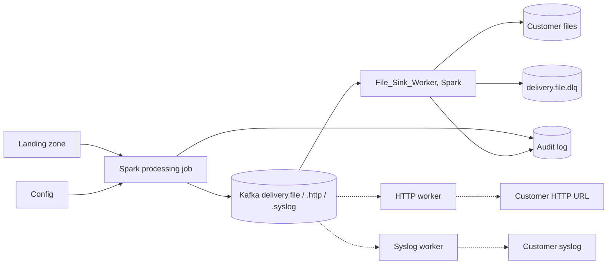

# Event Forwarding: Design

## Architecture

A Spark job filters landing-zone events by per-tenant rules and publishes to Kafka. Workers write to customer destinations.

Solid lines are built, dotted lines are designed only.

| Component | Status |
|---|---|
| Ingestion from the Landing_Zone | built |
| Config file (JSON or YAML, read once) | built |
| Config service and portal | designed only |
| Routing, shaping, Isolation_Guard (Spark) | built |
| Topics `delivery.file`, `delivery.file.dlq` | built |
| Topics `.http`, `.syslog`, retry | designed only |
| File_Sink_Worker (JSONL) | built |
| HTTP and syslog workers | designed only |
| Dead-letter topic / replay tooling | built / designed only |
| Audit log (minimal) | built |

**Where Spark is used.** Both the processing job and the File_Sink_Worker use PySpark, because filtering, shaping and publishing 2 to 6 TB/day needs a distributed engine. Event code never collects rows to the driver or uses pandas or Python UDFs, since the driver would hit its memory limit. A static AST scan enforces this, and only the config module is exempt. Spark is not used for the small configuration (driver) or for decoupling delivery (Kafka). The HTTP and syslog worker technology is an open decision.

**Landing_Zone read.** A Structured Streaming file source with a checkpoint replaces Databricks Auto Loader. The build runs `availableNow`. The full product triggers every 30 to 60 seconds.

**HTTP (designed only).** Tenant B's intended target is HTTP; the build delivers tenant B to a file destination. A worker reads `delivery.http` and POSTs one event as `application/json`, or two or more as `application/x-ndjson`. Connect timeout defaults to 5 s (1 to 30 s), total timeout to 30 s (5 to 120 s). 2xx is delivered. 408, 429, 5xx and connection failures retry through `delivery.http.retry` with backoff and jitter. Other 4xx go to `delivery.http.dlq`. Redirects to another scheme, host or port are not followed.

**Syslog (designed only).** A worker reads `delivery.syslog` and sends RFC 5424 over TCP with octet-counting framing. APP-NAME is `product`, MSGID is `schema`, STRUCTURED-DATA holds `tenant_id` and `event_id`, MSG is the JSON payload. Absent fields become `-`. Messages are capped at 8,192 bytes, and longer records are dead-lettered.

**Few shared topics.** About 15,000 tenants x 3 products x 2 destinations is 90,000 to 100,000 topics if per destination, with several times more partitions. That strains broker metadata, controller recovery, file handles and operations. So topics are shared by destination kind, and tenant, product and destination travel in the key and value.

**Key `<tenant_id>|<destination_id>`.** A destination always hashes to one partition, keeping its order and its records together in a batch, while destinations spread across partitions. The top 10 tenants still create a few hot partitions.

**Head-of-line blocking.** A failing destination stalls its shared partition, because the batch fails and the checkpoint stays put. Designed mitigations: retry topics with delays, pausing a partition or moving a failing destination to retry, per-destination circuit breaker and rate limits, a bounded worker pool, and dedicated topics and partitions for top tenants.

**Why a separate delivery query.** It decouples delivery from processing, isolates per-destination failures and lag, and gives idempotent output.

| Option | Isolation control | Ops effort | Failure isolation |
|---|---|---|---|
| 1. Spark writes files directly | Full | Lowest | Poor: slow destination stalls the job |
| 2. Kafka + custom workers (chosen) | Full, independent second check | Moderate | Good |
| 3. Kafka + Kafka Connect file, S3, HTTP sinks | Weaker: ownership check needs a custom transform | Lowest ongoing | Good |

Kafka Connect is designed only.

## Data isolation

Sending data to the wrong tenant is the worst failure, so three independent layers apply:

1. **Config validation and Isolation_Guard.** The loader rejects rules whose destination belongs to another tenant. A Spark anti-join before publishing keeps a record only if its tenant owns the destination and an enabled rule covers its product and schema. Violations are audited as `isolation_violation`, other records continue, and the run exits non-zero.
2. **Sink_Isolation_Check.** The worker re-checks every message against its own copy of the config: the destination exists, the tenant owns it, and the key equals `<tenant_id>|<destination_id>`. Failures go unchanged to the DLQ, never to a file.
3. **Path derivation.** Paths come only from the configured owner and destination id, never from message content. Each destination is written from its own filtered DataFrame.

**Tests.** Property tests cover layer 1 (random multi-tenant inputs), layer 2 (tampered messages), paths and config rejection. A scenario test runs the five-event example, and a test checks unmatched events produce nothing.

**Audit.** Spark and the worker write JSON Lines with `event_id`, tenant, product, schema, decision, reason and destination, never payload, so one event can be traced end to end.

**Security reviewer steps**
1. `isolation_guard.py`: the predicate matches tenant, product, schema and destination before publishing.
2. `sink_transform.py`: the check precedes any deliverable row, and the owner table comes from config.
3. `file_sink_write.py`: paths use only the loop's configured tenant and destination.
4. Run the isolation and acceptance tests: other tenants' directories stay empty.
5. After a tampered run, find `isolation_violation` in the audit and the DLQ.

## Operating it

Delivery is at-least-once end to end. The Spark Kafka sink can republish. File output for a replayed offset range is idempotent through deterministic names. A batch re-read with different offsets after a crash can duplicate records. Customers deduplicate on `event_id`. We do not claim exactly-once.

- **Slow or unreachable destinations.** Messages wait in Kafka, so only that destination's lag grows. A failed write is cleaned up and dead-lettered while other destinations continue. Retry topics, time budget and circuit breaker are designed only.
- **Noisy tenant.** Kafka absorbs bursts. Rate limits and dedicated partitions are designed only.
- **Configuration mistakes.** The whole config is rejected at start with every error listed, before any read.
- **Poison events.** Malformed lines go to the rejected output with a reason. Bad Kafka messages go to the DLQ with reason header and original key and value. One bad event never blocks a batch.
- **Duplicate delivery.** See above: dedupe on `event_id`.
- **Backlog recovery.** Assumed retention is 7 days on `delivery.*`. Replay with a new sink checkpoint and explicit `startingOffsets` inside retention. Identical ranges overwrite their files. After a fix, republish from the DLQ.
- **Monitoring per tenant.** Built: summaries per tenant and destination, and the audit log. Designed only: per-tenant lag, DLQ rate and latency alerts.

**Config changes.** The build reads the file once, so a change applies on the next start. Production would use a database-backed service with a portal and near-real-time reload. Messages already in Kafka are delivered under the config of the worker consuming them. Events not yet routed use the new config. A disabled rule drops later events, and a deleted destination dead-letters its messages.

## Scale and cost

**40,000 events/s** (about 3.5 billion a day) works with about 50 partitions on `delivery.file` and scaled-out Spark. The first failure is Kafka partition count and broker throughput on hot partitions. The top 10 tenants send about 60% (24,000 events/s) through the few partitions their keys hash to. Those saturate while others idle. Fix with more partitions and dedicated topics.

**120,000 events/s** pushes hot partitions past per-partition limits and creates many small files. Add partitions, brokers, workers and dedicated top-tenant topics.

**Cost drivers, ranked:** (1) Spark compute, (2) Kafka brokers and retention storage, (3) customer storage writes and small files, (4) egress, (5) audit and monitoring storage.

**5-minute budget.** Read trigger 60 s, processing 60 s, Kafka 5 s, worker trigger 60 s, write 30 s: about 3.5 minutes.

**Kafka ACLs (designed only).** The Spark principal writes only `delivery.*`. Each worker kind's principal reads only its topic and writes only its retry and DLQ topics. Customers get no Kafka access.

## Scope

**Built**
- Config validation, default-deny routing, field include, constant fields.
- Spark processing with checkpoint, Isolation_Guard, Kafka publish.
- Spark File_Sink_Worker: JSONL, DLQ, deterministic names, second isolation check.
- Minimal audit, summaries, docker-compose Kafka, isolation tests.

**Cut, with reasons**
- HTTP and syslog workers: about 5 hours available, isolation first.
- Parquet: JSONL proves the pattern.
- Replay tooling, lag monitoring: offsets and DLQ suffice for now.
- Calculated fields: an expression language adds risk.

**Next week**
- HTTP worker with retries, then syslog.
- Per-tenant lag monitoring and replay tooling.
- Dedicated top-tenant partitions.
- Config service with reload.

Only constant added columns (a fixed string, number or boolean) are supported, and calculated fields are cut.

**Default_Deny.** An event is forwarded only when an enabled rule matches its exact tenant, product and schema. "Forward all data" is not a pipeline feature.

**Portal assumption.** The portal and config updates are out of scope. The portal is assumed to expand "all my products" into explicit per-product and per-schema rules.

**Wildcard risk.** A wildcard rule is a possible extension. New products would be forwarded without explicit opt-in. `tenant_id` is never a wildcard.
